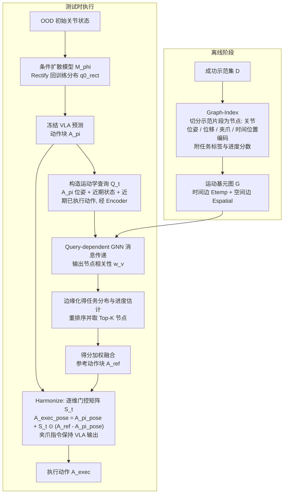

# Retrieve to Act（arXiv:2610.37215）

**Retrieve to Act**（*Retrieve to Act: Motion Primitive Graph Retrieval for Robust VLA Execution*，[arXiv:2610.37215](https://arxiv.org/abs/2610.37215)，[项目页](https://retrieve2act.github.io/r2a/)）来自 [具身智能小站 2026-10-28 盘点](../../sources/blogs/wechat_embodied_station_59_papers_human_video_to_robot_experience_2026-10-28.md)，属「VLA 与策略后训练」组。

## 一句话定义

**把成功示范构成时空运动基元图，推理时检索兼容轨迹，并用逐维门控与冻结策略融合。**

## 英文缩写速查

| 缩写 | 英文全称 | 简要说明 |
|------|----------|----------|
| Retrieve to Act | Retrieve to Act: Motion Primitive Graph Retrieval for Robust VLA Execution | 本文方法 / 基准的简称 |
| VLA | Vision-Language-Action | 视觉–语言–动作策略 |
| GNN | Graph Neural Network | 在动作基元图中定位与检索 |
| OOD | Out of Distribution | 分布外的视觉变化 |

## 为什么重要

- 从旧示范中检索几何纠偏线索。跨多种视觉语言动作模型考察扰动鲁棒性，基础策略无需微调，检索模块仍需学习。
- 开源结论：**待发布**（步骤 2.5，2026-10-28）。项目页 HTTP 200，未列 GitHub，页面含 soon 字样（脚本扫描）。
- 同期同组工作见 [潜在动作、免渲染事件仿真与机器人评测：具身智能小站 10-28 期 59 篇阅读坐标](../overview/embodied-station-2026-10-28-59-papers-technology-map.md)。

## 流程总览

图依据：论文 §3.2–3.5 / §4 / Fig.1

## 核心机制

| 项 | 内容 |
|----|------|
| **arXiv** | [2610.37215](https://arxiv.org/abs/2610.37215) |
| **开源** | **待发布** |
| **要点** | 把成功示范构成时空运动基元图，推理时检索兼容轨迹，并用逐维门控与冻结策略融合。 |
| **文内指标** | 公众号转述：跨多种视觉语言动作模型考察扰动鲁棒性，基础策略无需微调，检索模块仍需学习。 |

## 源码运行时序图

**不适用（待发布）** — 项目页 HTTP 200，未列 GitHub，页面含 soon 字样（脚本扫描）。 不编造运行脚本；代码公开后再补。

## 实验与评测

论文摘要报告在 GR00T N1.7、π₀.₅、StableVLA 上评估，LIBERO-Plus 与 RoboTwin2.0-Plus 仿真最高提升 12 个百分点，真机最高提升 40 个百分点；这是所测条件下的最大值，并非所有任务的平均提升。基础 VLA 冻结，GNN 检索和逐维门控仍需学习。

2026-10-29 再次访问项目页时未能获取页面；保留 2026-10-28 的代码待发布核查记录，不推断当前状态。

## 与其他工作对比

- 横向索引见 [潜在动作、免渲染事件仿真与机器人评测：具身智能小站 10-28 期 59 篇阅读坐标](../overview/embodied-station-2026-10-28-59-papers-technology-map.md)；同 arXiv 不重复造页。

## 结论

**从旧示范中检索几何纠偏线索：跨多种视觉语言动作模型考察扰动鲁棒性，基础策略无需微调，检索模块仍需学习。**

1. 开源边界：**待发布** — 项目页 HTTP 200，未列 GitHub，页面含 soon 字样（脚本扫描）。
2. 核心机制：把成功示范构成时空运动基元图，推理时检索兼容轨迹，并用逐维门控与冻结策略融合。
3. 复现与选型前核对任务协议、硬件与基准口径，勿直接横比公众号摘录数字。

## 关联页面

- [vla](../methods/vla.md)
- [imitation-learning](../methods/imitation-learning.md)
- [reinforcement-learning](../methods/reinforcement-learning.md)
- [embodied-station-2026-10-28-59-papers-technology-map](../overview/embodied-station-2026-10-28-59-papers-technology-map.md)

## 参考来源

- [项目页归档](../../sources/sites/retrieve-to-act.md)
- [retrieve_to_act_arxiv_2610_37215.md](../../sources/papers/retrieve_to_act_arxiv_2610_37215.md)
- [wechat_embodied_station_59_papers_human_video_to_robot_experience_2026-10-28.md](../../sources/blogs/wechat_embodied_station_59_papers_human_video_to_robot_experience_2026-10-28.md)
- [arXiv:2610.37215](https://arxiv.org/abs/2610.37215)
- [arXiv PDF](https://arxiv.org/pdf/2610.37215)：已通读方法部分（实验与附录以略读为准）：摘要、§1 引言、§2 相关工作、§3 方法（3.1–3.5）、§4 Action Harmonization

## 推荐继续阅读

- [arXiv PDF](https://arxiv.org/pdf/2610.37215)
- [项目页](https://retrieve2act.github.io/r2a/)
