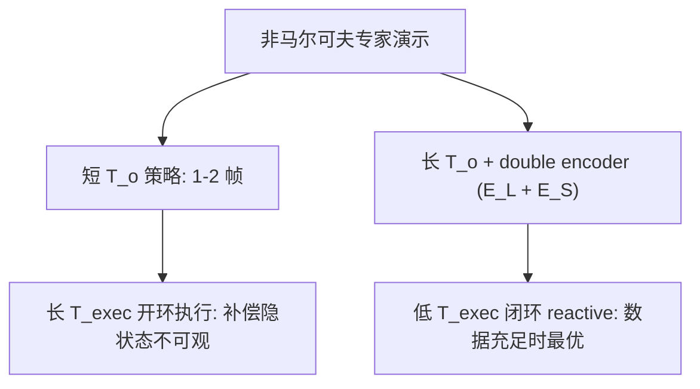

# Revisiting Open-Loop Execution（长上下文 reactive 策略）

**Revisiting Open-Loop Execution in Robotics: Toward Reactive, Higher-Performing Policies**（[arXiv:2608.15938](https://arxiv.org/abs/2608.15938)，[项目页](https://revisiting-open-loop-action-chunking.github.io/)，[总索引仓](https://github.com/Michaelszeng/Revisiting-Open-Loop-Execution-in-Robotics)，MIT / UC Berkeley）系统研究 **action chunking 的 open-loop 执行前缀**（execution horizon \(T_{\mathrm{exec}}\)）：为何业界默认需要 **0.5–1 s** 开环执行，以及如何用 **更长观测上下文** 恢复反应性。

## 一句话定义

**长 open-loop 执行主要是在帮只有 1–2 帧历史的策略模仿非马尔可夫专家；给够观测上下文并在充足数据下用 double encoder 稳定训练后，更 reactive 的短执行/闭环策略反而更好。**

## 英文缩写速查

| 缩写 | 英文全称 | 简要说明 |
|------|----------|----------|
| BC | Behavior Cloning | 监督式模仿学习 |
| DP | Diffusion Policy | 本文主策略族（69M 1D U-Net + 10 步 DDIM） |
| \(T_{\mathrm{exec}}\) | Execution Horizon | 每次查询后开环执行的动作步数 |
| \(T_o\) | Observation / Context Length | 策略条件化的历史帧数 |
| \(T_p\) | Prediction Horizon | 每次预测的 action chunk 长度 |
| DAgger | Dataset Aggregation | 复合误差干预（本文对照 3 轮 HG-DAgger） |
| RDE | Randomized Delay Ensemble | 对照论文 [Why AC](../entities/paper-why-action-chunking-improves-bc.md) 的部署技巧 |

## 为什么重要

- **重新排序因果叙事：** 相对「降复合误差 / 吸收延迟 / 动作平滑」三件套，本文用对照实验认为 **专家非马尔可夫性 + 策略短记忆** 是 success-horizon 倒 U 形曲线的主因；复合误差 **重要但通常更弱**。
- **与 CoRL 2026 Why AC 形成互补轴：** Why AC 拆 **chunk 训练 vs Delay/RDE 部署**；本文拆 **execution horizon vs context length**——共同指向：**不必死守长 open-loop 播放**。
- **给出工程方向：** **加长 \(T_o\)** + **double encoder** 可在多任务上让 \(T_{\mathrm{exec}}^*\) 明显左移（甚至接近 \(T_{\mathrm{exec}}=1\)），且数据规模充足时超过短上下文长执行策略。
- **真机验证：** 双 ARX-5 精密操作（SinglePillDispense、SlipIntoBaggie）支持仿真结论外推。

## 核心信息

| 项 | 内容 |
|----|------|
| **机构** | 麻省理工学院（MIT）；Mundane Systems Inc.；加州大学伯克利分校（UC Berkeley） |
| **策略** | Diffusion Policy（69M `[256, 512, 1024]` 1D U-Net，10 步 DDIM）；真机用 DINOv3 编码器（0.1× 学习率） |
| **仿真基准** | FurnitureSimOneLeg（10 Hz, R3M ResNet-18）、PushT-M（ManiSkill PPO M 专家 vs 300 人类）、PushT-D（Drake 160 demos）、GearInsertion（IsaacLab 30 Hz）、Kitchen（12.5 Hz） |
| **真机基准** | 双臂 ARX-5（10 Hz 策略 + 125 Hz IK 插值，chunk 边界 180 ms 线性插值）：SinglePillDispense（1.34h / 516 demos）、SlipIntoBaggie（5.24h / 540 demos） |
| **开源（2026-11-19 核查）** | 项目页 + arXiv v2 已发布；总索引仓 [`Michaelszeng/Revisiting-Open-Loop-Execution-in-Robotics`](https://github.com/Michaelszeng/Revisiting-Open-Loop-Execution-in-Robotics) 仅含 MIT `LICENSE` 与 `README.md`（外链 6 个子仓 + 2 个 HF 数据集，**0 个 `.py` 文件**）；真机推理代码**未开源** |

## 核心原理

### 被检验的三类解释

| 解释 | 本文读法 |
|------|----------|
| **专家非马尔可夫性** | 人类演示含隐式记忆/暂停/模式切换；短 \(T_o\) 策略需长 \(T_{\mathrm{exec}}\) 隐式承诺来补偿 → **主因** |
| **复合误差** | FurnitureSimOneLeg 上 3 轮 HG-DAgger（每轮 +40 条、累计标注 1500 条失败轨迹）可缓解部分漂移，但在短 \(T_o\) 下仍需非平凡 \(T_{\mathrm{exec}}\) |
| **推理延迟 / 平滑** | 仿真零延迟设定下长 \(T_{\mathrm{exec}}\) 仍呈倒 U 形 → 不能单独用延迟解释 |

### Double encoder 与长上下文配方（Appendix F）

直接拉长 \(T_o\) 会稀释最近观测并引起训练不稳。本文采用双编码器与跨注意力架构：
- **双路径编码：** 全局编码器 \(E_L\) 编码全部 \(T_o\) 帧；短程编码器 \(E_S\) 仅编码最近 \(T_s=2\) 帧，产生 \(T_o+T_s\) 个视觉/状态 token。
- **位置与尺度嵌入：** 对 token 叠加正弦时间嵌入及可学习范围嵌入（`LONG` / `SHORT` / `NULL`），经 cross-attention 输入 69M `[256, 512, 1024]` 1D U-Net（10 步 DDIM）。
- **正则与辅助目标：** 训练时以概率 \(0.3\) 对短程路径做 dropout（替换为空 token \(z_\emptyset\)），并将预测视野向过去延伸为 \(T_p + T_o - 1\) 以做 past-token 预测辅助监督。

### 流程总览

## 源码运行时序图

**不适用**（截至 2026-11-19 核查：官方项目页链接的 GitHub 仓库 [`Michaelszeng/Revisiting-Open-Loop-Execution-in-Robotics`](https://github.com/Michaelszeng/Revisiting-Open-Loop-Execution-in-Robotics) 为导航索引仓，仓内仅包含 MIT `LICENSE` 与 `README.md`，**无任何 `.py` 源码或统一训练/推理入口**；README 外链 6 个分散子仓与 2 个 HuggingFace 数据集，并明确说明双 ARX-5 真机推理软件属专有基础设施不开源，详见 [`sources/repos/revisiting-open-loop-execution-in-robotics.md`](../../sources/repos/revisiting-open-loop-execution-in-robotics.md)）。

## 工程实践

| 项 | 建议 / 论文发现 |
|----|----------------|
| **何时缩短 \(T_{\mathrm{exec}}\)** | 先确保 \(T_o\) 与演示数据量匹配（FurnitureSimOneLeg 在 100 demos 时即使 M 专家仍偏爱 \(T_{\mathrm{exec}}=4\)，到 1000 demos 才释放长上下文闭环上限） |
| **Double encoder 配方** | \(T_s=2\)、短程 dropout \(0.3\) + `LONG`/`SHORT`/`NULL` 嵌入 + past-token 辅助损失；真机 DINOv3 视觉骨干学习率降为 0.1× |
| **真机平滑插值** | 双 ARX-5 以 10 Hz 推理策略、125 Hz IK 插值，并在新旧 chunk 边界做 180 ms 线性插值缓解反应跳变 |
| **Checkpoint 早停（App I）** | 越短的 \(T_{\mathrm{exec}}\) 与越长的 \(T_o\) 越偏爱 **更早期的 checkpoint**——SinglePillDispense 取最后 checkpoint 成功率相对最优早点最高下跌 40 个百分点 |
| **代码复现边界** | 仿真评测需按总仓 README 索引分别拉取对应基准子仓；真机推理栈不可直接克隆复用 |

## 实验与评测

### 仿真主发现

- **Markov vs 非 Markov 专家：** PushT-M（PPO Markov 专家）上单调偏爱小 \(T_{\mathrm{exec}}\)；人类非马尔可夫演示上呈现经典倒 U 形。
- **数据规模交叉（FurnitureSimOneLeg，1000 NM demos）：** 短上下文典型设置 \(T_o=2, T_{\mathrm{exec}}=6\) 达 **90.6%**；长上下文短执行设置 \(T_o\in[12,20], T_{\mathrm{exec}}<4\) 达 **93.2%**。数据仅 100 条时，短上下文仍略占稳态优势。
- **HG-DAgger 对照：** 3 轮在线纠偏（+40 demos/轮）虽压低复合误差，仍无法像拉长 \(T_o\) 那样把最优 \(T_{\mathrm{exec}}\) 推向闭环。

### 真机 Table 1（双 ARX-5，每格 20 次评测，成功率 %）

| 任务 | \(T_o\) | \(T_{\mathrm{exec}}=2\) | \(T_{\mathrm{exec}}=4\) | \(T_{\mathrm{exec}}=8\) |
|------|---------|-------------------------|-------------------------|-------------------------|
| **SinglePillDispense** (1.34h / 516 demos) | \(2\) | 50 | 60 | 75 |
| **SinglePillDispense** | \(8\) | **90** | 80 | 60 |
| **SinglePillDispense** | \(12\) | 75 | 70 | 60 |
| **SlipIntoBaggie** (5.24h / 540 demos) | \(2\) | 60 | 40 | 80 |
| **SlipIntoBaggie** | \(8\) | **85** | 70 | 55 |
| **SlipIntoBaggie** | \(12\) | 75 | 65 | 65 |

读点：在 \(T_o=2\) 时两项任务均依赖长开环（\(T_{\mathrm{exec}}=8\) 最强，75% / 80%）；扩到 \(T_o=8\) 后，短执行高反应设置（\(T_{\mathrm{exec}}=2\)）反超为全场最高（**90%** / **85%**），且长开环（\(T_{\mathrm{exec}}=8\)）明显回落至 60% / 55%；继续增至 \(T_o=12\) 则在 500 余条真机数据下出现一定过拟合/稀释回落。

## 结论

**一句话总判：Action chunking 的价值不必绑定在长 open-loop 执行上——长 \(T_{\mathrm{exec}}\) 本质上是短记忆策略面对非马尔可夫演示的补丁，补齐历史上下文后高反应性策略能达到更高上限。**

1. **先区分问题来源** — 若团队把 \(T_{\mathrm{exec}}\) 调长才能过任务，优先排查「历史帧不够读出人类暂停/阶段隐状态」，而非默认认定硬件只能跑开环。
2. **数据量决定 \(T_o\) 上限** — 长上下文带来更高参数/统计容量需求；百条量级小样本下短执行容易过拟合，真机 Table 1 中 \(T_o=8\) 在 ~520 条下优于 \(T_o=12\)。
3. **用 Double Encoder 护住即时帧** — 直接堆长窗口易忽略当前帧精细接触，\(E_L+E_S\)（\(T_s=2\)）+ dropout \(0.3\) 是可直接借鉴的架构组合。
4. **注意早停 checkpoint** — 切向短 \(T_{\mathrm{exec}}\) + 长 \(T_o\) 时必须按闭环评测挑早期 checkpoint，不能直接取训末权重。
5. **保持「预测长、执行短」分离** — 本文否定的是「必须开环播完长段」，而非取消多步未来动作预测本身。

## 与其他工作对比

| 对照 | 差异读法 |
|------|----------|
| [Why Action Chunking Improves BC](./paper-why-action-chunking-improves-bc.md) | Why AC 拆「chunk 训练 vs Delay/RDE 部署」，在单模型上解释延迟观测条件化收益；本文拆「\(T_{\mathrm{exec}}\) vs \(T_o\)」，聚焦非马尔可夫隐状态恢复与高反应性闭环上限 |
| [BC Mysteries](../concepts/behavioral-cloning-mysteries.md) | 展示仅把低维状态简单拼历史（如 24 帧）仍可能输给长开环；本文强调需要能编码专家视觉隐状态的历史窗与双编码器正则 |
| [SPD](./paper-spd.md) | 同届真机长历史证据：32 步历史 + 8 步短 chunk 在 56-DoF 灵巧操作上全面胜过长 chunk 弱历史基线 |
| [Diffusion Policy](../methods/diffusion-policy.md) | 本文主干实现载体（69M 1D U-Net + DDIM） |

## 局限与风险

- **数据量与上下文甜点区：** \(T_o\) 并非越大越好（真机 ~520 demos 时 \(T_o=12\) 低于 \(T_o=8\)），小数据上强行拉长上下文会放大虚假关联与过拟合。
- **机制尚未完全理论化：** double encoder 的短程 dropout 与 past-token 辅助损失来自系统消融经验，尚缺严格泛化界证明。
- **硬件与推理复现门槛：** 总仓仅做导航且分散 6 个子仓，双 ARX-5 真机实时推理与 IK 栈未开源。
- **与工业大模型迁移待验：** 尚未在带语言条件的大型多任务 VLA 主干（如 \(\pi_0\) / OpenVLA）上直接验证同等长历史双编码器收益。

## 与其他页面的关联

- [Action Chunking](../methods/action-chunking.md) — 方法总页；拆解预测长度 \(T_p\) 与执行长度 \(T_{\mathrm{exec}}\)
- [Behavior Cloning](../methods/behavior-cloning.md) — 非马尔可夫专家、复合误差与 DAgger 对照
- [Diffusion Policy](../methods/diffusion-policy.md) — 主实验策略架构载体
- [Imitation Learning](../methods/imitation-learning.md) — 模仿学习路线总览
- [Bimanual Manipulation](../tasks/bimanual-manipulation.md) — 真机双臂 ARX-5 精密操作评测
- [Why Action Chunking Improves BC](./paper-why-action-chunking-improves-bc.md) — 并发机制论文：chunk 训练 vs Delay/RDE 部署
- [BC Mysteries](../concepts/behavioral-cloning-mysteries.md) — 无限数据与状态历史拼接的反例边界
- [VLA 真机部署指南](../queries/vla-deployment-guide.md) — 反应性、chunk 边界插值与延迟缓冲
- [AutoIntervene](./paper-autointervene.md) — chunk 执行期干预对照

## 参考来源

- [Revisiting Open-Loop 论文归档](../../sources/papers/revisiting_open_loop_action_chunking_arxiv_2608_15938.md)
- [项目页归档](../../sources/sites/revisiting-open-loop-action-chunking.md)
- [GitHub 总索引仓归档](../../sources/repos/revisiting-open-loop-execution-in-robotics.md)
- [具身智能小站 9 篇盘点](../../sources/blogs/wechat_embodied_station_9_papers_open_source_2026-08-23.md)

## 推荐继续阅读

- [论文全文（arXiv:2608.15938v2）](https://arxiv.org/abs/2608.15938)
- [官方项目页](https://revisiting-open-loop-action-chunking.github.io/)
- [官方 GitHub 索引仓](https://github.com/Michaelszeng/Revisiting-Open-Loop-Execution-in-Robotics)
- [Why Action Chunking Improves BC](./paper-why-action-chunking-improves-bc.md)
