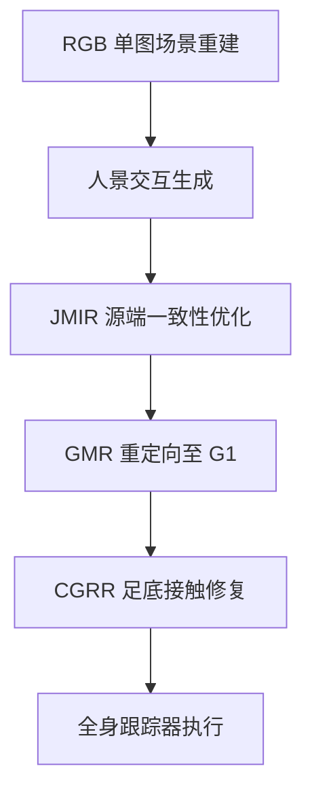

# 单图度量场景对齐与接触引导动作重定向（From a Single RGB Image to Robot Execution: Metric Scene Alignment and Contact-Guided Retargeting）

**机构：** 北京化工大学、国防科技大学、松延动力  
**论文：** [arXiv:2611.14981](https://arxiv.org/abs/2611.14981)

## 一句话定义

**SAM 3D Objects 重建单图场景并生成人体交互参考；JMIR 先优化人–景尺度、原交互相对位置与平滑；GMR 适配 G1 结构；CGRR 以足底接触几何做有限残差修正，最终交给可互换的预训练动作跟踪器。**

## 英文缩写速查

| 缩写 | 英文全称 | 简要说明 |
|---|---|---|
| RGB | Red Green Blue | 彩色单图 |
| JMIR | Joint Metric Interaction Refinement | 源端度量几何修复 |
| GMR | General Motion Retargeting | 人体到机器人映射 |
| CGRR | Contact-Guided Residual Retargeting | 目标足底接触修复 |

## 为什么重要

单目重建的场景尺度误差使人体交互错位，而人体到 G1 的关节映射又会额外破坏脚底支持关系。

## 核心原理

SAM 3D Objects 重建单图场景并生成人体交互参考；JMIR 先优化人–景尺度、原交互相对位置与平滑；GMR 适配 G1 结构；CGRR 以足底接触几何做有限残差修正，最终交给可互换的预训练动作跟踪器。

### 流程总览

以下根据论文方法整理，箭头表示控制/数据流向。

## 实验与评测

各方法 100 次仿真时完整 JMIR+GMR+CGRR 的支撑误差 0.21 cm、MPJPE-L 38.2 mm、成功率 89%；单 GMR 为 0.57 cm、50.7 mm、75%。G1 真机 50 次成功率 70%；源端精修 87 s vs 对照 GRAIL 480 s。

## 与其他工作对比

SAM 3D Objects 重建单图场景并生成人体交互参考；JMIR 先优化人–景尺度、原交互相对位置与平滑；GMR 适配 G1 结构；CGRR 以足底接触几何做有限残差修正，最终交给可互换的预训练动作跟踪器。 与传统同方向方法的主要区别见以上控制接口及研究动机；跨论文统计结果不具有相同测试协议。

## 结论

**单图度量场景对齐与接触引导动作重定向 的实际价值在于明确研究对象与实验边界，而非脱离原文场景比较单个成功率。**

1. 源端与目标端是两种不同的几何误差。
2. 仿真 89% 和真机 70% 不可混作同口径。
3. GMR 后必须重新评估目标机体支撑接触。

## 工程实践

实际验证时先检查任务接口与坐标系，再按论文试验复现主指标；记录 RGB / JMIR / GMR 相关状态、控制采样与异常回退路径，不能以论文中的概念图代替可执行模块证明。

**源码开放状态：** 本次核对的论文未发现可核实的作者算法运行入口，不臆测代码接口。

## 源码运行时序图

**不适用**：尚无可确认的官方完整算法运行入口；以上主干流程是论文方法图，不是虚构源码调用。

## 局限与风险

支持主导的交互为主；未覆盖任意复杂柔性物体，单图遮挡可能造成几何不确定性。多个 tracker 的实机对照样本量较少。

## 关联页面

- [motion retargeting](../concepts/motion-retargeting.md)
- [whole body control](../concepts/whole-body-control.md)
- [real2sim](../../roadmap/depth-real2sim.md)
- [11.09–11.13 29 篇总览](../overview/humanoid-quadruped-2026-11-09-13-29-papers.md)

## 参考来源

- [arXiv v1 原文核对归档](../../sources/papers/rgb-scene-contact-retargeting_arxiv_2611_14981.md)
- [arXiv v1 HTML 全文](https://arxiv.org/html/2611.14981v1)

## 推荐继续阅读

- [论文 PDF](https://arxiv.org/pdf/2611.14981v1)
