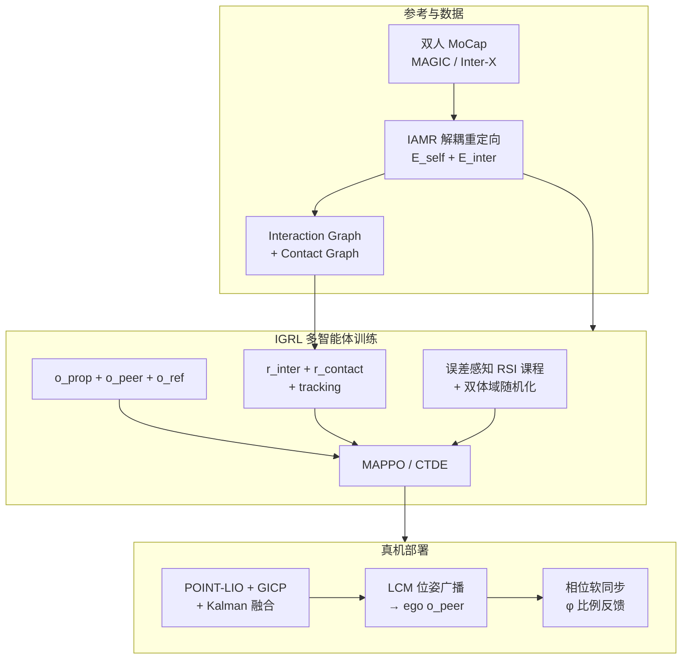

# Rhythm（Learning Interactive Whole-Body Control for Dual Humanoids）

**Rhythm**（[arXiv:2603.02856](https://arxiv.org/abs/2603.02856)，[项目页](https://hoshi-no-ai.github.io/Rhythm/)）由复旦大学、它石智航（TARS Robotics）、清华大学、上海交通大学、上海创智学院与中科院自动化所联合提出：在 **两台 Unitree G1** 真机上首次实现 **拥抱、共舞、问候、肩并肩** 等 **富接触 / 长时域** 双机全身物理交互的 **稳健 sim2real**。

## 一句话定义

**通过解耦交互感知重定向 IAMR、图奖励多智能体策略 IGRL 与真机 LiDAR 定位/相位软同步三段闭环，使两台同构人形机器人从双人动作数据学习并直接向真机迁移富接触对称全身交互。**

## 英文缩写速查

| 缩写 | 英文全称 | 简要说明 |
|------|----------|----------|
| IAMR | Interaction-Aware Motion Retargeting | 解耦自运动与交互几何的双人重定向模块 |
| IGRL | Interaction-Guided Reinforcement Learning | 以图结构奖励学习耦合动力学的多智能体 RL |
| MAGIC | Multi-Humanoid Geometric Interaction Dataset | 约 3 小时双人交互 MoCap + IAMR 重定向参考 |
| MAPPO | Multi-Agent Proximal Policy Optimization | CTDE 范式下的 on-policy 多智能体 PPO |
| CTDE | Centralized Training with Decentralized Execution | 训练用全局信息、部署仅局部观测 |
| WBT | Whole-Body Tracking | 按参考轨迹训练全身跟踪策略 |
| G1 | Unitree G1 Humanoid | 论文真机验证平台 |
| Sim2Real | Simulation to Real | 仿真策略迁移真机 |
| MoCap | Motion Capture | MAGIC 等交互参考的采集来源 |
| LCM | Lightweight Communications and Marshalling | 机间位姿与相位广播 |

## 为什么重要

- **填补真机双机交互空白**：多数多体工作停在仿真或 **人–机 / 人–物**；Rhythm 强调 **两台主动 humanoid 的物理耦合**，且 **真机闭环** 而非仅 physics avatar。
- **重定向层直面 kinematic conflict**：异构双人 MoCap → 同构双机时，**个体流形** 与 **统一交互流形** 不可同时满足；IAMR 的 **拓扑分区 + 距离衰减弹簧** 给出可工程复用的解耦配方，并导出 **交互图 / 接触图** 供下游奖励对齐。
- **策略层显式建模伙伴**：IGRL 用 **peer 相对位姿观测** 与 **继承 IAMR 权重的图奖励**，避免把双 agent 当孤立 tracker；与 [AssistMimic](./paper-assistmimic.md) 的 assistive MARL 形成 **「真机双机社交交互」vs「仿真护理力交换」** 的互补阅读轴。
- **开放数据**：**MAGIC** 覆盖协调、亲密、接触、仪式、竞争五类，paired raw + retargeted，降低后续双机交互研究的数据门槛。

## 流程总览

## 核心机制（归纳）

### IAMR：解耦重定向与拓扑先验

- **问题**：$\mathcal{M}_{ind}$ 保自运动但破坏相对几何（「空手握手」）；$\mathcal{M}_{uni}$ 保交互但致脚浮等 **形态不兼容**。
- **做法**：Interaction Mesh 边集分为 $\mathcal{E}_{self}$ / $\mathcal{E}_{inter}$；最小化 $E_{self}+E_{inter}$，后者刚度 $\omega_{ij}=\omega_{max}e^{-\gamma d_{ij}}$ **近距变硬、远距变软**。
- **产物**：除关节轨迹外，提取 **跨体交互图** 与 **碰撞检测接触图**，作为 IGRL 奖励的 **拓扑监督**。
- **基线对比（论文 Table I）**：相对 GMR / OmniRetarget(OR) / 双体 OR 扩展(DOR)，IAMR 在 **Intensive Contact** 上 **IPR=0**，Contact F1 与下游 DSR 更均衡。

### IGRL：耦合动力学策略

- **范式**：MA-MDP + **MAPPO**；观测含 **本体**、**伙伴 ego 系相对 root**、**未来参考**；1D-CNN 编码历史 + MLP 解码动作。
- **图奖励**：
  - $r_{inter}$：交互边距离对齐参考，权重继承 IAMR 的 $\omega_{ij}$；
  - $r_{contact}$：接触状态一致 + 力幅正则，抑制穿透与非接触虚假力。
- **训练技巧**：多目标 **adaptive RSI**（早期偏稳定、后期偏 tracking/交互精度）；**延迟噪声 peer 观测** 与初始位姿扰动模拟无线链路。

## 工程实践

- **建图融合定位：** 真机以 **POINT-LIO** 高频里程计 + **GICP** 预建点云地图配准 + **Kalman 融合** 实时输出双机全局位姿 $\{P, R\}$，避免富接触全身晃动造成纯视觉/里程计漂移。
- **ego 系伙伴重建与通信降级：** 通过 **LCM** 广播双机全局位姿后在各自本体坐标系重建与仿真一致的 $o_{peer}$，并在训练阶段加入延迟、噪声与初始位姿扰动域随机化。
- **相位软同步机制：** 真机使用基于运动相位 $\phi$ 的连续比例同步 $\dot{\phi}_{ego}=1+k(\phi_{peer}-\phi_{ego})$ 抑制时钟漂移，避免硬相位重置引发的关节力矩跳变。

## 源码运行时序图

**不适用**（截至 2026-11-29 复核 `https://hoshi-no-ai.github.io/Rhythm/` 与 arXiv `2603.02856`，官方训练/部署代码与 MAGIC 数据集下载仓库尚未公开挂出 GitHub 链接）。

## 实验与评测

- **重定向对比（Table I，MAGIC 三组 + Inter-X）：** `GMR` 与 `OR` 在强接触任务（Intensive Contact）交穿率 `IPR` 分别达 `35.2%` 与 `47.3%`；`IAMR` 在四项数据集上 `IPR = 0.00%` 且无穿透（`MPD = 0.0 cm`），在 `MAGIC: Intensive Contact` 下游跟踪成功率 `DSR = 78.3%`（vs `DOR 63.3%`），在未见数据集 `Inter-X` 上 `DSR = 69.9%`（vs `DOR 52.9%`），Contact F1-Strict 从 `DOR` 的 `0.589` 提至 `0.843`（+43%）。
- **IGRL 策略消融（Table II）：** 相比 `Single Agent`（Collaborate 交互成功率 `ISR = 18.7%`）与去掉伙伴观测 `w/o Peer Obs`（Light Contact 接触成功率 `CSR` 暴跌至 `18.6%`），完整策略在四个场景中均维持 `ISR > 75%`、`CSR > 77%`；去掉接触奖励 `w/o Contact Rew` 虽仍保持表面对齐，但出现穿模“ghosting”，使 `Light Contact CSR` 由 `78.0%` 跌至 `52.1%`。
- **Unitree G1 真机闭环（Table III，每任务 10 次试验关键帧判定）：**
  - `Hug`（拥抱）：`26/30 (86.7%)` vs `Single Agent 8/30 (26.7%)`；
  - `Shoulder`（搭肩）：`24/30 (80.0%)` vs `Single Agent 6/30 (20.0%)`；
  - `Greeting`（长时域问候）：`74/90 (82.2%)` vs `Single Agent 11/90 (12.2%)`；
  - 并在外力推、拉、踢腿扰动下（Fig. 6）恢复站立平衡与交互拓扑。

## 与其他工作对比

| 路线 | 交互对象 | 重定向 | 策略 | 真机证据 |
|------|----------|--------|------|----------|
| **单人 GMT / BeyondMimic 系** | 无伙伴 | GMR 等单 agent | 孤立 tracking | 单 G1 广泛 |
| **OmniRetarget / DOR** | 人–物或双体扩展 | Interaction mesh | 多为单 agent tracking | 以仿真为主 |
| **AssistMimic** | 双 avatar 护理 | 动态 hand retargeting | MARL + PHC prior | 仿真 SR 为主 |
| **Rhythm** | **双 G1 对称交互** | **IAMR 解耦** | **MAPPO + 图奖励** | **双机真机拥抱/共舞** |

## 局限与风险

- **双机同构前提**：框架针对 **两台 G1 级同构人形**；异构双机或人–机混合需重新设计观测与接触图。
- **基础设施依赖**：真机需要 **预建地图 LiDAR 定位**（POINT-LIO + GICP）与 **可靠机间 LCM 通信**；非结构化无先验地图野外场景仍需过渡到纯 ego 感知。
- **与 AssistMimic 勿混淆**：AssistMimic 聚焦 **护理 assistive 力交换** 且在 **仿真 avatar** 主验证；Rhythm 聚焦 **对称双机社交/协调交互** 且 **真机为主证据**。
- **代码/数据发布节奏**：项目页展示了 MAGIC 数据集与 G1 视频，但截至 2026-11-29 未公开独立 GitHub 仓库，工程复现细节需以论文与附录为准。

## 结论

**Rhythm 把双 humanoid 交互从仿真推到真机，难点不在单机跟踪，而在重定向层的 kinematic conflict 与部署层的机间定位/相位对齐——IAMR、IGRL、部署栈三段缺一不可。**

1. **IAMR 解耦重定向消除交穿与空气握手**：把 Interaction Mesh 边集拆为 `E_self` 与距离衰减的 `E_inter`，在强接触任务中实现 `IPR=0.00%` 并比 `DOR` 提升 15–17 个百分点的下游跟踪成功率。
2. **图结构奖励分层协同**：`r_inter` 先把双机拉入可交互包络，`r_contact` 再抑制穿模鬼影并正则化真实接触力，两项缺一不可。
3. **工程化定位与相位软同步是 Sim2Real 底座**：真机用 POINT-LIO + GICP 配准与连续相位比例同步，才能在长期问候中压住双机累积漂移。
4. **适用范围边界**：目前基于双同构 Unitree G1 与先验激光点云地图，且开源代码尚待发布。

## 关联页面

- [多机器人协作（Multi-Robot Collaboration）](../concepts/multi-robot-collaboration.md) — 双人交互与紧耦合多机协调轴定位
- [协同物体搬运（Collaborative Object Transport）](../concepts/collaborative-object-transport.md) — 对比无共享负载直接手接触与持物搬运约束
- [Multi-Agent Reinforcement Learning (MARL)](../methods/marl.md)
- [CTDE 与去中心化 MARL](../comparisons/ctde-vs-decentralized-marl.md)
- [Whole-Body Tracking Pipeline](../concepts/whole-body-tracking-pipeline.md)
- [Motion Retargeting Pipeline](../concepts/motion-retargeting-pipeline.md)
- [AssistMimic](./paper-assistmimic.md) — 双人 assistive MARL tracking（仿真主证据）
- [PHC](./phc.md) — 单人 tracking prior 族；Rhythm 走 **双 agent 图奖励** 而非 PHC 零填充扩展
- [GMR](../methods/motion-retargeting-gmr.md) — IAMR 重定向基线之一
- [Sim2Real](../concepts/sim2real.md)
- [Unitree G1](./unitree-g1.md)
- [多机器人协作纵深路线](../../roadmap/depth-multi-robot-collaboration.md) — 收录于 Stage 2 多人形全身交互节点

## 参考来源

- [Rhythm 论文摘录](../../sources/papers/rhythm_arxiv_2603_02856.md) — 全文 §I–§V 及 Table I–III 精读摘录与机构核对
- [Rhythm 项目页归档](../../sources/sites/hoshi-no-ai-rhythm-github-io.md)
- Chen et al., *Rhythm: Learning Interactive Whole-Body Control for Dual Humanoids*, arXiv:2603.02856, 2026. <https://arxiv.org/abs/2603.02856>

## 推荐继续阅读

- Inter-X 数据集（论文 Inter-X 鲁棒性评测）：<https://github.com/Inter-X-Generation/Inter-X>
- 项目页演示视频：<https://hoshi-no-ai.github.io/Rhythm/>
- [多机器人协作纵深路线](../../roadmap/depth-multi-robot-collaboration.md)
