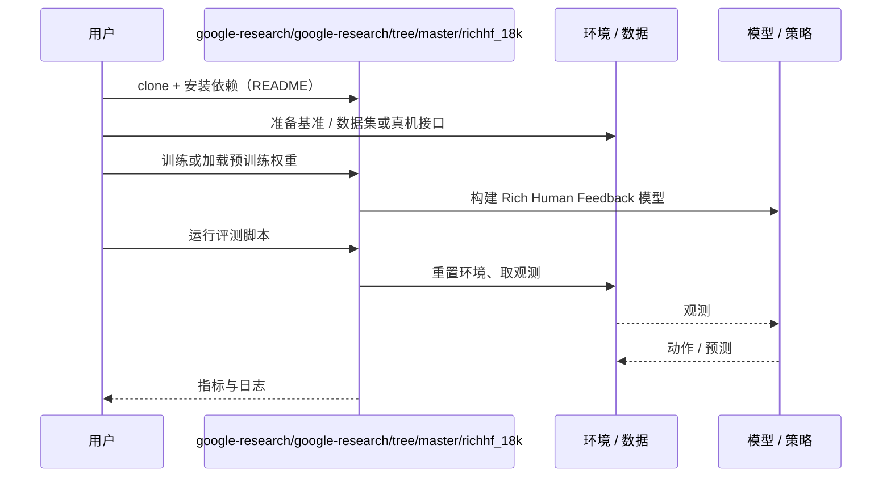

# Rich Human Feedback（arXiv:2312.10240）

**Rich Human Feedback**（*Rich Human Feedback for Text-to-Image Generation*，[arXiv:2312.10240](https://arxiv.org/abs/2312.10240)，[代码](https://github.com/google-research/google-research/tree/master/richhf_18k)）来自 [深蓝具身智能 2026-11-01 盘点](../../sources/blogs/wechat_shenlan_cv_best_papers_2023_2026_labs.md)，属「视觉推理与可控生成」组。

## 一句话定义

**Rich Human Feedback 把人类对文生图的反馈从单一分数扩展为可定位的区域标注（不合理或与文本不符的区域、对应词），并训练多模态模型预测这些细粒度反馈。**

## 英文缩写速查

| 缩写 | 英文全称 | 简要说明 |
|------|----------|----------|
| RLHF | Reinforcement Learning from Human Feedback | 基于人类反馈的强化学习 |
| T2I | Text-to-Image | 文生图 |
| RichHF | Rich Human Feedback | 富人类反馈 |

## 为什么重要

- 借鉴 LLM 的 RLHF，丰富 T2I 的反馈信号：区域标记 + 文本词标注 + 细粒度评分（公众号归属：Google Research 联合 UCSD 等）。
- 开源结论：**已开源**（步骤 2.5，2026-11-01）。arXiv 摘要页链接 google-research/richhf_18k（数据集）；母仓库 google-research/google-research 经 git ls-remote 可达，子目录内容未逐文件核对。
- 同期同组工作见 [从视觉编程到 4D 重建：CV 三大会 2023–2026 Best Paper 阅读坐标](../overview/cv-best-papers-2023-2026-technology-map.md)。

## 核心机制

| 项 | 内容 |
|----|------|
| **arXiv** | [2312.10240](https://arxiv.org/abs/2312.10240) |
| **开源** | **已开源** |
| **要点** | 标注数据集 RichHF-18K，并训练多模态 Transformer 预测富反馈，用于挑选训练数据、微调生成模型或做区域修复（arXiv 摘要）。 |
| **文内指标** | 数据集名 RichHF-18K（名称暗示约 1.8 万条）；其余数字未转录。 |

## 源码运行时序图

以下为按仓库入口（`google-research/google-research/tree/master/richhf_18k`）推断的通用运行链路；入库日仅核实仓库可达，未逐文件阅读，具体脚本名以 README 为准。

## 实验与评测

- 数据集名 RichHF-18K（名称暗示约 1.8 万条）；其余数字未转录。
- **读法：** 本页为索引级摘要，依据公众号转述的官方摘要与仓库信息整理；逐项数字与 baseline 以原文 PDF 为准。

## 与其他工作对比

- 横向索引见 [从视觉编程到 4D 重建：CV 三大会 2023–2026 Best Paper 阅读坐标](../overview/cv-best-papers-2023-2026-technology-map.md)；同 arXiv 不重复造页。

## 结论

**Rich Human Feedback：反馈要有空间位置，才能指导生成模型修哪里。**

1. 开源边界：**已开源** — arXiv 摘要页链接 google-research/richhf_18k（数据集）；母仓库 google-research/google-research 经 git ls-remote 可达，子目录内容未逐文件核对。
2. 核心机制：标注数据集 RichHF-18K，并训练多模态 Transformer 预测富反馈，用于挑选训练数据、微调生成模型或做区域修复（arXiv 摘要）。
3. 复现与选型前核对任务协议、硬件与基准口径，勿直接横比公众号摘录数字。

## 关联页面

- [generative-world-models](../methods/generative-world-models.md)
- [cv-best-papers-2023-2026-technology-map](../overview/cv-best-papers-2023-2026-technology-map.md)

## 参考来源

- [rich_human_feedback_arxiv_2312_10240.md](../../sources/papers/rich_human_feedback_arxiv_2312_10240.md)
- [wechat_shenlan_cv_best_papers_2023_2026_labs.md](../../sources/blogs/wechat_shenlan_cv_best_papers_2023_2026_labs.md)
- [arXiv:2312.10240](https://arxiv.org/abs/2312.10240)

## 推荐继续阅读

- [arXiv PDF](https://arxiv.org/pdf/2312.10240)
- [https://github.com/google-research/google-research/tree/master/richhf_18k](https://github.com/google-research/google-research/tree/master/richhf_18k)
