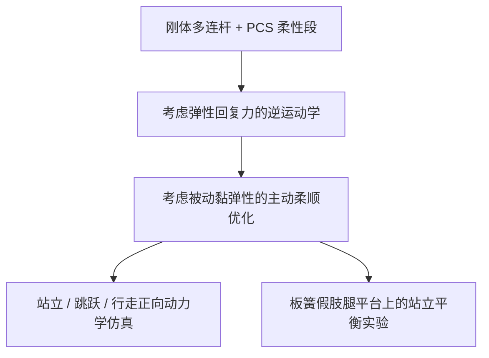

# 刚-软混合链路人形机器人建模与控制

**论文** *Modeling and Control of a Rigid-soft Hybrid-link Humanoid Robot*（[arXiv:2610.15073](https://arxiv.org/abs/2610.15073)，发表于 *Robotics and Autonomous Systems*）研究如何把被动柔性构件纳入人形机器人的运动学与柔顺控制。

## 一句话定义

该工作把分段常应变柔性体模型并入刚体人形系统，用逆运动学和柔顺优化处理板簧假肢腿与机器人关节之间的耦合。

## 英文缩写速查

| 缩写 | 英文全称 | 简要说明 |
|------|----------|----------|
| PCS | Piece-wise Constant Strain | 将连续柔性变形分段表示的模型 |
| IK | Inverse Kinematics | 求解满足末端/平衡目标的广义坐标 |
| RAS | Robotics and Autonomous Systems | 论文发表期刊名称缩写 |
| DoF | Degrees of Freedom | 机器人系统的广义自由度 |

## 为什么重要

常规刚体模型难以直接表达板簧假肢等柔性构件的连续变形。把柔性变形纳入动力学后，系统既能表示刚体关节运动，也能显式描述被动弹性对重力平衡、接触和动态运动的影响。这类建模对于分析能量存储与冲击缓解有意义，也要求控制器同时考虑主动关节和被动柔顺性。

## 核心原理

论文把 PCS 柔性段与浮动基刚体多连杆系统组合。方法的两部分是：

1. **考虑弹性回复力的逆运动学：** 生成运动学解时同时考虑重力与柔性结构的弹性回复力，使构型满足混合系统的平衡关系。
2. **柔顺优化控制：** 在被动黏弹性存在时优化刚体主动关节的柔顺矩阵，以协调全系统的柔顺响应。论文指出，这里的非对角耦合项使控制输入具有力/力矩语义，不能简单当作普通位置控制。

### 流程总览

## 工程实践

| 使用场景 | 读法 |
|----------|------|
| 柔性腿或被动弹性结构建模 | PCS 将连续变形纳入统一的混合链路动力学；实现时需确认柔性段参数和边界条件能由实际构件测量或辨识得到。 |
| 平衡控制 | 不能只用刚体关节位置误差解释控制结果；需同时检查弹性回复力、支撑状态和主动柔顺矩阵。 |
| 仿真到实验 | 论文在仿真中展示站立、垂直跳跃和双足行走；其实验只验证单支撑与双支撑站立平衡。动态运动真机能力需要独立实验支持。 |

## 实验与评测

- **仿真：** 正向动力学验证站立、垂直跳跃与双足行走控制。
- **硬件：** 双足人形机器人集成板簧式假肢腿，并用运动捕捉系统测量假肢变形。
- **实验：** 在双支撑和单支撑两种状态下验证站立平衡控制。
- **证据解读：** 跳跃、行走属于仿真结果；目前可确认的实体实验结论是站立平衡。

## 与其他工作对比

| 对照对象 | 关系 | 区别 |
|----------|------|------|
| 同团队 IROS 2024《Compliance Optimization Control for Rigid-Soft Hybrid System…》 | 直接前序 | 前序工作提出柔顺优化控制并做仿真；本文增加考虑弹性回复力的逆运动学、双足行走仿真和站立平衡实验 |
| 同团队 IROS 2021 刚-软混合多连杆动力学计算 | 建模基础 | 2021 年工作关注动力学计算；本文在此基础上补齐运动生成与控制 |
| 刚体假设下的 [Whole-Body Control](../concepts/whole-body-control.md) | 同为全身平衡控制 | 常规 WBC 把连杆视为刚体；本文用 PCS 显式建模柔性段的连续变形与弹性回复力 |
| 关节/末端 [Impedance Control](../concepts/impedance-control.md) | 同样调节柔顺性 | 常规阻抗控制只设计主动刚度/阻尼；本文在已有被动黏弹性的前提下优化主动关节柔顺矩阵，并保留非对角耦合项 |

## 结论

**这项工作的核心价值是把被动柔性构件纳入人形全身建模与柔顺控制；已报告的实验验证范围比仿真动态动作更窄。**

1. 需要表示柔性构件连续变形时，PCS 提供了与刚体多连杆系统组合的建模路径。
2. 运动学目标需考虑弹性回复力与重力，单独按刚体几何求解不足以描述混合系统平衡。
3. 被动柔顺性存在时，主动关节柔顺矩阵需要联合优化，且耦合项要求按力/力矩控制语义理解。
4. 仿真覆盖站立、跳跃和行走；当前实验只支持单/双支撑站立平衡这一结论。
5. 对真机部署和动态性能的外推，应等待跳跃、行走等动作的实体实验数据。

## 源码运行时序图

**不适用：** 本次核对的 arXiv 与期刊页面没有指向可运行的官方代码仓库；论文所述是建模、控制与实验验证流程，不是可复现的软件运行入口。

## 局限与风险

- **仿真/实验范围不同：** 跳跃和行走结果是正向动力学仿真；站立平衡才有单支撑和双支撑实验验证。
- **机构可迁移性需评估：** 论文实验使用板簧式假肢腿，向不同柔性材料、几何形状和人形本体迁移时，PCS 离散、材料参数及柔性段边界条件都需重新确认。
- **代码入口未确认：** 已查阅的论文记录没有给出可运行官方代码链接，因此不能据此评估软件复现成本。

## 关联页面

- [Whole-Body Control（全身控制）](../concepts/whole-body-control.md) — 全身任务与平衡控制背景
- [Impedance Control（阻抗控制）](../concepts/impedance-control.md) — 柔顺矩阵与力/位移关系
- [Humanoid Locomotion（人形运动）](../tasks/humanoid-locomotion.md) — 行走与跳跃任务背景

## 参考来源

- [论文来源归档](../../sources/papers/rigid_soft_hybrid_link_humanoid_arxiv_2610_15073.md)
- [arXiv:2610.15073](https://arxiv.org/abs/2610.15073)
- [期刊论文 DOI](https://doi.org/10.1016/j.robot.2026.105515)
- [IROS 2024 前序论文](https://doi.org/10.1109/IROS58592.2024.10801838)
- [东京大学实验室 2021 年论文列表](https://www.ynl.t.u-tokyo.ac.jp/wp/publications/publications-2021/)

## 推荐继续阅读

- [Whole-Body Control](../concepts/whole-body-control.md)
- [Impedance Control](../concepts/impedance-control.md)
- [PCS / 刚-软混合系统的前序 IROS 论文](https://doi.org/10.1109/IROS58592.2024.10801838)
