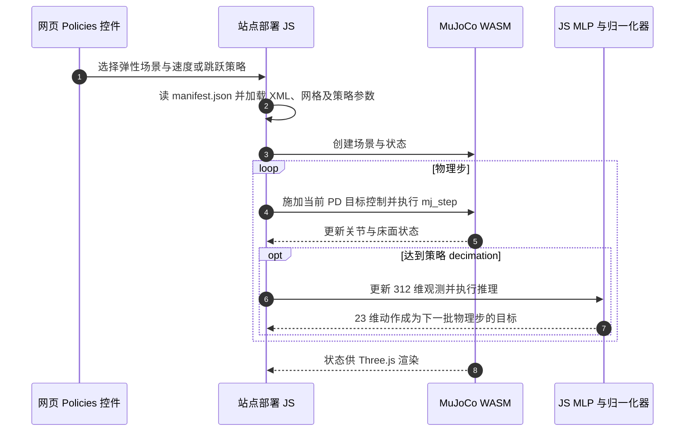

# RIPPLE：大变形弹性地形上的人形控制｜Riding the Wave: Sim-to-Real Humanoid Control on Elastic Terrain

## 一句话定义

RIPPLE 将预拉伸床面的形变、回弹和跨落脚点传力并入仿真，用纯本体感知训练人形机器人从刚性地面技能迁移到弹性地形站稳、速度跟踪和连续跳跃。

## 英文缩写速查

| 缩写 | 英文全称 | 简要说明 |
|---|---|---|
| RIPPLE | Robust Interaction via Proprioceptive Policies on Large-deformation Elastic Terrain | 用本体策略处理大变形弹性支撑 |
| PPO | Proximal Policy Optimization | 分阶段训练速度跟踪及跳跃 |
| PD | Proportional–Derivative | 关节位置目标下发后的低层控制 |
| MLP | Multilayer Perceptron | 将本体观测映射为 23 维动作 |
| WASM | WebAssembly | 网页版 MuJoCo 的运行环境 |

## 为什么重要

人在蹦床上踩下一脚，另一只脚脚下的床面也可能移动；离地后，上一脚留下的形变和速度仍在。对 [人形移动](../tasks/humanoid-locomotion.md) 来说，把接触调软仍可能漏掉下一次落脚遇到的运动支撑。RIPPLE 将支撑状态保留在仿真里，让部署策略通过自身运动间接感知其影响，而不是把整张床面的测量值送进网络。

| 核心信息 | 内容 |
|---|---|
| 机构 | 清华大学、新加坡国立大学、华东理工大学、南京大学、魔法原子机器人科技（无锡）有限公司、追觅科技、牛津大学 |
| 原文 | arXiv:2611.34569v1，2026-11-25 UTC；预印本 |
| 实机 | MagicBot Z1，直径 1.5 m 蹦床；实验安全绳保持松弛 |
| 仿真 | MuJoCo / MuJoCo-Warp + MJLab，训练床面 1 × 1 m |

## 核心机制

1. **让床面携带状态。** ElasticMembrane 的 11 × 11 节点中，边界固定，81 个内部质点可沿三轴移动。轴向与双对角的 420 条 tendon 模拟弹簧阻尼，缩短自然长度得到预张力。随节点运动的 200 个碰撞三角形负责接触，不另作结构弹性体；接触力同时改变机器人和床面动力学。
2. **分阶段改变任务而不改输入接口。** 从刚性地面速度跟踪开始，转到弹性床面速度跟踪，再微调为床面相对跳高任务；阶段间继承 actor 和观测归一化器，重置 critic 与训练状态。使用 [PPO](../methods/ppo.md)，并行环境各自保留床面状态；模拟配置为 4 × 1,024 环境、4 张 RTX 5090。
3. **训练可看特权信号，真机不看床面。** 四帧 78 维本体观测（机体系角速度、投影重力、命令、关节位置/速度、上一动作）组成 312 维输入；只有 critic 额外看基座速度、足接触、力与腾空时间。跳跃奖励用床面相对根高度，不意味着 actor 测量床面。
4. **输出关节目标。** 23 维动作缩放后叠加默认关节位姿，再由 PD 跟踪。论文中仿真每步 2 ms，10 步一个 50 Hz 策略周期；真机 actor 连同固定归一化器经 ONNX → RKNN 部署，不做真机微调。参见 [Sim2Real 迁移流程](../methods/sim2real-transfer-workflow.md)。

## 源码运行时序图

对应作者网站实际发布的浏览器 **Policies** 运行路径，非尚未公开的训练及真机部署入口。入口按清单加载 MJCF 和二进制网络参数，通过 MuJoCo WASM 更新机器人与床面。

## 工程实践

- **选床面而不是仅调软接触。** 刚度定张力增量，预张力定初始面外恢复力；阻尼和节点惯量决定下一脚看到的回弹。论文孤立床面试验在 2/3 ms 稳定、4 ms 发散，不能把该数值稳定性当成所有模型步长保证。
- **训练与部署接口分开。** flex 接触没有常规刚体对，论文从机器人一侧识别足地接触，避免双侧过滤漏计；机器人自碰仍用双侧过滤。真机不使用相机或力传感器来给策略输入。
- **发布与核验。** 截至 2026-11-27，网页、场景和演示推理资产可取；完整训练及 RKNN 部署代码未查到公开入口。使用网页部署的实际 JS 网络类与当前站点两个参数文件，在 CPU 上验证合成输入 312→23 且输出有限，错维会被拒绝。两文件的响应哈希与清单声明不一致，不能确认其与论文/真机检查点相同；未做物理闭环或硬件复现。

## 实验与评测

| 实验 | 作者报告 | 口径 |
|---|---|---|
| 真机连续跳 | **15 次**，每次腾空至少 150 ms，最高足部离床约 22 cm | 单段连续演示，在踏到外围弹簧前；不是 15 个独立试验，也不是根部跳高 |
| 真机受扰与上床 | 站立累计 657.5 s 无摔倒；刚性台进床 2/2，躯干 2.3 / 3.3 s 恢复 | 三段站立会话累计，不是一条连续测试；BouncyPlate-DR 也完成它的 1 次上床 |
| 真机与刚性地面对照 | 正机械功中位数 59 对 96 J（约降 39%）；峰值腿关节功率 1.33 对 1.94 kW（约降 32%） | 同一跳跃策略、12 个腿关节控制器估计力矩与关节速度；不是耗电量 |
| 仿真跨地形 | 0.3 m/s 扰动下，三种动态支撑上的站立成功均值至少 98.7% | 3 个训练种子，每种子每条件 50 次成对试验；不包括静态软接触平面 |
| 仿真刚度与尺寸 | 刚度 0.35–0.5 倍为 16–17/20，2.8 倍为 20/20；1–7 m 尺寸为 85–100%，8–10 m 各 0/20 | 0.5 m/s 扰动的固定策略站立协议；4 倍刚度在 2 ms 发散，不能读成策略失败；大床主要在初始沉降中摔倒 |

## 与相关工作对比

- **固定软接触**只改力学接触律，**独立弹簧**允许局部支撑动但无邻点弹簧传力，**BouncyPlate** 能整体升降但没有局部形变，**ElasticMembrane** 同时包含传播与回弹。论文匹配约 188–189 mm 的压陷后，三种动态支撑的探针回弹仍明显不同（361 / 304 / 148 mm）。仅匹配压陷不能替代动态验证。
- [Terrain-Grounded Imagination](terrain-grounded-imagination.md) 在想象 rollout 里用显式地形查询；RIPPLE 在物理仿真里耦合会随动作演化的床面，然后用 PPO，不是同一类世界模型。

## 结论

- 搭建弹性地形基准时，除静态沉降外，独立记录回弹、跨落脚点响应和数值稳定性。
- 评估连续跳要分别报腾空判据、连续次数和终止原因；机上部署只按实际可测观测设计。
- 仿真尺寸和刚度扫掠是站立证据，不能据此把真机跳跃泛化到任意床面。

## 局限

一台机器人与一张真机蹦床；其他七类支撑是仿真示例。作者未完成真床载荷—位移与回弹曲线的定量验证。三种动态支撑的差异同时包含回弹和空间耦合，不能单独把全部提升归因于空间耦合；静态软接触平面上也存在更强的对照。真机数据不是通用安全或可靠性认证。

## 关联页面

- [人形移动](../tasks/humanoid-locomotion.md) · [PPO](../methods/ppo.md) · [Sim2Real 迁移流程](../methods/sim2real-transfer-workflow.md)
- [足式强化学习纵深路线](../../roadmap/depth-rl-locomotion.md) · [mjlab](mjlab.md)

## 参考来源

- [论文归档：arXiv:2611.34569v1](../../sources/papers/ripple_arxiv_2611_34569.md)
- [项目页及部署资产核查](../../sources/sites/ripple-wave-rider.md)

## 推荐继续阅读

- [作者交互演示](https://fly-pigth.github.io/wave_rider/#demo)
- [论文实验与限制](https://arxiv.org/html/2611.34569v1#S4)
