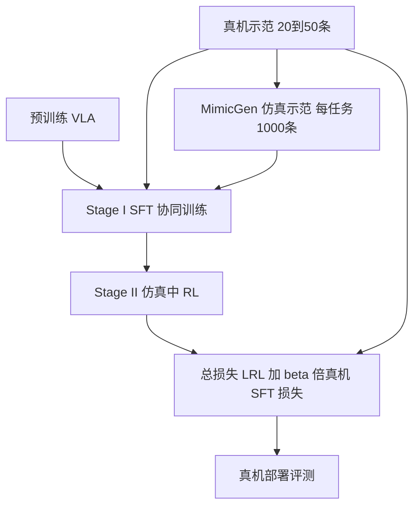

# RL-Co：基于强化学习的仿真–真机协同训练（arXiv:2602.12628）

*Beyond Imitation: Reinforcement Learning-Based Sim-Real Co-Training for VLA Models*（[arXiv:2602.12628](https://arxiv.org/abs/2602.12628)，v1 题为 RLinf-Co；[项目页](https://rl-co-training.github.io/)）。本页依据 v5（2026-10-22）全文与附录写成，来源归档见 [sources/papers](../../sources/papers/rl-co-sim-real-co-training_arxiv_2602_12628.md)。

## 一句话定义

**两阶段 VLA 后训练：Stage I 用真机加仿真示范做 SFT 协同训练，Stage II 在仿真里做 RL，并在 RL 损失上加一项真机示范的 SFT 损失（Ltotal = LRL + β·LSFT(Dreal)）作锚点，使仿真交互带来的提升不脱离真机可部署的行为。**（第 4 节）

## 英文缩写速查

| 缩写 | 英文全称 | 简要说明 |
|------|----------|----------|
| VLA | Vision-Language-Action | 视觉–语言–动作策略，本文用 OpenVLA 与 π0.5 |
| SFT | Supervised Fine-Tuning | 监督微调，在示范数据上做行为克隆 |
| RL | Reinforcement Learning | 强化学习，本文在仿真里做 |
| RL-Co | RL-based sim-real Co-training | 本文方法的简称 |
| PPO | Proximal Policy Optimization | OpenVLA 侧的 RL 算法（第 5.1 节） |
| ReinFlow | — | 面向流匹配策略的在线 RL 方法，π0.5 侧使用（第 5.1 节） |
| DR | Domain Randomization | 域随机化，本文作为视觉多样性对照 |
| TCP | Tool Center Point | 工具中心点，附录 E.1 用它衡量仿真对齐误差 |

## 为什么重要

- 现有仿真–真机协同训练大多只把仿真当静态示范来源，没用上仿真的闭环交互（摘要、第 1 节，作者自述）。
- 在同一份真机数据下，加入仿真 RL 后真机平均成功率明显高于 SFT 协同训练（表 1：OpenVLA 40.0 到 64.0，π0.5 45.9 到 66.1），且 Open Drawer 上 20 条真机示范即可追平监督基线用 200 条的水平（第 5.4 节）。
- 仿真不必是高保真数字孪生：论文只对齐相机、布局与控制器，不对齐材质与光照（附录 E.1）。这对「便宜搭个仿真就能用」是一个正面信号，但样本很小（见局限）。

## 核心原理与流程总览

1. **任务设定（第 3 节、附录 A）：** 每个真机任务配一个仿真对应任务，二者共享机器人形态、动作接口、语言指令与初始状态分布，允许视觉与动力学差异。
2. **Stage I（第 4.1 节）：** 以比例 α 混合仿真与真机示范做 SFT（式 1）。作用是注入真机任务知识，并让策略在仿真里有非平凡成功率，给 RL 一个可学的起点。
3. **Stage II（第 4.2 节）：** 在仿真里跑 RL，每次更新叠加真机 SFT 项；β 为权重。作者称该改动可与多种 RL 算法兼容，实测只验证了 PPO 与 ReinFlow 两种。
4. **仿真示范来源（附录 B）：** 回放真机轨迹为种子，用 MimicGen 生成每任务 1000 条成功轨迹，并裁掉自由空间的长段运动。

## 工程实践

- **机器人与任务（第 5.1 节、附录 C、D）：** Franka Panda，7 维末端增量位姿加夹爪二值，单个固定 RGB 相机；四个任务为 Pick and Place、Push Cube via Instruction、Open Drawer、Close Drawer。
- **仿真（附录 E.1）：** ManiSkill 刚体；相机外参手调；用一条遥操作轨迹优化 Franka 关节刚度与阻尼，回放 TCP 误差约 2 cm；其余参数保持默认。
- **奖励（附录 E.2）：** OpenVLA 用稠密奖励，π0.5 在 Pick and Place 上用稀疏奖励（抓住 0.2，放入 1，移出 −0.4）。设计思路见 [奖励设计](../concepts/reward-design.md)。
- **训练超参（附录 I、表 7）：** OpenVLA 用 LoRA rank 32；π0.5 只更新 action expert。各任务 α、β 不同（例如 π0.5 的 α 取 0.5/0.95/0.95/0.98，β 取 1.0/0.2/1.0/0.1）。β 与 α 是逐任务调的，论文没给出通用取值。
- **检查点选择（附录 G）：** 以仿真成功率收敛作为选择依据；图 13 显示真机成功率总体随仿真成功率上升，但相关并不完美。
- **算力与时间（附录 J、表 8）：** Open Drawer 上 MimicGen 约 1.5 小时（RTX 4090），RL 约 9.43 小时（2×H100）；建仿真约 1 人日，四任务共享。π0.5 的四个 RL 运行分别用 3、4、2、3 张 H100。
- **代码：** 论文只给了项目页，未列代码仓库，本页不填 `code:`。RL 侧训练框架用的是 RLinf，见 [RLinf-VLA](./paper-rlinf-vla.md)。

## 与清单说法的核对

清单（Glen Berseth 的 CoRL 2026 阅读清单，P2，条目由 LLM 据摘要起草）对该论文的一句话摘要为：「Sim-real co-training with RL in simulation plus a supervised loss on real data, instead of SFT-only co-training.」

| 清单说法 | 论文核对 |
|----------|----------|
| 在仿真里做 RL | 属实（第 4.2 节）；奖励与算法见附录 E.2、第 5.1 节 |
| 加真机数据上的监督损失 | 属实，即式 2 的 β·LSFT(Dreal)（第 4.2 节） |
| 「而不是只用 SFT 协同训练」 | 需限定：SFT 协同训练并未被替换，而是保留为 Stage I 必需的热启动；去掉它则 RL 学不起来（图 5a，单阶段变体真机 0.0，附录 H.1） |
| 未提及：真机验证 | 评测是真机（Franka 四任务，第 5.1 节），不是纯仿真；但摘要式一句话没体现「仅一个检查点、两个评测会话」的规模（附录 D.1） |
| 未提及：仿真示范来源 | 仿真侧 SFT 数据由 MimicGen 从真机种子轨迹生成（附录 B），仿真并非无需真机数据 |

结论：清单摘要大意准确，但漏掉了「两阶段」「Stage I 不可省」「MimicGen 数据」「证据规模较小」这几个限定。表中「作者自述」与「我的核对」分开列，上表右列为核对结果。

## 局限

**论文自己承认（第 7 节）：** 仿真仅限刚体；只有四个桌面任务、单一机器人形态、每个条件两个评测会话；更难任务与其他形态未探索；sim-to-real 差距仍在，多个设置成功率远低于 100%。附录 D.1 另说明：± 只反映评测会话间波动，训练种子方差与按任务的置信区间需要更多独立训练与更大评测才能给出。

**我看到的未验证之处（读后判断，非作者结论）：**
- 每个条件只评一个检查点，Open Drawer 与 Close Drawer 每会话仅 10 次试验（附录 D.1），差距的统计显著性无法从文中判断。
- 表 5 的 RialTo 式蒸馏（75.0）与单阶段变体（0.0）各只评一次，且无标准差（表 5 注）。
- 基线调参：α 与 β 逐任务设定，SFT 协同基线是否同等细致调过，文中未展开（推测）。
- 附录 F 的 Peg Insertion（32.5 到 42.5）只对比了 SFT 协同与 RL-Co，评测次数文中按「同一真机评测口径」带过，未单独给出试验次数。
- 仿真奖励要为每个任务手工设计（附录 E.2），任务一多，这部分工作量文中没有量化。
- 第 5.2.2 节的泛化实验只在 π0.5 的 Pick and Place 上做，未对 OpenVLA 或其他任务复现。
- 版本之间数字有修订（OpenVLA 纯真机平均 v1 为 16.5、v5 为 9.1），引用时应以 v5 为准。

## 关联页面

- [VLA 方法页](../methods/vla.md)
- [PPO](../methods/ppo.md)
- [模仿学习](../methods/imitation-learning.md)
- [行为克隆](../methods/behavior-cloning.md)
- [Sim2Real](../concepts/sim2real.md)
- [域随机化](../concepts/domain-randomization.md)
- [奖励设计](../concepts/reward-design.md)
- [RLinf-VLA](./paper-rlinf-vla.md)：本文 RL 侧所用训练框架的 VLA+RL 平台论文
- [OpenVLA](./paper-openvla.md)
- [π0.5](./paper-pi05-open-world-vla.md)
- [MimicGen](./mimicgen.md)：本文仿真示范的生成工具
- [Sim-and-Real Co-Training（视觉模仿学习配方）](./paper-notebook-sim-and-real-co-training-a-simple-recipe-for-vis.md)：本文沿用其协同训练设定
- [ManiSkill3](./paper-notebook-maniskill3-gpu-parallelized-robotics-simulation.md)

## 参考来源

- [来源归档：rl-co-sim-real-co-training_arxiv_2602_12628.md](../../sources/papers/rl-co-sim-real-co-training_arxiv_2602_12628.md)
- [arXiv:2602.12628](https://arxiv.org/abs/2602.12628)
- [项目页](https://rl-co-training.github.io/)

## 继续阅读

- [arXiv PDF（v5）](https://arxiv.org/pdf/2602.12628)
- [RLinf-VLA](./paper-rlinf-vla.md)
- [Sim2Real 概念页](../concepts/sim2real.md)
