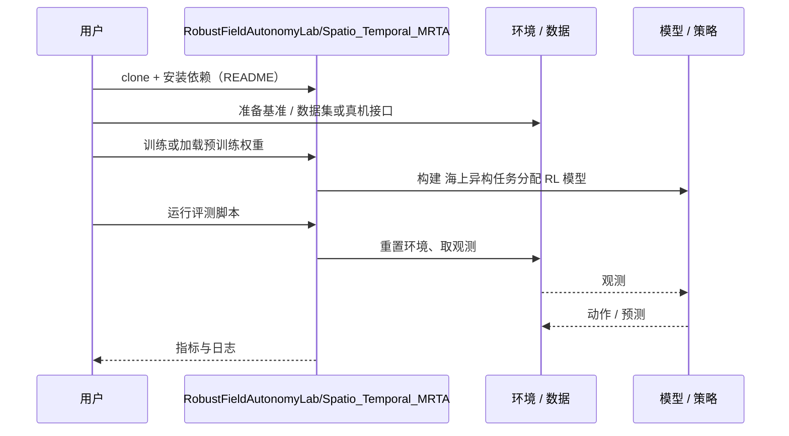

# 海上异构任务分配 RL（arXiv:2610.15237）

**海上异构任务分配 RL**（*Reinforcement Learning Based Heterogeneous Task Allocation Under Spatio-Temporal Environmental Uncertainty for Multi-Robot Teams*，[arXiv:2610.15237](https://arxiv.org/abs/2610.15237)，[代码](https://github.com/RobustFieldAutonomyLab/Spatio_Temporal_MRTA)）来自 [具身智能小站 2026-10-14 盘点](../../sources/blogs/wechat_embodied_station_41_papers_streamingwam_2026-10-14.md)，属「多机器人协作与评测」组。

## 一句话定义

**不同能力无人艇在时空随机扰动与动态任务下的分配，用去中心化 RL 应对观测偏差。**

## 英文缩写速查

| 缩写 | 英文全称 | 简要说明 |
|------|----------|----------|
| MRTA | Multi-Robot Task Allocation | 多机器人任务分配 |
| USV | Unmanned Surface Vehicle | 无人艇 |
| RL | Reinforcement Learning | 强化学习 |

## 为什么重要

- 海上扰动使静态分配失效。
- 开源结论：**已开源**（步骤 2.5，2026-10-14）。仓库可达。
- 同期同组工作见 [流式动作块与世界模型记忆：具身智能小站 10-14 期 41 篇阅读坐标](../overview/embodied-station-2026-10-14-41-papers-technology-map.md)。

## 核心机制

| 项 | 内容 |
|----|------|
| **arXiv** | [2610.15237](https://arxiv.org/abs/2610.15237) |
| **开源** | **已开源** |
| **要点** | 结论适用于论文仿真设定。 |
| **文内指标** | 以原文为准。 |

## 源码运行时序图

以下为按仓库入口（`RobustFieldAutonomyLab/Spatio_Temporal_MRTA`）推断的通用运行链路；入库日仅核实仓库可达，未逐文件阅读，具体脚本名以 README 为准。

## 实验与评测

- 以原文为准。
- **读法：** 本页为索引级摘要，依据公众号转述的官方摘要与仓库信息整理；逐项数字与 baseline 以原文 PDF 为准。

## 与其他工作对比

- 横向索引见 [流式动作块与世界模型记忆：具身智能小站 10-14 期 41 篇阅读坐标](../overview/embodied-station-2026-10-14-41-papers-technology-map.md)；同 arXiv 不重复造页。

## 结论

**异构队伍任务分配需把环境不确定性作为状态的一部分。**

1. 开源边界：**已开源** — 仓库可达。
2. 核心机制：结论适用于论文仿真设定。
3. 复现与选型前核对任务协议、硬件与基准口径，勿直接横比公众号摘录数字。

## 关联页面

- [marl](../methods/marl.md)
- [reinforcement-learning](../methods/reinforcement-learning.md)
- [embodied-station-2026-10-14-41-papers-technology-map](../overview/embodied-station-2026-10-14-41-papers-technology-map.md)

## 参考来源

- [rl_heterogeneous_task_allocation_spatio_temporal_arxiv_2610_15237.md](../../sources/papers/rl_heterogeneous_task_allocation_spatio_temporal_arxiv_2610_15237.md)
- [wechat_embodied_station_41_papers_streamingwam_2026-10-14.md](../../sources/blogs/wechat_embodied_station_41_papers_streamingwam_2026-10-14.md)
- [arXiv:2610.15237](https://arxiv.org/abs/2610.15237)

## 推荐继续阅读

- [arXiv PDF](https://arxiv.org/pdf/2610.15237)
- [https://github.com/RobustFieldAutonomyLab/Spatio_Temporal_MRTA](https://github.com/RobustFieldAutonomyLab/Spatio_Temporal_MRTA)
