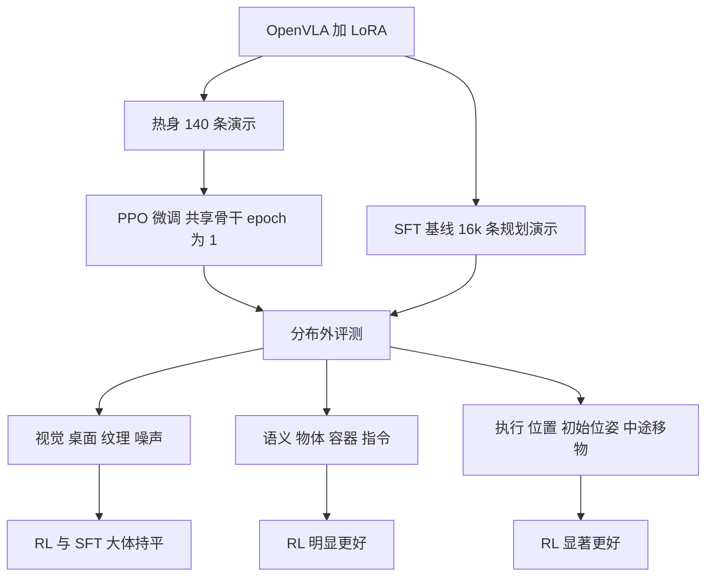

# What Can RL Bring to VLA Generalization?（arXiv:2505.19789）

*What Can RL Bring to VLA Generalization? An Empirical Study*（Jijia Liu、Feng Gao 等，清华大学，NeurIPS 2025，[arXiv:2505.19789](https://arxiv.org/abs/2505.19789)；本页依据 v4 全文）。这是一篇**对照实验论文**：不提新模型，而是回答「RL 微调相对 SFT 到底给 VLA 的泛化带来什么」，并顺带比较了三种从大语言模型借来的 RL 算法。

## 一句话定义

**在仿真 pick-and-place 上，以 OpenVLA（LoRA）为基座，系统比较 PPO / GRPO / DPO 与 SFT：PPO 是三者里最有效的 RL 算法，PPO 微调相对 SFT 在语义与执行的分布外泛化上明显更好，视觉鲁棒性大体持平（§1、§5.3）。**

## 英文缩写速查

| 缩写 | 英文全称 | 简要说明 |
|------|----------|----------|
| VLA | Vision-Language-Action | 视觉–语言–动作策略，本文用 OpenVLA |
| SFT | Supervised Fine-Tuning | 监督微调，此处即对演示做行为克隆 |
| RL | Reinforcement Learning | 强化学习 |
| PPO | Proximal Policy Optimization | 近端策略优化，带价值函数的 on-policy 算法 |
| GRPO | Group Relative Policy Optimization | 组内相对优势，无价值函数 |
| DPO | Direct Preference Optimization | 偏好对离线优化；本文用轨迹级变体 TPO |
| GAE | Generalized Advantage Estimation | 广义优势估计 |
| LoRA | Low-Rank Adaptation | 低秩适配；本文 rank=32 |
| POMDP | Partially Observable Markov Decision Process | 部分可观测马尔可夫决策过程 |
| OOD / IND | Out-of-Distribution / In-Distribution | 分布外 / 分布内 |
| OXE | Open X-Embodiment | OpenVLA 的预训练数据集 |

## 为什么重要

- **作者出发点：** VLA 主要靠 SFT，在分布偏移下有复合误差；RL 直接优化任务回报，可能学到纠正行为（§1）。但 RL 对 VLA 泛化的具体收益此前缺乏系统对照（§1）。
- **对本库读者：** 给出一张「哪些泛化维度 RL 有用、哪些没用」的实证表，并回答「LLM 里流行的 GRPO / DPO 能否直接搬给 VLA」——在本文设置下不行，PPO 更稳（§4.1）。
- **与 [RLinf-VLA](./paper-rlinf-vla.md) 的关系：** RLinf-VLA 是统一训练平台；本文是平台之前的算法 / 泛化实证。本文致谢里也出现 GRPO 调参的外部建议（Acknowledgements）。两者的具体关系（如是否复用代码）本页**未核实**。

## 核心机制

### 研究设置（§3.2、§4.1、§5.1）

| 项 | 内容 |
|----|------|
| 基座 | OpenVLA：SigLIP + DINOv2 视觉编码、Llama-2 7B、动作离散为 256 bin，H=1（§3.2） |
| 微调方式 | 所有方法都用 LoRA rank=32，加到全部线性层，value head 全参数训练（§4.1、附录 A.1） |
| 环境 | ManiSkill，8 自由度 WidowX-250S；640×480 RGB + 指令；末端 delta + 夹爪（§5.1） |
| 任务 | pick-and-place：「put $O$ on $R$」（§5.1、附录 A.4） |
| 奖励 | 稀疏：抓取并保持 0.1，成功放置 1.0（§5.1） |
| SFT 数据 | 运动规划器（MPLib）生成，过滤掉约三分之一的空转动作（附录 A.2）；约 16k 条后进入平台期，取 SFT-16k 为基线（§5.2） |

### 三个泛化维度（§5.1、附录 A.4）

| 维度 | 测试项（论文原文） |
|------|--------------------|
| Vision | 未见桌面；前景动态纹理（透明度 0.3 / 0.5）；整图动态噪声（0.3 / 0.5） |
| Semantics | 9 个未见物体；16 个未见容器；16 种未见指令模板；Multi-Object；Distractive Receptacle；Multi-Receptacle |
| Execution | 物体与容器位置范围外推；机器人初始位姿随机；第 5 步把物体传送到新位置（Mid-Episode Object Reposition） |

### PPO 为什么优于 GRPO / DPO：论文自己的解释（§4.1）

论文的比较在**训练任务的成功率学习曲线**上（图 3b，每算法 2 个种子，横轴至 1M 环境步），文字结论是 PPO 一致优于 GRPO，也优于 DPO。解释全部写成假设：

- **GRPO：** 自然语言任务与机器人任务的环境动力学不同；机器人 POMDP 中每个动作会以非平稳方式依次改变环境状态，可能使 GRPO 的优势估计不稳定。
- **DPO：** 稀疏奖励让不同轨迹难以区分优劣；离线数据集与在线执行间有显著分布偏移。
- **实现口径：** GRPO 为 32 组 × 8 条轨迹，只在回合末给 outcome 奖励；DPO 用轨迹级 TPO，仅用稀疏奖励（附录 A.1）。
- **本页判断（非论文结论）：** 论文没有为这两条解释做专门消融，所以「PPO 更好」是实验现象，原因仍是猜想；且 PPO 靠价值函数做逐步信用分配，与论文的 "逐步改变状态" 说法方向一致，但论文并未这样展开（推测）。

### 高效 PPO 配方（§4.2）

| 设计 | 论文给出的效果 |
|------|----------------|
| 共享 actor-critic 骨干 + 三层 MLP value head，取第一个动作 token 的隐状态 h0 | 回报最高最稳；独立 critic 骨干回报相当，但慢 35%、显存多 83%（81.3 GB 对 44.4 GB）（图 4） |
| VLA 预热：140 条 Octo-Small + 运动规划器演示 | 收敛所需环境步约少 50%，渐近回报相当（图 5a） |
| 最小 PPO epoch = 1 | 更多 epoch 无回报 / 样本效率增益，墙钟时间近似线性变长（图 5b/5c） |
| 总耗时 | 主实验单张 A100 约 42 小时收敛（§4.2） |

### RL 对 SFT 的泛化结果（§5.3、附录 B.3 表 1）

成功率（SFT-16k / PPO，3 种子均值）：

| 测试项 | SFT | RL |
|--------|-----|----|
| IND | 0.781 | 0.938 |
| Table（视觉） | 0.719 | 0.844 |
| Texture-s（视觉） | 0.557 | 0.630 |
| Noise-s（视觉） | 0.505 | 0.667 |
| Obj.（语义） | 0.453 | 0.714 |
| Instruct（语义） | 0.672 | 0.891 |
| M-Obj.(OOD)（语义） | 0.297 | 0.578 |
| Obj. Pos.（执行） | 0.568 | 0.807 |
| Robot Pose（执行） | 0.339 | 0.797 |
| Obj. Rep.（执行） | 0.286 | 0.745 |

- 正文口径：RL 在训练分布上与 SFT-16k 相当，在未见物体与桌面上高 42.6%（§5.3）；RL 约 0.4M 环境步后超过 SFT-16k 的 OOD 表现（§5.3）。
- **作者的机制假设（§5.3、§5.4）：** 视觉上两者都没超出训练时的视觉随机性；RL 通过试错学到较少依赖物体类别的抓取；RL 的训练轨迹覆盖更宽的工作空间与末端姿态，SFT 贴着规划器路径（图 8）；RL 能从失败抓取和中途移位中恢复（图 9 定性展示）。

## 工程实践

- **复现要点：** OpenVLA 官方检查点在该基准上很差，需要先用少量演示预热再上 PPO（§4.2）；SFT 数据要过滤规划器的空转动作，否则模型易卡住（附录 A.2）。
- **算力：** 单 A100 约 42 小时（§4.2）；独立 critic 需要 81.3 GB 显存，已超过常见 A100 40 GB，而共享骨干为 44.4 GB（§4.2，是否 80 GB 卡未说明）。
- **动作分块变体：** OpenVLA-OFT（chunk=4）需把裁剪比降到 0.1、γ=0.96、λ=0.85 并按动作维度裁剪，RL 仍优于 SFT（附录 B.5）。
- **与 [PPO](../methods/ppo.md)、[GAE](../methods/gae.md) 的关系：** 本文 PPO 用 GAE；去掉 GAE 的 PPO-ORZ 也被比较过（§4.1），具体曲线差异本页未读到数值。
- **统一平台：** 想要多模型、多仿真的 VLA+RL 工程框架可看 [RLinf-VLA](./paper-rlinf-vla.md)。

## 局限与未验证之处

**论文自己承认的（§6）：**

1. SFT 只用运动规划器演示，可能不代表人类数据的多样性。
2. 主评测只做 pick-and-place，多任务 / 更复杂场景留待未来。
3. 主实验全在仿真，真机验证是后续工作。

**本页读到的其他限制：**

- 真机实验只是附录里的初步结果：Franka 重训后零样本，30 次试验，pick-and-place 成功率 SFT 0.00 对 RL 0.27，抓取 0.10 对 0.43（附录 B.4 表 2），绝对值很低。
- RL 并非处处更好：Texture-s 的抓取准确率 RL 略低（表 1），动作分块版 M-Recep. 成功率 RL 0.297 低于 SFT 0.365（表 3），开关门任务 IND 与动态噪声 / 重述指令上 RL 更低（表 4）。
- PPO 与 GRPO / DPO 的比较只在一个任务、每设置 2 个种子、仅稀疏奖励下做过；DPO 版本还删去了原 TPO 的稠密奖励（附录 A.1），所以不应外推为「GRPO / DPO 在 VLA 上一般不行」。
- 「PPO 在执行条件变化时更好」这一说法容易混淆：PPO 对 GRPO / DPO 的比较在训练任务上（图 3b）；执行条件变化下的泛化比较是 **PPO 微调对 SFT**（图 7、表 1）。论文没有在 OOD 执行测试里对比 GRPO / DPO。
- 机器人侧的「接触状态」在论文的 PPO / GRPO 解释中没有出现，论文只说动作使环境状态非平稳地变化（§4.1）。
- 图 3、图 4、图 5、图 6 的曲线只按正文与图注引用，未逐点核对数值。

## 关联页面

- [PPO](../methods/ppo.md)：本文胜出的算法
- [GRPO](../methods/grpo.md)：本文对照的组相对算法
- [GAE](../methods/gae.md)：PPO 的优势估计
- [VLA 方法页](../methods/vla.md)
- [行为克隆](../methods/behavior-cloning.md)：SFT 基线的本质
- [分布外泛化](../concepts/out-of-distribution-generalization.md)
- [奖励设计](../concepts/reward-design.md)：本文只用稀疏奖励
- [Sim2Real](../concepts/sim2real.md)：附录 B.4 的初步真机迁移
- [RLinf-VLA](./paper-rlinf-vla.md)：统一的 VLA+RL 训练平台
- [OpenVLA](./paper-openvla.md)：本文基座
- [ManiSkill2](./maniskill2.md)：仿真平台的前代介绍

## 参考来源

- [原文归档：rl-vla-generalization-empirical-study_arxiv_2505_19789.md](../../sources/papers/rl-vla-generalization-empirical-study_arxiv_2505_19789.md)
- [arXiv:2505.19789](https://arxiv.org/abs/2505.19789)

## 推荐继续阅读

- [arXiv PDF](https://arxiv.org/pdf/2505.19789)
- [项目页 rlvla.github.io](https://rlvla.github.io)
- [RLinf-VLA（arXiv:2510.06710）](./paper-rlinf-vla.md)
