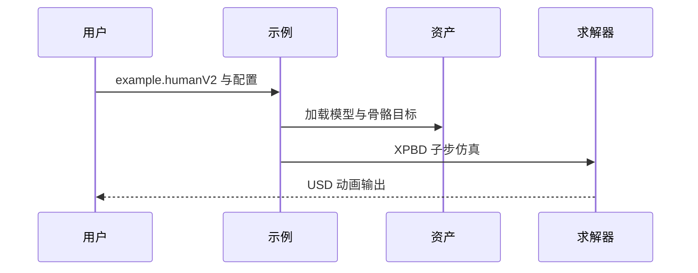

# RLMuscle: Muscle-Driven Character Animation via Reinforcement Learning

强化学习控制器在一维 Hill 肌肉模型中学习参考动作跟踪激活，再用相同本构规律驱动三维肌肉变形。

## 英文缩写速查

| 缩写 | 英文全称 | 简要说明 |
|------|----------|----------|
| RL | Reinforcement Learning | 学习肌肉激活
| XPBD | Extended Position-Based Dynamics | 肌肉体积仿真
| EMG | Electromyography | 肌电先验 |

## 核心信息

| 字段 | 内容 |
|------|------|
| 机构 | 北京航空航天大学、西湖大学、伦敦大学学院 |
| 论文 | [arXiv:2610.30033](https://arxiv.org/abs/2610.30033) |
| 项目页 | [官方网站](https://chunleili.github.io/project-page-rlmuscle/) |

## 方法与意义

强化学习控制器在一维 Hill 肌肉模型中学习参考动作跟踪激活，再用相同本构规律驱动三维肌肉变形。 策略网络与肌肉网络在一维替代模型中共同训练；测量肌电先验约束冗余的肌肉募集解。三维阶段以 XPBD 和几何多重网格求解体积变形。研究目标是角色动画，不能直接推断对真实肌肉或人形电机的控制效果。

## 源码运行时序图

## 实验与评测

论文报告 194 块肌肉的全身模型在 RTX 4090 上仿真 18 ms/帧；仓库注明该数字不含 USD 导出，不代表完整动画管线延迟。

## 结论

该工作提供了值得验证的管线，但实验指标应按原始设置解读。

- 先确认输入、输出及所需资产，再评估接入成本。
- 在目标动作、材料和仿真器上独立测量效果。
- 将仿真结果用于真机前，检查物理约束与安全边界。

## 与其他工作对比

- **vs 运动学 / 物理重定向：** [ReActor](../methods/reactor-physics-aware-motion-retargeting.md) 等方法把参考动作迁移到刚体机器人上用 RL 跟踪；RLMuscle 的 RL 控制器输出的是 Hill 肌肉 **激活**，并以相同本构规律驱动三维肌肉变形，目标是角色动画而非机器人。
- **两阶段解耦：** 先在一维替代模型中训练策略与肌肉网络，再在 XPBD + 几何多重网格中做三维体积变形；三维阶段不参与策略训练（论文报告全身 194 块肌肉 18 ms/帧，不含 USD 导出）。

## 工程实践与局限

官方仓库提供 Warp/XPBD 仿真示例与单独下载的资产；README 未明确提供论文完整 RL 训练复现入口，不能据此认定完整训练已发布。

## 关联页面

- [相关方法](../concepts/motion-retargeting.md)
- [相关概念](../methods/reactor-physics-aware-motion-retargeting.md)

## 参考来源

- [论文归档](../../sources/papers/rlmuscle_arxiv_2610_30033.md)
- [项目页归档](../../sources/sites/rlmuscle-project.md)
- [代码归档](../../sources/repos/rlmuscle.md)

## 推荐继续阅读

- [原论文](https://arxiv.org/abs/2610.30033)
