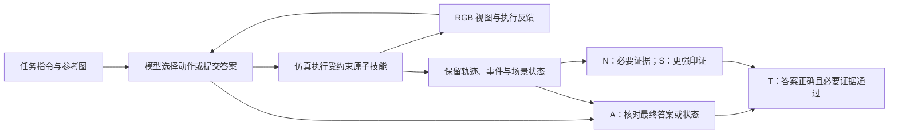
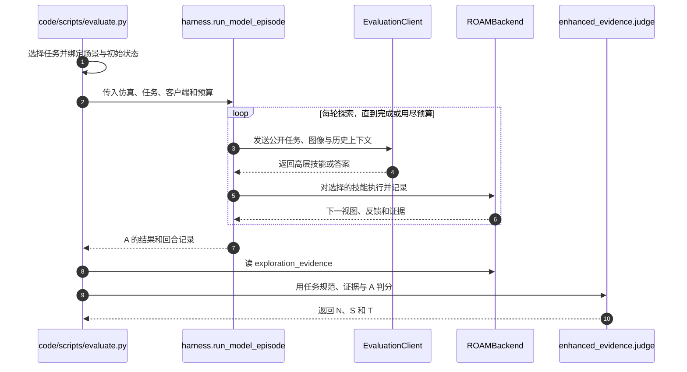

# ROAM-Bench：用执行证据评测具身主动空间智能 / Evaluating Embodied Active Spatial Intelligence through Evidence Verification

## 一句话定义

让空间智能体在仿真里自己去找、看和操作，不仅核验最终答案，还核验是否完成任务指定的探索和交互。

## 英文缩写速查

| 缩写 | 英文全称 | 简要说明 |
| --- | --- | --- |
| VLM | Vision-Language Model | 读任务和图像、选择原子技能的受测模型 |
| RGB | Red, Green, Blue | 提供给模型的彩色相机观测 |
| QA | Question Answering | 通过导航和交互收集信息后回答问题 |
| GT | Ground Truth | 裁判用于核验的仿真状态与任务参考 |

## 为什么重要

猜对屋内杯子的总数不代表找全了杯子；看过所有目标也不代表模型能从不同视角辨认同一个杯子。ROAM-Bench 把证据采集和最终判断拆开，能区分漏搜、看见后的几何判断失败、以及搬运过程中选错物体等不同错误。

| 项目 | 内容 |
| --- | --- |
| 机构 | 香港大学、电子科技大学、上海创智学院、京东 |
| 环境与规模 | Isaac Sim、场景使用 SceneSmith 生成并人工校正；27 个室内环境，250 道人工核验任务 |
| 五组能力 | 物体/房间定位、跨区域聚合与计数、度量几何、参考系整合、目标导向移动物体 |

## 核心机制

智能体收到任务、允许的参考图、RGB、技能反馈及轨迹上下文，可按描述检索之前的视角。它选择受约束的移动、观察、开柜、抓取和放置等原子技能；仿真执行后返回下一轮观测。评分真值和对象语义不作为标准评测模型输入。

- **A** 检查答案或最终场景状态是否正确。
- **N** 检查是否按任务要求看到指定实例、搜索规定区域、完成必要的顺序交互。
- **S** 在 N 基础上要求更强的几何、视点或放置支撑证据；通过 S 并不保证 A 正确。
- **T = A ∧ N** 是严格成功；S 是独立诊断指标。例如搬运需先拿到指定实物，再将同一物体放到目标位置；更强的证据还检查松手后的目标面是否实际托住物体。

## 流程总览

## 源码运行时序图

入口把每个任务的回合与证据写入 `trajectory.json`，把分数写入指定汇总结果；继续运行时核对数据、源码及参数身份。

## 工程实践

- 公开代码与 250 份任务定义、388 张参考图在 MIT 主仓，场景另发在 Hugging Face。仿真需 Isaac Sim 5.1.0（Python 3.11、兼容 NVIDIA GPU），G1 和 Inspire Hand 原始资产另取；模型端点和凭据由使用者提供。
- 先用 `download_scenes.py` 下载单个场景（如 `scene_148`）并用 `build_environment.py --inspect` 核对场景，确认资产与任务 ID 对齐，再跑所选任务。本文是静态源码核对，未启动 Isaac Sim 或调用模型。
- 保存房间覆盖、实例身份和动作反馈，避免仅记录最后一帧或答案。可用 [公开实现与运行说明](../../sources/repos/roam-bench.md) 核对入口。

## 实验与评测

论文表 2 中七个模型各评 250 题，最高模型的 **A 为 73.2%，T 为 69.2%**；其余模型 T 低于 50%。人类在 100 道抽样题上 A、T 均为 **84.0%**，样本与模型全量分母不同。在 1,750 个模型回合中，**206** 个属于 A 通过但 N 不通过；扣除 106 个地标路径积分案例，其余 100 个中 85 个缺必要对象观察。另有回合 S 通过但 A 失败；用完整视角或额外深度、位姿与标定数据可以改善部分几何判断，这些是诊断条件而非标准榜单输入。

## 结论

应同时记录任务结果和达成结果所需的证据，才能知道下一步应改善探索、几何判断还是交互。

- 用 T 衡量实际符合任务要求的成功，配合 A 与 N 的差定位漏看、漏查或漏操作。
- 对 S 已通过但答错的回合，优先排查跨视角实体归并、尺度或参考系。
- 搬运任务分开记录选中目标、抓取、正确放置和释放后的支撑，不用一个终态总分代替全链路诊断。
- 比较效率时纳入失败消耗；只看成功回合平均动作数会偏乐观。

## 局限与风险

这是模拟室内环境和高层原子技能的评测，不测真机低层抓取或运动控制。证据规则依赖仿真真值、人工设定的任务门槛与容差；即便通过 S，也不能证明模型采用了特定推理过程。名称相近的 [WorldRoamBench](./paper-worldroambench.md)（arXiv:2606.31672）面向交互世界模型长程视频稳定性，并非本项目。

## 关联页面

- [具身模型测评纵深路线](../../roadmap/depth-embodied-eval.md)

- [AI 基准评测](../methods/ai-benchmark-evaluation.md)：理解结果、必要条件与诊断指标的分工。
- [自主探索任务](../tasks/autonomous-exploration.md)：对照具身导航决策与空间证据采集。
- [具身评测与基准](../overview/hub-embodied-eval-benchmark.md)：对比主动空间、导航和操作评测。
- [ICLWorld](./paper-iclworld.md)：比较情境规则执行与主动搜集证据两类长程评测。

## 参考来源

- [论文与通读记录](../../sources/papers/roam-bench_arxiv_2611_33143.md)
- [项目主页归档](../../sources/sites/roam-bench.md)
- [官方评测实现](../../sources/repos/roam-bench.md)

## 推荐继续阅读

- [OpenEQA 官方项目](https://open-eqa.github.io/)：对照具身问答与任务证据核验的边界。
