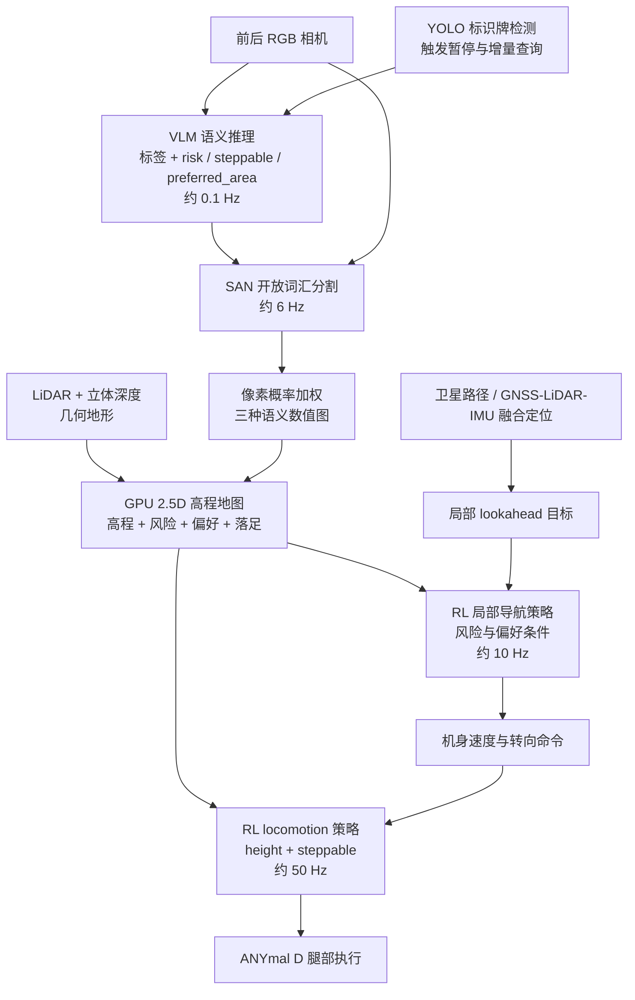
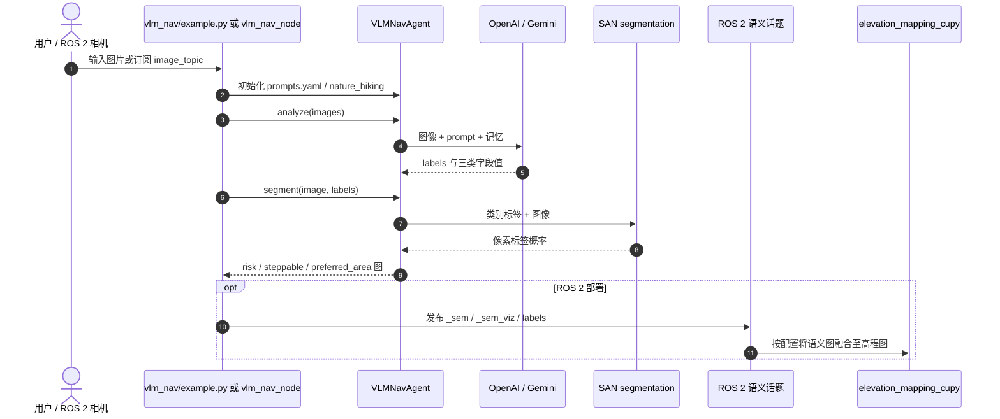

# ROAM：Bridging vision-language reasoning and learned control for legged navigation in the wild（视觉语言推理与学习控制协同的野外腿式导航）

| 信息 | 内容 |
|---|---|
| 系统 / 全称 | **ROAM** — Robust Open-world Autonomous Mobility |
| 论文 | **Science Robotics** 11(120), eaee1549，2026-11-18；[DOI](https://doi.org/10.1126/scirobotics.aee1549)，[arXiv:2611.25215v1](https://arxiv.org/abs/2611.25215) |
| 作者 | Takahiro Miki、Robin Schmid、Manthan Patel、Turcan Tuna、Julia Richter、Julian Nubert、Joonho Lee、Matthias Müller、Marco Hutter |
| 机构 | **苏黎世联邦理工（ETH Zurich）**、**苹果公司（Apple）**；作者所属不代表 Apple 参与了所有软件、模型或数据的生产，见论文免责声明 |
| 项目与代码 | [项目主页](https://roam-hiking.github.io/) · [官方 GitHub](https://github.com/leggedrobotics/roam) · [原文核对归档](../../sources/papers/roam_legged_navigation_arxiv_2611_25215.md) |

## 一句话定义

**ROAM 把视觉语言模型（VLM）的常识判断压缩为可投影的语义风险/落足/偏好字段，通过开放词汇分割与几何高程图桥接至两级强化学习策略，使腿式机器人在真实野外既知道“哪里能走”，也能高频地“怎么走”。**

## 英文缩写速查

| 缩写 | 英文全称 | 简要说明 |
|---|---|---|
| ROAM | Robust Open-world Autonomous Mobility | 论文系统名：开放世界自主腿式移动 |
| VLM | Vision-Language Model | 低频生成语义标签、风险、可落脚与偏好值 |
| SAN | Side Adapter Network | 开放词汇像素分割，投影 VLM 的文字标签 |
| RL | Reinforcement Learning | 学习局部导航与高频落足/运动控制 |
| GNSS | Global Navigation Satellite System | 山地长距离定位，与 LiDAR/IMU 联合估计 |
| VLA | Vision-Language-Action | 对照路线：VLM/策略直接产出空间动作 |
| ROS | Robot Operating System | 官方仓库发布 ROS 2 和 ROS 1 语义接口 |

## 为什么重要

- 几何地图无法读懂“禁止入内”“施工中”“草地不宜穿越”，而 VLM 直接预测像素路径/关节动作又遇到空间精度与延迟问题。ROAM 把两者分工：**VLM 说什么危险，分割网络说危险在哪，RL 决定如何避开并实际落脚**（原文 1.1、3）。
- 三个语义值必须分开：`risk` 是危险程度，`steppable` 是能否放脚，`preferred_area` 是人类/任务偏好；“草地可走但不优先”不同于“湖水禁止穿越”。这比单个二值障碍图更适配开阔野外。
- 实验在 ANYmal D 上验证长程高自主率，但仍有安全接管：不能把“公里级自主”读成“全程无人监督”。

## 流程总览

## 核心机制

1. **语义生成（4.4）**：实地原始实验使用 `gpt-4-vision-preview`，每 10 秒从前后视觉输入分析类别；prompt 显式给出 ANYmal 的运动能力、禁止产生带方向词的类别、JSON 输出约束，并记忆最近三次输出。关键的牌子由 YOLO 旁路触发即时关注。
2. **从语言到地图（式 1–3）**：SAN 对每个标签输出每像素概率；语义图值为 `Σ(label_value × pixel_probability)`，并融入 LiDAR/立体深度构建的 **8×8 m、4 cm 分辨率 2.5D 地图**。地图维护时间上的语义信息，而非只相信当前一张 RGB。
3. **Navigation RL（4.6）**：策略看 `elevation + risk + preferred_area`，输出速度与 yaw rate（10 Hz）；仿真把不可达区域/高风险区加入奖励惩罚，并对非首选区域做条件性的虚拟高度惩罚；全局路径沿卫星图路点由 OpenRouteService 生成，pure pursuit 在 8 m 前瞻目标上接入局部导航。
4. **Locomotion RL（4.5）**：策略看 `elevation + steppable`，在 RaiSim 中用 Perlin 噪声生成禁落脚区域，负奖励系数 α=0.1；privileged teacher → student 蒸馏使落脚策略在真机的几何/语义误差下工作。高层 VLM 不需要在 50 Hz 驱动电机。
5. **长程定位（4.7–4.8）**：GNSS + LiDAR SLAM + IMU + 惯性/运动学里程计经 Graph-MSF 融合；不是单凭 VLM 进行定位或全局寻路。

## 实验与评测

| 任务与指标 | 论文结果 | 如何解读 |
|---|---|---|
| Zermatt 山地长走 | **10.1 km**、下降 1220 m、最陡约 30%；时间自主率 **96.7%**，2 次介入 | 含施工/崖边危险，必须安全员介入 |
| Seealpsee 湖边环线 | **2.38 km**、20 m 高差；时间自主率 **97.5%**，3 次介入 | 水边、滑坡与无法通行的旋转门构成边界 |
| 固定姿态人体模型（补充 S4） | 10 次中到达 **10/10、无碰撞**；随机姿态亦 10/10 到达但 **30% 轻微碰触** | 小样本，细长几何仍受限 |
| 1.2 km 校园语义挑战 | 道路偏移、人体模型、施工牌子；对照 geometry-only / ViNT | 模型可按标志绕路并按新牌子回到主路 |
| 27 张有效静态图像（表 1） | ROAM 风险图 + **图像空间 A*** 安全率 **0.991**、首选率 **0.868**、到达 **27/27** | 测的是语义/几何路径抽象，**并非**真机 RL 策略的定量成功率；30 张中 3 张失去 label 输出被共同剔除 |

## 结论

**ROAM 的价值是可复用的“语义代价 → 空间图层 → 低延迟策略”接口，而不是让 VLM 直接操纵四足；真实风险瓶颈仍在分割正确性与安全接管。**

1. **决定分层频率**：VLM 0.1 Hz、分割约 6 Hz、局部导航 10 Hz、落足 50 Hz；调试优先观察语义滞后能否被反应式低层弥补。
2. **分别维护三字段**：`risk`、`steppable`、`preferred_area` 不能合成同一“可通行”布尔值，否则无法表示“能走但应尽量绕行”。
3. **别混淆评测**：表 1 的 0.991 是 27 张图片轨迹像素安全占比，不能宣称为 99.1% 实地导航成功率。
4. **排查数据路径**：两次野外实验共 5 次主导介入，补充材料归因为 **4 次分割问题 + 1 次物理通过限制**。重点追踪视觉标签到像素边界的错配。
5. **工程复现分阶段**：先跑公开 `vlm_nav` + SAN → ROS 语义话题 → `elevation_mapping_cupy`；完整 locomotion/nav policy 权重与真机一键运行不能由当前仓库推定存在。

## 与其他工作对比

| 工作 | 高层信息 | 下游执行 / 差异 |
|---|---|---|
| [NaVILA](./paper-notebook-navila-legged-robot-vision-language-action-model.md) | 语言/图像 → 中层导航动作 | 偏学习式 VLA 动作输出；ROAM 用连续语义代价地图把空间定位交给分割/几何模块 |
| [Legged-VLN Barrier Caging](./paper-legged-vln-barrier-caging.md) | VLM/VLA 离散动作提议 | MPPI + dEBF 形式化硬滤波；ROAM 靠 RL 规避代价和感知鲁棒性，**未声称形式化安全保证** |
| [SE(2) Navigation Mesh](./paper-se2-navigation-mesh.md) | 几何位姿 / 朝向可行域 | 解决机器人航向足印可通行性；ROAM 解决语义风险与高频执行的跨层连接 |
| [分层四足导航栈](../concepts/hierarchical-quadruped-navigation-stack.md) | 定位 / 路径 / 局部运动分层 | ROAM 是接入开放词汇语义和 RL 的一条具体工程实现 |

## 源码运行时序图

**此图对应公开仓库可复现的语义前端运行时序，并不冒充论文完整 ANYmal 真机运动控制代码。** 与 [代码归档](../../sources/repos/leggedrobotics-roam.md) 及官方 README 对照。

- 纯 Python 冒烟入口：`cd vlm_nav && python3 example.py example_data/hiking_lake.jpg --seg_model api`（需 API key 与 SAN GPU 服务）。
- ROS 2 入口：`ros2 launch vlm_nav_ros vlm_nav_ros.launch.py`；高程图联动使用 `vlm_nav_elevation_mapping.launch.py`。真实上机控制须另接 locomotion / navigation 运行栈。

## 工程实践

- **机体**：ANYmal D；六个 RealSense 立体相机、Velodyne LiDAR、广角 HDR 相机、RTK GNSS、Jetson AGX Orin 和蜂窝网络（论文 4.2）。
- **可复现切面**：`vlm_nav`（Python + VLM + SAN）、`vlm_nav_ros` / `vlm_nav_ros1`、图像 A* demo、30 s Seealpsee 语义高程图回放（官方仓 README）。
- **版本差异**：2024 实地部署原始 VLM `gpt-4-vision-preview`；2026 当前 GitHub README 默认 `gemini-4-hydrogen`，**不可把 README 默认当成论文实地跑分模型**。
- **可观测性建议（工程推演）**：日志逐条关联 VLM label/时间戳、SAN 概率、融合栅格、局部目标、body cmd、足端接触；遇高风险误报/漏报先拆语义→像素→规划链路。
- **公开范围**：代码 **部分开源**（语义前端 + ROS/高程图例），未见完整 RL 训练/权重与 ANYmal 端到端部署仓；源代码存在不代表整套论文性能可独立复现。

## 局限与风险

- **5 次实地介入，不是零介入**。4 次主要来自像素分割（施工栅栏/新道路/湖边/坡地），1 次为无法跨越窄旋转门（补充材料）；应保留安全停机与遥控接管。
- **网络/依赖**：原始实地实验 VLM 是云端服务；延迟、掉线、账号/API 成本影响野外可用性。分层架构对 VLM 供应商可替换，但替换后效果仍需实测。
- **复杂视觉条件测试有限**：原文主要白天、视线良好；雾、夜晚、强背光没有充分验证。文中提出传感器几何导航降级，不等于各种失效场景都已量化安全验证。
- **少量实地采样**：两次大路线、受控各方法 N=1（人体模型 N=10）；时间自主率不等于全环境可靠性分布。
- **图像空间/物理边界**：补充楼梯高度实验提示，VLM 即使给定 15 cm 阈值仍可能错判 15.5–16 cm 台阶；厘米级可通行约束须落到几何与控制层。

## 关联页面

- [视觉语言导航（VLN）](../tasks/vision-language-navigation.md)
- [分层四足导航栈](../concepts/hierarchical-quadruped-navigation-stack.md)
- [NaVILA 腿式导航 VLA](./paper-notebook-navila-legged-robot-vision-language-action-model.md)
- [Legged-VLN Barrier Caging](./paper-legged-vln-barrier-caging.md)
- [SE(2) Navigation Mesh](./paper-se2-navigation-mesh.md)
- [导航纵深路线 · Stage 3/4](../../roadmap/depth-navigation.md)

## 参考来源

- [arXiv v1 逐章原文核对](../../sources/papers/roam_legged_navigation_arxiv_2611_25215.md)
- [官方项目页归档](../../sources/sites/roam-hiking.md)
- [官方 GitHub 源码归档](../../sources/repos/leggedrobotics-roam.md)

## 推荐继续阅读

- [arXiv 全文 HTML（含补充材料）](https://arxiv.org/html/2611.25215v1)
- [ROAM 项目交互路线与视频](https://roam-hiking.github.io/)
- [ROAM GitHub 和 ROS 2 接口](https://github.com/leggedrobotics/roam)
