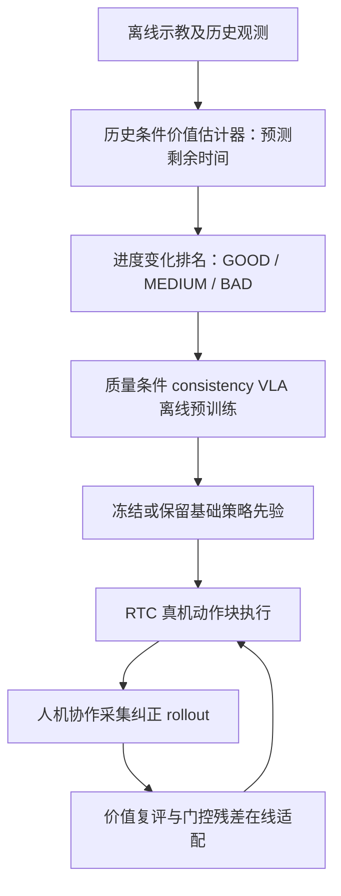
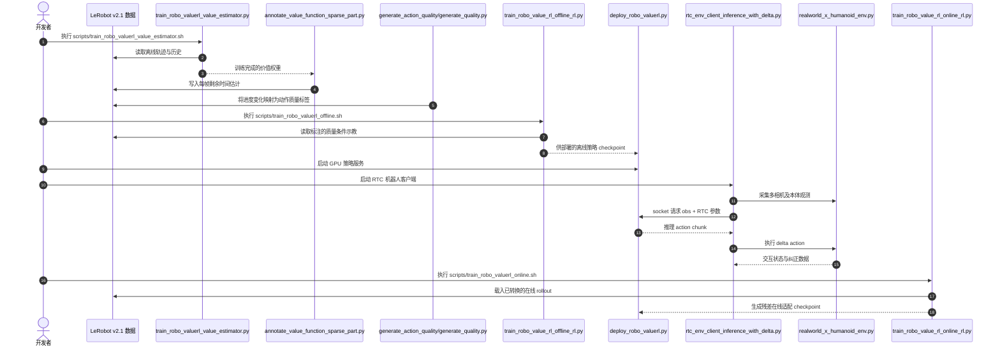

# Robo-ValueRL：可靠价值引导的离线到在线机器人强化学习

## 一句话定义

**用历史条件价值函数评估示教动作的真实进度，并把价值可靠性贯穿离线数据筛选和真机残差微调，实现从杂质示教到高精度操作的持续改进。** 论文：[arXiv:2607.09866](https://arxiv.org/abs/2607.09866)。

## 英文缩写速查

| 缩写 | 英文全称 | 简要说明 |
|---|---|---|
| VLA | Vision-Language-Action | 视觉-语言-动作策略，此处基于 π₀/π₀.₅ 系实现 |
| RL | Reinforcement Learning | 依据价值信号改善离线与在线策略 |
| RTC | Real-Time Chunking | 真机推理与动作块异步衔接 |
| BC | Behavior Cloning | 对照方法，对示教片段赋予同等训练权重 |
| OOD | Out-of-Distribution | 未见状态和对象分布 |

## 为什么重要

- 真机演示里的停顿、试错和纠正动作混杂；单纯扩充示教集容易模仿无效行为，尤其毫米级插装。
- 部分观测下，仅凭当前图像无法可靠判断任务进度；历史条件估值可区分“正在接近完成”与“在原地调整”。
- 在线训练不必全面覆盖既有 VLA：门控残差只在关键失败状态接入，保护已学会的常规动作。

## 核心原理

1. **估值：** 用历史图像/机器人状态回归剩余完成时间；评估全局进度相关性和局部偏好准确性。
2. **质量标注：** 计算动作块内预测剩余时间的下降，排序得到 GOOD / MEDIUM / BAD 片段；严格与宽松阈值须按任务选择。
3. **离线策略：** 在异质演示上训练质量条件 consistency 策略，避免对有问题的片段一视同仁。
4. **在线适配：** 真机 RTC 收集带人工干预的 rollout，重新评估高质量段；用门控残差校正插入/定位等困难动作。

### 流程总览

## 源码运行时序图

官方完整 [代码仓](https://github.com/Open-X-Humanoid/Robo-ValueRL) 的实际命令/脚本对应 [源码归档](../../sources/repos/robo-valuerl.md)；下图区分训练与在线部署：

## 工程实践

| 关键项 | 论文/源码给出的做法 |
|---|---|
| 机构 | 中国人民大学；北京人形机器人创新中心；北京林业大学；北京大学；微软亚洲研究院 |
| 实验 | 天工双臂真机，头部和左右腕部三个相机 |
| 数据 | LeRobot v2.1；需携带 remain_time 和 quality 字段 |
| 复现 | 先下载 [Hugging Face 数据/模型](https://huggingface.co/collections/X-Humanoid/robo-valuerl)，按仓库 README 的四阶段运行 |
| 计算 | 论文仓库配置：训练 8×A100，单 RTX 4090 推理（不是最低需求证明） |
| 开源 | **已开源**：价值函数、标注、离线训练、RTC 策略服务/机器人客户端、在线适配脚本 |

## 实验与评测

- **精密芯片插入：** 严格价值引导的离线策略成功率 **46%**，三轮各 500 条在线 rollout 后升至 **86%**（论文 §4.3）。
- **积木拆解：** 最终报告 **84%** 成功率；更宽松的价值选择较适合长段操作，不可将芯片插入的阈值直接套用。
- **消融：** 与无历史价值、普通 BC、DAgger 比较；价值可靠性影响筛选质量，过严会把简单抓取和调整动作一起过滤。

## 结论

**Robo-ValueRL 的实质创新是让“估值准确”成为数据质量与真机迭代的共同门控，而不是只给策略加一个 critic。**

1. **先检验价值可靠性**：失真的价值会错误剔除有用的动作块。
2. **质量阈值按任务选**：芯片插入更需要严格筛选，长时拆解更需要行为多样性。
3. **关键状态才加残差**：降低在线修改对基础 VLA 熟练动作的破坏。
4. **在线性能须按轮次报告**：86% 是三轮采样更新结果，不能当零样本能力。
5. **复现有真实硬件门槛**：公开代码不意味着无需多相机、干预或多卡计算。

## 与其他工作对比

- [SafeDojo](./paper-safedojo.md) 在交互式世界模型中用碰撞代价约束 RL；Robo-ValueRL 主要以任务进度价值驱动筛选，**并不提供碰撞硬安全证明**。
- [RL 与策略优化](../methods/reinforcement-learning.md) 的常规离在线算法侧重回报和策略更新；本框架强调价值预测的可辨识性和数据再标注。
- [Action Chunking](../methods/action-chunking.md) 与 RTC 解决动作的时间执行组织，和价值引导是两个正交轴。

## 局限与风险

- 依赖特定任务的进度估计和高质量干预，价值函数有偏会传播到筛选和更新。
- 真机主要在双臂与指定任务上验证，跨机器人/通用工业任务效果未经证明。
- 价值优先的动作质量标签不是满足力、碰撞、关节限位的控制安全约束。

## 关联页面

- [SafeDojo：世界模型训练期安全](./paper-safedojo.md)
- [强化学习](../methods/reinforcement-learning.md)
- [VLA](../methods/vla.md)
- [动作分块](../methods/action-chunking.md)

## 参考来源

- [论文全文核对归档](../../sources/papers/robo_value_rl_arxiv_2607_09866.md)
- [官方项目页核查](../../sources/sites/robo-valuerl-project.md)
- [官方仓库源码入口](../../sources/repos/robo-valuerl.md)

## 推荐继续阅读

- [论文 HTML](https://arxiv.org/html/2607.09866)；[官方代码](https://github.com/Open-X-Humanoid/Robo-ValueRL)；[项目主页](https://gewu-lab.github.io/Robo-ValueRL/)
