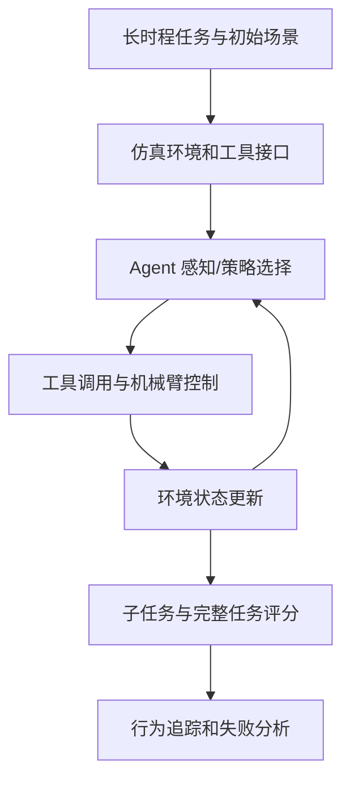
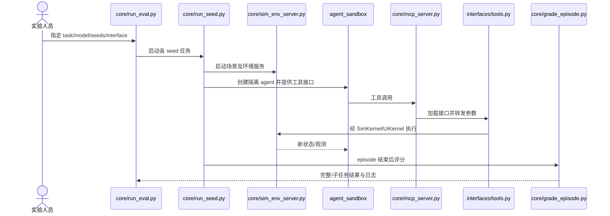

# RoboARCade：智能体式机器人控制评测

## 一句话定义

面向 22 个长时程操作任务的 agentic robot control 评测，提供模拟器、工具接口、分步打分与可运行开放代码。

## 英文缩写速查

| 缩写 | 英文全称 | 简要说明 |
|---|---|---|
| VIA | Visual Interface Agent | 图形界面操作接口 |
| RGB-D | Red-Green-Blue plus Depth | 多视角彩色与深度观测 |
| MCP | Model Context Protocol | agent 与仿真控制工具的接口 |
| EGL | Embedded-System Graphics Library | 无界面 GPU 图形上下文 |

## 为什么重要

- 低层控制任务成功率不能全面体现长时程机器人智能体在策略选择、工具调用、恢复与精密执行中的失败。
- 将完整任务按可验证子目标评分，有利于区分 agent 计划失败和执行器无法完成动作的问题。

## 核心原理（方法）

1. **任务：** 22 个长时程仿真操作场景，涵盖多个机械臂构型；同时提供 RGB-D 与视觉交互接口。
2. **运行：** 每个 seed 创建独立仿真与沙箱 agent，以接口工具调用机器人能力；在固定预算内记录轨迹和子任务完成。
3. **测量：** 除完整任务结果，还统计可验证子目标进度、费用、工具调用行为；实验研究零样本及自主改进设定。

## 项目流程图

## 工程实践

- 官方 README 给出的最小执行：安装 EGL/Bubblewrap 等，`bash scripts/setup.sh`、`source set_env.sh`、`python -m core.run_eval --model MODEL_ID --seeds 1`。
- 依次核对 core/run_eval.py、core/run_seed.py、core/mcp_server.py、core/grade_episode.py；默认 setup 需资源和 provider key，不是无凭据的离线评测。
- 复现需固定任务、seed、接口模式、模型、推理预算与评分规则，不能直接只比较总 token 或单次成功。

## 实验与评测

- 项目公开榜单给出的较强组合子任务完成率约 49.8%；**子任务成功率不是整任务成功率**，也不是所有模型的均值。
- 论文指出策略选择与精密执行仍为主要瓶颈；结果需按模型、工具界面、预算和失败类别分解。

## 与其他工作对比

- 与以单步抓取成败为中心的低层基准不同，RoboARCade 显式评价多步骤工具选择与动作执行。
- 与真实机器人评测不同，这里主要在 MuJoCo 仿真中运行，接口与资产限制需单独说明。

## 结论

**面向 22 个长时程操作任务的 agentic robot control 评测，提供模拟器、工具接口、分步打分与可运行开放代码。**

1. 报告 49.8% 时必须加上 subtask completion 的指标名称。
2. 至少同时报告任务完成、子任务进度、失败类别与成本。
3. 用 oracle/接口对照区分推理错误和低层执行困难。

## 局限与风险

- 模拟器任务与真实硬件接触、视觉和延迟分布有差异。
- 模型订阅/API 预算、接口工具可用性会影响重复评测，资产可能受其他许可约束。

## 源码运行时序图

下图按公开官方 README 与执行入口源码的职责组织；未进行实际 GPU 环境复现。

## 关联页面

- [manipulation ](../tasks/manipulation.md)
- [vla ](../methods/vla.md)
- [paper-oopsierecover ](./paper-oopsierecover.md)

## 参考来源

- [原始论文资料核验归档](../../sources/papers/roboarcade_arxiv_2611_08209.md)
- [官方项目页开放状态归档](../../sources/sites/roboarcade.md)
- [官方源码入口核查](../../sources/repos/satvik1701_roboarcade.md)
- [arXiv HTML v1](https://arxiv.org/html/2611.08209v1)

## 推荐继续阅读

- [官方项目主页](https://roboarcade.org/)
- [官方开源代码](https://github.com/Satvik1701/RoboARCade)

