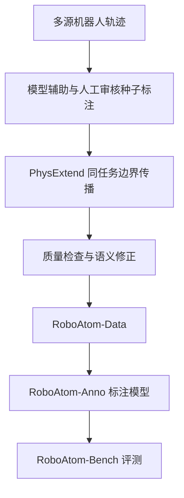
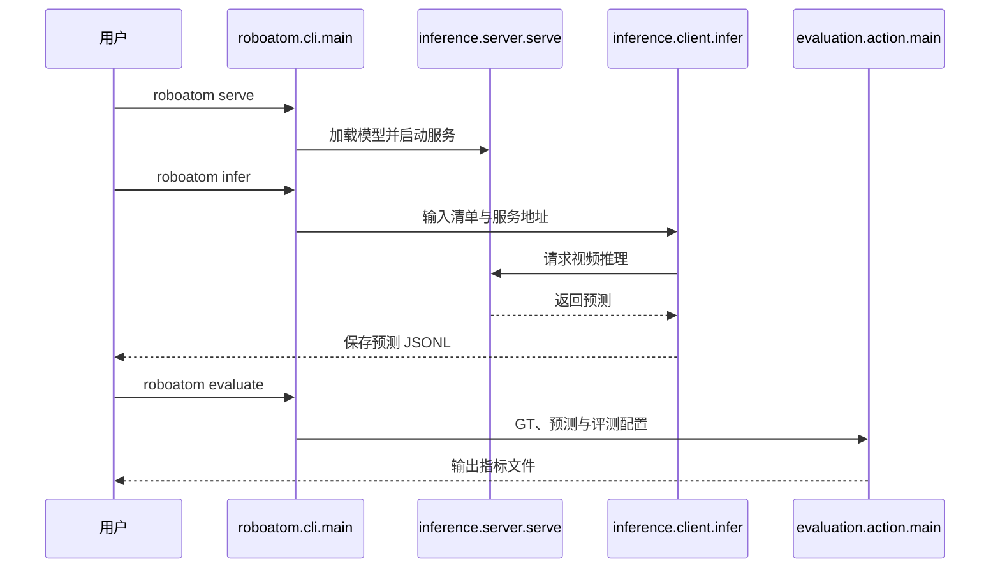

# RoboAtom：面向机器人学习的大规模原子动作监督

**RoboAtom**（*RoboAtom: Large-scale Atomic-Action Supervision for Robot Learning*，[arXiv:2610.40207](https://arxiv.org/abs/2610.40207)）收录于 senlanke「具身运控lab」10-26–10-30 前沿论文动态（Manipulation）。本页正在补充官方资料；论文全文及必要源码尚未完整核读，仍需继续核验。

## 一句话定义

**RoboAtom：面向机器人学习的大规模原子动作监督——构建 RoboAtom-Data 和 RoboAtom-Bench，使用原子动作表示组织机器人操作数据。结合人工标注、自动标注和同任务扩展机制生成细粒度监督，并研究这些标注如何用于机器人领域预训练、监督微调和策略执行。**

## 英文缩写速查

| 缩写 | 英文全称 | 简要说明 |
|------|----------|----------|
| VLA | Vision-Language-Action | 视觉–语言–动作模型 |
| IL | Imitation Learning | 模仿学习 |
| DTW | Dynamic Time Warping | 动态时间规整，用于轨迹对齐 |

## 为什么重要

- 周报所述待解决的问题：大规模机器人数据通常只包含整段任务指令，缺少细粒度动作语义和任务阶段标注，不利于策略学习动作组合与长程执行。

## 核心机制

| 项 | 内容 |
|----|------|
| **arXiv** | [2610.40207](https://arxiv.org/abs/2610.40207) · [PDF](https://arxiv.org/pdf/2610.40207) |
| **作者（arXiv）** | Wei, Xueyuan, Wang, Xuanxu, Li, Xudong, He, Yuping, Gan, Wanshui, Peng, Jiaqi, Guo, Wenqi, Zhou, Jianjun et al. |
| **机构（周报所述，未逐条核实）** | 上海人工智能实验室、浙江大学、复旦大学、清华大学、上海交通大学。 |
| **arXiv 评论栏** | （无） |
| **开源** | 官方已发布 [代码](https://github.com/InternRobotics/RoboAtom)、[数据](https://huggingface.co/datasets/InternRobotics/RoboAtom)和[模型](https://huggingface.co/InternRobotics/RoboAtom)入口；公开范围见数据卡 |
| **周报所述创新点** | 构建 RoboAtom-Data 和 RoboAtom-Bench，使用原子动作表示组织机器人操作数据。结合人工标注、自动标注和同任务扩展机制生成细粒度监督，并研究这些标注如何用于机器人领域预训练、监督微调和策略执行。 |

### arXiv 摘要节选（英文原文）

> Fine-grained action annotations can support skill reuse and compositional generalization in robot policies. However, robot datasets typically provide task-level instructions without subtask annotations.

## 项目流程总览

论文的原子动作包含共享技能类别、物体相关描述和起止帧。PhysExtend 依赖同任务已知且一致的技能顺序，以状态和动作信号定位边界；它不能单凭视频推断未知动作顺序。

## 源码运行时序图

入口和分发依据 `pyproject.toml` 与 `src/roboatom/cli.py`；客户端逐行读取输入并 POST 至 `/predict`；服务加载 Segmenter 并返回预测。

## 实验与评测

- 论文报告完整归档含 1,446,974 条轨迹、6,876,282 个技能片段、16,882.1 小时；官方 README 指公开标注覆盖 12 个数据集，不能将论文总量直接等同公开子集。
- RoboAtom-Bench 包含 500 条轨迹、4,018 个真值片段；PhysExtend 单参考 Skill F1@0.7 为 71.0，Cortex 为 48.5（论文表 2）。
- 论文表 4 中 LIBERO-Long 成功率由 95.0% 提升至 98.2%；此比较同时改变原子动作条件训练和分层执行，不能单独归因于其中一项。
- 读法：先对齐任务设定、传感器与成功定义（仿真/真机），再解读 headline 数字，勿跨论文直接比较。

## 与其他工作对比

| 维度 | 读法 |
|------|------|
| **同周对照** | 见 [Manipulation周报技术地图](../overview/senlanke-weekly-2026-10-26-30-manipulation-technology-map.md)，按方向浏览同期论文 |
| **开源状态** | 代码、数据与模型有官方发布入口；各数据来源许可及公开范围需分别核对 |

## 结论

**RoboAtom：面向机器人学习的大规模原子动作监督。**

1. 本页是入库级摘要，复现前请核对论文正文、附录与代码仓库。
2. 指标须连同实验条件解读。
3. 论文尚未验证原子动作监督在大规模策略预训练中的作用；第一视角人类视频尚未纳入。

## 关联页面

- [senlanke-weekly-2026-10-26-30-manipulation-technology-map](../overview/senlanke-weekly-2026-10-26-30-manipulation-technology-map.md)
- [manipulation](../tasks/manipulation.md)
- [vla](../methods/vla.md)

## 参考来源

- [官方项目页归档](../../sources/sites/roboatom.md)
- [官方代码归档](../../sources/repos/roboatom.md)

- [roboatom-atomic-action-supervision_arxiv_2610_40207.md](../../sources/papers/roboatom-atomic-action-supervision_arxiv_2610_40207.md)
- [wechat_senlanke_weekly_manipulation_2026-10-26_30.md](../../sources/blogs/wechat_senlanke_weekly_manipulation_2026-10-26_30.md)
- [arXiv:2610.40207](https://arxiv.org/abs/2610.40207)

## 推荐继续阅读

- [arXiv PDF](https://arxiv.org/pdf/2610.40207)
