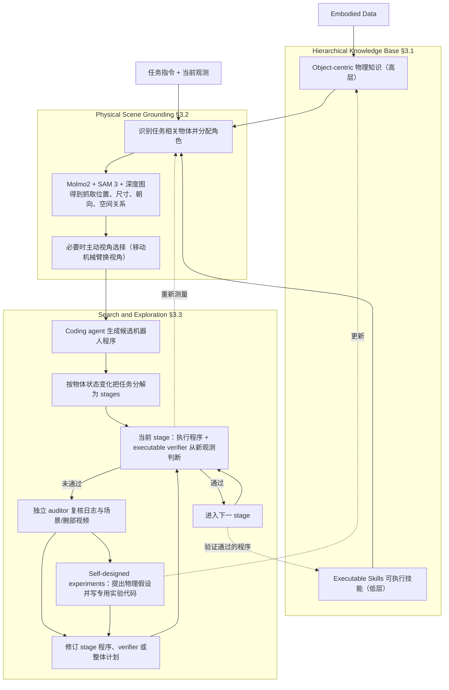

# RoboAuto（arXiv:2610.36533）

**RoboAuto**（*RoboAuto: Autonomous Robot Program Search through Multi-Level Physical Understanding*，[arXiv:2610.36533](https://arxiv.org/abs/2610.36533)，[项目页](https://roboauto-ai.github.io/)）来自 [具身智能小站 2026-10-28 盘点](../../sources/blogs/wechat_embodied_station_59_papers_human_video_to_robot_experience_2026-10-28.md)，属「VLA 与策略后训练」组。

## 一句话定义

**围绕物体、场景与交互建立分层知识和场景落地机制，通过自设计实验检查阶段效果。**

## 英文缩写速查

| 缩写 | 英文全称 | 简要说明 |
|------|----------|----------|
| RoboAuto | RoboAuto: Autonomous Robot Program Search through Multi-Level Physical Understanding | 本文方法 / 基准的简称 |

## 为什么重要

- 让程序搜索主动检验物理假设。跨多个操作基准评估，启发是把执行反馈变成可验证的物理假设，而非只改代码。
- 开源结论：**待发布**（步骤 2.5，2026-10-28）。项目页 HTTP 200，未列 GitHub，页面含 soon 字样（脚本扫描）。
- 同期同组工作见 [潜在动作、免渲染事件仿真与机器人评测：具身智能小站 10-28 期 59 篇阅读坐标](../overview/embodied-station-2026-10-28-59-papers-technology-map.md)。

## 流程总览

图依据：论文 §3 / §3.1 / §3.2 / §3.3 / Fig.2

## 核心机制

| 项 | 内容 |
|----|------|
| **arXiv** | [2610.36533](https://arxiv.org/abs/2610.36533) |
| **开源** | **待发布** |
| **要点** | 围绕物体、场景与交互建立分层知识和场景落地机制，通过自设计实验检查阶段效果。 |
| **文内指标** | 公众号转述：跨多个操作基准评估，启发是把执行反馈变成可验证的物理假设，而非只改代码。 |

## 源码运行时序图

**不适用（待发布）** — 项目页 HTTP 200，未列 GitHub，页面含 soon 字样（脚本扫描）。 不编造运行脚本；代码公开后再补。

## 实验与评测

- 公众号转述：跨多个操作基准评估，启发是把执行反馈变成可验证的物理假设，而非只改代码。
- **读法：** 本页为索引级摘要，依据公众号转述的官方摘要与仓库信息整理；逐项数字与 baseline 以原文 PDF 为准。

## 与其他工作对比

- 横向索引见 [潜在动作、免渲染事件仿真与机器人评测：具身智能小站 10-28 期 59 篇阅读坐标](../overview/embodied-station-2026-10-28-59-papers-technology-map.md)；同 arXiv 不重复造页。

## 结论

**让程序搜索主动检验物理假设：跨多个操作基准评估，启发是把执行反馈变成可验证的物理假设，而非只改代码。**

1. 开源边界：**待发布** — 项目页 HTTP 200，未列 GitHub，页面含 soon 字样（脚本扫描）。
2. 核心机制：围绕物体、场景与交互建立分层知识和场景落地机制，通过自设计实验检查阶段效果。
3. 复现与选型前核对任务协议、硬件与基准口径，勿直接横比公众号摘录数字。

## 关联页面

- [vla](../methods/vla.md)
- [imitation-learning](../methods/imitation-learning.md)
- [reinforcement-learning](../methods/reinforcement-learning.md)
- [embodied-station-2026-10-28-59-papers-technology-map](../overview/embodied-station-2026-10-28-59-papers-technology-map.md)

## 参考来源

- [roboauto_arxiv_2610_36533.md](../../sources/papers/roboauto_arxiv_2610_36533.md)
- [wechat_embodied_station_59_papers_human_video_to_robot_experience_2026-10-28.md](../../sources/blogs/wechat_embodied_station_59_papers_human_video_to_robot_experience_2026-10-28.md)
- [arXiv:2610.36533](https://arxiv.org/abs/2610.36533)
- [arXiv PDF](https://arxiv.org/pdf/2610.36533)：已通读方法部分（实验与附录以略读为准）：§1 引言、§3 方法（3.1–3.3）、Fig.1/2

## 推荐继续阅读

- [arXiv PDF](https://arxiv.org/pdf/2610.36533)
- [项目页](https://roboauto-ai.github.io/)
