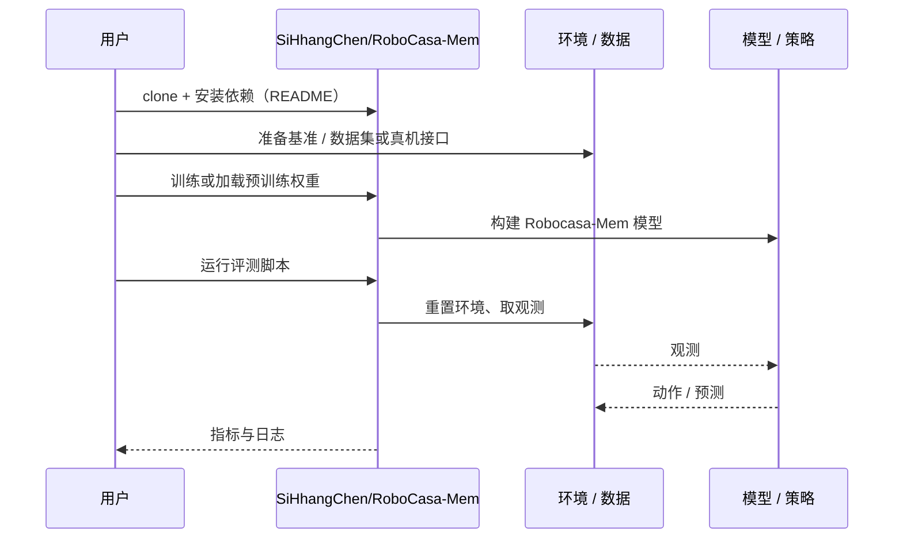

# Robocasa-Mem（arXiv:2611.06475）

**Robocasa-Mem**（*Robocasa-Mem: Benchmarking Environment and Process Memory in Long-Horizon Mobile Manipulation*，[arXiv:2611.06475](https://arxiv.org/abs/2611.06475)，[项目页](https://sihhangchen.github.io/RoboCasa-Mem/)，[代码](https://github.com/SiHhangChen/RoboCasa-Mem)）来自 [具身智能小站 2026-11-06 盘点](../../sources/blogs/wechat_embodied_station_20_papers_curobov2_fast_halo_humanwam_2026-11-06.md)，属「导航与闭环评测」组。

## 一句话定义

**后半程的正确目标由机器人先前的选择决定。**

## 英文缩写速查

| 缩写 | 英文全称 | 简要说明 |
|------|----------|----------|
| Robocasa-Mem | Robocasa-Mem: Benchmarking Environment and Process Memory in Long-Horizon Mobile Manipulation | 本文方法 / 基准的简称 |

## 为什么重要

- 杯子该放回哪里，由机器人先前的动作决定。九项厨房仿真任务中，记录物体和任务进度的分层策略平均成功率为 24%，作为基线的 π₀.₅ 为 16%。
- 开源结论：**已开源**（步骤 2.5，2026-11-06）。资源入口 SiHhangChen/RoboCasa-Mem 经 git ls-remote 可达；项目页 Models 按钮标 coming soon（模型权重未发布）。
- 同期同组工作见 [按路段调速的规划、虚拟房间到真机的人形动作与人类视频缩放：具身智能小站 11-06 期 20 篇阅读坐标](../overview/embodied-station-2026-11-06-20-papers-technology-map.md)。

## 核心机制

| 项 | 内容 |
|----|------|
| **arXiv** | [2611.06475](https://arxiv.org/abs/2611.06475) |
| **开源** | **已开源** |
| **要点** | 后半程的正确目标由机器人先前的选择决定。 |
| **文内指标** | 公众号转述：九项厨房仿真任务中，记录物体和任务进度的分层策略平均成功率为 24%，作为基线的 π₀.₅ 为 16%。 |

## 源码运行时序图

以下为按仓库入口（`SiHhangChen/RoboCasa-Mem`）推断的通用运行链路；入库日仅核实仓库可达，未逐文件阅读，具体脚本名以 README 为准。

## 实验与评测

- 公众号转述：九项厨房仿真任务中，记录物体和任务进度的分层策略平均成功率为 24%，作为基线的 π₀.₅ 为 16%。
- **读法：** 本页为索引级摘要，依据公众号转述的官方摘要与仓库信息整理；逐项数字与 baseline 以原文 PDF 为准。

## 与其他工作对比

- 横向索引见 [按路段调速的规划、虚拟房间到真机的人形动作与人类视频缩放：具身智能小站 11-06 期 20 篇阅读坐标](../overview/embodied-station-2026-11-06-20-papers-technology-map.md)；同 arXiv 不重复造页。

## 结论

**杯子该放回哪里，由机器人先前的动作决定：九项厨房仿真任务中，记录物体和任务进度的分层策略平均成功率为 24%，作为基线的 π₀.₅ 为 16%。**

1. 开源边界：**已开源** — 资源入口 SiHhangChen/RoboCasa-Mem 经 git ls-remote 可达；项目页 Models 按钮标 coming soon（模型权重未发布）。
2. 核心机制：后半程的正确目标由机器人先前的选择决定。
3. 复现与选型前核对任务协议、硬件与基准口径，勿直接横比公众号摘录数字。

## 关联页面

- [simulation-evaluation-infrastructure](../concepts/simulation-evaluation-infrastructure.md)
- [vision-language-navigation](../tasks/vision-language-navigation.md)
- [manipulation](../tasks/manipulation.md)
- [embodied-station-2026-11-06-20-papers-technology-map](../overview/embodied-station-2026-11-06-20-papers-technology-map.md)

## 参考来源

- [robocasa_mem_arxiv_2611_06475.md](../../sources/papers/robocasa_mem_arxiv_2611_06475.md)
- [wechat_embodied_station_20_papers_curobov2_fast_halo_humanwam_2026-11-06.md](../../sources/blogs/wechat_embodied_station_20_papers_curobov2_fast_halo_humanwam_2026-11-06.md)
- [arXiv:2611.06475](https://arxiv.org/abs/2611.06475)

## 推荐继续阅读

- [arXiv PDF](https://arxiv.org/pdf/2611.06475)
- [项目页](https://sihhangchen.github.io/RoboCasa-Mem/)
- [https://github.com/SiHhangChen/RoboCasa-Mem](https://github.com/SiHhangChen/RoboCasa-Mem)
