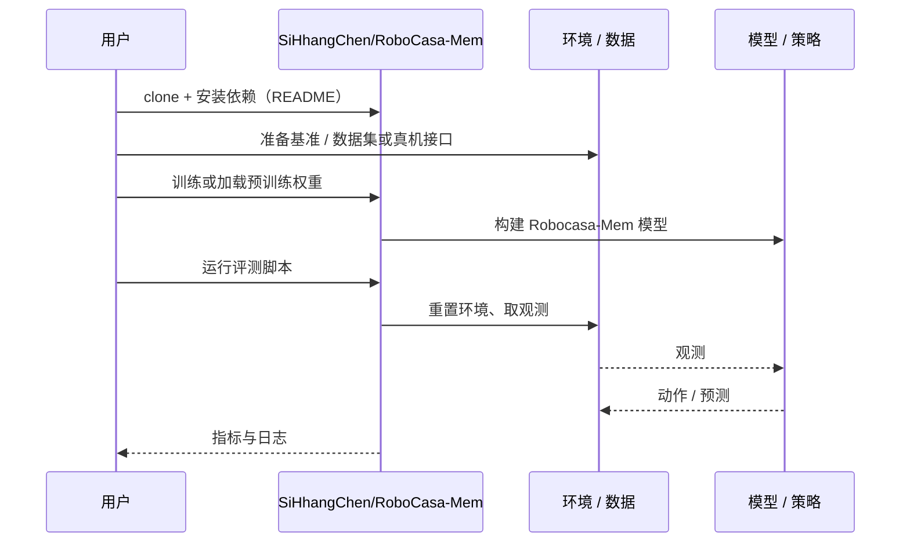

# Robocasa-Mem（arXiv:2611.06475）

**Robocasa-Mem**（*Robocasa-Mem: Benchmarking Environment and Process Memory in Long-Horizon Mobile Manipulation*，[arXiv:2611.06475](https://arxiv.org/abs/2611.06475)，[项目页](https://sihhangchen.github.io/RoboCasa-Mem/)，[代码](https://github.com/SiHhangChen/RoboCasa-Mem)）来自 [具身智能小站 2026-11-06 盘点](../../sources/blogs/wechat_embodied_station_20_papers_curobov2_fast_halo_humanwam_2026-11-06.md)，属「导航与闭环评测」组。

## 一句话定义

**后半程的正确目标由机器人先前的选择决定。**

## 英文缩写速查

| 缩写 | 英文全称 | 简要说明 |
|------|----------|----------|
| Robocasa-Mem | Robocasa-Mem: Benchmarking Environment and Process Memory in Long-Horizon Mobile Manipulation | 本文方法 / 基准的简称 |

## 为什么重要

- 杯子该放回哪里，由机器人先前的动作决定。九项厨房仿真任务中，记录物体和任务进度的分层策略平均成功率为 24%，作为基线的 π₀.₅ 为 16%。
- 开源结论：**已开源**（步骤 2.5，2026-11-06）。资源入口 SiHhangChen/RoboCasa-Mem 经 git ls-remote 可达；项目页 Models 按钮标 coming soon（模型权重未发布）。
- 同期同组工作见 [按路段调速的规划、虚拟房间到真机的人形动作与人类视频缩放：具身智能小站 11-06 期 20 篇阅读坐标](../overview/embodied-station-2026-11-06-20-papers-technology-map.md)。

## 核心机制

| 项 | 内容 |
|----|------|
| **arXiv** | [2611.06475](https://arxiv.org/abs/2611.06475) |
| **开源** | **已开源** |
| **要点** | 后半程的正确目标由机器人先前的选择决定。 |
| **文内指标** | 公众号转述：九项厨房仿真任务中，记录物体和任务进度的分层策略平均成功率为 24%，作为基线的 π₀.₅ 为 16%。 |

## 源码运行时序图

以下为按仓库入口（`SiHhangChen/RoboCasa-Mem`）推断的通用运行链路；入库日仅核实仓库可达，未逐文件阅读代码，具体脚本名以 README 为准。

## 实验与评测

依据论文全文（Table 3–5、附录 D）：

| 方法 | 平均 SR | 平均 SCR |
|------|--------|---------|
| HMAP | 0.24 | 0.47 |
| π₀.₅ | 0.16 | 0.41 |
| MemER-style | 0.02 | 0.25 |
| DP | 0.02 | 0.14 |
| ACT | 0.00 | 0.16 |

- **环境记忆收益最明显：** TempReport SR 0.22→0.86（条件回忆正确率 0.41→0.90）；SweetCup 选对加糖杯条件率 0.22→0.45；PutBackCup 0.68→0.70、MilkMatch 0.12→0.16 提升有限；CanRecall 全部方法 SR 为 0。
- **过程记忆不稳定：** SugarCount 与 π₀.₅ 同为 0.28，DrawerSearch 0.08 反低于 π₀.₅ 的 0.12；HeatAndInspect、FillAndRetrieve 无任何方法完成（HeatAndInspect SCR 0.32→0.50）。
- **真机：** AgileX Cobot Magic 物体搬运（100 条示范，各 10 次），选对目标容器 HMAP 8/10，π₀.₅ 2/10。
- **消融（SingleMilkMatch 终端成功率）：** π₀.₅ 0.20 → +规划器 0.34 → +VGGT-Ω 0.40 → 完整 0.46；规划器管目标选择，几何调制改善执行。

## 工程实践

- **数据与接口：** 20 Hz；三路 224×224 RGB（左右外置 + 腕部）、37 维状态、13 维动作（7 关节 + 夹爪 + 3 底盘 + 躯干 + 模式位）；原始 HDF5，转 LeRobot 格式；成功 / 终止标志不进策略输入。示范由 MPLib + 闭环底盘导航的规则专家生成，经谓词验证并抽 180 条做动作回放审计。
- **训练：** 批大小 48；ACT/DP 40k 步；π₀.₅/HMAP 20k 或 30k 步（视任务）；规划器重规划间隔 40 控制步（部分任务）。优化器、LoRA 配置、checkpoint 选择论文自述待补，复现需以仓库为准。
- **对照设置：** MemER-style 与 HMAP 共用同一 Qwen3-VL-4B 与低层骨干，仅高层记忆训练不同。
- **开源：** 代码与数据（ModelScope）已公开，模型权重项目页标 coming soon。

## 局限

- 以仿真为主，真机仅 1 个任务、每方法 10 次，结论不外推到更广真实场景。
- 五类记忆不穷尽；数据仅含成功专家示范。
- 阶段指标无法完全区分记忆错误与执行错误；SugarCount 各阶段适用 episode 不同，SCR 口径不齐。
- HMAP 未解决过程记忆：两个交错调度任务无人完成，进度追踪与任务切换 / 恢复仍是开放问题；绝对成功率仅 24%。
- 训练超参数披露不全，FillAndRetrieve 训练预算未给出。

## 与其他工作对比

- 横向索引见 [按路段调速的规划、虚拟房间到真机的人形动作与人类视频缩放：具身智能小站 11-06 期 20 篇阅读坐标](../overview/embodied-station-2026-11-06-20-papers-technology-map.md)；同 arXiv 不重复造页。

## 结论

**杯子该放回哪里，由机器人先前的动作决定：九项厨房仿真任务中，记录物体和任务进度的分层策略平均成功率为 24%，作为基线的 π₀.₅ 为 16%。**

1. 开源边界：**已开源** — 资源入口 SiHhangChen/RoboCasa-Mem 经 git ls-remote 可达；项目页 Models 按钮标 coming soon（模型权重未发布）。
2. 核心机制：后半程的正确目标由机器人先前的选择决定。
3. 复现与选型前核对任务协议、硬件与基准口径，勿直接横比公众号摘录数字。

## 关联页面

- [simulation-evaluation-infrastructure](../concepts/simulation-evaluation-infrastructure.md)
- [vision-language-navigation](../tasks/vision-language-navigation.md)
- [manipulation](../tasks/manipulation.md)
- [embodied-station-2026-11-06-20-papers-technology-map](../overview/embodied-station-2026-11-06-20-papers-technology-map.md)
- [具身大模型评测基准选型闭环](../queries/embodied-eval-benchmark-selection-loop.md) — 归其 ③ 策略任务成功率层：RoboCasa 厨房仿真的记忆依赖任务，测的是长程记忆而非单步操作

## 参考来源

- [robocasa_mem_arxiv_2611_06475.md](../../sources/papers/robocasa_mem_arxiv_2611_06475.md)
- [wechat_embodied_station_20_papers_curobov2_fast_halo_humanwam_2026-11-06.md](../../sources/blogs/wechat_embodied_station_20_papers_curobov2_fast_halo_humanwam_2026-11-06.md)
- [arXiv:2611.06475](https://arxiv.org/abs/2611.06475)

## 推荐继续阅读

- [arXiv PDF](https://arxiv.org/pdf/2611.06475)
- [项目页](https://sihhangchen.github.io/RoboCasa-Mem/)
- [https://github.com/SiHhangChen/RoboCasa-Mem](https://github.com/SiHhangChen/RoboCasa-Mem)
