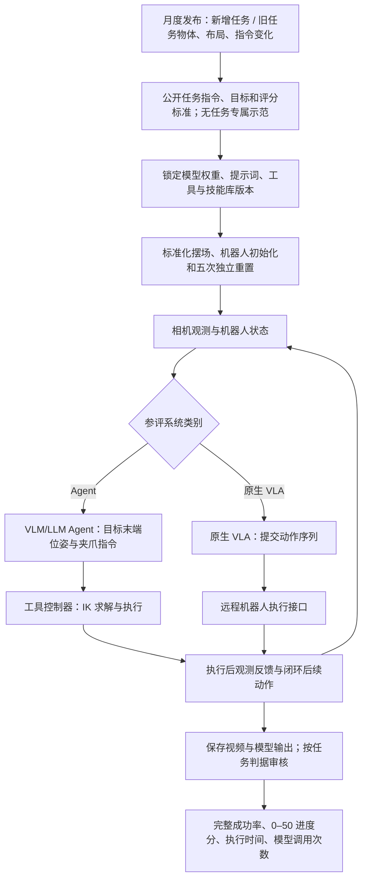

# RoboChallenge Zero：持续演化的真机零样本评测基准 / A Continually Evolving Benchmark for Zero-Shot Evaluation on Real Robots

## 一句话定义

**RoboChallenge Zero**（*A Continually Evolving Benchmark for Zero-Shot Evaluation on Real Robots*）是 RoboChallenge 面向**新任务及旧任务条件变化**的月度真机零样本操作评测：锁定被测具身系统版本，直接观察它能否在不提供任务特定示范或微调的前提下完整完成任务，并单独统计部分进度与执行成本。

## 英文缩写速查

| 缩写 | 英文全称 | 简要说明 |
|---|---|---|
| VLA | Vision-Language-Action | 将观测与指令直接映射到机器人动作的原生策略类别 |
| VLM | Vision-Language Model | 使用视觉模型理解状态并规划动作的 Agent 类别 |
| LLM | Large Language Model | 使用语言推理与工具调用组合机器人技能的 Agent 类别 |
| RGB-D | Red, Green, Blue + Depth | 真机观察用彩色与深度相机 |
| IK | Inverse Kinematics | Agent 指定末端目标位姿后控制器求逆运动学执行 |
| OOD | Out-of-Distribution | 泛化至训练与开发阶段未见条件；不能与本协议名词直接等同 |

## 为什么重要

传统固定任务集能追踪优化，但成绩增长可能同时包含模型通用能力提升与针对熟悉任务的工程适配。RoboChallenge Zero 通过**月度新增任务 + 改变既有任务的物体、布局和指令**，专门考察固定系统版本在陌生真实物理条件下的泛化。它与稳定任务集的 Table30 V2 **互补而非共用榜单**（PDF 表 1，p.2）。

## 核心机制：评测协议

### 任务、提交与版本

1. **发布任务与评判标准**：指令和成功判据公开，但不提供任务专属训练示范；提交者预期未对这些基准任务训练或微调。严格零样本协议下原则上避免任务定制 prompt、在线参数更新与人工指导。
2. **支持不同完整系统**：原生 VLA、VLM/LLM Agent、或融合感知、记忆、规划、技能与控制器的集成系统可参加；共同看实际任务结果，比较时要标记系统类别和可用工具。
3. **锁定系统版本**：模型权重、prompt、工具或技能库改变，都算**新的系统版本**；可让同一系统版本连续参加多个月度 release，观察泛化变化。
4. **真机复测**：每个系统每项任务独立运行 **5 次**，每次重置机器人与场景；硬件/基础设施引起的异常失败可以重跑。
5. **报告边界**：只在**同一 release** 的任务分布上横向比较，不能将不同月份的绝对成功率直接当作统一排名。

### 硬件和控制接口

| 项 | W1 | ARX5 |
|---|---|---|
| 机器人 | 搭载两条 Airbot Play 机械臂和平行夹爪的双臂移动平台 | 台式六自由度机械臂 |
| 视觉 | RealSense 俯视/双腕 RGB-D | RealSense 俯视/腕部 RGB-D，另有侧相机 |
| 首发任务 | T1–T3 | T4–T6 |

在 **VLM/LLM Agent 路径**，系统每步看到影像与机器人状态（可用深度/力矩），通过工具输出末端目标位姿与夹爪指令；控制器利用 IK 执行并返回新观测。单臂任务**最多 40 次**模型调用、双臂**最多 50 次**。在**原生 VLA 路径**，策略通过远程机器人接口提交动作序列；不要把 Agent 的工具调用机制误写成所有参评类别共享的神经网络架构（PDF §2.2，p.2）。

## 流程总览

该图仅抽象 PDF §2 描述的**评测运行协议**，不是对未提供的源码调用链进行假定。

## 评测设置与首发实验

技术报告 §3 使用 **11 个 VLM/LLM Agent、6 项任务、每模型每任务 5 次独立 rollout**，共 **330 次真实机器人测试**。**首发没有原生 VLA 策略的实验结果**；“可提交 VLA”不等于“已有 VLA 排名”。

| 任务 | 主要挑战 | 首发成功率 |
|---|---|---:|
| T1：先推倒矮瓶，再推高瓶 | 高度辨识 + 动作顺序 | 65.45%（36/55） |
| T2：一手按纸、一手写“Z0” | 双臂协调 + 连续精确轨迹 | 7.27%（4/55） |
| T3：解开线缆并平铺无重叠 | 可变形物状态估计 + 接触规划 | 0%（0/55） |
| T4：将较大方块放入盘中 | 大小比较 + 抓取放置 | 89.09%（49/55） |
| T5：把蓝衣玩偶放入盒中 | 颜色属性辨认 + 柔性物抓取 | 61.82%（34/55） |
| T6：移动一根火柴修正算式 | 数学推理 + 精确重排 | 45.45%（25/55） |

### 指标与模型差异

- **完整成功率是主要指标**：整体 **148/330 = 44.85%**；最高的是 **gpt-6.2-astra：21/30（70%）**，其次 **claude-fable-5-2：20/30（66.67%）**（PDF §3.2、图 1，pp.3–4）。
- **部分进度另算**：单次 0–10 分；每项任务将 5 次得分相加（0–50），再对 6 项任务的总分取平均（0–50），**不等于成功率**。图 1 中 gemini-4-neon 进度分 **37.50/50**，而 gpt-6.2-astra 为 **35.83/50**。
- **T3 的部分成功不能当完成**：有一次 gemini-4-neon 解开绳结、得到 7/10，但线缆未按要求平铺，仍判失败（§3.4）。
- **效率不合入成功总分**：T2 成功的 4 次平均消耗 **1,735.6k token、23.8 分钟、43.8 次调用**；T4 成功运行平均约 13.8 分钟、479.8k token，显示精细轨迹成本更高（图 6，p.7）。

## 与其他工作对比

| 基准 | 评测对象 | 任务 / 数据边界 | 核心区别 |
|---|---|---|---|
| **RoboChallenge Zero** | 原生 VLA、Agent 与集成系统；首轮结果仅 Agent | 按月新增任务/改变条件，不提供任务特定示范 | 固定系统版本的真机零样本泛化 |
| **Table30 V2** | 通用机器人策略 | 相对稳定的真机操作任务，提供任务示范数据 | 跟踪固定任务集上的迭代进展 |
| [AA-Robotics](./aa-robotics.md) | 编码型 Agent 控制真机单臂 | 8 项桌面任务，代码/HTTP 控制 | 与 Zero 的平台、工具接口和任务数不同，分数不横比 |
| [RoboDojo](./robodojo.md) | 多类真实与仿真操作策略 | 仿真与真机多任务评测 | 更侧重 sim-and-real 统一评测，而 Zero 着重跨月新任务零样本 |

## 结论

**固定任务集高分不能替代零样本真机泛化验收；Zero 的首发结果进一步说明，简单抓放成功不意味着精确轨迹和柔性物体操作可靠。**

1. **先看任务类别再看总分**：T4 为 89.09%，T3 为 0%，跨任务难度差明显大于头尾模型总体成功率差的简单解读。
2. **完成与进度分开记账**：T3 解结但未平铺依旧为失败，不能把中间状态当完整达成。
3. **核对被测系统范围**：本次 11 个结果都是 Agent，不应宣称已测出原生 VLA 的领先型号。
4. **跨月固定版本**：保留权重、prompt、工具和技能库的版本；对不同 release 的绝对分数不直接排序。
5. **同时计入执行成本**：细粒度双臂任务的调用次数、耗时与 token 费用可能很高，不能只看最终成功。
6. **分析真实失败链**：将视觉属性误判、空间几何/避碰、轨迹生成、抓取与物理状态反馈分开记录，不把所有失败归咎于模型推理。

## 工程实践

建议评测记录表至少保留：系统类别和完整版本、任务与 benchmark release、机器人和相机、指令与成功判据、五次独立 rollout 的最终状态/部分进度、时长、调用次数、视频以及基础设施故障重跑标记。开展内部复测时，另记录标定与避碰状态，便于区分感知规划与执行链路错误。

**源码运行时序图：不适用。** 本次已通读的官方 PDF 没有给出可复现的 Zero 专用评测代码入口；2026-11-21 的官方详情页正文未能经公开抓取工具核验。仅可画出论文中描述的执行协议，不能把通用脚本名称伪装成实有源码。

## 局限与风险

- 首轮只有 2 种机器人平台、6 个操作任务、11 个 Agent；对其他本体、开放工厂场景、人形全身控制以及原生 VLA 的成绩不可直接外推。
- 报告虽展示失败案例，但**未隔离**推理模型、相机标定、轨迹生成与碰撞处理对故障率的贡献（§3.5）。
- 任务说明与评分标准公开、每月刷新可缓解**固定测试题过拟合**；不能仅由协议断言所有参评预训练数据都绝无任务污染。
- 2026-11-20 是否为首次公开日期、Zero 专属数据/评测源码是否可下载，尚需核对官网详情页；不由 PDF 文件名或旧版 Table30 材料推断。

### 从接入到评分：分开记录提交系统、任务进度与执行代价

| 审计项 | 首发技术报告所定义的口径 |
|---|---|
| 提交系统（§2.2–2.3） | 原生 VLA、调用工具/技能的 VLM/LLM Agent、组合感知／规划／控制的系统用相同任务目标；首发比较只有 11 个 VLM/LLM Agent，不能说 VLA 已在该报告对照中落败。提示词、工具、技能库或权重改动都算新系统版本。 |
| 进度（§2.4） | 单回合按任务细则 0–10；某任务五回合相加 0–50，六个任务等权平均，整体仍为 0–50。与达成全目标的二值成功率分列；T3 的一次解开线缆但未摆好仍为 7 分、失败。 |
| 代价（§3.4） | 执行时间和模型调用次数分别报告；单臂/双臂预算分别最多 40/50 次调用。API 成本估计用成功回合的 token 和模型价格，不能称作含失败、操作者、硬件的部署总成本；首轮 182 次失败中有 30 次超过 60 分钟。 |

## 关联页面

- [机器人操作任务](../tasks/manipulation.md) — 真机抓放、柔性物与精细操作难点
- [VLA](../methods/vla.md) — 与 Agent 工具调用接口有区别的直接动作策略
- [AA-Robotics](./aa-robotics.md) — 真机 Agent 操控任务与成本对比（非同榜）
- [RoboDojo](./robodojo.md) — 真实与仿真混合策略评测
- [仿真与真机评测差距](../concepts/sim-vs-real-eval-gap.md) — 为什么基准分数需要真实执行验证
- [具身大模型评测基准选型闭环](../queries/embodied-eval-benchmark-selection-loop.md) — Stage 3 任务侧成功率与进度判据
- [具身模型测评纵深路线](../../roadmap/depth-embodied-eval.md) — 如何组织评测与榜单治理

## 参考来源

- [官方技术报告全文归档（含页码）](../../sources/papers/robochallenge_zero_technical_report_2026.md) — RoboChallenge Team，11 页，表 1–2 / 图 1–10
- [官方页面与代码开放性核验记录](../../sources/sites/robochallenge-zero-verification-20261121.md)

## 推荐继续阅读

- [RoboChallenge Zero 官方技术报告 PDF](https://robochallenge.ai/docs/robochallenge_techreport_ZERO.pdf) — §2 协议、§3 首轮结果与 §3.5 局限
- [RoboChallenge Zero 详情页](https://robochallenge.ai/benchmark_detail/zero) — 独立榜单入口，网页正文需复查
- [RoboChallenge Challenges](https://robochallenge.ai/challenges) — 与 Table30 V2 的实际榜单分开查看
