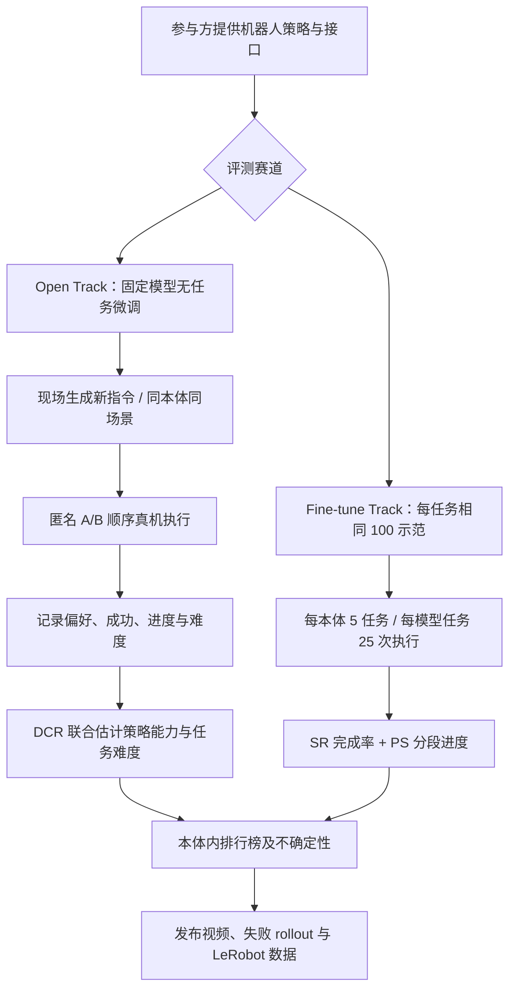
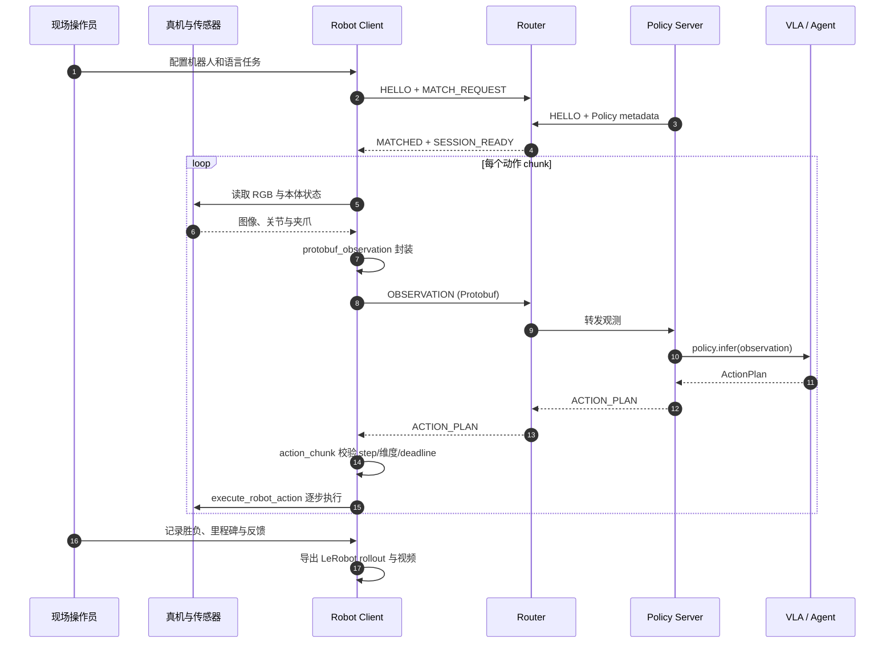

# RoboColosseum：在真实环境中规模化评测物理智能

**RoboColosseum**（*RoboColosseum: Evaluating Physical Intelligence at Scale In-The-Wild*，[论文 arXiv:2611.02497](https://arxiv.org/html/2611.02497)，[官网/榜单](https://robocolosseum.ai/)，[开源仓库索引](https://github.com/RoboColosseum/RoboColosseum)）是一个由多地机器人站点执行、统一协议和统计汇总的**真实机器人策略评测平台**。它不是“只在仿真里跑一次成功率”的 benchmark。本文依据论文 v1（2026-11-02）、官网、LeRobot 文档及 Client / Policy Server 一手源码整理。

## 一句话定义

**以分布式真机站点 + 匿名配对评测检验零任务微调能力，再以固定示范预算检验任务适应能力，用任务难度校准排名及子目标进度补足简单 SR 的盲区。**

## 英文缩写速查

| 缩写 | 英文全称 | 简要说明 |
|---|---|---|
| VLA | Vision-Language-Action | 视觉—语言—动作机器人策略 |
| DCR | Difficulty-Calibrated Rasch | 联合建模策略能力与任务难度的 Open Track 排名 |
| SR | Success Rate | 整个任务的成功试验比例 |
| PS | Progress Score | 进度条件满足比例按试验平均 |
| BTD | Bradley–Terry–Davidson | 含平局的成对比较概率模型 |
| API | Application Programming Interface | Robot Client 与 Policy Server 交互接口 |

## 核心信息与定位

| 维度 | 论文与官网证据 |
|---|---|
| 研究形式 | 分布式真实场地实验，不是纯 Simulation |
| 论文 | 2026-11-02，arXiv:2611.02497v1，预印本 |
| 原论文试验时间 | 2026-09-17—2026-10-28（41 天） |
| 实验规模 | Open Track：124 站点，5,699 次配对试验 |
| 支持的四类本体 | SO-101；Franka / DROID；Bimanual-YAM；Unitree G1 |
| 模型 | 5 个 VLA：GR00T N1.7、π₀.₅、MolmoAct2、G0.5、LingBot-VLA v2；另有 Open Track 的 3 个 frontier agent |
| 生态 | LeRobot 格式数据与失败轨迹公开；Client/Policy Server、Fine-tune 单本体工具可查 |
| 统计时点 | 官网现称 140+ 场景；不要覆盖论文原实验的 124 站点数字 |

**同名消歧：** 这是 Robo**Colosseum**（双 s，真机多地评测）；[RoboColiseum](./robocoliseum.md)（单 s）是智元 **Genie Sim 仿真挑战赛**，两者项目主体、硬件、指标及代码均不同。

## 流程总览

### Open Track：未适应任务的真机能力

- 操作员使用现场可用物体自拟新指令；平台选择两个隐藏身份的模型，在相同机器人、任务和场景下依次尝试，记录 A 赢、B 赢或平局，并记录结果、进度、1–10 难度与反馈。
- 按比较对的估计不确定性主动匹配（active matchmaking），减少昂贵的重复比较。
- 论文使用 Difficulty-Calibrated Rasch：模型能力 θ、任务难度 β 联合推断，成功概率为 σ(θ−β)；人类难度分级只作为难度先验而不是手工加权。展示的 DCR Elo-style rating 为能力分数的线性变换，**不是逐场更新的传统 Elo**。
- 同一任务 A/B 都失败也提供“该任务可能更难”的证据，不应只按胜负表判断策略的绝对成功率。

### Fine-tune Track：同一数据预算下的适应

- 四种本体 × 每本体 5 个固定任务 = **20 个任务**。所有 VLA 对同一任务使用相同 100 条示范，但保留各模型官方的微调 recipe。
- 每模型-任务 25 个试验名额。SR 只计全部目标完成；PS 取满足的里程碑/任务条件比例并在 25 次试验上平均，适合诊断“失败但接近完成”。
- 因优化器、训练策略和冻结模块不完全相同，这测的是**端到端实际适应能力**，不能推断模型结构的纯因果差异。

## 实验与评测：论文 v1 的主要量化结果

| 对比 | 论文结果 | 解释 |
|---|---|---|
| Open Track | 124 站点、5,699 次配对 | 真实任务随现场变化，不等同固定测试集 |
| 代理 vs VLA | 901 对直接比较：代理赢 394、VLA 赢 265、平局 242；进度差平均 +5.3 个百分点（代理侧） | 具体代理/本体差异很大，不能外推所有模型 |
| 难度极端 | 难度 1–4：成功率 30.7%、进度 56.6%；难度 9–10：成功率 0.4%、进度 3.5% | 任务组成有混杂，属观察性关联 |
| YAM 微调 | π₀.₅ 五任务平均 SR 93.6% | 不是通用跨形态冠军 |
| DROID/Franka 微调 | π₀.₅ 五任务平均 SR 84.0% | 接口与物理部署条件限定 |
| G1 微调 | 所有模型五任务 SR 为 0%；不同模型平均 PS 为 13.3%–23.2% | 失败也可有可比较的阶段进度 |
| 跨本体排名 | Kendall’s W = 0.24 | 任务和形态联动变化，排名不可直接迁移 |
| 主动选配 | 约 400–500 对试验达到对全量排名约 90% 一致性；均匀抽样约 1,000 对 | 这是已有试验数据的重采样效率分析 |
| 站点分半可靠性 | DROID/YAM 模型对排名一致率约 85%，SO-101 约 59% | 榜单置信度受样本/站点覆盖约束 |

论文同时显示：Open Track 排名不稳定预测 Fine-tune 后的能力，不能把“零样本领先”直接当成“少样本适应最快”。具体任务还可分解为抓取、抬升、放置、闭合、细分进度；只报单一 SR 会遗漏可操作的失败根因。

## 源码运行时序图

下图据 [Client 的 ColosseumClient.connect/infer 与 robot_runner.py](https://github.com/RoboColosseum/robocolosseum-client/tree/main/src/colosseum_client)、[PolicyServer.run/_handle 与 SDK](https://github.com/RoboColosseum/robocolosseum-policy-server/tree/main/src/colosseum_policy_server) 编写。它表示一条 Open Track 真机推理链，不假装已经验证后台 Router 的私有实现，也不混入智元仿真 WebSocket 协议。

**代码路径说明：** Client 以 Protobuf RelayFrame 走 WebSocket 收发，Server 调用策略推理，Client 校验后执行 action chunk。官方 [Policy Server 示例](https://github.com/RoboColosseum/robocolosseum-policy-server) 可用 ColosseumPolicySDK.get_obs() / send_action() 适配自有模型；上述图不是关于具体机器人安全或网络时延的实测结论。

## 开源现状与工程实践

- **已开放：** [代码汇总](https://github.com/RoboColosseum/RoboColosseum)、[Robot Client](https://github.com/RoboColosseum/robocolosseum-client)、[Policy Server](https://github.com/RoboColosseum/robocolosseum-policy-server)；[Franka](https://github.com/RoboColosseum/robocolosseum-finetune-franka)、[G1](https://github.com/RoboColosseum/robocolosseum-finetune-g1)、[YAM](https://github.com/RoboColosseum/robocolosseum-finetune-yam)、[SO-101](https://github.com/RoboColosseum/robocolosseum-finetune-so101) 的微调赛道评测仓。
- **数据：** [Hugging Face RoboColosseum](https://huggingface.co/RoboColosseum) 与 [LeRobot 接入指南](https://huggingface.co/docs/lerobot/main/en/robocolosseum)；公开示范与评测轨迹，包括失败数据。
- **启动方法：** Client 安装 Python 3.10+、uv、FFmpeg，并按机器人配置运行 colosseum-robot；Policy Server 支持 test backend 验证连接，然后通过 SDK 将图像/状态/任务送入模型并返回 (horizon, action_dim) 动作。
- **版本/可运行边界：** 当前 Client README 标记 G1 adapter TODO，YAM 硬件验证也有待完成项。不要把不同 repo 的已开源等同于所有本体都可本地一键复现实验。
- **提交评测：** 官网申请后由团队确认机器人与接口，可在自有服务器托管策略，或提交 checkpoint 由现场推理机运行；不等于任何用户无需审核就能远程直接控制真机。
- **安全与证据：** 客户端对动作 chunk、步号/超时等进行检查；风险停止试验按失败处理；高分必须报告相应本体、任务、次数及统计置信度。

## 局限与风险

1. **覆盖有限：** 论文只是特定日期的初始 8 个模型与四本体快照；可复现不代表所有机构或任务的外推有效。
2. **协议不是绝对公平的模型结构对照：** Fine-tune 数据相同但训练 recipe 不同；Open Track 模型参赛资格受平台兼容性限制。
3. **站点差异影响排序：** 即使本体内采用匹配 A/B，SO-101 站点分半一致率仍明显低于 DROID/YAM。
4. **动态榜单不可当历史实测：** 官网提到的 140+ 场景和论文的 124 个站点分属不同时点，任何排行榜分数必须写明访问日期和赛道。
5. **开源不代表全部复现：** 已核对公开客户端/策略服务器源码，但 Router 托管服务与完整线下运营并未作为本次可复现实验验证。

## 与其他基准对比

| 基准 | 评测对象与主轴 | 划清的边界 |
|---|---|---|
| **RoboColosseum（本页）** | 分布式真机、跨现场、匿名配对 + 统一微调 | 真实物理执行，DCR + SR/PS |
| [RoboColiseum（智元）](./robocoliseum.md) | Genie Sim 在线四维榜、仿真推理隧道 | 名称相近但独立项目，非真机赛道 |
| [RoboDojo](./robodojo.md) | 统一 sim+real 操作评测 | 协议和任务库与本项目不同 |

## 结论

**RoboColosseum 的贡献是把昂贵的真机验证组织成可比较、带统计不确定性的公共评测，而非创造一个跨所有机器人适用的单一冠军分数。**

1. 选 VLA 先明确本体和任务，再读 Open Track 与 Fine-tune 两张结果表，不能直接把一个榜分数迁移到另一个场景。
2. 先按 SR 看能否完成，再按 PS 和失败里程碑定位哪里卡住；尤其人形复杂任务中 SR=0 并不代表无进展。
3. 真机比较要记录同场景/同任务的盲测和安全终止，同时保留失败视频以防“只挑成功案例”。
4. 若预算有限，主动配对比均匀抽样更有效，但也要展示重复采样区间和站点敏感性。
5. 项目 Client 与 Policy Server 可作为接入骨架；实际机器人驱动、依赖、审批和现场安全仍要分别验证。

## 关联页面

- [RoboColiseum 仿真排行榜](./robocoliseum.md)
- [RoboDojo sim+real 评测](./robodojo.md)
- [LeRobot](./lerobot.md)
- [VLA 方法页](../methods/vla.md)
- [具身评测基础设施](../concepts/simulation-evaluation-infrastructure.md)
- [具身评测基准选型知识链](../overview/hub-embodied-eval-benchmark.md)
- [具身模型测评纵深路线](../../roadmap/depth-embodied-eval.md)

## 参考来源

- [论文 v1 精读归档](../../sources/papers/robocolosseum_arxiv_2611_02497.md)
- [项目官网核对](../../sources/sites/robocolosseum.md)
- [官方源码精读归档](../../sources/repos/robocolosseum-client-policy-server.md)
- [arXiv 原文 HTML](https://arxiv.org/html/2611.02497)
- [LeRobot 官方集成](https://huggingface.co/docs/lerobot/main/en/robocolosseum)

## 推荐继续阅读

- [RoboColosseum 实验数据与轨迹（Hugging Face）](https://huggingface.co/RoboColosseum)
- [官网实时排行榜](https://robocolosseum.ai/leaderboard)
- [Client 与 Policy Server 仓库总览](https://github.com/RoboColosseum/RoboColosseum)