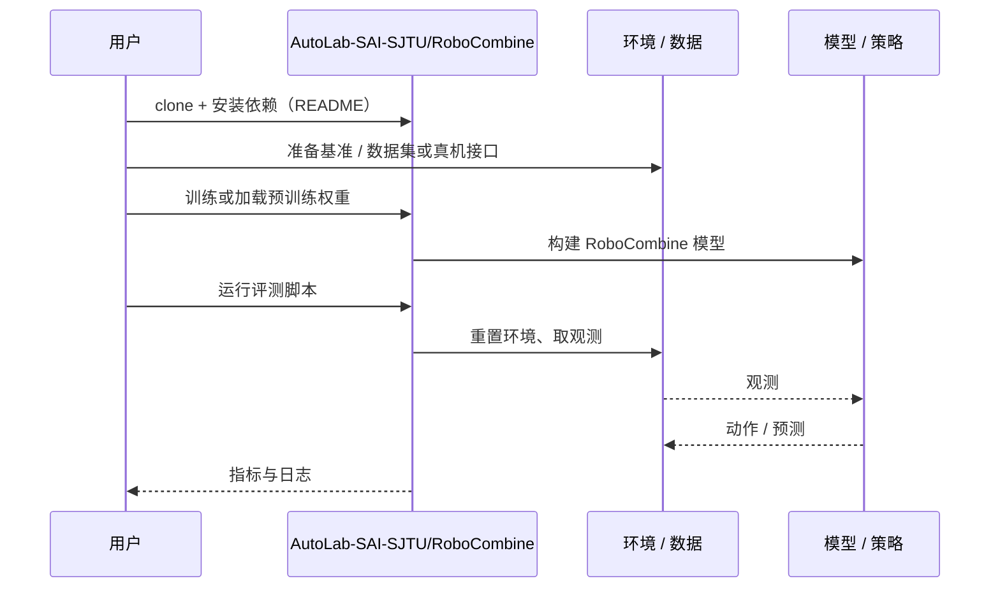

# RoboCombine（arXiv:2610.15425）

**RoboCombine**（*Exploring the Limits of Combinatorial Generalization in Embodied Manipulation*，[arXiv:2610.15425](https://arxiv.org/abs/2610.15425)，[代码](https://github.com/AutoLab-SAI-SJTU/RoboCombine)）来自 [具身智能小站 2026-10-14 盘点](../../sources/blogs/wechat_embodied_station_41_papers_streamingwam_2026-10-14.md)，属「多机器人协作与评测」组。

## 一句话定义

**把长程操作失败定位到子任务交接状态：分别统计有序成功率与交接成功率，区分理想触发与预测触发。**

## 英文缩写速查

| 缩写 | 英文全称 | 简要说明 |
|------|----------|----------|
| PRTI | Perturbed/Extended atomic Initial states | 扩展原子起始状态的训练策略（论文提出） |
| SR | Success Rate | 成功率 |
| IL | Imitation Learning | 模仿学习 |

## 为什么重要

- 技能单独成功不意味着串联后成功；没有交接级诊断，组合泛化失败只能被笼统归为「长程难」。
- 开源结论：**部分开源**（步骤 2.5，2026-10-14）。仓库可达，但公众号称主要提供评测运行时，需自备策略与仿真资产。
- 同期同组工作见 [流式动作块与世界模型记忆：具身智能小站 10-14 期 41 篇阅读坐标](../overview/embodied-station-2026-10-14-41-papers-technology-map.md)。

## 核心机制

| 项 | 内容 |
|----|------|
| **arXiv** | [2610.15425](https://arxiv.org/abs/2610.15425) |
| **开源** | **部分开源** |
| **要点** | 评测框架记录每个子任务起止状态；提出扩展原子起始状态的 PRTI 以覆盖交接分布。 |
| **文内指标** | 评测协议为主；数值以原文为准。 |

## 源码运行时序图

以下为按仓库入口（`AutoLab-SAI-SJTU/RoboCombine`）推断的通用运行链路；入库日仅核实仓库可达，未逐文件阅读，具体脚本名以 README 为准。

## 实验与评测

- 评测协议为主；数值以原文为准。
- **读法：** 本页为索引级摘要，依据公众号转述的官方摘要与仓库信息整理；逐项数字与 baseline 以原文 PDF 为准。

## 与其他工作对比

- 横向索引见 [流式动作块与世界模型记忆：具身智能小站 10-14 期 41 篇阅读坐标](../overview/embodied-station-2026-10-14-41-papers-technology-map.md)；同 arXiv 不重复造页。

## 结论

**评长程策略先看交接处：扩大原子技能的起始状态覆盖，往往比加大模型更直接。**

1. 开源边界：**部分开源** — 仓库可达，但公众号称主要提供评测运行时，需自备策略与仿真资产。
2. 核心机制：评测框架记录每个子任务起止状态；提出扩展原子起始状态的 PRTI 以覆盖交接分布。
3. 复现与选型前核对任务协议、硬件与基准口径，勿直接横比公众号摘录数字。

## 关联页面

- [manipulation](../tasks/manipulation.md)
- [simulation-evaluation-infrastructure](../concepts/simulation-evaluation-infrastructure.md)
- [imitation-learning](../methods/imitation-learning.md)
- [embodied-station-2026-10-14-41-papers-technology-map](../overview/embodied-station-2026-10-14-41-papers-technology-map.md)
- [具身大模型评测基准选型闭环](../queries/embodied-eval-benchmark-selection-loop.md) — 本页属 ③ 策略任务成功率层：用有序成功率与交接成功率拆解长程失败，避免均值成功率掩盖子任务交接问题

## 参考来源

- [robocombine_combinatorial_generalization_arxiv_2610_15425.md](../../sources/papers/robocombine_combinatorial_generalization_arxiv_2610_15425.md)
- [wechat_embodied_station_41_papers_streamingwam_2026-10-14.md](../../sources/blogs/wechat_embodied_station_41_papers_streamingwam_2026-10-14.md)
- [arXiv:2610.15425](https://arxiv.org/abs/2610.15425)

## 推荐继续阅读

- [arXiv PDF](https://arxiv.org/pdf/2610.15425)
- [https://github.com/AutoLab-SAI-SJTU/RoboCombine](https://github.com/AutoLab-SAI-SJTU/RoboCombine)
