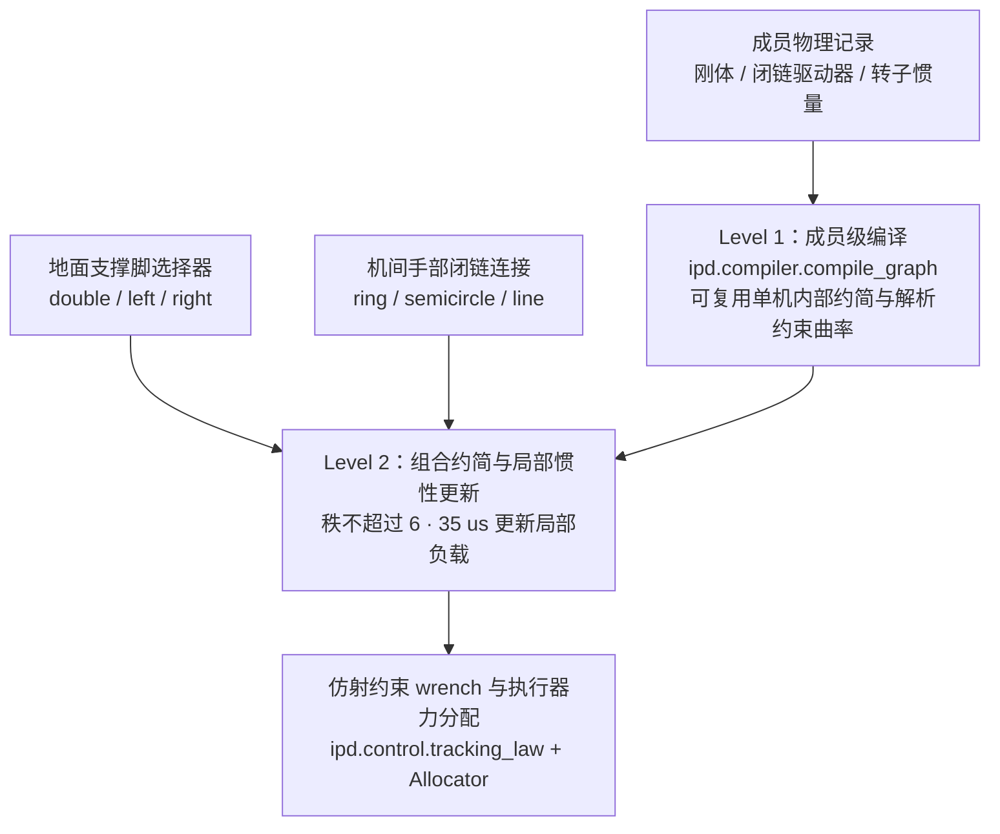
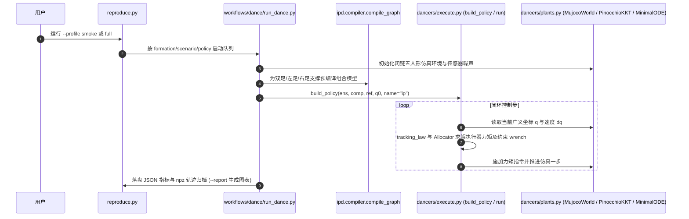

# RoboCompiler-Humanoids（arXiv:2610.14237）

**RoboCompiler-Humanoids** 是面向闭链协作人形的可组合动力学建模扩展，支持将各机器人保留为可复用模块，再按手部连接和地面支撑状态组合整体模型。论文由坦佩雷大学（Tampere University）Mehdi Heydari Shahna 与 Jouni Mattila 撰写，发表于 arXiv cs.RO 预印本；[论文](https://arxiv.org/abs/2610.14237)与[作者代码、结果及视频](https://github.com/Mehdi-Heydari-Shahna/RoboCompiler-Humanoids)均可公开获取。

## 一句话定义

把多台彼此牵手、接触地面状态变化的人形机器人作为可组合的动力学模块建模，同时保留每台机器人的内部约简。

## 英文缩写速查

| 缩写 | 英文全称 | 简要说明 |
|------|----------|----------|
| DoF | Degrees of Freedom | 自由度 |
| RMS | Root Mean Square | 均方根误差 |
| MJCF | MuJoCo XML Format | MuJoCo 仿真模型格式 |
| KKT | Karush-Kuhn-Tucker | 受约束多体系统拉格朗日乘子方程 |
| WBC | Whole-Body Control | 全身控制；论文接口支持执行器感知跟踪与耦合力分配 |

## 为什么重要

多个人形通过手部连接形成闭链系统时，机器人之间的约束力、每台机器人的执行器动力学以及不断变化的地面支撑必须在同一动力学模型中一致处理。如果按传统思路为每一种牵手拓扑（环形、半圆、单线）与双足/单足支撑状态组合重新推导整队模型，不仅无法复用单机约简，也会在踩步切换支撑足或手腕附加未知负载时引发高昂重算与接触力分配失稳。

## 核心机制

### 流程总览

1. **成员级动力学编译：** 从刚体、运动执行器部件与折算转子惯量等物理记录组装惯性、Coriolis、重力、阻尼和驱动项，编译刚体雅可比与解析 lift 曲率，满足成员级功率恒等式。
2. **两级组合约简与局部载荷更新：** 保留每台机器人的内部约简矩阵，再在组合层处理手部连接及地面支撑脚变换；当单只手腕附加新载荷时，局部惯性更新秩不超过 `6`，`35 µs` 即可刷新（相比完整重编译 `4.0 ms`）。
3. **执行器力–约束力仿射映射：** 维持指定约束加速度所需的足底支撑 wrench 与手部内力可写为执行器广义力的显式仿射映射，直接接入二次规划力分配器与脚尖/摩擦锥约束。

## 源码运行时序图

仓库根目录 `reproduce.py` 通过 `workflows/dance/run_dance.py`、`workflows/dance/run_steps.py`、`workflows/statewise/run_statewise.py` 与 `workflows/manipulator/run_manipulator.py` 四组工作流驱动完整评估；多机闭链控制主循环在 `workflows/dance/run_dance.py` 与 `dancers/execute.py` 中装配 `ipd.compiler` 与多后端仿真植物：

官方仓库提供的验证对象为合成闭链人形装配模型（42 个刚体、49 个关节、21 个执行器端口，使用代表性电驱与传动折算惯量参数），state-wise 挖掘机独立对比脚本需要用户自备未公开的实验数据记录。

## 实验与评测

| 验证维度 | 原文 Table II / III 关键数字 |
|------|----------|
| **状态级数值一致性（264 可行状态 / 8 构型）** | 与独立刚体硬约束 Pinocchio 参考加速度相对差异不超过 `1.6×10^-10`，与未约简系统偏差不超过 `1.4×10^-10`；手部约束力恢复与 Pinocchio 一致至 `3.3×10^-11 N` |
| **求值计算耗时（Table II，单 BLAS 线程）** | 环形编队完整求值（含 `C` 与解析曲率）耗时 **`3.5 ms`**（vs 投影树解析曲率 `5.1 ms`、投影树有限差分 `9.2 ms`、刚性 Pinocchio `18.4 ms`）；`3 kg` 负载局部秩-6 更新仅 **`35 µs`**（vs 完整重估 `4.0 ms`） |
| **五人形 30s 闭环舞蹈（Table III，真实仿真对象 Realistic plant）** | 环形编队骨盆 RMS 误差 **`0.73 mm`**、手掌 **`1.92 mm`**、手部预测力偏差 **`2.2 N`**、最小足底法向力 **`55 N`**、不可行松弛步骤 **`0%`**；去掉模型协同的每机独立模型（`decentralized`）在环舞时出现 **`11%`** 步骤分配不可行且最小足底法向力跌至 `21 N`；无模型 `actuator_pd` 在半圆与直线编队于 **17 s 摔倒** |
| **行进侧步支撑切换（20 次双足/单足切换）** | 预编译双足/左足/右足组合器切换完成 **`32.1°`** 原地转向（目标 `32.1°`），环形编队骨盆 RMS **`0.69 mm`**、落地误差不超过 `0.9 mm`；每机独立模型在 **全部三类编队首周期（ring 为 4.7 s）均摔倒** |
| **手腕突发 2 kg 负载在线更新** | `t=1 s` 附加 `2 kg` 点质量并通过 `payload_inertia` 替换前臂局部块后，30s 舞蹈手掌 RMS 误差从 `7.43 mm` 降至 **`1.81 mm`** |

## 工程实践

- **预编译多支撑模式表避免实时奇异：** 在行进切换中提前离线/准备阶段对双足、左足、右足支撑组合器完成行选择器秩校验（row-selector rank check），切步时只替换独立广义速度选择矩阵与继承上一拍执行器努力向量，抬脚提前 `20 ms` 脱模、落脚延后 `40 ms` 接入支撑模。
- **包含转子反射惯量与解析约束曲率：** Table III 的 ideal plant 消融显示，省略执行器反射惯量会使骨盆误差放大 `20.5×`，省略解析曲率会使手掌误差放大 `9.1×`；在高减速比闭链人形上不可按简单刚体近似处理。
- **模型接口复用于力分配：** 将手部耦合约束 wrench 显式写入不等式约束 Allocator，可将五机环舞时的手部挤压内力（7.0 N 协同预测 vs 1.8 N 独立盲目顶推）与足底摩擦锥边界统一起来。

## 局限与风险

- **全程未开展实体硬件实验：** 论文及仓库的全部闭环控制结果均建立在 MuJoCo、Pinocchio KKT 与最小 ODE 仿真模型上，对真实机载传感延迟、通信抖动与结构柔性的鲁棒性尚待物理验证。
- **刚体连杆与理想手部/足底连接前提：** 解析曲率与可组合约简假定刚性手部耦合约束（soft equality / weld）及固定切换时刻表，不包含柔性缆绳、大变形布料或未知突发性摔倒重接触切换的反应式重规划。
- **手–手联结需集中广义坐标同步求解：** 该建模与控制器位于全身多机动力学集中汇编层，若团队扩大至通信受限分散部署，仍需在上层或通过状态观测传递耦合边界状态。

## 与其他工作对比

| 对象 | 建模范围 | 闭链 / 支撑切换处理 | 与本文的关系 |
|------|----------|---------------------|--------------|
| [Pinocchio](./pinocchio.md) / [ABA·RNEA](../formalizations/articulated-body-algorithms.md) | 单个树状浮动基机器人的刚体动力学 | 闭链与接触需在外层以约束雅可比另行拼装 | 本文复用刚体雅可比编译，但把执行器转子惯量与多机连接约束纳入成员级 + 组合层两级约简；仓库示意流程中 Pinocchio 可作为 plant |
| [MuJoCo](./mujoco.md) 等式约束 | 通用多体仿真 | 以求解器施加硬约束 / 软约束 | 本文以硬约束参考作数值对照（加速度差异 `≤1.6×10^-10`），并在 MuJoCo 中做舞蹈与侧步仿真 |
| [Rhythm](./paper-rhythm-dual-humanoid-interaction.md) / [OmniInteract](./paper-omniinteract-dual-humanoids.md) | 双人形全身交互 | 学习式伙伴条件化与图奖励追踪控制 | Rhythm / OmniInteract 走多智能体学习控制路线；RoboCompiler-Humanoids 从严谨动力学建模侧提供可组合约简与显式耦合力映射 |

## 结论

**这项工作把多人形闭链动力学中的约束与支撑组合封装为可复用的模型接口，通过成员级约简与解析曲率在不重 derive 整队方程的前提下实现了高精度闭环跟踪与力分配，证据范围目前限于数值校验与 MuJoCo 仿真。**

1. **两级约简兼具复用性与数值精确度：** 保留单机内部约简仅更新连接/支撑组合层，与全系统 Pinocchio 硬约束加速度一致至 `10^-10` 量级，求值速度加快约 `5×`（`3.5 ms` vs `18.4 ms`）。
2. **闭链协调需要整队组合模型：** 对比实验证明只给每台人形喂各自单机动力学（`decentralized`），在双足切换行进时第一周期即失稳摔倒，而组合模型能稳定完成 20 次支撑切换。
3. **局部惯性更新可毫秒级吸收突发负载：** 秩不超过 6 的前臂块更新只耗 `35 µs` 即可把手腕 2 kg 突发负载的跟踪误差压低四倍（`7.43 -> 1.81 mm`）。
4. **仿真与实机边界清晰：** `0.73 mm` 骨盆误差等均为 MuJoCo 仿真数字，不可视为真机精度；本地复现可先运行 `python reproduce.py --profile smoke`。

## 关联页面

- [多机器人协作（Multi-Robot Collaboration）](../concepts/multi-robot-collaboration.md) — 多机闭链紧耦合动力学支点
- [协同物体搬运（Collaborative Object Transport）](../concepts/collaborative-object-transport.md) — 闭链接触内力分解与支撑切换建模基础
- [Floating Base Dynamics](../concepts/floating-base-dynamics.md)
- [人形多机协调](../concepts/humanoid-multi-robot-coordination.md)
- [Humanoid Locomotion](../tasks/humanoid-locomotion.md)
- [Loco-Manipulation](../tasks/loco-manipulation.md)
- [Robot Control System Architecture · 机器人控制系统架构](../methods/robot-control-architecture.md)：对照将可组合动力学模块与执行器力接口接入多机全身控制（WBC）的控制系统架构。
- [具身智能小站 2026-10-14 论文技术地图](../overview/embodied-station-2026-10-14-41-papers-technology-map.md)
- [多机器人协作纵深路线](../../roadmap/depth-multi-robot-collaboration.md) — 收录于 Stage 3 动力学与闭链全身协调节点

## 参考来源

- [论文归档与原文精读](../../sources/papers/robocompiler_humanoids_composable_dynamics_arxiv_2610_14237.md) — 全文 §I–§VI 及 Table I–III 精读
- [作者仓库与复现入口核查](../../sources/repos/robocompiler_humanoids_composable_dynamics.md) — 核对 `reproduce.py`、`workflows/dance/run_dance.py`、`dancers/execute.py`、`ipd/compiler.py`
- [arXiv:2610.14237](https://arxiv.org/abs/2610.14237)
- [RoboCompiler-Humanoids README](https://github.com/Mehdi-Heydari-Shahna/RoboCompiler-Humanoids/blob/main/README.md)

## 推荐继续阅读

- [浮动基动力学基础](../concepts/floating-base-dynamics.md)
- [人形多机协调](../concepts/humanoid-multi-robot-coordination.md)
- [多机器人协作纵深路线](../../roadmap/depth-multi-robot-collaboration.md)
- [RoboCompiler-Humanoids 代码仓库](https://github.com/Mehdi-Heydari-Shahna/RoboCompiler-Humanoids)
