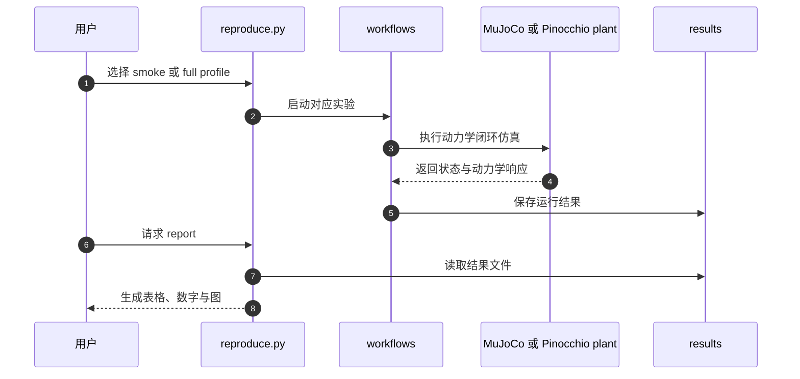

# RoboCompiler-Humanoids（arXiv:2610.14237）

**RoboCompiler-Humanoids** 是面向闭链协作人形的可组合动力学建模扩展，支持将各机器人保留为可复用模块，再按手部连接和地面支撑状态组合整体模型。论文由坦佩雷大学 Mehdi Heydari Shahna 与 Jouni Mattila 撰写，发表于 arXiv cs.RO 预印本；[论文](https://arxiv.org/abs/2610.14237)与[作者代码、结果及视频](https://github.com/Mehdi-Heydari-Shahna/RoboCompiler-Humanoids)均可公开获取。

## 一句话定义

把多台彼此牵手、接触地面状态变化的人形机器人作为可组合的动力学模块建模，同时保留每台机器人的内部约简。

## 英文缩写速查

| 缩写 | 英文全称 | 简要说明 |
|------|----------|----------|
| DoF | Degrees of Freedom | 自由度 |
| RMS | Root Mean Square | 均方根误差 |
| MJCF | MuJoCo XML Format | MuJoCo 仿真模型格式 |
| WBC | Whole-Body Control | 全身控制；论文接口支持执行器感知跟踪与耦合力分配 |

## 解决的问题

多个人形通过手部连接形成闭链系统时，机器人之间的约束力、每台机器人的执行器动力学以及不断变化的地面支撑必须在同一动力学模型中一致处理。逐个组合状态重新推导整体模型会降低模型复用性，也使支撑切换与载荷更新更难维护。

## 核心方法

1. **成员级动力学编译：** 从刚体、运动执行器部件与折算转子惯量等物理记录组装惯性、Coriolis、重力、阻尼和驱动项。
2. **解析约束曲率：** 编译刚体雅可比与解析 lift 曲率，得到适用于浮动基准速度的显式 Coriolis 分解，并满足成员级功率恒等式。
3. **两级组合约简：** 先保留每台机器人的内部约简，再在组合层处理手部连接及地面支撑；局部惯性更新秩至多为 6。
4. **执行器相关接口：** 指定约束加速度所需的约束 wrench 可表示为执行器力的仿射映射，服务于跟踪、耦合力分配、载荷更新和支撑模式切换。

## 验证结果

| 验证 | 论文报告 |
|------|----------|
| 状态级数值对比 | 8 种人形配置、264 个可行状态 |
| 加速度差异 | 相对硬约束参考不超过 1.6×10^-10；相对编译器无关参考不超过 1.4×10^-10 |
| 环形队形舞蹈 | MuJoCo 仿真骨盆 RMS 误差 0.73 mm |
| 支撑切换 | 侧步任务完成 20 次支撑模式切换 |

这些数字分别表示数值参考对比和 MuJoCo 仿真结果，不能解释为真实机器人精度或真机验证。

## 源码运行时序图

README 给出从复现实验到生成报告的入口。smoke profile 用于短运行检查，full profile 重跑论文报告的实验；报告由结果文件生成。

官方仓库提供的对象是合成闭链人形设计（42 个刚体、49 个关节、21 个执行器端口），使用代表性电驱参数；仓库包含代码、报告结果、手稿与视频。论文中的五人形协作验证基于仿真，不能据此推断实体人形部署性能。state-wise 研究中的挖掘机案例需要用户提供仓库未分发的记录文件。

## 结论

**这项工作把多人形闭链动力学中的约束与支撑组合封装为可复用的模型接口，论文给出了严格数值对照和仿真验证，证据范围仍限于仿真。**

1. 需要建模多人形手部连接、载荷变化或支撑切换时，可优先检查其两级约简和模块复用设计。
2. 数值精度结果适合判断动力学实现与参考模型的一致性，不代表整体机器人闭环误差只有相同量级。
3. 0.73 mm 是环形舞蹈仿真中的骨盆 RMS 误差，不能转述为真机精度。
4. 复现实验可从 README 的 smoke profile 开始；完整 profile 依赖 Linux / Python 3.12 及仓库列出的数值依赖。
5. 研究扩展到挖掘机状态研究时，须另行准备未随仓库发布的 excavator record。

## 关联页面

- [Floating Base Dynamics](../concepts/floating-base-dynamics.md)
- [人形多机协调](../concepts/humanoid-multi-robot-coordination.md)
- [Humanoid Locomotion](../tasks/humanoid-locomotion.md)
- [具身智能小站 2026-10-14 论文技术地图](../overview/embodied-station-2026-10-14-41-papers-technology-map.md)

## 参考来源

- [论文归档与摘要摘录](../../sources/papers/robocompiler_humanoids_composable_dynamics_arxiv_2610_14237.md)
- [作者仓库与复现入口核查](../../sources/repos/robocompiler_humanoids_composable_dynamics.md)
- [arXiv:2610.14237](https://arxiv.org/abs/2610.14237)
- [RoboCompiler-Humanoids README](https://github.com/Mehdi-Heydari-Shahna/RoboCompiler-Humanoids/blob/main/README.md)

## 推荐继续阅读

- [浮动基动力学基础](../concepts/floating-base-dynamics.md)
- [人形多机协调](../concepts/humanoid-multi-robot-coordination.md)
- [RoboCompiler-Humanoids 代码仓库](https://github.com/Mehdi-Heydari-Shahna/RoboCompiler-Humanoids)
