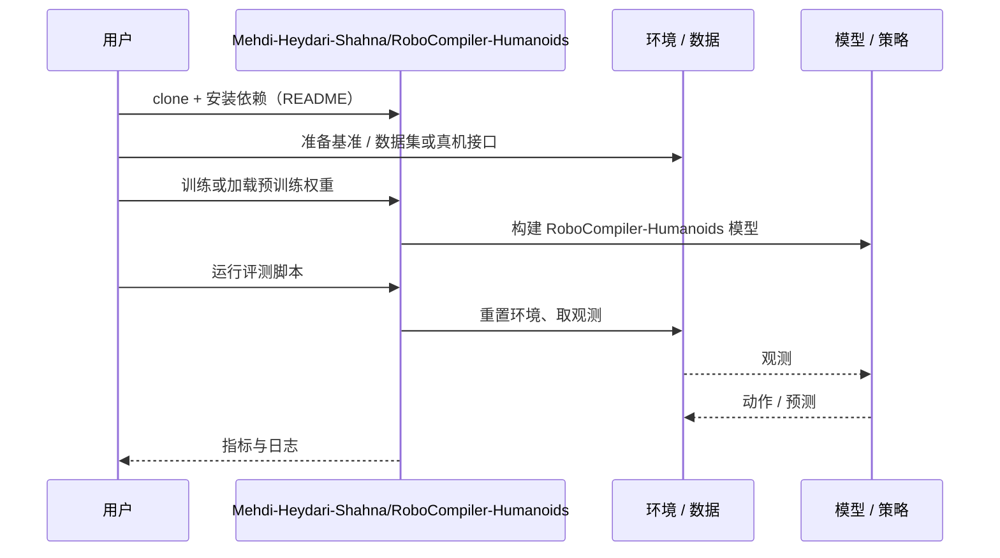

# RoboCompiler-Humanoids（arXiv:2610.14237）

**RoboCompiler-Humanoids**（*Composable Dynamics for Cooperative Humanoids: A RoboCompiler Extension*，[arXiv:2610.14237](https://arxiv.org/abs/2610.14237)，[代码](https://github.com/Mehdi-Heydari-Shahna/RoboCompiler-Humanoids)）来自 [具身智能小站 2026-10-14 盘点](../../sources/blogs/wechat_embodied_station_41_papers_streamingwam_2026-10-14.md)，属「人形与移动操作」组。

## 一句话定义

**以成员级装配与两级约简组合多个人形的动力学、手部连接与地面支撑；数值校验与 MuJoCo 仿真验证一致性。**

## 英文缩写速查

| 缩写 | 英文全称 | 简要说明 |
|------|----------|----------|
| WBC | Whole-Body Control | 全身控制 |
| DoF | Degrees of Freedom | 自由度 |
| MuJoCo | Multi-Joint dynamics with Contact | 仿真器 |

## 为什么重要

- 协作人形需要可组合的动力学模型而非逐例手推。
- 开源结论：**已开源**（步骤 2.5，2026-10-14）。仓库可达。
- 同期同组工作见 [流式动作块与世界模型记忆：具身智能小站 10-14 期 41 篇阅读坐标](../overview/embodied-station-2026-10-14-41-papers-technology-map.md)。

## 核心机制

| 项 | 内容 |
|----|------|
| **arXiv** | [2610.14237](https://arxiv.org/abs/2610.14237) |
| **开源** | **已开源** |
| **要点** | 仿真跟踪误差不能外推到真机。 |
| **文内指标** | 以原文为准。 |

## 源码运行时序图

以下为按仓库入口（`Mehdi-Heydari-Shahna/RoboCompiler-Humanoids`）推断的通用运行链路；入库日仅核实仓库可达，未逐文件阅读，具体脚本名以 README 为准。

## 实验与评测

- 以原文为准。
- **读法：** 本页为索引级摘要，依据公众号转述的官方摘要与仓库信息整理；逐项数字与 baseline 以原文 PDF 为准。

## 与其他工作对比

- 横向索引见 [流式动作块与世界模型记忆：具身智能小站 10-14 期 41 篇阅读坐标](../overview/embodied-station-2026-10-14-41-papers-technology-map.md)；同 arXiv 不重复造页。

## 结论

**多人形协作的建模应模块化装配，约束在组合层处理。**

1. 开源边界：**已开源** — 仓库可达。
2. 核心机制：仿真跟踪误差不能外推到真机。
3. 复现与选型前核对任务协议、硬件与基准口径，勿直接横比公众号摘录数字。

## 关联页面

- [floating-base-dynamics](../concepts/floating-base-dynamics.md)
- [humanoid-multi-robot-coordination](../concepts/humanoid-multi-robot-coordination.md)
- [humanoid-locomotion](../tasks/humanoid-locomotion.md)
- [embodied-station-2026-10-14-41-papers-technology-map](../overview/embodied-station-2026-10-14-41-papers-technology-map.md)

## 参考来源

- [robocompiler_humanoids_composable_dynamics_arxiv_2610_14237.md](../../sources/papers/robocompiler_humanoids_composable_dynamics_arxiv_2610_14237.md)
- [wechat_embodied_station_41_papers_streamingwam_2026-10-14.md](../../sources/blogs/wechat_embodied_station_41_papers_streamingwam_2026-10-14.md)
- [arXiv:2610.14237](https://arxiv.org/abs/2610.14237)

## 推荐继续阅读

- [arXiv PDF](https://arxiv.org/pdf/2610.14237)
- [https://github.com/Mehdi-Heydari-Shahna/RoboCompiler-Humanoids](https://github.com/Mehdi-Heydari-Shahna/RoboCompiler-Humanoids)
