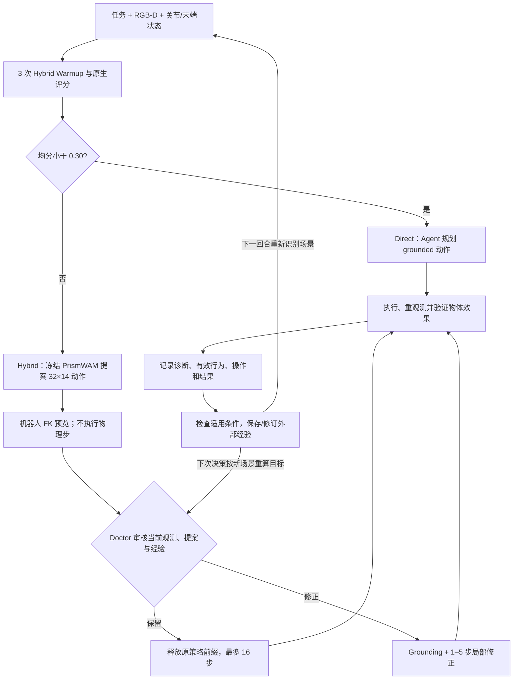
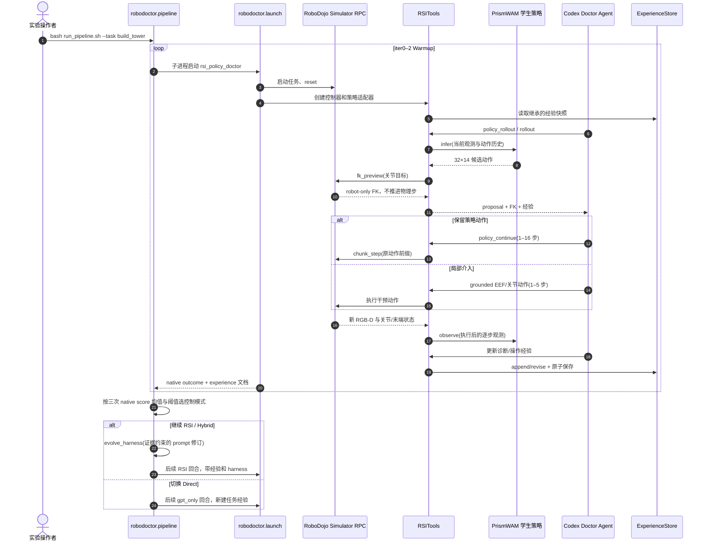

# RoboDoctor：无需重训的机器人策略递归自我改进 / Training-Free Recursive Self-Improvement for Robot Policies

## 一句话定义

**RoboDoctor** 不更新机器人策略与多模态 Agent 的权重，而用执行反馈决定由谁控制、是否打断当前动作、如何实现并验证局部物理修正；经验以外部记录传给后续回合。

## 英文缩写速查

| 缩写 | 英文全称 | 简要说明 |
|---|---|---|
| RSI | Recursive Self-Improvement | 执行时改进控制组织、介入及外部经验 |
| WAM | World Action Model | 本文主要使用冻结的 PrismWAM 产生连续动作片段 |
| VLA | Vision-Language-Action | 与 WAM 并列的机器人通用策略类别 |
| RGB-D | Red, Green, Blue and Depth | RGB 图像与深度观测，用于空间 grounding |
| FK | Forward Kinematics | 不推动仿真物体的机器人正运动学预览 |
| EEF | End Effector | 末端执行器及其测量位姿 |

## 为什么重要

- 策略已经稳定抓住瓶子，不代表瓶口已经对准杯口：应**保留有效抓握、只修正偏差**，而非每次重新抓取或整体重规划。
- 将「整体策略不适用」「策略局部动作有误」「物理接触方法失效」分开处理，便于按反馈粒度修改。
- 可在**冻结权重**的条件下复用经过条件检查与重新 grounding 的诊断、动作与结果；但这不等同于证明跨回合记忆的独立增益。

## 核心机制

### 三层 RSI

1. **Harness RSI（控制分配）**：先运行三次 Hybrid Warmup（iter0–2）。按有效 native score 的均值决定后续控制模式：< 0.30 选 **Direct**，否则继续 **Hybrid**。此选择在后续 run 中固定；Direct 由 Agent 主导，Hybrid 由 WAM 提案、Doctor 审核。
2. **Intervention RSI（有界介入）**：Hybrid 在**零物理步**的候选动作与 robot-only FK 预览基础上，释放 **1–16 步**不变的动作前缀，或用 **1–5 个物理步**的 grounded correction 替代；原动作剩余后缀丢弃，重新观测再预测。
3. **Operation RSI（动作实现与验证）**：从图像像素与深度定位可见表面，结合当前 EEF、接触区域、夹爪开合和等待臂动作，执行后检查**机器人是否达到目标、物体是否发生预期交互**。不能用指令下达或 FK 预览推定成功。

### 流程总览

### 瓶口对准但不丢失抓握：论文 Figure 4(b)

- **观察**：已持瓶，但 bottle mouth 相对 cup rim 有横向偏移；抓握仍稳定。
- **干预**：Doctor 执行**一次横向位置修正**，同时**保持抓握、倾角和高度**，使瓶口对准杯口；并非松爪、重抓或更换整个倒水策略。
- **续接**：WAM 后续继续倾倒并收瓶。论文将「局部对齐核验」和「倒入杯中核验」分成两项证据：前者不能推断后者或原生任务判定必然成功。
- **可复用条件**：复用的是「倾倒前检查口缘偏移；保留已验证抓握并修正横向误差」的诊断规则，**不是**当时的固定世界坐标或位移值。

### 外部经验与必要的证据边界

Hybrid 的诊断/操作记录关联事件、机器人状态、动作提案/执行状态、FK 类型、接触方法、停止条件、观测结果与适用前提；更新可 append 或按 ID revise，结构验证不保证语义正确。Direct 用 TODO.md / NOTES.md 记录当前任务计划与详细证据，回合结束才合并可复用经验；下一回合仍须重新测定场景。短步重观测提高了介入机会，**不构成形式化碰撞安全保证**。

## 源码运行时序图

下面是依据官方代码**实际可辨识入口和方法**整理的运行时序（非抽象论文示意）。主要核对 `run_pipeline.sh`、`robodoctor/pipeline.py`、`robodoctor/launch.py`、`robodoctor/rsi.py`、`robodoctor/prismwam_policy.py`、`robodoctor/experience.py`。

`run_rsi.sh` 则直接运行 `python -m robodoctor.launch --evaluation-method rsi_policy_doctor`；`run_pipeline.sh` 会调用 `python -m robodoctor.pipeline`。实际调用需另配 RoboDojo、Isaac Sim 5.1、PrismWAM 权重/环境与 Agent API，本文**没有运行仿真或复现实验**。

## 工程实践

| 项 | 论文 / 源码核对 |
|---|---|
| 输入 | 头部、双腕 RGB-D；关节状态和实测 EEF，不提供特权物体真值 |
| 策略 | PrismWAM；一次提案 32 步，每步两个手臂各 6 个绝对关节目标 + 1 个夹爪开度，共 14 维 |
| 执行 | 当前 RSI host 每次原策略前缀至多 16 步，Doctor 修正每次 1–5 步；丢弃未执行后缀 |
| 时间历史 | 同一策略历史累积 WAM 与 Doctor 的每个实际执行步；下次使用新观测 |
| 可运行入口 | `bash run_rsi.sh`、`bash run_pipeline.sh`，底层 Python `robodoctor.launch` / `robodoctor.pipeline` |
| 安装限制 | Linux + NVIDIA GPU + RoboDojo/Isaac Sim 5.1 + PrismWAM 独立推理环境 + Codex provider 凭据；README 给出环境预检与 dry-run |
| 发布边界 | [THUSI-Lab/RoboDoctor](https://github.com/THUSI-Lab/RoboDoctor) 已公开源码与测试，仓库声明 Apache-2.0；权重从单独的 PrismWAM Hugging Face 仓库取得；并非端到端零依赖 |

## 实验与评测

**仅 RoboDojo-Sim 的筛选后本地运行归档**，任务 54 条，分属 Generalization / Precision / Long-Horizon / Memory / Open 五维；每维等权平均。

| 指标 | Warmup（iter0–2） | Refinement（iter3–8） |
|---|---:|---:|
| 五维综合分 | 49.74 | **57.10**（+7.37 分） |
| 原生成功率 | 40.83% | **49.44%**（+8.61 pp） |
| 有效 episode | 162/162 | 301/324 |

- 任务分布：**24 改善、20 退化、10 持平**；Long-Horizon **54.58→52.92**，并未全面提升。
- 文中对比包括 HexaShell-Preview 等已公布 leaderboard 指标，但**交互预算、配置、回合筛选及数据覆盖不一致**，不能据此给出严格同条件排名。
- Warmup **本身已有 Doctor 干预与经验记录**，不是纯 WAM baseline；论文也未用受控消融隔离跨回合记忆/三类 RSI 各自的因果贡献。
- Figure 4(b) 的瓶口修正是**被记录的一个局部案例**；不能把一段成功倒水演示推成全体任务成功率。

## 结论

**真正可迁移的工程思路，是在已验证的稳定抓握之上按需微调位置，并分别验证局部修正与最终任务结果，而不是把一次视觉对齐当作全程成功。**

1. 先评估既有动作是否有效，再决定保留、局部修正或改控制策略；避免无依据的全量重规划。
2. Hybrid 候选动作先做无副作用 FK 预览，**1–16 步放行或 1–5 步修正**后必须获取新观测。
3. 保存「错误证据→方法→实测结果→适用条件」；复用时重新定位空间关系，不复制旧坐标。
4. 评分增益基于筛选后的异质运行，**不能直接归因于外部经验**，也不等于真机验证。
5. 介入计算和执行延迟、碰撞安全与跨策略/真机迁移仍待量化。

## 与其他工作对比

- **PrismWAM** 是冻结的底层动作模型，RoboDoctor 添加上层执行诊断与修正，并不重新训练 WAM。
- **PhysicalRSI / [EmbodiedRSI](./paper-embodiedrsi.md)** 可改 Harness 或技能；其中 EmbodiedRSI 借助 VOI 主动选择实验并联合演化代码、技能和记忆，RoboDoctor 则侧重已有控制器的选择、干预及物理方法复用。
- **Recova** 通过仿真恢复技能、独立恢复策略与 DAgger 后续训练；RoboDoctor 本文主要强调执行期外部状态更新，训练目标不同。

## 局限与风险

- 全部报告结果来自仿真，本论文未验证真机或 PrismWAM 之外策略族的迁移。
- 筛选与非同条件跨方法对比、任务回退，以及缺少独立记忆消融，限制「递归自我改进」因果解释。
- Agent 语言判断和经验条目可能不准确；结构化字段验证**并不证明**操作诊断事实真实。
- 有界步长不是碰撞避免算法；重复 grounding、策略推理与多次验证增加成本，论文未给统一执行费用。
- 旧 [RoboDoctor-Preview](https://github.com/THUSI-Lab/RoboDoctor-Preview) 于 2026-10-22 核查为空仓库；**截至 2026-11-07 已另有正式开源实现**，不能沿用旧「尚未开源」结论。

## 关联页面

- [Manipulation / 机器人操作](../tasks/manipulation.md)
- [递归自我改进（RSI）](../concepts/recursive-self-improvement.md)
- [VLA / 视觉语言动作](../methods/vla.md)
- [Imitation Learning / 模仿学习](../methods/imitation-learning.md)
- [Reinforcement Learning / 强化学习](../methods/reinforcement-learning.md)
- [Recova / 失败恢复](./paper-recova.md)
- [59 篇具身论文导读](../overview/embodied-station-2026-10-28-59-papers-technology-map.md)

## 参考来源

- [arXiv v1 论文通读归档](../../sources/papers/robodoctor_arxiv_2610_35604.md)
- [项目主页与开源状态归档](../../sources/sites/robodoctor.md)
- [官方代码与运行入口核对](../../sources/repos/robodoctor.md)
- [2026-10-22 历史项目页状态](../../sources/sites/robodoctor-rsi-github-io.md)

## 推荐继续阅读

- [官方论文 HTML（正文 + 附录）](https://arxiv.org/html/2610.35604v1)
- [官方项目主页及倒水演示](https://robodoctor-rsi.github.io/)
- [正式源码仓库](https://github.com/THUSI-Lab/RoboDoctor)
- [PrismWAM 官方 RoboDojo 权重](https://huggingface.co/THUSI-Lab/PrismWAM/tree/main/robodojo)
