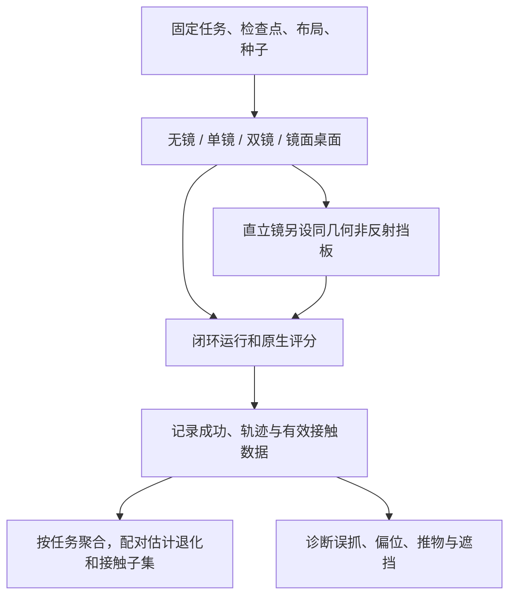
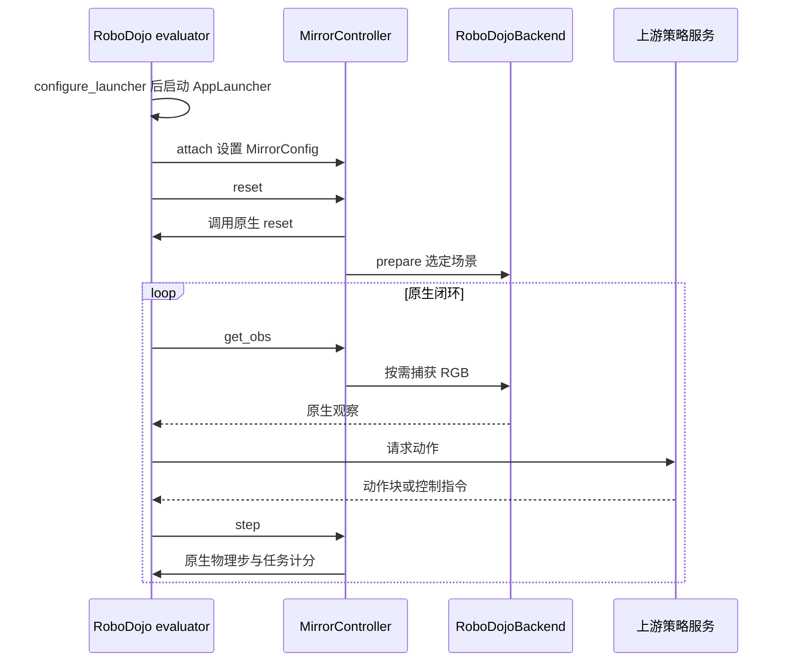

# 镜面反射如何干扰机器人策略 / Embodied AI Fails the Mirror Test: How a Simple Mirror Breaks Robot Policies

## 一句话定义

**RoboDojo-Mirror** 固定操作目标及评分接口，比较同一策略在有无镜面时的闭环表现，并以非反射挡板对照检验直接碰撞能否解释失败。这里的「镜子测试」评估的是外部物体操作，不是机器人自我识别。

## 英文缩写速查

| 缩写 | 英文全称 | 含义 |
|---|---|---|
| VLA | Vision-Language-Action | 从观察和指令产生动作的一类策略 |
| WAM | World Action Model | 对未来观察和动作联合建模的一类方法 |
| SR | Success Rate | 原生任务判定的成功率 |
| ECL-G | Geometric Empty Close-and-Lift | 利用闭合位置和抬升轨迹检测抓空后抬起的行为指标 |

## 为什么重要

反射不仅改变亮度或背景，还在共轭位置产生可辨认却不可抓取的虚像。策略可能对倒影动作、偏离实体，或碰到物理镜板；总成功率无法区分这些路径。反之，遮挡场景的反射也可能提供可用线索，测试不能简单理解为「镜子应被完全忽略」。

## 核心原理与方法

基于 [RoboDojo](./robodojo.md) 的八项共有任务，用无镜原场景作基线，加入单直立镜、双直立镜、镜面桌面。对同策略同任务匹配初始布局和种子，统一保留任务目标、原生评分、检查点和执行预算。四个预训练策略各 120 次/条件（8×5×3），工具代理 Astra 为 40 次/条件（8×5×1）。差值是百分点；以任务为固定集合，对成簇布局做配对 bootstrap；不同策略的执行预算不代表公平排名。

## 实验评测

| 策略 | 无镜 SR | 单镜 SR | 双镜 SR | 镜面桌面 SR | 三种镜条件平均下降 |
|---|---:|---:|---:|---:|---:|
| WALL-OSS | 67.5% | 21.7% | 15.0% | 25.0% | 46.9 pp |
| VPP2 | 72.5% | 33.3% | 35.0% | 27.5% | 40.6 pp |
| Awomo-0.5 | 60.8% | 15.8% | 6.7% | 10.0% | 50.0 pp |
| Rex-M1 Preview | 66.7% | 15.8% | 10.0% | 4.2% | 56.7 pp |
| GPT-6-Astra | 65.0% | 62.5% | 52.5% | 47.5% | 10.8 pp |

- **挡板对照：** 单/双镜各为同构型非反射挡板，限定 WALL-OSS、Awomo-0.5，各 120 个匹配槽位。将「无镜和挡板均成功、镜面失败」定义成镜面特异失败：WALL-OSS 单/双镜分别 8、22 例，Awomo-0.5 为 13、34 例。其中镜子及挡板均未记录机器人接触的分别为 7、11、9、20 例（50.0%–87.5%）。数字指特定子集，不是全体失败概率；支持直接接触并非唯一解释，不证明其余因素已隔离。
- **真机 Franka FR3：** 4 项任务 × 5 布局 × 2 重复，每种策略与镜面条件各 40 次。π0.5 在无镜/直立镜/镜面桌面依次 31/40、21/40、11/40（77.5%、52.5%、27.5%）；FastWAM 为 24/40、12/40、4/40（60%、30%、10%）。两者在无镜堆叠都 8/10，镜面桌面都 0/10。附录 G 两路 RGB 未启用深度，不意味着 RGB-D 可自动解决反射。
- **定向诊断：** 镜面桌面观察到偏离实物闭合并空抓抬升；Push-T 的位移与持续脱离倒像轮廓不是同一终点；主相机遮挡时，腕部相机仍可能看到实体，提示不稳定改善完成率。行为录像支持错位或虚像目标解释，但不会直接揭示网络内部推理。

## 工程实践与代码时序

公开 MIT 场景适配器依赖 RoboDojo、Isaac 环境、场景资产与上游策略。按固定 [公开提交](https://github.com/iPPLab/robodojo-mirror/tree/fe311cef196afe155b066f487171ce2256a9c2cb) 静态核对如下；不表示已运行评测。

先以一两个配对 episode 核对原生输出存在、布局 ID 一致及策略种子单独设置，再增至代表性任务；任务失败仍可算一次有效运行。公开脚本能规划 case 和聚合结果，但历史 runner/日志不随包发布。论文历史 `paper` 放置与修正的双镜构型必须分别报告。

## 与其他工作对比

与 [LIBERO-Pro2.0](./paper-libero-pro2-0.md) 的广谱扰动载体相比，这里重点是可几何配对的反射干扰和物理接触对照；与 RoboDojo 原基准相比，沿用原生任务及评分，新加镜面条件和行为诊断。

## 局限与风险

- 同几何挡板控制物理形状，但反射条件仍改变画面内容和空间线索；不声称每个失败均由同一原因造成。
- 仅两种仿真策略做挡板对照，真机仅两模型及四任务，不外推所有策略、镜面类别或视觉模态。
- 单视线遮挡不等于所有传感器不可见。研究报告不是独立复现也非生产安全证据。

## 结论

把镜面视为视觉和物理耦合的扰动。最可复用的是同任务同初始化的成对比较、非反射挡板及分离接触、成功和轨迹指标，而非把单个失败比例推广到所有场景。

## 关联页面

- [RoboDojo](./robodojo.md)、[仿真评测基础设施](../concepts/simulation-evaluation-infrastructure.md)
- [VLA](../methods/vla.md)、[操作任务](../tasks/manipulation.md)
- [具身智能评测基准枢纽](../overview/hub-embodied-eval-benchmark.md)

## 参考来源

- [论文原文及分母核对](../../sources/papers/robodojo_mirror_arxiv_2611_33010.md)
- [公开源码、项目与许可核对](../../sources/repos/robodojo-mirror.md)

## 推荐继续阅读

- [原文 §4.2 与附录 C](https://arxiv.org/html/2611.33010v1#S4.SS2)：挡板对照与接触子集
- [真机实验附录 G](https://arxiv.org/html/2611.33010v1#A7)：相机、平台及任务协议
