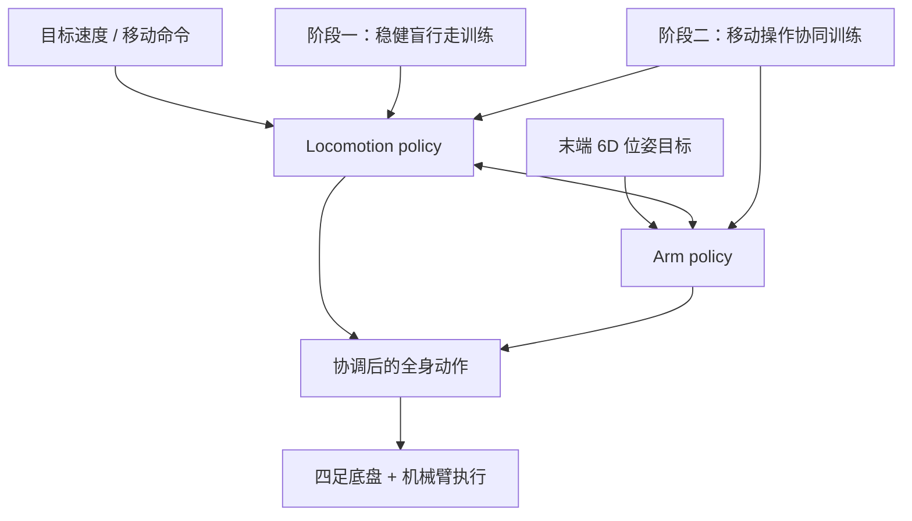
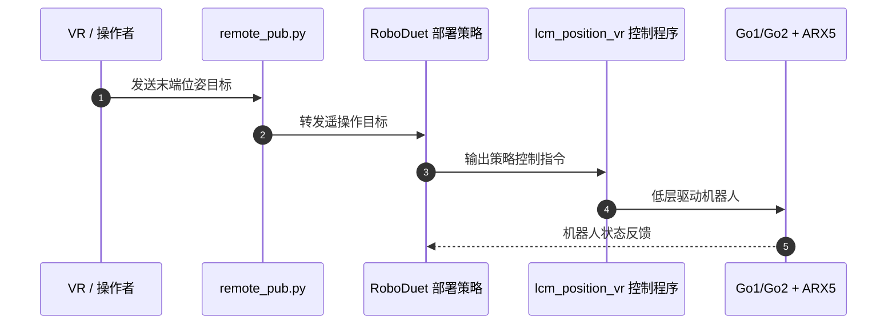

# RoboDuet：四足机器人协作式全身移动操作

**一句话定义：** RoboDuet 是面向“腿式移动底盘 + 机械臂”的双策略强化学习框架，让 locomotion policy 与 arm policy 协作完成边走边操作，而不是把两者作为互不沟通的独立控制器。

## 英文缩写速查

| 缩写 | 英文全称 | 简要说明 |
|------|----------|----------|
| RL | Reinforcement Learning | RoboDuet 用于训练协调策略的强化学习范式 |
| DoF | Degree of Freedom | 论文讨论的四足全身与机械臂可控自由度 |
| 6D | Six-Dimensional Pose | 操作策略需要跟踪的末端位置与姿态目标 |
| AFB+ID | Adaptive Floating Base + Inverse Dynamics | 论文移动操作任务中的对比基线 |
| ARX5 | ARX5 Robotic Arm | RoboDuet 实机演示中的六关节机械臂 |

## 为什么重要

给四足机器人装上机械臂后，底盘移动会改变机械臂工作空间，机械臂伸展也会扰动机身姿态。只分别训练腿和手臂、再把动作拼起来，可能造成目标跟踪与机身稳定之间的冲突。RoboDuet 将“动作如何相互让步”写进两策略的协作接口，重点解决在保持足式运动的同时做大范围末端操作。

该工作适用于研究带机械臂腿式机器人的全身移动操作，不应直接等同于人形机器人控制方法：其公开实验平台是 Unitree Go1/Go2 四足底盘搭配 ARX5 臂。

## 核心方法

项目页把控制器拆为两个策略：

- **locomotion policy（\(\pi_{loco}\)）**：跟踪目标移动命令 \(\mathbf{c}_t\)，并根据 arm policy 给出的指引调整动作，以配合末端操作。
- **arm policy（\(\pi_{arm}\)）**：跟踪末端六自由度位姿。其动作包含六个机械臂关节的目标位置偏移；其余动作分量用于替换/调节姿态命令，为末端位姿追踪提供额外自由度。
- **协同控制**：策略间交换任务相关信息，形成一个全身控制器；两者不是简单的“底盘走完、机械臂再动”的时序串联。

### 两阶段训练

第一阶段先获得稳健的盲行走能力，设计受 blind locomotion 方法启发；第二阶段同时启用 arm policy 和机械臂关节，在移动过程中训练 locomotion 与 manipulation 的协调。这样先建立可用的运动基座，再学习全身移动操作。

### 流程总览

## 实验与评测

| 评测维度 | 官方报告 |
|----------|----------|
| 末端控制 | 在移动中跟踪大范围 6D 末端位姿目标 |
| 复杂地面 | 展示在坡面、碎石等地形移动时维持机械臂目标位姿，也包括后退通过地形 |
| 移动操作 | 开门任务中把手高度为 100 cm；物体跨地面、椅面、柜面、站立桌面（0/20/60/100 cm）搬运 |
| 对比结果 | 困难移动操作任务的成功率相对 AFB+ID 基线提升 23% |
| 跨平台迁移 | Go1+ARX5 上训练的策略直接迁移到 Go2+ARX5；项目页报告 Go2 底盘重量增加 14.7%，仍能完成灵活的 6D 追踪与全身控制 |

结果支持“协作策略能够改善特定四足移动操作任务”这一结论；23% 是作者报告的相对基线改进，不应解读为所有场景统一提升 23 个百分点。

## 结论

**一句话总判：** RoboDuet 的关键价值是用双策略协作接口学习底盘与机械臂的全身协调，并通过 Go1→Go2 零样本迁移展示一定的形态鲁棒性。

1. **先稳住运动基座，再学协调。** 两阶段训练将盲行走能力与移动操作协调分开组织。
2. **接口设计是方法重点。** locomotion policy 会响应 arm policy 的指引；这比事后拼接独立动作更能体现全身协作。
3. **读懂 23% 的比较口径。** 数字对应论文所报告的困难移动操作任务，相对 AFB+ID 基线，不是通用成功率保证。
4. **迁移范围有限且具体。** 证据是 Go1+ARX5 到 Go2+ARX5 的直接迁移；不能外推到任意四足、人形机器人或任意机械臂。
5. **复现时区分训练与部署代码。** 训练仓库基于 Isaac Gym；独立部署仓库提供 Go1/Go2 + ARX5 的硬件控制流程。

## 源码运行时序图

官方部署 README 给出 Go1/Go2 对应的策略启动脚本、VR 目标发布程序与低层控制程序；具体二进制、SDK、网络接口及设备规则依机器人型号配置，图中概括的是运行时职责，而非对所有部署分支的逐行调用顺序。

## 工程实践

| 内容 | 可复现入口 / 边界 |
|------|--------------------|
| 仿真训练 | `RoboDuet` README 给出 Isaac Gym Preview 4、Python 3.8 环境，并用 `python scripts/auto_train.py --num_envs 4096 --run_name test_roboduet --sim_device cuda:0 --robot go1` 启动训练；支持 `go1` / `go2` 与 `--headless` |
| 仿真交互 | `python scripts/play_by_key.py --logdir <训练日志目录> --ckptid <检查点编号> --sim_device cuda:0`；README 列出键盘控制移动与机械臂目标的映射 |
| 真机部署 | 独立 `RoboDuet_Deployment` 仓库说明 Go1/Go2 + ARX5 部署；Go1 使用低层程序、RL policy 与 VR receiver，Go2 提供 Jetson Orin（可选）部署步骤 |
| 开放状态 | 训练实现与部署仓库均公开，仓库标注 MIT License；项目页提供论文、代码与演示。当前官方页面未单列数据集下载或预训练权重链接 |
| 复现限制 | 训练依赖 NVIDIA Isaac Gym Preview 4；硬件部署还依赖 Unitree SDK、ARX5 机械臂、LCM/网络与 VR 设备配置。仿真能运行不等同于已复现论文真机结果 |

## 与其他工作对比

| 路线 | 全身协调方式 | RoboDuet 的区别 |
|------|--------------|-----------------|
| 单一全身策略 | 一个策略同时产生底盘与机械臂动作 | RoboDuet 保留 loco/arm 两个策略，以策略间协作实现整体控制 |
| 传统 AFB+ID | 自适应浮动基座与逆动力学作为控制基线 | RoboDuet 通过学习到的协作策略在论文的困难移动操作任务上报告更高成功率 |
| 任务规划或 VLA 高层控制 | 高层给语义/任务目标，底层仍需运动执行器 | RoboDuet 聚焦底层全身运动与末端 6D 跟踪，不是通用语言动作模型 |

## 局限与风险

- 公开证据集中在 Go1/Go2 四足 + ARX5，不代表已验证于双足人形或其他机械臂。
- 跨平台实验只覆盖项目页报告的相近形态 Go1 与 Go2；“zero-shot”不等于不需要校准、接口适配或硬件配置。
- 项目页展示若干真实任务与对比视频，但未提供公开数据集下载入口；训练依赖和实体硬件会增加复现成本。
- 训练实现与部署仓库分开维护，阅读代码时应分别核实训练配置、checkpoint 与真机控制接口。

## 关联页面

- [Loco-Manipulation（移动操作）](../tasks/loco-manipulation.md)
- [Whole-Body Control（全身控制）](../concepts/whole-body-control.md)
- [Quadruped Locomotion（四足运动控制）](../tasks/locomotion.md)

## 参考来源

- [RoboDuet 论文来源归档](../../sources/papers/roboduet_arxiv_2403_17367.md)
- [RoboDuet 官方项目页归档](../../sources/sites/roboduet.md)
- [RoboDuet 训练仓库归档](../../sources/repos/roboduet.md)
- [RoboDuet 真机部署仓库归档](../../sources/repos/roboduet_deployment.md)

## 推荐继续阅读

- [RoboDuet 官方项目页](https://locomanip-duet.github.io/)
- [RoboDuet 论文 DOI](https://doi.org/10.1109/LRA.2025.3551230)
