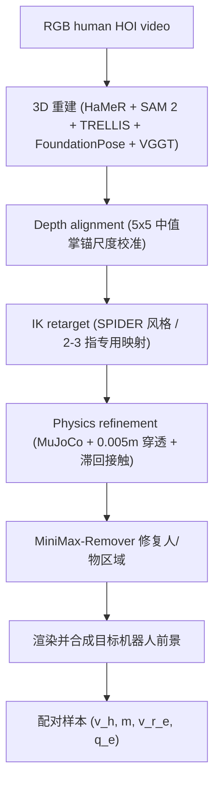
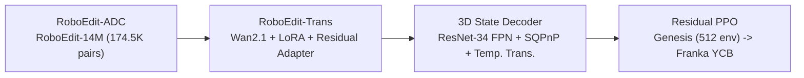

# RoboEdit：人类视频转机器人经验

**RoboEdit**（*Turning Human Manipulation Videos into Scalable Robot Experience*；[arXiv:2608.18948](https://arxiv.org/abs/2608.18948)）由 **UCLA**（Chenfanfu Jiang、Ying Jiang 等）提出：把 abundant **human hand-object RGB 视频** 转成 **action-consistent、物理 plausible 的 target-robot 视频**，并同步恢复 **aligned 3D robot hand states** — 通过 **RoboEdit-Trans**（跨具身 video editor + 3D Robot-State Decoder）与 **RoboEdit-ADC**（自动 paired-data 管线），构造 **RoboEdit-14M**（174K aligned pairs / 14.1M frames / 7 embodiments）。

## 一句话定义

**不从头生成机器人场景，而是在保留原场景、相机与物体动力学前提下，把 human video 编辑成 target-robot 交互视频，并用 decoder 抽出可驱动控制的 3D 手态轨迹。**

## 英文缩写速查

| 缩写 | 英文全称 | 简要说明 |
|------|----------|----------|
| HOI | Hand-Object Interaction | 手-物交互重建与编辑对象 |
| ADC | Automatic Data Curation | RoboEdit-ADC 自动配对管线 |
| LoRA | Low-Rank Adaptation | 跨具身 appearance/motion 适配 |
| PnP | Perspective-n-Point | 由 2D palm anchor + 3D palm 几何估 wrist pose |
| PPO | Proximal Policy Optimization | 下游 residual 跟踪控制器 |
| YCB | Yale-CMU-Berkeley | 真机评测物体集 |

## 为什么重要

- **数据瓶颈：** 机器人 interaction 视频 贵且 embodiment-specific；人类视频覆盖 scene/viewpoint/contact 但 **不能直接训练**。
- **比中间表示更进一步：** 相对只抽 EEF 轨迹 / affordance / value（或 [Ego2Robot](./paper-ego2robot.md) 的相机系 EEF），RoboEdit 输出 **full video + dense 3D states** 双监督。
- **规模：** RoboEdit-14M 174K pairs — Table 1 称唯一同时具备 **Auto curation + RGB pair + Robot state + 14M-frame 级** 的 human→robot 数据集（截至论文）。
- **闭环验证：** decoded 3D trajectory 可训 Genesis residual PPO 并在 **Franka Panda 真机** YCB 任务执行。

## 核心信息

| 项 | 内容 |
|----|------|
| **机构** | 加州大学洛杉矶分校（UCLA）；麻省理工学院（MIT）；犹他大学（University of Utah） |
| **项目页** | <https://roboedit.github.io/>（见于 arXiv v4 摘要元数据；2026-10-17） |
| **组件** | RoboEdit-Trans / RoboEdit-ADC / RoboEdit-14M |
| **Backbone** | Nova / NovaEdit 扩展（初始化自 `Wan2.1-Fun-1.3B-InP` + `Wan2.1-T2V-1.3B`；283.4M 主干微调）；flow matching；LoRA（2.5M）+ 残差适配器（7.9M）；Qwen-Image-Edit 关键帧 |
| **Embodiments** | Inspire、XHand、Ability、SCHUNK SVH、Allegro、Unitree Dex3、Franka Panda gripper（7） |
| **源视频** | DexYCB、HOT3D、H2O、GigaHands、TACO（145,459 真景对）+ 29,088 RoboEngine 合成对 |
| **开源** | **代码与 RoboEdit-14M 暂未公开**（截至 **2026-11-14**，arXiv v4 摘要仅附 `roboedit.github.io` 主页，文内无 GitHub/HF 下载链接） |

## 开源状态

核查日：**2026-11-14**（通读 `arXiv:2608.18948v4` 全文与 arXiv 摘要页元数据）。

| 产物 | 状态 |
|------|------|
| 项目主页 `roboedit.github.io` | **见于 arXiv v4 元数据**（摘要 `Project webpage` 字段） |
| 训练/推理代码与 `RoboEdit-14M` | **未公开**（v4 论文与附录 A–H 未给出 GitHub/HF/数据集下载 URL） |

## 核心原理

### RoboEdit-ADC（数据管线）

### RoboEdit-Trans（编辑引擎）

- 输入：masked human video \(z^h\) + sparse target-robot condition frames \(z^{c,e}\)（关键帧 \(\{0,10,\ldots,80\}\)）
- 输出：robot latent \(\hat{z}^{r,e}=G_\theta(z^h,z^{c,e})\) via **flow matching**（20 步 UniPC 采样）
- **LoRA（2.5M 参数）** — 跨具身 appearance / spatiotemporal
- **Residual bottleneck adapter（7.9M 参数，末 10 层）** — hand geometry / contact pattern（单 adapter 增益 > 单 LoRA）
- **3D Robot-State Decoder** — 共享 ResNet-34 FPN + 具身专属 8 掌锚点/指尖/关节头 → SQPnP wrist → 81 帧时序 Transformer refine → FK 轨迹 \(\hat{q}^e_{1:T}\)

### 流程总览（训练→部署）

## 源码运行时序图

**不适用。** 截至 **2026-11-14**，官方仅在 `arXiv:2608.18948v4` 摘要给出项目页 <https://roboedit.github.io/>，论文与附录均未发布 GitHub 代码仓、模型权重或 `RoboEdit-14M` 下载地址，本地无官方可运行实现可对照绘制。若后续公开源码，应补充 `sources/repos/` 并对齐真实训练/推理入口重绘。

## 工程实践

| 项 | 建议 |
|----|------|
| 与 Ego2Robot 分工 | 需要 **像素级 robot video + 手态** 时用 RoboEdit；只需 EEF 轨迹预训练 VLA 时可先用 lighter pipeline |
| Keyframe | 推理用 sparse keyframes \(\{0,10,\ldots,80\}\)；微调后的 `Qwen-Image-Edit`（约 4.9K 步）40 步采样 9 帧约耗时 **267.71 s**（H100 NVL） |
| 适配模块 | LoRA + residual **并用**（Table 3）；仅 backbone 不够 |
| Retarget 质量 | depth regularization + physics refinement 减 floating/penetration（Fig. 7） |
| 推理耗时权衡 | 单条 81 帧：ADC 离线管线约 **20.0 min（1199.94 s）**，Qwen 关键帧 + Trans 编辑与 3D 解码合计 **8.3 min（498.99 s）**（Table S3） |
| 下游控制 | decoded trajectory + residual PPO（动作缩放 \(\rho_{\text{act}}=0.02\text{ rad}\)）；sim Panda **71%** / XHand **62%** 再部署真机 |
| 数据集等待 | RoboEdit-14M 尚未公开下载链接；持续关注 `roboedit.github.io` 与 arXiv 更新 |

## 实验与评测

**300-case benchmark（Table 2，multi-keyframe 与单参考最佳基线对比）：**

| Method | Cond. | SSIM↑ | Edit LPIPS↓ | BG SSIM↑ | VBench AQ↑ / MS↑ | OpenVE↑ |
|--------|-------|-------|-------------|----------|------------------|---------|
| VACE 1.3B | M | 0.8996 | 0.0258 | **0.9419** | 0.4768 / 0.9923 | 3.1446 |
| VINO 13B | S | 0.5564 | 0.0679 | 0.6041 | 0.4488 / **0.9967** | **3.2711** |
| **RoboEdit-Trans 1.3B** | **M** | **0.9282** | **0.0171** | 0.9188 | **0.4832** / 0.9956 | 3.2511 |

**Adaptation 消融（Table 3）与 3D Decoder（Table 4）：** LoRA+Adapter 全面优于单独模块；完整 3D Decoder（Wrist **42.03 mm** / Rotation **23.28°** / Fingertip **43.26 mm** / Joint **0.2260**）显著优于 Shared 头与去时序（w/o Temp.：Rotation 退化至 33.23°、Fingertip 退化至 55.85 mm）。

**RoboEdit-14M（Tables S1–S2）：** **174,547** aligned pairs（**14,138,307** 帧，30 FPS 下 **130.91 h**）；145,459 real + 29,088 synthetic；7 embodiments。

**下游控制（§4.5 & Appendix G）：** Genesis 512 env residual PPO — Panda **71%**、XHand **62%** trajectory reproduction；Franka Panda + 并行夹爪 / 12-DoF XHand 真机 YCB 四任务（Fig. 8），按 RoboDojo 协议每组 10 trials 均 **≥50%** 成功率。

## 结论

**一句话总判：人类视频的价值不只在于抽稀疏动作，而在于可编辑成 target-robot 像素监督并同步给出 3D 手态——RoboEdit 把这两路监督绑在同一套件里，并在下游控制上闭环验证到真机。**

1. **编辑 > 纯生成** — 保留 scene/camera/object dynamics，避免 de novo 生成破坏上下文。
2. **ADC 可扩展** — 从 DexYCB/HOT3D/H2O/GigaHands/TACO 自动构造 174.5K pairs / 14.1M 帧级配对数据。
3. **跨具身** — LoRA（2.5M）+ residual bottleneck adapter（7.9M）在 1.3B 骨干上适配 7 种 hand/gripper。
4. **3D Decoder** — 编辑视频本身无 metric motion；SQPnP + 时序 Transformer 解码器是 downstream control 桥梁。
5. **重建领先与指标权衡** — 300-case 多关键帧重建 SSIM **0.9282** / Edit LPIPS **0.0171** 领先 8 个基线，OpenVE（**3.2511**）仅微弱次于单参考 VINO（**3.2711**）。
6. **真机闭环** — decoded trajectory 驱动 Genesis residual PPO（71%/62%）并上 Franka YCB 四任务（≥50%）。
7. **开源边界** — arXiv v4（2026-10-17）已列主页 `roboedit.github.io`，但代码与 RoboEdit-14M 下载仍未公开。

## 与其他工作对比

| 对照 | 差异读法 |
|------|----------|
| 只抽中间表示（EEF 轨迹 / affordance / value） | 丢掉像素级上下文，只留稀疏信号；RoboEdit 输出 **full video + dense 3D states** 双监督 |
| [Ego2Robot](./paper-ego2robot.md) | 同走「人类视频→机器人数据」，但产出相机系 EEF 轨迹；RoboEdit 产出像素级 robot video + 手态——需要 EEF 轨迹预训练 VLA 时用前者更轻，需要视觉监督时用后者 |
| De novo 机器人场景生成 | 从头生成会破坏原场景 / 相机 / 物体动力学；RoboEdit 走 **编辑** 路线，这三者被保留 |
| VACE 1.3B / OmniWeaving 13B / VINO 13B | 300-case benchmark 上重建 SSIM **0.9282** vs 0.8996 / 0.8107 / 0.5564、Edit LPIPS **0.0171** 全面占优（VINO 单参考 OpenVE 3.2711 略高，但重建与动态表现明显弱于本文） |
| 仅 LoRA 或仅 residual adapter | 消融（Table 3）显示两者**并用**才够；单 adapter 增益已大于单 LoRA，只用 backbone 不行 |
| 其他 human→robot 数据集 | Table 1 称 RoboEdit-14M 是截至论文唯一同时具备 **自动 curation + RGB 配对 + robot state + 14M 帧级** 四项的数据集 |
| 只报 perceptual metric 的编辑工作 | RoboEdit 把 decoded 轨迹接 Genesis residual PPO（Panda 71% / XHand 62%）并上 Franka 真机 YCB（≥50%），闭到控制而非停在指标 |

## 局限与风险

- **BG SSIM 偏低解释：** robot vs human 手空间范围不同，edit-mask 边界处 background metric 系统性低估（论文 §4.3）。
- **Decoder 误差传播：** 编辑 artifact 会进入 3D state；temporal Transformer 缓解 jitter 但非万能。
- **Embodiment 覆盖：** 7 种 hand/gripper 仍远小于真实部署多样性；synthetic 29K pairs 补 visual 但非物理全集。
- **未开源：** 无法复现 ADC 与 14M；benchmark 300 cases 细节依赖未来 release。
- **与 NovaEdit 依赖：** 依赖 `Wan2.1-Fun-1.3B-InP` / `Wan2.1-T2V-1.3B` 主干微调与微调版 `Qwen-Image-Edit` 关键帧生成，单条 81 帧端到端仍需约 8.3 min（H100 NVL），迁移到新平台与实时闭环生成仍有延迟成本。

## 关联页面

- [Ego2Robot](./paper-ego2robot.md) — 第一人称人视频→机器人 EEF 数据（互补路线）
- [Motion retargeting](../concepts/motion-retargeting.md) — ADC 中 retarget 环节
- [Imitation Learning](../methods/imitation-learning.md) — 配对机器人视频与 3D 手态监督的策略训练语境
- [PPO](../methods/ppo.md) — 下游 Genesis residual PPO 轨迹跟踪控制器
- [Manipulation 任务](../tasks/manipulation.md) — 桌面 YCB 操作与手–物交互评测
- [Sim2Real](../concepts/sim2real.md) — Genesis 512 环境残差控制迁移至 Franka 真机
- [Cross-embodiment 枢纽](../overview/hub-cross-embodiment.md)

## 参考来源

- [RoboEdit 论文归档](../../sources/papers/roboedit_arxiv_2608_18948.md)

## 推荐继续阅读

- [项目主页](https://roboedit.github.io/) — arXiv:2608.18948v4 摘要所列官方主页
- [机器人论文阅读笔记：RoboEdit](https://imchong.github.io/Robot_Learning_Paper_Notebooks/papers/06_Manipulation/RoboEdit__Turning_Human_Manipulation_Videos_into_Scalable_Robot_Experience/RoboEdit__Turning_Human_Manipulation_Videos_into_Scalable_Robot_Experience.html)
- [arXiv:2608.18948v4 全文 PDF](https://arxiv.org/pdf/2608.18948) — RoboEdit-ADC/Trans 细节与附录 A–H（Tables S1–S3）
- [Nova / NovaEdit（arXiv:2603.02802）](https://arxiv.org/abs/2603.02802) — RoboEdit-Trans 架构基底
