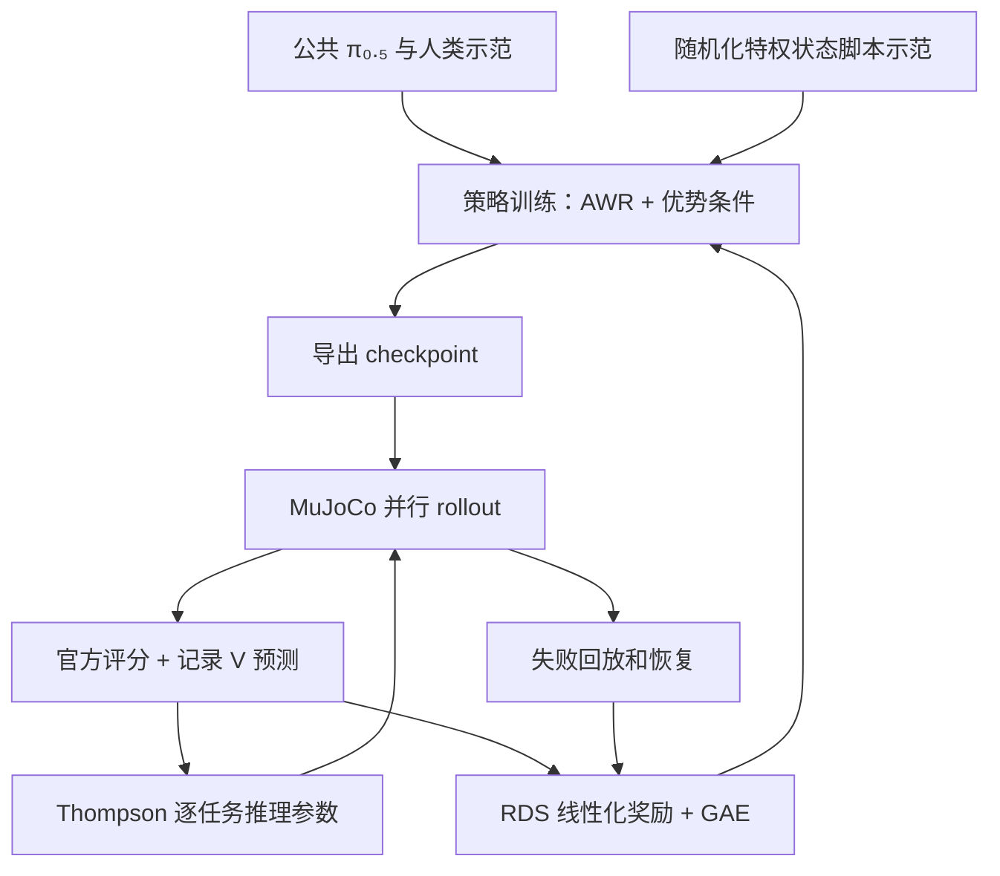
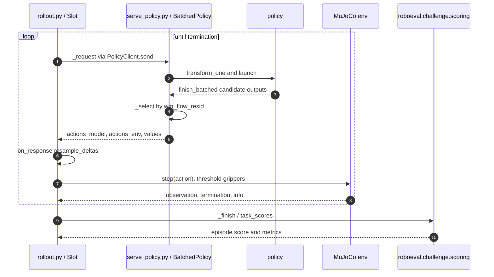

# RoboEval 冠军方案：离策略强化学习与在线推理调优 / Off-Policy RL with Online Inference Tuning: 1st Place Solution to the CoRL 2026 RoboEval Challenge

## 一句话定义

在双臂仿真操作中，以同一个 π₀.₅ 衍生模型同时生成动作与估计价值，用比赛评分驱动离策略后训练、推理参数搜索和困难数据补充，最终覆盖全部八项任务。

## 英文缩写速查

| 缩写 | 英文全称 | 简要说明 |
|---|---|---|
| VLA | Vision-Language-Action | 视觉语言动作策略，此处使用任务 ID 代替文本 |
| VLM | Vision-Language Model | PaliGemma 视觉语言骨干 |
| RDS | RoboEval Diagnostic Score | 比赛诊断评分 |
| RL | Reinforcement Learning | 强化学习 |
| AWR | Advantage-Weighted Regression | 优势加权回归 |
| RECAP | RL with Experience and Corrections via Advantage-conditioned Policies | 借鉴优势条件策略的经验后训练 |
| GAE | Generalized Advantage Estimation | 广义优势估计 |
| CFG | Classifier-Free Guidance | 无分类器引导 |
| FAST | Frequency-space Action Sequence Tokenization | 训练期辅助离散动作表示 |

## 为什么重要

- 用任务结果与过程质量而非单一成功率监督策略；可将评分变化反馈到逐步训练。
- 收集动作与价值预测的同时探索推理设置，减少训练、评测和调参的割裂。
- 示范覆盖不足时，先诊断漏掉的阶段，再增加能完成阶段的新策略数据，而非盲目增加同类示范。

## 核心信息

| 项 | 内容 |
|---|---|
| 作者 | Ilia Larchenko |
| 机构 | 独立研究者 |
| 论文 | [arXiv:2611.11464v2](https://arxiv.org/abs/2611.11464v2)，2026-11-24 修订，新增 §9 最终比赛结果 |
| 环境 | MuJoCo，两台 7-DoF Franka Panda |
| 观测 | 最多五路 256×256 RGB、本体状态、任务 ID |
| 动作 | 30×14 动作块：相对块起点的双臂末端位姿与夹爪，由执行端转换为逐步增量；环境 20 Hz，块长 1.5 秒 |
| 开源 | [官方代码](https://github.com/IliaLarchenko/RoboEvalSolution) 与 [权重](https://huggingface.co/IliaLarchenko/RoboEvalSolution)，Apache-2.0 |

## 核心原理与方法栈

1. **评分。** 设结果 O=0.7×success+0.3×stage progress，RDS=O×(0.4+0.3S+0.2E+0.1C)，其中 S/E/C 分别为安全、效率、协作。按任务先聚合指标，再与成功人类示范的中位数比较，最后对任务平均；不是简单逐 episode RDS 的均值。参考值处行为分封顶。
2. **统一策略和 critic。** PaliGemma 2B 视觉语言骨干与 300M 动作专家，V query 不读优势和本体状态，Q query 读取候选动作并预测 17 维价值残差（成功、5 个阶段、11 个未来行为项）；FAST 辅助头仅训练用。状态和速度可 dropout。
3. **优势后训练。** 在当前策略均值附近将 RDS 线性化，逐步奖励 r_t=∇RDS·Δm_t+Φ_(t+1)−Φ_t，Φ=0.3×completion 预测；δ_t=r_t+α(V_(t+1)−V_t)，α 每任务按回报与预测的协方差/预测方差拟合。GAE λ=0.95 后归一化，AWR 按 exp(clip(A,−2,2)) 采样，正优势条件用于 CFG。
4. **推理搜索。** 每次 rollout 以 Thompson sampling 探索约 20 个参数；连续参数用共享和逐任务平滑基函数的贝叶斯线性回归，二值开关用 Beta arms；换 checkpoint 后按数据新近程度重拟合。候选共享 prefix，批量 CFG/flow 5–19 步，最多 6 个候选，按成功残差或全指标加权残差选择。
5. **数据与连续执行。** 每 250 训练步输出新策略，20 worker 每轮收集 2000 episode；失败分支从失败点、前 2 秒或最后价值峰回放并恢复，仅保留全奖励后续。脚本读取特权物体状态生成多样示范，评测策略不读该状态。跨块保留未执行动作的一部分并重采样，夹爪阈值按任务选择。

## 在线调参不等于在线更新权重

| 阶段 | 每回合做什么 | 更新什么 |
|---|---|---|
| 训练采集 | 按任务抽取推理参数，记录动作、价值预测和该回合官方评分 | 采集协调器用回合分数更新调参后验；训练机另用不同批次的 rollout、示范和恢复轨迹更新策略权重 |
| 固定策略评测 | `--best configs/settings.json` 加载逐任务固定参数；同一步仍会采样多个动作块并按 Q 排序 | 不启动 Thompson 搜索，不更新权重。卡顿触发的加热/重采样属于提交策略自身的条件规则 |

采集入口 `rl_loop.py` 以 `--param-search` 启动评估进程。协调器先过滤出策略服务支持的请求级参数，再向每个任务的队列放 Thompson 样本；进程存活且成功返回的非错误回合提交证据。训练奖励基于任务级 RDS 局部线性化，而后验吃的是单回合官方分数，不能把二者混成同一目标或同一聚合方式。

## 流程总览

## 源码运行时序图

以下依据官方 scripts/rollout.py 和 scripts/serve_policy.py 的实际调用路径，不是实测 trace。

## 工程实践

- 训练：README 指定 `scripts/bucket_daemon.py --role trainer/collector` 和 `scripts/rl_loop.py --config configs/trainer.yaml` / `configs/collector.yaml`；一端更新数据加载，另一端刷新策略、收集与恢复。
- 评测：运行 `scripts/serve_policy.py` 加载权重，再以 `scripts/rollout.py --best configs/settings.json` 启动并行仿真；见[源码归档](../../sources/repos/roboeval-solution.md)。
- 作者报告约 600 GPU 小时，训练从 H200 切换至 8×B300，采集侧 RTX PRO 6000 + 24 CPU cores。环境 20 Hz 不等同于实机端到端推理时延。

## 实验与评测

| 协议 | 每任务 episode | RDS | 成功率 |
|---|---:|---:|---:|
| 作者公布种子 | 50 | 0.987 | 99.25% |
| 作者独立随机种子 | 500 | 0.990 | 99.6% |
| 主办方未公开种子复评 | 1000 | 0.988 | 99.3% |

v2 §9 表 6 将主办方复评纳入论文：最终第一 0.988，第二 0.982、第三 0.978。公开种子前三差距至多 0.002；最终评估让三队原样提交的策略跑同一套预先确定的未公开种子，再对种子做配对 bootstrap，95% 区间排除零。作者独立评测各任务 RDS：LiftPot 0.999、LiftTray 0.998、StackTwoBlocks 0.979、StackSingleBookShelf 0.998、CubeHandover 0.998、PackBox 0.974、PickSingleBookFromTable 0.988、RotateValve 0.989。

仅通用循环约两天到 0.85（论文 §7 将它描述为采集曲线，采集时仍在探索推理参数）；50k 步附近采集约 0.97、调参后的作者留出评测约 0.98。最终为两份 checkpoint 加权和逐任务参数搜索，在新的留出评测达到 0.990。并非严格控制变量的消融，不能据此把所有增益归给单一模块。

## 结论

这是评分驱动的 VLA 后训练与推理联合优化案例，不是已经证明通用真机操作的基础模型。

- 先让评测阶段与训练目标对齐，再选择数据及奖励。
- 将收集策略的 value 与 rollout 一起保存，避免用任意新 critic 代替历史预测。
- 将推理参数当作探索维度；真机应额外核算执行延迟和计算预算。
- 局部探索无法补齐未出现的技能时，补全阶段示范并保留恢复数据。
- 使用独立随机种子复核候选配置，避免只在选参种子上报最优。

## 与其他工作对比

- [π*₀.₆ / RECAP](./paper-rcl-2511-14759-0-6-a-vla-that-learns-from-experience.md)：此方案借鉴优势条件，差异是以比赛可计算指标及其梯度构造监督，同时使用在线参数搜索；不直接复述为原版 RECAP。
- [MolmoAct2](./paper-molmoact2.md)：同为动作策略相关研究，但训练范围、基准协议及后训练数据不同，不可跨表直接做排名。

## 局限与风险

- 仅评测双 Franka 仿真八项任务、固定任务 ID，不是自然语言泛化或真实部署证明。
- 原始示范的漏阶段问题显著：StackTwoBlocks 仅 1/141 全阶段，PackBox 仅 2/99；LiftTray 有 54/154 未达到抬升要求。
- StackTwoBlocks 人类参考偏单臂，PackBox reset 可能产生非策略造成的碰撞；分数不是纯粹动作质量。
- 脚本需要可信仿真与可编程任务。更干净的数据还可能弱化已学恢复技能；作者观察但未量化。
- 约 20 万合成轨迹含被丢弃数据，不能等同于公开可下载训练集；24 万余自主 rollout 也不等于完整公开。代码与权重开放，本次未下载运行。
- 50 seeds 的运行波动约 ±0.005 RDS；最后约 0.01 的榜单收益消耗了大量评测，不应无条件迁移到真机。

## 关联页面

- [具身大模型评测基准选型闭环](../queries/embodied-eval-benchmark-selection-loop.md) — 对应策略成功率与过程质量评测，以及评测反馈后训练；本案结果仅限双臂仿真协议。

- [VLA](../methods/vla.md)
- [动作分块](../methods/action-chunking.md)
- [VLA 纵深路线](../../roadmap/depth-vla.md)
- [具身模型测评纵深路线](../../roadmap/depth-embodied-eval.md)

## 参考来源

- [论文全文归档](../../sources/papers/roboeval_solution_arxiv_2611_11464.md)
- [作者项目页归档](../../sources/sites/roboeval-solution.md)
- [官方源码归档](../../sources/repos/roboeval-solution.md)
- [主办方最终榜单](https://robo-eval.github.io/challenge.html#results)

## 推荐继续阅读

- [RoboEval 基准论文](https://arxiv.org/abs/2507.00435)
- [LeHome 前作](https://arxiv.org/abs/2606.27163)
- [官方公开权重](https://huggingface.co/IliaLarchenko/RoboEvalSolution)
