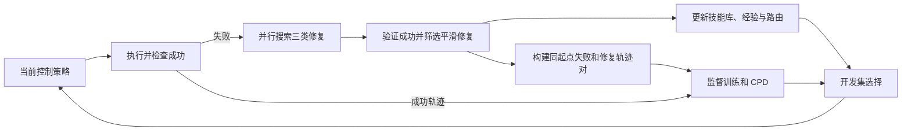
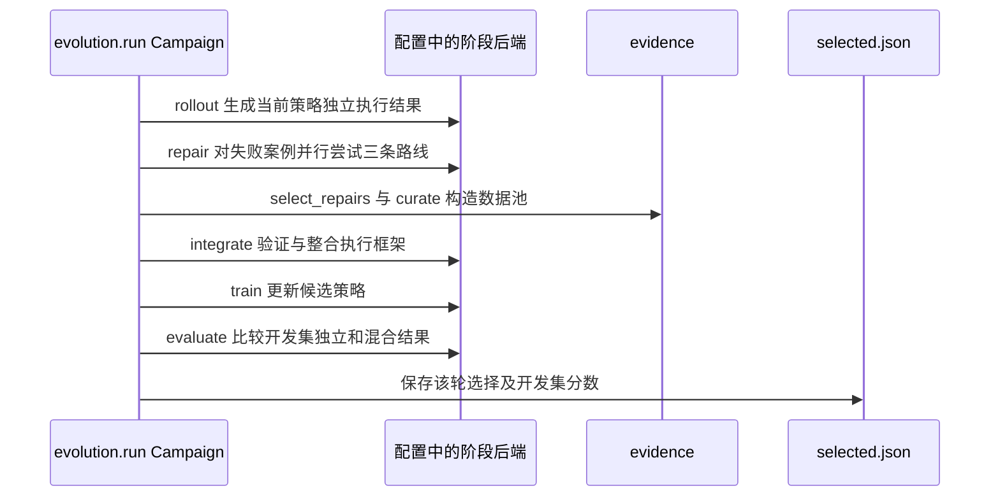

# RoboEvo²: Recursive Robot Self-Improvement via Harness–Policy Co-Evolution / 执行框架与策略协同演进的机器人自改进

## 一句话定义

**RoboEvo²** 将机器人策略的失败交给代码智能体查找并验证修复，用这些修复更新技能库与路由，并把成功修正蒸馏回策略。

## 英文缩写速查

| 缩写 | 英文全称 | 简要说明 |
|---|---|---|
| P2H | Policy-to-Harness | 策略失败触发执行框架改进 |
| H2P | Harness-to-Policy | 验证通过的修复反哺低层策略 |
| CPD | Counterfactual Preference Distillation | 比较同起点的成功修复与失败轨迹 |
| EWC | Elastic Weight Consolidation | 缓解多轮训练遗忘 |

## 为什么重要

**机构：** 香港大学、浙江大学、南方科技大学、香港中文大学（深圳）、香港城市大学。

程序执行框架擅长显式修正和复用步骤，却有反复推理的开销；低层策略执行更快，但遇到分布外状态容易失败。让两者互相更新，使部分过去必须靠智能体救场的步骤可以由策略独立完成。

## 核心原理

- 从当前策略未通过的案例启动 Code、Code+ICL、Code+Policy 三条修复路线，分别使用程序、示范引导、已有神经策略。先验证任务成功，再以归一化运动 jerk 筛选，只有相容的改动合并到执行技能、经验记忆和路由。
- 对验证轨迹做监督微调，并将同一保存状态的失败续段与修正续段配对。CPD 相对冻结的轮初策略拉开两者动作预测误差的偏好差距，用非对称邻近惩罚避免修正能力退化或过度抑制失败选项。失败感知采样与 EWC 兼顾难任务与保留旧能力。
- 用独立开发案例选择轮后策略与执行框架。测试区分策略独立执行与混合执行，不把后者的成绩算作单模型能力。

## 实验与评测

| 设置 | 作者报告 | 边界 |
|---|---|---|
| LIBERO-PRO，八轮 | 独立 11.0%→84.1%，混合 30.4%→90.5% | 区分是否启用执行框架 |
| RoboTwin C2R，五轮 | 独立 46.0%→77.5%，混合终点 87.4% | 方法用 7.5K 轨迹匹配常规训练 27.5K 轨迹的报告成绩 |
| Unitree G1-D 真机 | 仿真演进框架采集 120 条示范训练后独立 85.0%，200 条人工示范基线 80.0%，固定框架混合 95.0% | 是特定操作协议，不是开箱跨本体成功率 |

## 源码运行时序图

将训练、开发和测试用例分开，并记录任务、初始状态、修复路线与成功判定，使偏好对可追溯。源码核对的是开源轮级编排入口，不代表已跑通训练、实机或 API。

## 工程实践

实施时分开记录开发集的候选选择、留出集的运行模式和实际示范成本。横向比较应区分纯策略运行与保留上层 Agent 的混合运行。

## 局限

固定原语与感知工具仍限制可发现技能，如力控接触、手内重抓；任务成功判据若不可信，错误修复可能进入训练。无需额外人工示范不等于没有用过人工数据，也不等于无需仿真、验证工具或模型调用。

## 与相关工作对比

[SEEK](paper-seek.md) 在冻结推理模型的前提下维护程序和动作效果记录；RoboEvo² 还把验证后的修复用于更新低层策略。比较应区分仅调用策略与保留在线 harness 的运行模式。

## 结论

相互更新使框架不仅当作一次性救场工具，也把可验证的修正变为下一轮策略训练的来源。

## 关联页面

- [递归自我改进纵深路线](../../roadmap/depth-rsi.md)

- [机器人操作](../tasks/manipulation.md)：任务是否成功须按物体交互状态判定。
- [动作分块](../methods/action-chunking.md)：区分下层策略输出与上层技能路由的时间尺度。

## 参考来源

- [论文 HTML v1](https://arxiv.org/html/2611.34675v1)、[论文 PDF](https://arxiv.org/pdf/2611.34675v1)、[原文核对记录](../../sources/papers/roboevo2-2611-34675.md)。
- [作者项目页](https://kaiknower.github.io/RoboEvo2/)、[轮级源码入口](https://github.com/kaiknower/RoboEvo2/blob/cd0a8ee12dd9e4616d8804ef5ffed537d4f5d63d/evolution/run.py)。

- [项目站归档](../../sources/sites/roboevo2-2611-34675.md)、[代码仓库归档](../../sources/repos/roboevo2-2611-34675.md)。

## 推荐继续阅读

- 论文第 3.2、3.3 节和附录 D：分别核对搜索、偏好学习和评测分割。
