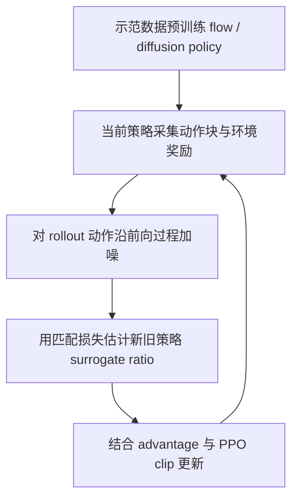
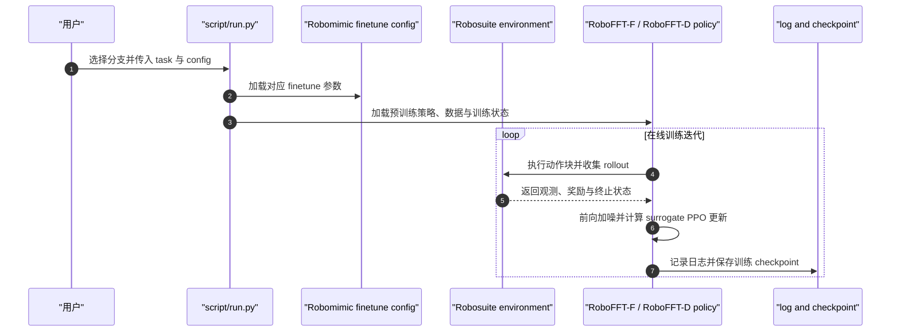

# RoboFFT（arXiv:2609.32236）

**RoboFFT**（*RoboFFT: Finetuning Generative Robot Policy via Online Reinforcement Learning with Forward Process*，[arXiv:2609.32236](https://arxiv.org/abs/2609.32236)，[项目页](https://student-of-holmes.github.io/RoboFFT/)）是北京大学人工智能研究院、PKU-PsiBot 联合实验室与南京大学团队提出的生成式机器人策略在线强化学习微调框架，CoRL 2026 项目页标注录用。

## 一句话定义

**RoboFFT 沿策略训练时的前向加噪过程评估 rollout 动作，用加权匹配损失的策略差构造 PPO surrogate ratio，从环境奖励继续优化预训练的生成策略。**

## 英文缩写速查

| 缩写 | 英文全称 | 简要说明 |
|------|----------|----------|
| RL | Reinforcement Learning | 利用环境交互奖励微调策略 |
| PPO | Proximal Policy Optimization | 以裁剪代理目标限制策略更新 |
| VLA | Vision-Language-Action | 视觉、语言条件的动作策略；论文报告其动作头微调实验 |
| ELBO | Evidence Lower Bound | 项目页用于解释匹配损失与动作对数似然关系的变分下界 |

## 为什么重要

扩散或 flow policy 可表达多模态动作，但标准 PPO 更新需要可计算的新旧策略似然比；多步生成策略的动作 likelihood 通常难以直接求得。RoboFFT 把训练阶段已有的加噪/匹配目标重新用于在线策略更新，减少显式求逆向生成链似然的负担。

## 方法栈与流程总览

1. **预训练并采样动作块**：从示范数据训练生成式策略，按当前策略与观测采集动作块及环境奖励。
2. **沿前向过程加噪**：对 rollout 中的干净动作块采样噪声等级与高斯噪声，得到带噪动作；当前策略与旧策略使用相同噪声样本估计匹配损失，以降低差分估计方差。
3. **构造 surrogate ratio**：以旧策略损失减当前策略损失后指数化，作为动作概率比的 surrogate，并按 ratio temperature 校准。
4. **PPO 更新**：结合 rollout advantage 与 clip 目标更新策略。RoboFFT-F 使用 flow-matching loss；RoboFFT-D 使用扩散噪声预测 loss，并按相邻步骤的 clipped log-SNR 变化加权。
5. **稳定训练**：flow 采样可注入 SDE 探索噪声；困难任务可用最佳评估 checkpoint 的 anchor loss；扩散变体还以负优势折扣减轻过度惩罚。

## 源码运行时序图

官方仓库提供可运行的 Robomimic flow 与 diffusion 入口，但当前 release 不含论文里的 VLA 与真实机器人实验代码；入口和资产准备见 [官方代码归档](../../sources/repos/robofft.md)。

## 实验与评测

- **仿真**：项目页覆盖 Robomimic 的 Lift、Can、Square、Transport，含 state 与 pixel 输入；RoboFFT-F 平均训练迭代速度约为 ReinFlow 的 1.53×，RoboFFT-D 在 state-input 设置下约为 DPPO 的 38.0×。
- **VLA 微调**：项目页报告通过 π₀ flow 动作头微调，在 LIBERO-Object 与 LIBERO-Spatial 上提升预训练策略，并与 πRL baseline 比较。
- **真机 RL**：项目页列出 Pick Eggplant、Peg Insertion、Pour、Cabinet Retrieval 四项任务；聚合成功率由预训练阶段 45.0% 提升到 online RoboFFT 93.8%。项目页描述流程为少量 SpaceMouse 示范初始化，再结合 IQL 优势估计、离线更新、示范刷新与在线 refinement。
- **读数边界**：上述效率和成功率均为项目页展示值；精确复现实验应核对论文中的任务协议、rollout 数与统计口径。仓库当前公开代码只覆盖 Robomimic 仿真。

## 与其他工作对比

| 路线 | PPO ratio 来源 | 优化路径 | RoboFFT 相关差异 |
|---|---|---|---|
| 直接对生成策略用普通 PPO | 需要生成动作的可计算似然 | 按策略分布对 rollout 动作作更新 | 生成式策略的 likelihood 通常难算 |
| Reverse-process RL（如 DPPO / ReinFlow 类方法） | 逆扩散/流轨迹转移概率 | 对生成链中多个去噪步骤进行优化 | 可能形成更长的优化图 |
| RoboFFT | 匹配损失差构造 surrogate ratio | 在前向加噪目标上做 PPO-style 更新 | 复用预训练目标；ratio 是 surrogate，需关注估计误差 |

## 结论

**RoboFFT 的实用贡献是把生成式策略已有的匹配目标变成 PPO 可用的近似概率比，便于用环境奖励继续微调；它没有让生成策略似然变成精确可算。**

1. 适合已经有 flow / diffusion 示范策略、又希望用环境奖励改善长时序或稀疏奖励任务的操作场景。
2. 同一噪声样本估计新旧损失、调校 ratio temperature 和 PPO clipping，是控制 surrogate 方差与更新幅度的关键。
3. flow 与 diffusion 两类策略需分别匹配 loss 权重、探索噪声和 negative-advantage 处理，不能把实现细节混成统一公式。
4. 项目页的 surrogate-ratio 分析显示特定设置下误差会下降，但排名相关仍有限；把它视为实用近似，不应宣称与精确 likelihood ratio 等价。
5. 复现边界要按代码版本判断：Robomimic 仿真可运行，论文 VLA 与真机实验代码当前未发布到该仓库。

## 局限与风险

- surrogate ratio 建立在加权 denoising / flow-matching loss 与似然估计关系上，温度与噪声采样影响校准；它与真实策略比率并非处处相等。
- 在线 rollout 仍需要仿真或真机交互和可靠 reward / advantage；真机安全、复位与数据预算不会因替代 ratio 自动消失。
- 公开仓库的 README 说明 VLA 与真实机器人实验代码不在当前 release，且部分数据 / checkpoint 自动下载链接需要核查，勿把论文全部结果视为开箱可复现。

## 关联页面

- [Diffusion Policy](../methods/diffusion-policy.md)
- [PPO](../methods/ppo.md)
- [Flow Matching](../concepts/flow-matching-embodied-policy.md)

## 参考来源

- [论文来源摘录](../../sources/papers/robofft_arxiv_2609_32236.md)
- [官方项目页与开放状态核查](../../sources/sites/robofft.md)
- [代码仓库与运行入口](../../sources/repos/robofft.md)

## 推荐继续阅读

- [RoboFFT 项目页](https://student-of-holmes.github.io/RoboFFT/)
- [RoboFFT 代码仓库](https://github.com/shshsunny/RoboFFT)
- [PPO](../methods/ppo.md) 与 [Diffusion Policy](../methods/diffusion-policy.md)
