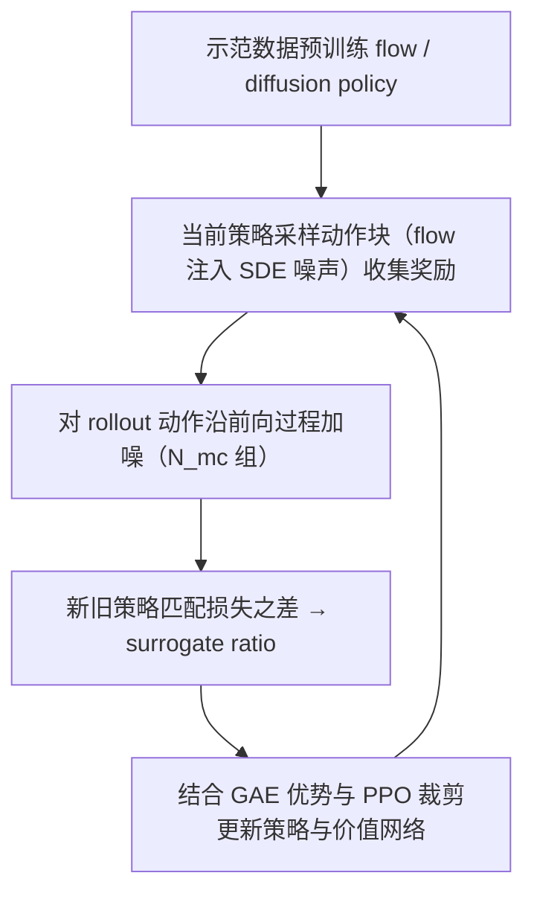
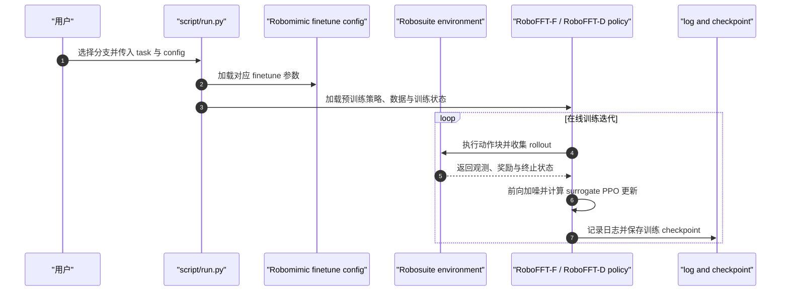

# RoboFFT（arXiv:2609.32236）

**RoboFFT**（*RoboFFT: Finetuning Generative Robot Policy via Online Reinforcement Learning with Forward Process*，[arXiv:2609.32236](https://arxiv.org/abs/2609.32236)，[项目页](https://student-of-holmes.github.io/RoboFFT/)）由北京大学人工智能研究院、中关村学院、PKU-PsiBot 联合实验室与南京大学团队提出（论文首页脚注），是生成式机器人策略的在线强化学习微调框架；CoRL 2026 录用见项目页标注，论文 PDF 内未见会议标注。全文通读归档见 [论文来源归档](../../sources/papers/robofft_arxiv_2609_32236.md)。

## 一句话定义

**RoboFFT 沿策略训练时的前向加噪过程评估 rollout 动作，用加权 score / flow matching 损失之差构造 PPO surrogate ratio，用环境奖励继续优化预训练的扩散或 flow 策略，而不把逆向去噪链当作多步 MDP（论文摘要、第 4 节）。**

## 英文缩写速查

| 缩写 | 英文全称 | 简要说明 |
|------|----------|----------|
| RL | Reinforcement Learning | 利用环境交互奖励微调策略 |
| PPO | Proximal Policy Optimization | 以裁剪代理目标限制策略更新（式 1） |
| GAE | Generalized Advantage Estimation | 论文用它估计优势（式 13） |
| ELBO | Evidence Lower Bound | 论文用加权去噪损失与 ELBO 的联系解释 surrogate（第 4.2 节，附录 A.1） |
| SDE | Stochastic Differential Equation | flow 策略 rollout 时注入噪声的 Euler-Maruyama 采样（式 4） |
| MC | Monte Carlo | 对噪声等级与高斯噪声取 N_mc 个样本估计匹配损失（式 7） |
| CFM | Conditional Flow Matching | RoboFFT-F 的匹配损失（附录 B.5） |
| SNR | Signal-to-Noise Ratio | RoboFFT-D 用相邻去噪步的 log-SNR 差加权（式 16-17） |
| IQL | Implicit Q-Learning | 真机流程中用来估计离线优势（附录 G.2） |
| VLA | Vision-Language-Action | 论文在 π0 的 flow 动作头上做微调（第 5.2 节） |

## 为什么重要

扩散与 flow 策略能表达多模态动作，但纯模仿受示范质量与分布偏移限制（第 1 节）；PPO 需要新旧策略的概率比，而这类策略没有可计算的精确似然。已有的反向过程做法（DPPO、ReinFlow）把去噪链视为内层 MDP；作者认为它带来计算与显存开销，并可能因长链而不稳（第 1 节，这是作者的动机陈述）。RoboFFT 的思路是复用预训练的匹配损失，使 RL 微调目标与预训练目标同形。论文同时覆盖扩散、flow、π0 与真机，是在 FPO / FPO++（主要面向 locomotion，第 2.2 节）之后把前向过程路线推进到操作任务的一次尝试。

## 核心原理与流程总览

1. **预训练与采样**：用示范预训练扩散或 rectified-flow 策略；rollout 时扩散策略用自带 SDE 采样器，flow 策略注入固定强度 η 的噪声做 Euler-Maruyama 采样，只用于收集动作，不参与似然计算（第 4.1 节）。
2. **前向加噪**：对 rollout 的干净动作块 a⁰ 采 N_mc 组噪声等级与高斯噪声，得到带噪动作；新旧策略复用同一批噪声以稳定差分（第 4.3 节，式 7）。
3. **surrogate ratio**：ρ̂ = exp(新旧匹配损失之差)，再用温度 α_ratio 校准尺度（式 5、8）；代入 PPO 裁剪目标，优势由 GAE 得到（式 6、13）。附录 A.1 指出：ELBO 之比等于真实似然比再乘一个变分间隙修正项，所以 surrogate 只是近似。
4. **两种实例化**（附录 B.5-B.8，表 6）：RoboFFT-F 基于 ReinFlow 代码库，速度匹配损失权重恒为 1，N_mc 通常 1 或 2；RoboFFT-D 基于 DPPO 代码库，噪声预测损失按离散 Δlog-SNR 加权，N_mc = 16，困难任务加 best-evaluation anchor 正则与负优势折扣 β_neg。

## 工程实践

- **Robomimic 设置**（附录 B）：Lift、Can、Square、Transport，稀疏奖励，state 与 pixel 输入；动作块 H = 4（Transport 为 8）；在线样本预算 4.86M 到 32.16M（表 3）。RoboFFT-F 主要超参：η = 0.25，10 个采样步，α_ratio 为 2（Transport 为 1），裁剪系数 0.02，10 个更新轮（表 4、附录 B.5）；RoboFFT-D：state 输入 20 个去噪步微调后 10 步，pixel 输入 100 步微调后 5 步（表 5）。
- **VLA 设置**（第 5.2 节，附录 F）：基于 RLinf 实现，只替换对数概率计算；与 πRL 的配置差异为 KL 系数 0.5 对 0.0、PPO 裁剪 0.05 对 0.20、N_mc = 8（表 7）。作者提到动作块高维时对损失直接求和会使幅值过大，是扩展难点。
- **真机流程**（第 5.4 节，附录 G.2）：不是纯在线 PPO。每任务 50 条 SpaceMouse 示范，预训练 rectified-flow 策略与 IQL critic，离线 RoboFFT 更新，部署收集 1 轮 30 条轨迹，与示范合并模仿学习，再做 5 次在线迭代；奖励为人工判定的 0/1。
- **代码**：仓库归档记录 Robomimic flow 与 diffusion 入口可运行，论文中的 VLA 与真机代码不在当前 release（见 [官方代码归档](../../sources/repos/robofft.md)；这是仓库 README 信息，本次通读论文未再核实）。运行入口时序如下，同样来自仓库归档，未逐行核对源码。

## 实验与评测摘录

- **仿真（第 5.1 节，图 3）**：Robomimic 四个任务，三种子均值曲线。Lift、Can 上与反向过程基线最终成功率相当；Square、Transport（尤其 pixel）上作者称 RoboFFT 更稳定。图 3 仅有曲线，没有汇总表。附录 C.2 用 10 个种子（Square-state）与 5 个种子（Transport-state）复核，结论与主图一致。
- **训练时间（图 4，附录 C.3）**：只统计策略与价值网络更新，不含 rollout，取前 10 次迭代的均值。RoboFFT-F 相对 ReinFlow 平均 1.53×，RoboFFT-D 相对 DPPO 平均 38.0×（仅四个 state 任务，N_mc = 16）。论文自己说明这不等于整轮迭代加速，也不是单一操作的隔离测量。
- **π0 on LIBERO（第 5.2 节，图 5）**：LIBERO-Object 与 LIBERO-Spatial 上相对预训练策略提升，与 πRL 相比作者称有竞争力；全文没有给出具体成功率数字，只有曲线。
- **真机（第 5.4 节，图 9，每任务 20 次）**：Pretrain 到 Offline 到 Online 的成功次数为 Pick Eggplant 12、18、20，Peg Insertion 10、19、20，Pour 9、15、18，Cabinet Retrieval 5、14、17；按表汇总为 36/80、66/80、75/80，即 45.0%、82.5%、93.75%。只在 Pick Eggplant 上比较了 BC Aggregation（14/20）、DRWR（12/20）与 RL100（20/20），在线 RoboFFT 为 20/20（相同数据预算）。
- **消融与诊断（第 5.3 节，附录 D）**：SDE 噪声过小会坍塌、过大也退化；N_mc 在 flow 上由 1 到 2 即有收益，扩散上 1 明显弱于 4 或 16；去掉优势加权或 PPO 裁剪会不稳；RoboFFT-D 去掉负优势折扣明显恶化。surrogate 与 ReinFlow 式闭式参考比率的 Spearman 秩相关约 0.2，相对误差末期 90% 以上样本低于 5%（图 8），论文说明这不证明两者严格对应。

## 与清单说法的对比核对

清单（Glen Berseth 的 CoRL 2026 阅读清单，005/101，P0，分组「RL Fine-Tuning of VLAs and Generative Policies」）对该论文的一句话摘要为：Online RL fine-tuning of diffusion and flow policies via forward noising and a weighted flow-matching surrogate for the policy ratio。排序是作者用自己的研究兴趣模型打分得来，不是论文质量评价，摘要由 LLM 据摘要起草。逐项核对：

| 清单说法 | 论文实际 | 判断 |
|---|---|---|
| Online RL fine-tuning of diffusion and flow policies | 摘要与第 5.1 节：RoboFFT-D（扩散）与 RoboFFT-F（rectified flow）在 Robomimic 仿真中在线微调；真机实验却是离线到在线流程（第 5.4 节、附录 G.2），并非纯在线 | 基本相符，真机部分要加限定 |
| via forward noising | 第 4 节：对 rollout 动作沿前向过程加噪 | 相符 |
| weighted flow-matching surrogate | 摘要为 weighted score / flow matching loss：flow 策略用 CFM，扩散策略用加权去噪 score matching（式 3，附录 B.6），且 RoboFFT-F 的权重恒为 1（附录 B.5） | 略窄：只点了 flow，漏了扩散的 score matching 与 Δlog-SNR 加权 |
| for the policy ratio | 第 4.2 节：新旧损失之差指数化为 surrogate ratio，再乘温度 α_ratio（式 8）；论文强调这只是近似（附录 A.1，局限第 6 节） | 相符，但清单未提「近似」 |
| （清单未提）VLA 与真机 | 第 5.2 节 π0 on LIBERO，第 5.4 节四项真机任务 | 清单摘要缺失该论文的另外两块实验 |

两点值得留意：第一，该论文的「更稳定、更高效」均为作者自述，训练时间加速限定为更新时间且 38.0× 只覆盖 state 任务；第二，清单摘要不含任何数字，故无可核对的数字错误。

## 结论

RoboFFT 为生成策略构造可优化的 PPO 代理比率，但它不等同精确似然比，校准与在线样本成本仍关键。

- 按噪声日程、动作维度与结构重新标定代理比率尺度。
- 比较算法时对齐基础策略、负优势处理、数据聚合和离线预热。
- 把完整真机流程的收益与 surrogate ratio 的单独贡献分开，少量任务不能证明通用后训练优势。

## 局限

论文自己承认的（第 6 节）：

- 加权 matching loss 只是真实对数似然的替代，尺度随噪声日程、动作维度与策略结构变化，仍需温度标定等额外校准。
- 依赖 on-policy PPO，数据效率有限，难以复用历史轨迹，单机器人真机部署困难；离线到在线范式只能部分缓解，仍需迭代采集与离线重训。

通读时看到的未验证之处（以下为本页判断，非作者自述）：

- 代理比率与参考的 Spearman 约 0.2，论文只在 RoboFFT-F 的 Square-state 上做了这项诊断，没有在扩散策略、pixel 输入或 VLA 上验证。
- 真机每个任务只有 20 次试验，没有跨种子或置信区间，且基线对比只在 Pick Eggplant 一项上做；真机流程混合了 IQL、数据聚合与模仿学习，难以把增益单独归因到 surrogate ratio（论文用 BC Aggregation 与 DRWR 做了一项对照，仅限该任务）。
- VLA 结果只有曲线，且与 πRL 的配置不同（KL 系数、裁剪范围、N_mc，表 7），差异来源不能单独归因给方法。
- 各任务的超参（α_ratio、N_mc、β_neg、anchor）不同（表 4、表 5），RoboFFT-D 对负优势折扣尤其敏感（附录 D），实际使用需要按任务调参；FPO 基线是作者自己改入代码库并去掉其 SDE 与温度的版本（附录 B.4），其落后可能部分来自实现差异。
- 公开仓库只含 Robomimic 仿真代码（仓库归档），VLA 与真机结果当前无法由仓库复现。

## 关联页面

- [Diffusion Policy](../methods/diffusion-policy.md)
- [PPO](../methods/ppo.md)
- [Flow Matching 具身策略](../concepts/flow-matching-embodied-policy.md)
- [RFPO：reward-aware reflow 与蒸馏](paper-rfpo-rectified-flow-policy-optimization.md)
- [RLinf-VLA](paper-rlinf-vla.md)（同属 RLinf 生态的 VLA 强化学习框架；本文实际引用的是 RLinf 系统论文 [49]，并非该页论文）
- [πRL：flow VLA 在线 RL 微调](paper-rcl-2510-25889-rl-online-rl-fine-tuning-for-flow-based-vision-l.md)（本文 VLA 实验的基线）
- [SERL](paper-rcl-2401-16013-serl-a-software-suite-for-sample-efficient-robot.md)（论文引用的真机 RL 框架之一）
- [π0](paper-pi0.md)

## 参考来源

- [论文来源归档（全文通读）](../../sources/papers/robofft_arxiv_2609_32236.md)
- [官方项目页与开放状态核查](../../sources/sites/robofft.md)
- [代码仓库与运行入口](../../sources/repos/robofft.md)

## 继续阅读

- [RoboFFT 项目页](https://student-of-holmes.github.io/RoboFFT/)
- [RoboFFT 代码仓库](https://github.com/shshsunny/RoboFFT)
- 论文引用的相邻工作：DPPO（arXiv:2409.00588）、ReinFlow（arXiv:2505.22094）、FPO（arXiv:2507.21053）、RL-100（arXiv:2510.14830）
- [PPO](../methods/ppo.md) 与 [Diffusion Policy](../methods/diffusion-policy.md)
