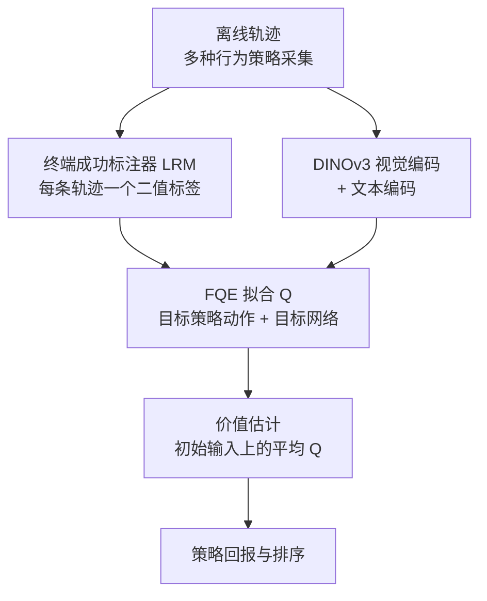

# RoboFQE：不跑 rollout，从离线轨迹评估视觉机器人策略

**RoboFQE 把「策略评估」当成离线策略评估（OPE）问题：在已有轨迹上用拟合 Q 评估（FQE）、预训练视觉编码器与一个终端成功标注器，直接估计目标策略的折扣回报并给多个策略排序，不需要新的真机/仿真 rollout，也不依赖逐帧生成的视频世界模型。**

论文 *RoboFQE*（[arXiv:2610.18699](https://arxiv.org/abs/2610.18699)，[项目页](https://yfdeng.com/robofqe/)）。

## 英文缩写速查

| 缩写 | 英文全称 | 简要说明 |
|------|----------|----------|
| FQE | Fitted Q Evaluation | 用 Bellman 回归拟合目标策略的 Q 函数，无需行为策略密度 |
| OPE | Off-Policy Evaluation | 用别的策略采集的数据估计目标策略表现 |
| ARE | Absolute Relative Error | 估计值与真值的绝对相对误差，衡量价值准确度 |
| MMRV | Mean Maximum Rank Violation | 排序错误的严重程度，越低越好 |

## 为什么重要

- 评估每个检查点都要真机或仿真 rollout，成本高；世界模型评估器则在长 horizon 上自回归误差累积（Long 套件 ARE 54–69%）。
- RoboFQE 的误差不随 rollout 步数累积，因为它只学一个 Q 函数，而不生成未来帧；这是论文的核心卖点。
- 与 [sim-vs-real 评测差距](../concepts/sim-vs-real-eval-gap.md) 相关：它提供一条不经仿真器的第三种评估路径。

## 核心信息

| 项 | 内容 |
|----|------|
| **机构** | University of Wisconsin–Madison 计算机系（威斯康星大学麦迪逊分校） |
| **平台** | LIBERO、CALVIN ABC→D 仿真；SO-101 真机叠方块 |
| **数据** | LIBERO 每 suite 750 条离线轨迹；真机 150 条遥操作 + 100 条 BC rollout |
| **开源** | **宣称将开源**（2026-10-17 核查）：项目页为 "Project page in progress"，"Code coming soon"，无仓库链接 |

## 核心原理

### 流程总览

- **奖励只在终点：** 每条轨迹一个二值成功标签，所有目标策略共享；标注可由 VLM 代替真值（LIBERO 微调后 97.4%，真机零样本 83.3%）。
- **视觉编码器是关键：** 预训练 DINOv3 比从零训练在 Long 套件上 ARE 低得多（5.63% 对 32.09%）。

## 源码运行时序图

**不适用**：截至 2026-10-17 项目页仅 "Code coming soon"，无可运行的官方实现。

## 与其他工作对比

| 维度 | RoboFQE（本文） | [Ctrl-World](./paper-ctrl-world.md) | [WorldGym](./paper-shenlan-wm-15-worldgym.md) | [SimplerEnv](./paper-simplerenv-real2sim-eval.md) |
|------|------|------|------|------|
| 评估方式 | 离线轨迹上拟合 Q（FQE），不做 rollout | 动作条件多视角视频 WM 中想象 rollout | WM 中 MC 模拟 | 对齐控制与视觉后的物理仿真 rollout |
| 成功信号 | 终端成功标注器（可用 VLM 替代真值） | 本库页未述 | VLM 奖励 | 仿真内任务判定 |
| 长 horizon 误差来源 | 不随 rollout 步数累积（论文主张），依赖数据覆盖 | 自回归生成，用位姿记忆稳住长时 rollout | 自回归 WM 生成 | 不涉及生成误差，受 sim–real gap 影响 |
| SO-101 真机（RoboFQE 论文） | ARE 7.5%，r=+0.90 | ARE 10.3%，r=+0.49 | ARE 17.8%，r=+0.44 | 未在该文评测 |

- **相对 Ctrl-World / WorldGym：** 二者都靠生成未来帧来评估，RoboFQE 只学一个 Q 函数，因而在 LIBERO-Long 上 ARE 5.63% 对世界模型 54–69%；代价是对离线数据覆盖与成功标注器误差敏感。
- **相对 SimplerEnv：** SimplerEnv 仍需在仿真中跑新 rollout，换取物理一致性；RoboFQE 不需要仿真器，但只能评估离线数据覆盖到的状态分布。
- 真机行数字来自 RoboFQE 论文同一设定；各文自报的相关性结果口径不同，不可横比。

## 工程实践

| 项 | 建议 |
|----|------|
| 数据覆盖 | 离线数据需覆盖目标策略会访问的状态，论文局限明确指出对覆盖敏感 |
| 成功标注 | 无真值奖励时可用学得的标注器，代价是准确度略降 |
| 排序而非绝对值 | 论文重点是 r 与 MMRV；选 checkpoint 时优先看排序指标 |
| 零成功基线 | 论文的失败案例：真值成功率为 0 的随机策略仍获正价值，会拉低排序，需配合健全性检查 |
| 开源状态 | 未发布；入库日期 2026-10-17，后续复查 |

## 实验与评测

- **LIBERO（ARE，RoboFQE vs 最强世界模型）：** Spatial 3.40% 对 8.44%；Object 4.56% 对 8.17%；Goal 2.34% 对 8.03%；Long 5.63% 对 54.37%（Cosmos 2.5-AC）。
- **LIBERO 排序（对 Vπ）：** r = +0.96 / +0.91 / +0.90 / +0.88，MMRV = 0.03 / 0.02 / 0.05 / 0.07。
- **CALVIN ABC→D（X-VLA）：** 真值平均链长 4.32；RoboFQE 3.61，WorldGym 1.04，Cosmos 2.5-AC 1.48。
- **真机（SO-101，三个策略 SmolVLA / π0.5 / 多任务 BC，真值 58.5 / 81.0 / 33.0%）：**

| 方法 | ARE % | r | MMRV |
|------|-------|---|------|
| RoboFQE | 7.5 | +0.90 | 0.11 |
| Ctrl-World | 10.3 | +0.49 | 0.19 |
| WorldGym | 17.8 | +0.44 | 0.40 |
| Cosmos 2.5-AC | 24.5 | +0.68 | 0.28 |

## 结论

**RoboFQE 的价值在长 horizon 与真机上的排序保真度，而不是绝对数值的精确。**

1. **长 horizon 是主战场** — LIBERO-Long 上 ARE 5.63% 对世界模型 54–69%。
2. **预训练编码器不可省** — 从零训练编码器 Long 上 ARE 升至 32.09%。
3. **排序比价值更稳** — 真机 r=+0.90、MMRV 0.11，明显优于三种世界模型评估器。
4. **注意假阳性** — 零成功率策略仍得正价值，在策略集含极差策略时会损伤排序（Spatial 上 r 从 +0.93 降至 +0.54）。
5. **没有代码** — 当前只能依论文自建；真机仅 3 个策略，排序统计力有限（推测）。

## 局限与风险

- 依赖离线数据对目标策略访问分布的覆盖（作者自述）。
- 对成功检测器误差敏感；真机零样本标注准确度仅 83.3%。
- Q 函数条件于当前输入而非完整历史（作者自述）。
- 真机评估规模小：一种机械臂、三个策略。
- 项目页内容仅占位，无独立补充材料。

## 关联页面

- [sim-vs-real 评测差距](../concepts/sim-vs-real-eval-gap.md) — 评估可信度语境
- [仿真评测基础设施](../concepts/simulation-evaluation-infrastructure.md) — 对照：rollout 式评估
- [具身大模型评测基准选型闭环](../queries/embodied-eval-benchmark-selection-loop.md) — RoboFQE 以离线价值估计替代部分 rollout，处在任务成功率层与 sim↔real 校准层之间
- [在线与离线 RL](../comparisons/online-vs-offline-rl.md) — 离线价值学习背景
- [LIBERO 基准](libero-benchmark.md) — 主要实验场
- [CALVIN 基准](calvin-benchmark.md) — 长链任务

## 参考来源

- [robofqe_arxiv_2610_18699.md](../../sources/papers/robofqe_arxiv_2610_18699.md) — 论文摘录与开源核查
- [robofqe-project.md](../../sources/sites/robofqe-project.md) — 项目页归档
- [arXiv:2610.18699](https://arxiv.org/abs/2610.18699) — 原文

## 推荐继续阅读

- [RoboFQE 项目页](https://yfdeng.com/robofqe/)
- [arXiv HTML 全文](https://arxiv.org/html/2610.18699)
