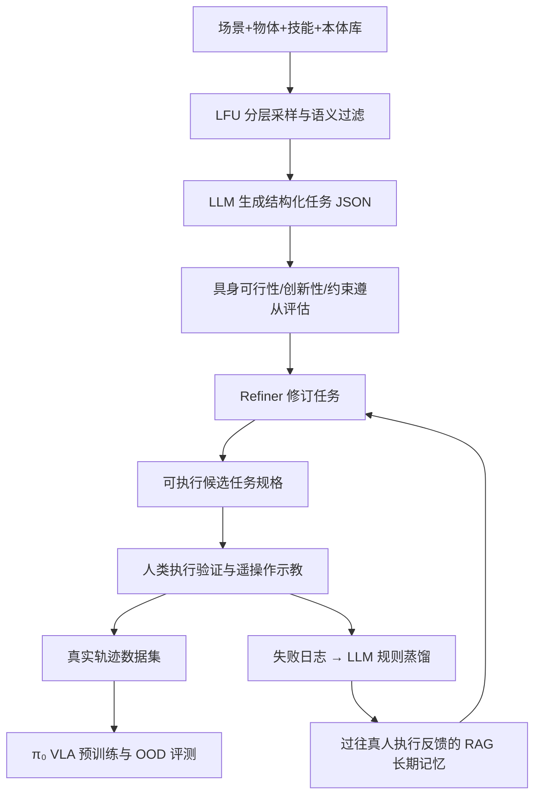

# RoboGene：多样性驱动的机器人任务智能体生成

## 一句话定义

**用“均衡采样→LLM 提案→具身可行性自反思→人类执行反馈记忆”的闭环自动设计机器人示教任务，再由真实采集形成更广覆盖的 VLA 预训练数据。** 论文：[arXiv:2602.16444](https://arxiv.org/abs/2602.16444)。

## 英文缩写速查

| 缩写 | 英文全称 | 简要说明 |
|---|---|---|
| VLA | Vision-Language-Action | 下游视觉-语言-动作策略 |
| LFU | Least Frequently Used | 按历史使用频次优先采样长尾任务元素 |
| LLM | Large Language Model | 生成提案与进行任务反思 |
| RAG | Retrieval-Augmented Generation | 检索以往真人执行约束辅助修正 |
| OOD | Out-of-Distribution | 物体、环境、光照及指令的未见分布变化 |

## 为什么重要

- VLA 不仅缺少轨迹数量，还缺少“能采集、又足够多样”的任务分布；人类设计偏好家庭/厨房任务。
- 单次 LLM 提案可能要求不兼容本体的操作、凭空增加物件或生成错误时序；以物理验证的反思和长期记忆避免重复错误。
- RoboGene 属于**上游数据采集任务设计**，和 [RoboAug](./paper-roboaug.md) 的“已有轨迹图像增强”互补。

## 核心原理

1. **任务空间：** 场景、物体、技能、机器人本体库（论文附录：8 类场景、118 种技能、1137 个物体）；按 LFU 降低热门类别过采样，并通过相似度过滤不合理场景组合。
2. **Agent 反思：** 提案生成器输出 JSON；具身可行性、创新度、约束遵从三个评估器输出批评，再交由 Refiner 汇总修订。
3. **长期记忆：** 真人执行任务时记录失败原因；LLM 提炼可复用经验规则，RAG 匹配语义相近任务，提高下一轮物理可信度。
4. **采集与预训练：** 生成可执行任务规范后由操作员遥操作采集真实演示轨迹，训练 π₀，并在未见任务上评估。

### 流程总览

## 源码运行时序图

**不适用**：截至 2026-11-12，项目页与开放数据未提供经核实可运行的完整任务生成 Agent 代码入口；论文中的概念图是算法流程，不能冒充源码调用时序。

## 工程实践

| 维度 | 原文与项目情况 |
|---|---|
| 机构 | 北京人形机器人创新中心及合作研究机构（详见论文作者页） |
| 真实设备 | 单臂 UR5e、双臂 Franka、AgileX 移动双臂等 |
| 任务样本 | 每个方法 300 个预训练任务 × 每任务 15 条遥操作示教 |
| 模态 | 任务规格是结构化文本 / JSON；真人遥操作产出供 VLA 训练的视觉与机器人动作轨迹。具体数据字段与同步约定以开放数据集说明为准，不能把任务 JSON 当动作标注。 |
| 可用资源 | [论文](https://arxiv.org/html/2602.16444)；[数据集](https://huggingface.co/datasets/X-Humanoid/RoboGene) |
| 开源状态 | **数据公开，完整生成器代码入口未核实**；勿将数据集当成算法实现 |
| 可复现性 | 任务 JSON 库、采集本体能力、执行审核及训练配方都需对齐 |

## 实验与评测

- **任务覆盖：** 论文 §4.2：RoboGene 生成任务触及 **719 种物体**，高于当时各对照生成器。
- **真实示教：** 四种生成方案合计 **18,000 条**示教轨迹；这是四组共同评测规模，不是 RoboGene 自动生成的动作数据。
- **OOD：** 五种分布变化（新物体、背景、干扰物、光照、语言）× 五个双臂任务共 1500 试次/方案，RoboGene **40.2%**，Human **19.0%**、GPT-4o **15.8%**、Gemini **17.8%**。
- **50 条示教适配：** 附录表 9，RoboGene 预训练组五任务平均 **48%** vs Human **38%**；与上一段 OOD 测试的协议不同。

## 结论

**最有价值的不是“自动造轨迹”，而是自动提出能被实际采集且分布更均衡的机器人任务。**

1. **任务规格与轨迹要分开**：Agent 产任务描述，真实演示仍需遥操作与人工审查。
2. **LFU 管覆盖**：降低热门场景重复，扩展对象长尾。
3. **多评估器管质量**：具身可行性、约束与创新性须分别检查。
4. **真人反馈管闭环**：把实际不可执行原因固化为可检索约束。
5. **注意实验计数**：18k 是四种任务生成方法合计采集的轨迹，不能夸大成单一方案产量。

## 与其他工作对比

- [RoboAug](./paper-roboaug.md)：在**既有演示轨迹**上做物体分割、背景合成和区域对比；RoboGene 在**采集之前**规划任务覆盖。
- [Robo-ValueRL](./paper-robo-valuerl.md)：在**采集之后**评价哪些动作有用；RoboGene 解决前端“采什么”的问题。
- [VLA](../methods/vla.md) 是最终被训练的策略，不直接等价于生成任务的 LLM Agent。

## 局限与风险

- 任务候选仍受有限库约束；扩展到未知物件/技能需维护库与物理审核。
- 人工执行验证及远程操作采集不可省略，数据成本未被算法自动消除。
- 论文中的物理可行性分数不等于真机零失败，OOD 指标限于原评测设置。
- 无经核实的完整可运行生成器代码，无法从公开资源直接复现任务设计闭环。

## 关联页面

- [RoboAug 数据增广](./paper-roboaug.md)
- [Robo-ValueRL 价值引导](./paper-robo-valuerl.md)
- [VLA 基础](../methods/vla.md)
- [操作任务](../tasks/manipulation.md)

## 参考来源

- [arXiv v3 全文与实验归档](../../sources/papers/robogene_arxiv_2602_16444.md)
- [官方项目/数据核查](../../sources/sites/robogene-project.md)

## 推荐继续阅读

- [论文 HTML](https://arxiv.org/html/2602.16444)；[项目页](https://robogene-boost-vla.github.io/)；[开放数据集](https://huggingface.co/datasets/X-Humanoid/RoboGene)
