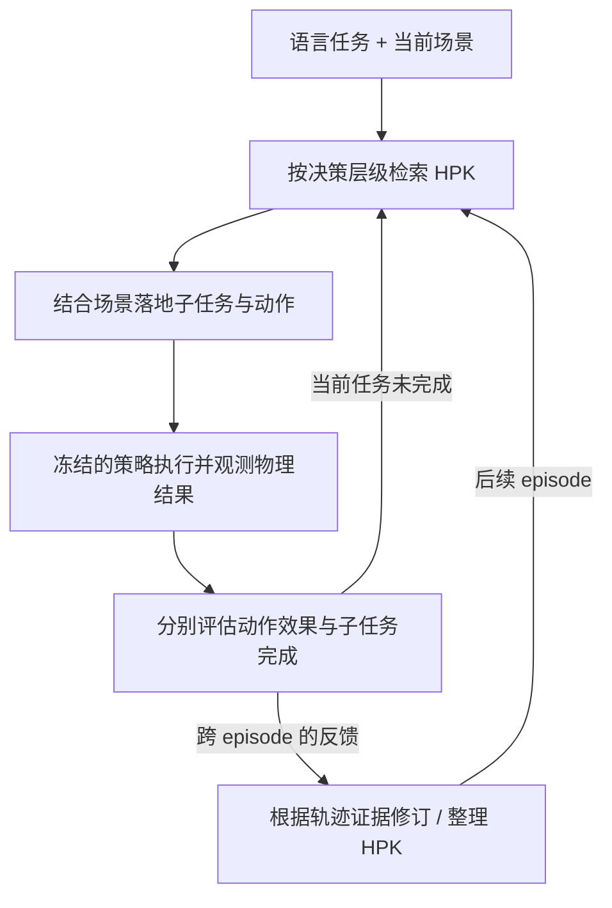
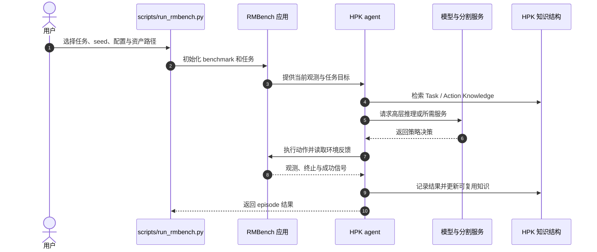

# RoboHarn-Evo（可演化分层物理知识 · arXiv:2609.37583）

**RoboHarn-Evo**（[论文](https://arxiv.org/abs/2609.37583)、[项目页](https://ruckbreasoning.github.io/RoboHarn-Evo/)、[代码](https://github.com/RUCKBReasoning/RoboHarn-Evo)；中国人民大学、清华大学与 XYZ Embodied AI）通过交互积累可复用的物理知识，让机器人在后续操作回合中减少重复犯错。它更新的是外置知识结构，基础 VLM 与低层执行器保持固定。

## 英文缩写速查

| 缩写 | 英文全称 | 简要说明 |
|------|----------|----------|
| HPK | Hierarchical Physical Knowledge | 由任务级与动作级知识构成的可演化知识 |
| VLM | Vision-Language Model | 接收视觉与语言信息、为机器人提供高层推理的模型 |
| VLA | Vision-Language-Action | 将视觉语言输入映射到机器人动作的策略形式 |
| RMBench | Robot Manipulation Benchmark | 评估操作任务、知识使用与跨回合改进的基准 |
| LIBERO-PRO | 项目 benchmark 名称（README 未展开缩写） | RoboHarn-Evo 仓库中的 benchmark 集成，含多组 suite 与任务定义 |

## 核心信息

| 字段 | 内容 |
|------|------|
| **机构** | 中国人民大学（Renmin University of China）；清华大学（Tsinghua University）；XYZ Embodied AI |
| **arXiv** | [2609.37583](https://arxiv.org/abs/2609.37583)（v2，2026-09-30） |
| **项目页** | [RoboHarn-Evo](https://ruckbreasoning.github.io/RoboHarn-Evo/) |
| **代码 / 许可证** | [RUCKBReasoning/RoboHarn-Evo](https://github.com/RUCKBReasoning/RoboHarn-Evo)；Apache-2.0 |
| **基准与运行入口** | RMBench、LIBERO-PRO；scripts/run_rmbench.py、scripts/run_libero_pro.py |
| **设计约束** | 跨回合更新 HPK；基础模型与低层执行器固定 |

## 为什么重要

- **把反馈变成长期资产：** 机器人从一次交互中得到的物理证据可影响后续 episode 的决策。
- **知识与策略权重解耦：** 外置知识层可以被修订和组织，基础 VLM 与低层执行器保持不变，利于诊断知识错误和适用条件。
- **任务层与动作层分别维护：** 子任务排序/完成判断与局部几何策略/物理效果是不同决策粒度，分开检索与评估，减少把“动作做到了”误判为“任务完成”。
- **实证结果有多种口径：** RMBench、80 次交互 rollout、知识纠错、跨 benchmark 迁移及真机结果各回答不同问题，比较时要对应各自协议。

## 英文名词与机制

- **Task Knowledge**：记录子任务选择、顺序、目标与完成条件，支持长时程任务推进。
- **Action Knowledge**：记录物体相对几何策略、接触/动作的预期物理效果，支持场景条件下的局部动作落地。
- **Inner execution loop**：在当前回合检索相应层级知识，结合当前场景执行并分别判断动作结果和子任务状态。
- **Outer knowledge-update loop**：从已记录的物理结果中更新、整合和组织知识，以供后续 episode 检索。
- **HPK**：把两级知识统一为一个可更新结构；所提出的 harness 通过演化知识而不改基础模型参数来积累经验。

## 流程总览

内层循环处理当前场景下的检索、执行和结果判断；外层循环将可复用的证据写入知识结构，供之后回合读取。

## 结果与评测

### RMBench 六任务平均成功率

| Agent 模型 | 无 HPK | Full HPK | 增益 |
|------------|-------:|---------:|-----:|
| Qwen3.8-27B | 19.2% | 41.7% | +22.5 个百分点 |
| GPT-5.5 | 58.3% | 82.5% | +24.2 个百分点 |
| GPT-6 | 72.5% | 91.7% | +19.2 个百分点 |

### 持续交互与知识维护

- 独立的 80 rollouts 学习实验中，held-out 成功率：GPT-5.5 **48.3%→75.0%**，GPT-6 **70.0%→88.3%**。评估使用冻结知识快照，不把 held-out 反馈回流到更新。
- 80 次交互后，历史知识错误中 GPT-5.5 **83.3%**、GPT-6 **91.7%** 被修复或停用；两模型均保留 **95.8%** 初始有效知识。
- 从 RMBench 到 RoboDojo 零样本迁移，GPT-5.5 / GPT-6 成功率分别提升 **35 / 25 个百分点**。
- 真机实验报告三类任务、每类八个场景；物理交互更新前后平均成功率 **41.7%→62.5%**，标准化任务进度 **70.5%→84.2%**。

## 源码运行时序图

仓库 README 暴露 RMBench 与 LIBERO-PRO 两套 benchmark runner，以及模型服务脚本；图概括其运行边界，具体服务调用与知识更新由配置决定。首次复现可先用 runner 的 list / dry-run 参数检查任务和配置，再准备模型服务与 benchmark 资源。

## 与其他工作对比

| 维度 | RoboHarn-Evo（本文） | [Harness VLA](./paper-harness-vla.md) | [RoboHarness](./paper-robo-harness.md) | [ASENA](./paper-asena-self-evolving-agents.md) |
|------|------|------|------|------|
| 冻结什么 | 基础 VLM + 低层执行器 | VLA（作可重试接触原语） | 各异构策略（VLA / RL / TAMP） | 模型与控制器权重 |
| 演化的对象 | 双层 HPK（Task / Action Knowledge） | Task / Global Memory（参考种子蒸馏后重绑定） | 技能路由与记忆辅助技能 | coding agent 的可执行工作区（程序 + 笔记） |
| 知识来源 | 跨 episode 物理交互反馈，含纠错与停用 | 参考种子演示 | 技能执行结果与能力边界 | MCAP 回放后的程序修复 |
| 代表基准 | RMBench、LIBERO-PRO、RoboDojo 迁移、真机 | LIBERO-Pro、RoboCasa365、RoboTwin | LIBERO-LoHo | 仿真重复任务 + Unitree G1 演示 |

- **相对 Harness VLA：** 二者都把记忆放在冻结策略之外；RoboHarn-Evo 强调**持续交互中的知识修订**（错误条目修复 / 停用、有效知识保留率），Harness VLA 更侧重从参考种子蒸馏后对扰动场景重绑定。
- **相对 RoboHarness：** RoboHarness 的核心是在异构技能间做能力边界感知路由；RoboHarn-Evo 不调度多种策略，而是给同一套执行栈补「物理效果」层知识。
- **相对 ASENA：** ASENA 演化的是可执行程序，RoboHarn-Evo 演化的是结构化知识条目；前者更依赖 coding agent 与安全检查，后者更依赖检索粒度设计。
- 各文基准与 agent 模型不同，表中成功率不可横向比较。

## 工程实践

- **代码可得性：** 官方仓库已开源（Apache-2.0），实现与运行脚本分别见[repo 归档](../../sources/repos/roboharn-evo.md)。
- **依赖边界：** Python 3.10+；模拟器、模型 checkpoint、SAM3 源码与权重、外部数据及许可资产需单独配置。
- **结果复现：** 先统一 benchmark、模型、任务/场景划分和知识快照；项目页演示剪辑不能代替成功率协议。
- **部署含义：** 若使用的模型服务或执行器变化，应重新验证原知识条目的适用条件；知识可积累本身不保证换本体或换分布后仍然有效。

## 结论

**总判：** RoboHarn-Evo 展示了把物理交互反馈转化为外置、分层、可修订知识的路径，结果支持其在给定 benchmark 和模型设置下改善长时程操作。

- 若要复用子任务顺序、目标和完成条件，优先查 Task Knowledge；若要定位局部接触几何与效果，查 Action Knowledge。
- 复现实验时分别记录 RMBench 主表和 80-rollout 学习曲线，二者的基线与 held-out 协议不同。
- 评估知识自我纠错时，同时报告错误条目修复/停用比例与有效知识保留率，避免只看单侧指标。
- 迁移到新 benchmark 或真机前，核对物体、动作、环境和执行器是否匹配知识的适用范围。
- 将 HPK 视为模型之外的可变状态；测试和部署需明确其初始化、快照、更新与回滚策略。

## 参考来源

- [RoboHarn-Evo 论文归档](../../sources/papers/roboharn_evo_arxiv_2609_37583.md)
- [RoboHarn-Evo 官方项目页归档](../../sources/sites/roboharn-evo-project.md)
- [RoboHarn-Evo 官方代码仓归档](../../sources/repos/roboharn-evo.md)

## 关联页面

- [VLA](../methods/vla.md)
- [机器人操作任务](../tasks/manipulation.md)
- [Harness VLA](./paper-harness-vla.md)
- [RoboHarness](./paper-robo-harness.md)
- [ASENA](./paper-asena-self-evolving-agents.md) — 冻结权重、演化可执行工作区的另一条自演化路线

## 推荐继续阅读

- [论文 arXiv 页面](https://arxiv.org/abs/2609.37583)
- [官方 RMBench / LIBERO-PRO benchmark 说明](https://github.com/RUCKBReasoning/RoboHarn-Evo/tree/main/benchmarks)
- [VLA 方法页](../methods/vla.md)
