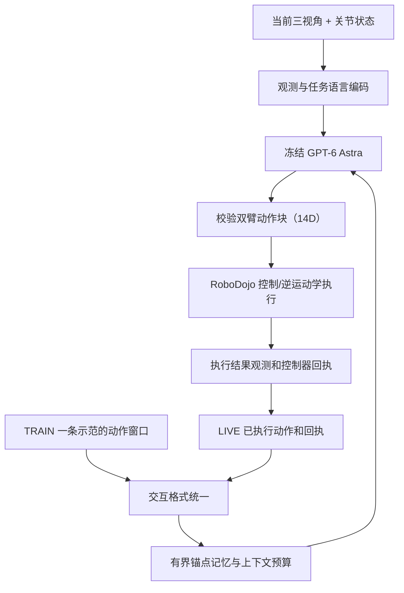
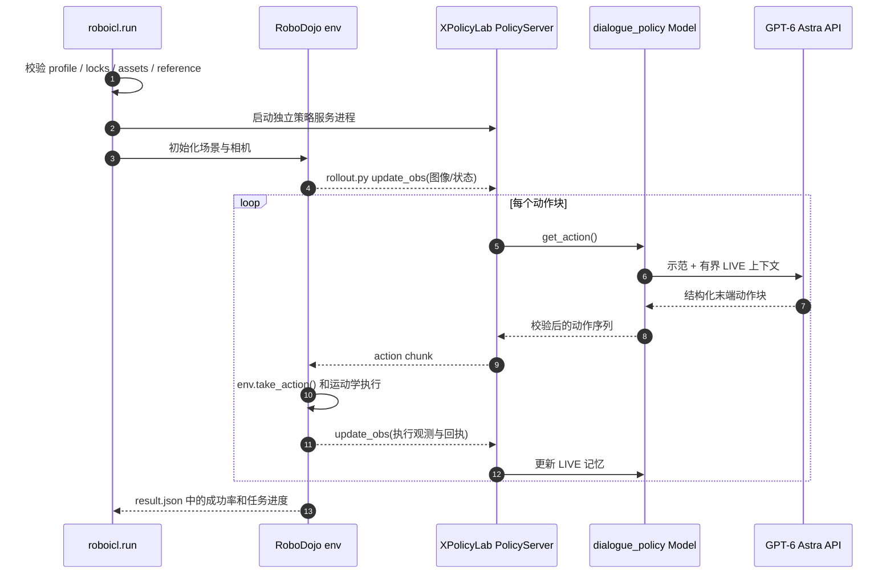

# RoboICL：利用 GPT-6 Astra 实现具身上下文学习

**RoboICL: Embodied In-Context Learning with GPT-6 Astra**（[arXiv:2609.34261](https://arxiv.org/abs/2609.34261)；[官方代码](https://github.com/Mosi-AI/RoboICL)）。

## 一句话定义

RoboICL 把机器人示范和自身执行后的视觉/控制反馈转成同一种上下文交互记录，让**不更新权重的多模态模型**在新任务中持续产生双臂动作块并在线修正。

## 英文缩写速查

| 缩写 | 英文全称 | 简要说明 |
|---|---|---|
| ICL | In-Context Learning | 用上下文示范改变当前策略 |
| VLM | Vision-Language Model | 冻结通用多模态推理模型 |
| LIVE | Live Interaction Memory | 当前执行回合的闭环交互记忆 |
| TRAIN | Demonstration Context | 离线示范片段上下文 |
| EE | End Effector | 末端执行器动作接口 |
| KV | Key-Value Cache | 重复上下文推理缓存 |

## 为什么重要

- 对照需反复更新 VLA 参数的方案，展示使用冻结基础模型、执行回执与动作 API 的部署期适应路线。
- **不能将历史记忆直接等同 ICL**：这里同时使用任务示范（改变映射）与在线执行历史（纠正进度）；必须单独消融两者贡献。
- 上下文预算与动作块频率形成显式工程取舍：VLM API 不承担高速电机伺服内环。

## 核心机制

1. **观察**：头部与左右腕三视角、双臂本体状态；每轮构造面向动作执行的模型输入。
2. **TRAIN**：有示范时引入 12 个包含起始图像、动作块和结果观测的实例；零样本没有 TRAIN。
3. **LIVE**：以“观测 → 动作 → 控制器回执 → 结果观测”保存历史，保留初始、若干时间锚点和最新交互；已删除中间历史用轨迹间隔标志隔开。
4. **动作**：输出双臂 14 维末端笛卡尔增量与夹爪控制，使用任务设定的有限动作 horizon 分块执行。
5. **反馈**：驱动侧执行动作后回传已执行动作/追踪误差；被拒动作与已执行动作严格区分，再让模型修正下一块。

## 流程总览



## 实验与评测

| 协议 | 作者报告 | 应如何解读 |
|---|---|---|
| RoboDojo 30 任务归一化进度 | RoboICL 50.64；最强对照 33.68 | Open 子集零示范、其余一示范；不是 50.64% 的所有任务成功率 |
| 3 项真机任务的任务进度 | 零/一/三示范 14.45 / 63.33 / 78.89 | 小规模真实任务，不外推所有双臂场景 |
| Jev 调度门控 | 开发任务 API 调用减少约 33–48% | 调用节省与最终任务成功率需分别看 |
| 运行策略 | J=12/B=12（一示范）；J=0/B=25（零示范） | 两者上下文预算与示范可用性不同 |

## 源码运行时序图

根据 [官方 README 与 run.py / rollout.py / policy_server.py](../../sources/repos/roboicl.md) 的可辨识调用链；未实测真机/仿真。



**可核验入口**：```python -m roboicl.run deposit_coin --shots 0 --seed 0 --layout 0 --profile configs/protocols/zero_shot_b25.json --dry-run```；去掉 ```--dry-run``` 并配置 API/仿真环境后才执行评测，退出码为 0 不代表任务成功。

## 工程实践

1. 先固定 RoboDojo/Isaac Sim 版本与 SHA256 资产引用；用 ```--dry-run``` 和 ```--capture-only``` 分别验证依赖/相机。
2. 分开部署 VLM 策略进程和仿真/驱动进程，记录 API 延迟、每步 token、动作块长度与实际执行频率。
3. 在动作输出和低层控制间设置维度、幅值、碰撞、超时与执行回执校验；记录被拒动作与追踪误差。
4. 保留 zero-shot/one-shot 的 TRAIN/LIVE 配比以及失败场景，不能只取最佳视频案例。

## 局限与风险

- 上下文请求、推理时延与 API 连通性限制其直接承担高频控制。
- 基准多为规定的桌面任务；部分未见物体/柔性材料变化仍失败。
- 开源的是策略运行与 RoboDojo 对接代码，不等于已经完成真机安全验证或所有第三方资产再分发。

## 与其他工作对比

- [H-VLA](./paper-h-vla.md)：训练层次动作表示并生成连续规划；RoboICL 不做权重更新，采用提示上下文调度。
- [Co-VLA](./paper-co-vla.md)：双臂共享/残差协调与执行期 LAC；RoboICL 从闭环观测与回执进行大模型动作修正。
- [机器人 ICL](../concepts/robot-in-context-learning.md)：判别示范是否真正改变观测到动作的映射，不把一般长期记忆算作 ICL。

## 结论

**RoboICL 证明冻结多模态模型加上结构化示范和执行回执可以成为具身少样本控制的一条路线，但不能绕过推理预算与低层安全控制。**

1. 最重要的接口是执行后回执，不要让模型把未执行/被拒动作当作真实进展。
2. 零样本与一示范必须按 J/B 预算分别评估，禁止直接混表。
3. 离线示范的 TRAIN 与在线状态记忆的 LIVE 要分别消融，才能解释适应来源。
4. 每轮 VLM 推理和机器人的高速闭环应以受控动作块分层解耦。
5. 复现时从仓库锁文件、dry-run、capture-only 开始，再核实 result.json 与失败轨迹。

## 关联页面

- [具身 ICL 概念](../concepts/robot-in-context-learning.md)
- [VLA 方法](../methods/vla.md)
- [H-VLA](./paper-h-vla.md) 与 [Co-VLA](./paper-co-vla.md)
- [ICL 纵深路线](../../roadmap/depth-icl.md)

## 参考来源

- [arXiv v1 精读归档](../../sources/papers/roboicl_arxiv_2609_34261.md)
- [官方代码与运行入口核对](../../sources/repos/roboicl.md)
- [arXiv HTML](https://arxiv.org/html/2609.34261v1)
- [官方项目主页](https://mosi-ai.github.io/RoboICL-GPT6-Astra.github.io/)

## 推荐继续阅读

- [官方 README 与可复现协议](https://github.com/Mosi-AI/RoboICL#run-roboicl)
- [具身 ICL 纵深](../../roadmap/depth-icl.md)
