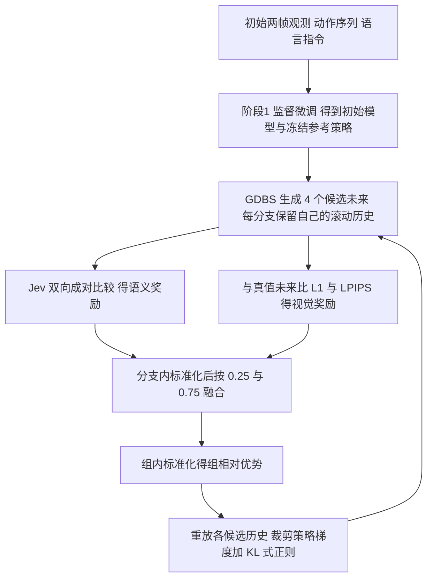

# RoboImagine（arXiv:2611.07850）

**RoboImagine**（*Learning Robotic World Models with Semantic and Visual Feedback*，[arXiv:2611.07850](https://arxiv.org/abs/2611.07850)，v1，2026-11-05）来自 CMU、纽约城市学院、NTU、UW-Madison、UC Merced（首页脚注）。通讯作者 Ming-Hsuan Yang。

## 一句话定义

**对 GPT 式（离散 token 自回归）机器人世界模型做强化学习后训练：同一观测、动作与指令下用分组多样化束搜索（GDBS）生成多个候选未来视频，用冻结多模态评判器的成对任务进度偏好加像素 / 感知视觉一致性打分，融合成组相对优势更新生成器。**

## 英文缩写速查

| 缩写 | 英文全称 | 简要说明 |
|------|----------|----------|
| GDBS | Grouped Diverse Beam Search | 分组多样化束搜索，组间对重复 token 加惩罚（§3.2） |
| SFT | Supervised Fine-Tuning | 监督微调，本文后训练的初始化与对照（§3.1、§4.3） |
| FSQ | Finite Scalar Quantization | 有限标量量化，把图像编成离散 token（§3.1） |
| Jev / mJev | multimodal Judge（4B 评判器） | 冻结的多模态评判器，做成对任务进度比较（§3.3） |
| PSNR / SSIM / LPIPS | 峰值信噪比 / 结构相似性 / 学习感知图像块相似度 | 视觉预测质量指标（§4.1） |
| MCTS | Monte Carlo Tree Search | 蒙特卡洛树搜索，作为候选构造对照（§4.4） |
| UCT | Upper Confidence bounds applied to Trees | MCTS 的选择规则（附录 B.2） |
| KV cache | Key-Value cache | 注意力键值缓存，每帧边界重建（附录 B.1） |

## 为什么重要

- **作者自述的动机（§1）：** 只用最大似然 / 重建 / 感知目标训练，视觉相似不等于任务进度正确（外观保留但物体位移缺失）；纯语义评判又对局部结构失真不敏感；已有 RL 后训练（RLVR-World 用视觉指标奖励，RoboAlign-R1 蒸馏评判器给单个视频打分）没有回答「如何构造并比较候选未来」。
- **对本 wiki 的位置（我的判断）：** 它是把 GRPO 式组相对优势用到视频世界模型后训练上的一个具体样本，可与 [RLVR-World](./paper-shenlan-wm-14-rlvr-world.md) 对照；奖励设计思路（语义偏好 + 可验证的像素误差互补）与 [奖励设计](../concepts/reward-design.md) 相通。

## 核心原理 · 方法栈 · 流程总览

1. **世界模型（§3.1、附录 A.1）：** 初始观测经上下文条件双分支编码器与 FSQ 离散化，上下文 1280 token，每个预测帧 80 个动态 token；动作按训练集范围归一化后离散成 256 个 bin；12 层 LLaMA 式解码器（宽度 768、12 头），冻结 T5-base 文本特征通过插在第 4、8、12 层前的交叉注意力注入，输出投影零初始化；分辨率 256×320。
2. **候选构造（§3.2）：** G=4 组、每组 2 束、λ_div=0.1，对前序组已选 token 计重叠惩罚，每组返回 1 个完整候选；滚动历史保留固定初始上下文、观测动态锚点与最近 W=6 个状态 - 动作对（附录 B.1：每帧边界重建前缀与 KV cache）。
3. **语义反馈（§3.3）：** 冻结 mJev（4B，附录 B.3 给出 `SoMarkAI/mJev-Qwen3-VL-4B-RLCD` 与固定修订号）读取指令、初始观测与每个候选 8 帧，一次前向取 A/B/C/D 四个答案 token 的 softmax；两种展示顺序反对称化以抵消位置偏差；4 个候选共 6 个无序对、12 次有序比较。
4. **视觉反馈（§3.3）：** 视觉奖励 = −（逐像素 L1 + LPIPS），两项系数相等；真值未来帧只进入这一分支，不进入候选生成历史。
5. **融合与优化（§3.3–3.4）：** 两分支组内标准化后按 (wJ, wV)=(0.25, 0.75) 加权，再做组内标准化得优势；裁剪比 η=0.2、双重裁剪 3、λ_KL=1e-3；只更新主干与文本交叉注意力；奖励与统计量均不反传，不需要穿过评判器或解码器求导。
6. **理论补充（§3.5、附录 E）：** 在固定候选集上，奖励梯度可写成候选间 (r_i−r_j)(v_i−v_j) 的成对差分形式；全部奖励相同或全部候选得分梯度相同时该梯度为零。这只是对经验替代目标的恒等式，不证明收敛或性能（论文自己也说差异不保证非零梯度）。

## 关键结果（均为论文数字）

| 内容 | 数字 | 出处 |
|------|------|------|
| RT-1 相对继续 SFT（同 50k 步 SFT 初始化、同 500 次更新） | PSNR +1.26 dB，LPIPS −11.93% | 摘要；§4.3 图 8：22.57 vs 继续 SFT 21.31 dB |
| 相对共享初始化 | PSNR 21.37→22.57，SSIM +0.0175，LPIPS −11.15%，MAE −14.55% | §4.3 图 8 |
| RT-1 / RoboCasa PSNR | 22.57 / 18.39 dB，分别高于最强列出基线 2.03 / 1.68 dB | §4.2 表 2 |
| RoboAlign-Judge 总分（RT-1） | 8.98±0.10，对 RoboAlign-R1 的 8.52±0.15 | §4.2 表 1 |
| 训练开销 | 继续 SFT 1.06 GPU 小时，RoboImagine 28.15 GPU 小时 | §4.3 图 9 |
| 奖励消融（RT-1，表 3A） | 仅视觉：PSNR 22.67、Qwen 7.97；混合：22.57、8.30；仅 Jev：21.95、7.69；SFT：21.37、7.04 | §4.4 |
| 候选搜索（表 3B / 表 4） | 随机 21.47 / 普通束 22.07 / GDBS 22.57 dB；MCTS 21.49 dB 且 84.29 GPU-s 每轨迹（GDBS 25.34） | §4.4 |
| 长程记忆（11 条轨迹） | 64 帧：PSNR +2.18 dB、LPIPS −17.09%；128 帧：+1.09 dB、−11.04% | §4.5 图 13 |
| 窗口大小（30 条轨迹，表 5） | 96 帧时 W=6 为 20.31 dB，W=12 降到 18.96 dB；W=3 比 W=6 快 7.74% | §4.5 |

## 工程实践

- **默认配置（§4.1、附录 A.3 表 6）：** AdamW、学习率 1e-6、全局批大小 8、500 次更新；训练时每个候选 10 帧，评测 32 帧、帧级普通束宽 4；评测不使用评判器或真值未来。
- **BridgeV2 的初始化与选点：** 先视觉 - 动作 SFT，再 500 次文本适配更新；后训练学习率 2e-7，按 32 条验证轨迹上的 LPIPS 选检查点（附录 A.2–A.3）。
- **复现入口（附录 D，论文自述）：** 仓库含模型实现、推理接口与实验源码；Hugging Face 含各数据集的主 / SFT 预测器与演示输入；并**不含**每个消融检查点与完整缓存。我入库日未打开这些链接核实。
- **硬件（附录 C.6）：** 窗口效率测量用 4 张 H20，峰值显存 W=6 约 2.3 GiB（§4.5）。

## 局限与风险

**论文自己承认的：**
- 证据只涉及离线视频预测，**不证明闭环规划或真机控制改进**（结论节）。
- 训练成本高：500 次更新 28.15 vs 1.06 GPU 小时；论文说明这是质量 - 算力权衡，不构成等算力下的效率优势（§4.3）。
- 外部基线沿用既往报告或适配结果，训练预算、条件接口与解码流程可能不同，排名不代表匹配队列比较（§4.1、表 2 注、附录 C.2）。
- BridgeV2 的最佳检查点在 32 条验证轨迹上选出，在另外 128 条报告轨迹上 PSNR 21.65 vs SFT 21.74 dB，验证增益不构成该队列上的增益（§4.2）。
- 多评判器评测中 Doubao（10 对）与 GPT-6 Astra（50 对）的配对置信区间包含零；GPT-6 Astra 是配置模型的会话式评审，非固定版本 API（§4.2 图 7）。
- MCTS 对照只是一种似然引导实例，搜索预算（16 次模拟 vs 8 条路径）与并行度不同，不是等算力基准（§4.4、附录 B.2）；MCTS 相对 SFT 的 0.12 dB 置信区间为 [−0.03, 0.27]。
- 记忆实验未单独隔离固定动态锚点的贡献；W=3 与 W=6 的差异在配对置信区间内包含零（§4.5）。

**我看到的未验证之处（判断，非论文自述）：**
- 受控消融只有单次训练运行（附录 A.3 明说分布式副本不是独立训练种子），置信区间只反映轨迹方差，没有跨训练种子的方差，0.5 dB 级别差异的稳健性未知。
- 奖励融合权重 (0.25, 0.75) 与等权 L1+LPIPS 为经验选择（附录 B.4 承认），论文未给出权重敏感性扫描。
- 仅视觉反馈在所有视觉指标上最好（表 3A）；混合反馈的收益主要体现在外部 Qwen 评分（8.30 vs 7.97），而 Qwen 与训练用评判器同属 Qwen3-VL 系，二者是否相互独立我无法确认（推测存在共同偏差的可能）。
- 视觉奖励依赖真值未来帧，所以这是有真值数据的后训练，不适用于无真值的在线想象场景。

## 与周报说法的核对

| 周报（具身运控lab，Y21u 来源）说法 | 核对 |
|------|------|
| 机构「待核实」 | 补全：CMU、纽约城市学院、NTU、UW-Madison、UC Merced（论文首页脚注） |
| 世界模型只优化视频重建误差 | 与论文引言一致（最大似然 / 重建 / 感知目标），但论文并非说「只」优化重建；RLVR-World、RoboAlign-R1 已有奖励式后训练 |
| 为相同动作条件生成多个候选 | 一致，且方法名是 GDBS，4 候选 |
| 语义偏好 + 像素误差 + 感知一致性 + 组相对优势 | 一致 |
| PSNR +1.26 dB | 一致，但**基准是继续 SFT**，非任意基线；绝对值 22.57 dB |
| LPIPS −11.93% | 摘要一致，同为相对继续 SFT；相对共享初始化为 −11.15%（图 8） |
| 周报未提 | 代价是约 27 倍训练 GPU 小时；仅离线视频预测，无闭环验证 |

## 关联页面

- [生成式世界模型](../methods/generative-world-models.md)
- [GRPO](../methods/grpo.md)
- [奖励设计](../concepts/reward-design.md)
- [RLVR-World](./paper-shenlan-wm-14-rlvr-world.md)
- [iVideoGPT](./paper-sa-2405-15223-ivideogpt-interactive-videogpts-are-scalable-wor.md)
- [Ctrl-World](./paper-ctrl-world.md)
- [RT-1](./paper-rt-1.md)
- [RoboCasa](./robocasa.md)

## 参考来源

- [roboimagine_arxiv_2611_07850.md](../../sources/papers/roboimagine_arxiv_2611_07850.md)
- [arXiv:2611.07850](https://arxiv.org/abs/2611.07850)
- 代码：<https://github.com/Alexander-wu/RoboImagine>（论文附录 D 给出）

## 继续阅读

- [arXiv PDF](https://arxiv.org/pdf/2611.07850)
- [RLVR-World](./paper-shenlan-wm-14-rlvr-world.md)
- [生成式世界模型](../methods/generative-world-models.md)
