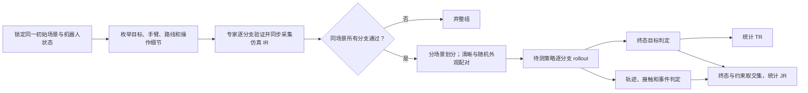
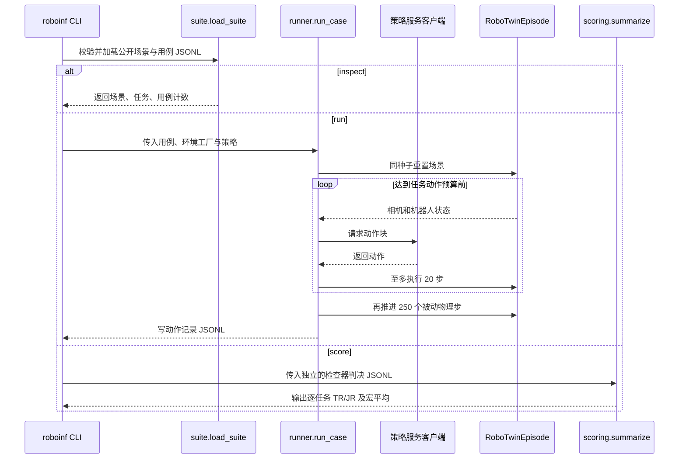

# RoboInF：机器人操作指令保真度基准 / A Benchmark for Instruction Fidelity in Robotic Manipulation

## 一句话定义

同一个场景换一条指令，不仅问机器人能否把物体送到目标，还检查有没有用指定手、走指定路线、按指定顺序接触或达到指定角度。

## 英文缩写速查

| 缩写 | 英文全称 | 含义 |
|---|---|---|
| TR | Task Success Rate | 满足指令对应的终态目标 |
| JR | Joint Success Rate | 达成终态，且所有适用的过程与细节约束通过 |
| IR | Intermediate Representation | 仿真记录的中间几何、运动、接触及事件 |
| VLA | Vision-Language-Action | 把视觉和语言等输入转换为动作的策略 |
| WAM | World-Action Model | 对环境未来和动作建模的策略家族，本论文评测 OpenWAM |

## 为什么重要

只看终态会把用错手、从错侧绕路或摇晃次数不对都当成成功。配对场景排除了初态本身的变化，更接近回答「模型是否真的因指令改变动作」。

## 核心原理与方法

1. **明确分支。** 在 RoboTwin 2.0 上设置八个双臂操作任务（放瓶、摇瓶、风扇朝向、选开关、绕隔板、开笔记本、按顺序归放积木与按键），每个任务 6–12 种同初态分支；变化来自目标选择、过程或精细条件。
2. **验证可行性。** 视觉语言模型依据任务合同修订专家程序；开发验收需至少 8/10 个场景的全部分支通过。规模化采样时任一分支失败即淘汰该场景，不把容易的兄弟分支单独留下；通过后回放，记录仿真真值，并按场景拆分语料。
3. **独立评分。** 每条轨迹的终态检查给 TR 判定，JR 还要求全部适用约束通过；规则可以同时检查接触区域、事件顺序或轨迹统计。先按任务算百分比，再将八个任务等权平均；TR−JR 表示「做成但未全部照做」的差距。

## 评测与局限

| 清晰测试，八任务等权 | JR | TR |
|---|---:|---:|
| π0.5（后训练，仅任务说明） | 52.4% | 79.3% |
| OpenWAM（后训练，仅任务说明） | 34.0% | 70.0% |
| GPT-6 Astra（推理代理，共享固定技能执行器） | 17.6% | 28.9% |
| Qwen3.8-Flash（同推理代理协议） | 8.2% | 14.7% |

表 3 中后训练 π0.5 的摇瓶 TR 99.0%，但 JR 仅 1.9%；用 IR 重标注并加入在线语言引导的作者配置平均 JR 也低于仅任务说明配置，不能推广成 IR 本身无用。随机外观条件复用同指令、场景与物理状态，仅改变渲染条件；论文没有给出真机验证，也不保证未见任务泛化。

论文的 4,242 条专业轨迹来自 566 个保留场景；公开有标签训练与验证示范合计 3,381 条，其余 861 条测试只提供场景和指令。不要用专家验证标签给新 rollout 代评分。

## 与其他工作对比

- [RoboTwin](robotwin.md) 提供双臂操作仿真和域随机化底座。RoboInF 保留这个环境，把重点从跨场景操作能力转到同初始物理状态下的指令差异。
- [LIBERO](libero-benchmark.md) 常用于比较跨任务或长时序学习能力；RoboInF 的同状态兄弟分支更适合定位「做成了但没照做」。二者任务和评分协议不同，不能比较原始百分比。

## 结论

RoboInF 的关键是用同场景对照并把过程约束单独做成可检验指标，而不是只多加几种提示词。

- 排查时先按手臂、路线、次数和顺序拆分约束，而非只看任务成功均值。
- 准备透明结果表，分开报 TR、JR、分母、外观域和策略训练配置。
- 将可复现的公开输入与未公开的参考判决分开对待，避免把检查器聚合误当完整基准服务。

## 工程实践：公开源码运行时序图

已用官方 CLI 校验公开文件：`val`、`test`、`test_random` 各 8 任务、115 场景、861 用例。跑策略另需 RoboTwin、模拟资产与兼容服务。本次未运行仿真策略；仓库不发布官方权重或托管评分服务。

## 关联页面

- [操作任务](../tasks/manipulation.md)
- [视觉语言动作模型](../methods/vla.md)
- [具身评测纵深 Stage 3](../../roadmap/depth-embodied-eval.md)

## 参考来源

- [论文全文归档](../../sources/papers/roboinf_arxiv_2611_30555.md)
- [源码与开放边界](../../sources/repos/roboinf.md)
- [数据集和划分](../../sources/datasets/roboinf-4k.md)

## 推荐继续阅读

- [官方任务演示与逐项结果](https://sjtu-deepvisionlab.github.io/RoboInF/)
- [官方评估协议](https://github.com/SJTU-DeepVisionLab/RoboInF/blob/main/docs/benchmark.md)
