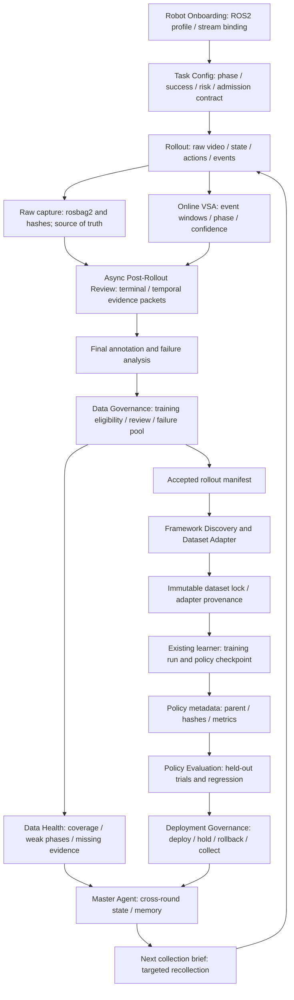
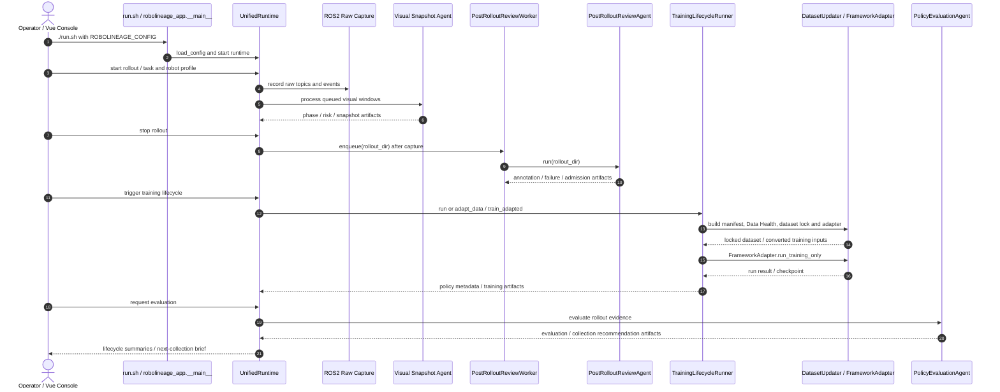

# RoboLineage：跨机器人策略迭代的 Agent 原生数据生命周期治理
**RoboLineage: Agent-Native Data Lifecycle Governance Across Robot Policy Iterations**

## 一句话定义

**RoboLineage** 是一层运行在现有机器人采集、策略训练和评估系统外围的数据生命周期治理框架：它把每次 rollout 的原始证据、审阅判断、数据准入、训练版本、评估结果、部署建议和下一轮采集计划用**类型化、带依赖和校验记录的 artifact** 连接起来，便于 Agent 辅助操作而不丢失人工审计链。

## 英文缩写速查

| 缩写 | 英文全称 | 简要说明 |
|---|---|---|
| VSA | Visual Snapshot Agent | 采集期间按关键事件抽取稀疏视觉快照并输出阶段/风险提示 |
| VLM | Vision-Language Model | 对快照与证据包提供视觉语义解释，输出仍受 artifact schema 约束 |
| ROS 2 | Robot Operating System 2 | 机器人话题、图像与 rosbag2 原始数据采集的集成层 |
| ACT | Action Chunking with Transformers | ARX 实验采用的动作分块策略训练风格 |
| VLA | Vision-Language-Action | GALBOT G1 工作流中的现有策略学习家族 |
| OOD | Out-of-Distribution | 用于识别训练数据未覆盖的抓取位置等样本 |
| API | Application Programming Interface | 模型调用和 FastAPI 操作员界面的接口 |
| LLM | Large Language Model | 驱动生命周期摘要、配置发现等语义任务的语言模型 |

## 核心信息

| 项目 | 内容 |
|---|---|
| 论文 | [arXiv:2606.22142v1](https://arxiv.org/html/2606.22142v1)，2026-06-20 |
| 会议 | **CoRL 2026 收录**（作者[项目主页](https://robolineage.github.io/)明示，区别于 arXiv 预印本元数据） |
| 作者 | Qian Luo、Wentao Guo、Zhennan Qin、Nanchun Guo、Yunhan Zhao、Yi Ma、Yanchao Yang |
| 机构 | 忆生科技（TranscEngram）、香港大学（The University of Hong Kong）、北京理工大学（Beijing Institute of Technology） |
| 主页 | [RoboLineage](https://robolineage.github.io/) |
| 代码 | [robolineage/robolineage](https://github.com/robolineage/robolineage)：研究运行时、前端、artifact schemas 和 tests，**MIT** |
| 对接 | ARX / ACT-style；Realman / Diffusion Policy；GALBOT G1 / VLA-LeRobot-style |
| 定位 | 数据/训练/评测的**治理基础设施**，不直接输出关节控制动作 |

## 为什么重要

实验室迭代策略时，通常知道一个 checkpoint 的路径，却不能快速解释：**哪些失败证据促使剔除某条 rollout？训练集为何升级？这个策略比父版本弱在什么阶段？接下来该采哪些数据？** 将这些信息固化为可追踪对象，可减少人工查视频、对 spreadsheet、改训练输入和口头交接造成的损耗。

与仅追踪训练指标的数据版本工具相比，本文把**具身语义评审和训练准入原因**也写入谱系；与 [真机 autoresearch 闭环](../queries/real-robot-policy-autoresearch-harness.md) 相比，RoboLineage 优先解决证据、版本、审计与复采建议，而不是自主发明控制器。

## 流程总览（依据论文 §3 / Figure 2–3）

**权限边界：** VLM 提供语义证据，不可让其未经验证直接修改原始数据、绕过 dataset admission 或执行机器人策略部署；实际操作受现有实验室安全和操作者审批流程制约。

## 核心原理

### 1. 类型化谱系与权责隔离（§3.1–3.2，Appendix A–C）

一轮工作流可表示为：

$
(b,\tau,c_k)\rightarrow\mathcal{R}_k\rightarrow\mathcal{A}_k\rightarrow D_k\rightarrow T_k\rightarrow\pi_k\rightarrow\mathcal{E}_k\rightarrow G_k
$

这里 \(\mathcal{R}_k\) 是采集回合，\(\mathcal{A}_k\) 是审阅和准入 artifact，\(D_k\) 是锁定数据集，\(T_k\) 是训练，\(G_k\) 是下一轮的部署/回退/复采治理决策。谱系图 \(\mathcal{L}_k=(\mathcal{V}_k,\mathcal{P}_k)\) 用类型化节点和依赖边记录谁产生了什么决策、引用了哪些证据。

Artifact 包括 `robot.profile.yaml`、`task.config.json`、`snapshot.jsonl`、`annotation.final.json`、`dataset_decision.json`、`dataset.health.json`、`dataset.lock.json`、`policy.meta.json`、`eval.summary.json`、`deploy.ticket.json` 及 Master 摘要。文件记录 schema version、producer、parent IDs 和 content hash；纠正历史决策时保留 superseded/override 记录，而不是覆盖审计链。

### 2. 采集、在线快照与严格的离线审阅（§3.3–3.4，Appendix D/E）

- **Raw lane：** rosbag2 与 sensor/action streams 独立录制；模型 API 超时不能阻塞原始证据。
- **Online VSA：** 按事件调度小型图像窗，输出 phase、progress、risk、confidence、needs_review 等语义锚点；有状态阶段约束和异常回退规则，但**不能单凭它决定训练准入**。
- **Post-review：** 录制结束并处理已排队快照后，对终态、终态后稳定性、时序信息与操作者事件做证据包审阅；以 schema 校验结果、失败定位和置信度组成最终注释。
- **Dataset governance：** `accepted_for_training`、`needs_review`、`failure_pool_candidate` 与 `rejected` 含义不等价。失败可以用于诊断/后续复采，但默认不进入主要行为克隆训练集。

### 3. 数据健康、训练版本与下一轮复采（§3.5–3.6，Appendix G）

- Data Health 独立分析覆盖不足、阶段不均衡、OOD grasp 等，以免把“已准入”误读成“足够训练”。
- 框架发现/适配组件支持 direct manifest、用户提供转换命令或生成 converter；对输入样本、转换字段和版本保留 hash 链接。
- Data lock 将 selected episodes 与 adapter 和代码版本固定，输出训练记录与带父策略引用的 metadata；策略评估侧保存失败阶段、安全风险与回归，再输出 deploy/hold/rollback/collect-more **建议**。
- Master Agent 读摘要谱系而非反复拼接原视频，把跨轮错误分布变成下轮具体的采集 brief。

## 实验与评测（论文 §4、Appendix I/J）

### 审阅质量：25 个任务、500 次 rollout（Table 1）

| 指标 | Direct video-to-VLM | RoboLineage |
|---|---:|---:|
| Outcome accuracy | 78.4% | **96.0%** |
| Failure-phase accuracy | 58.0% | **88.0%** |
| 数据使用路由准确率 | 79.6% | **96.4%** |
| Bad-data leakage | 16.0% | **2.1%** |

“路由准确率”是**与专家共识一致**的判断比例；leakage 分母是 194 条专家拒绝样本，并非所有部署轨迹的安全失败率。消融表明 online anchor、post-review packets、final terminal observation 和 schema 组合重要，而非“加个 VLM 即可自动管理数据”。

### 策略质量、时间与成本（Figure 4–5、Tables 2、10–11）

- **八任务匹配训练：** 两组均从每任务同一 100 个候选 rollout 选 60 条训练，held-out 评估每任务 60 trials；成功率 **92.7%（RoboLineage）vs 93.1%（人工）**，说明此协议下未发现明显策略质量损失，**不是 RoboLineage 击败人工的证据**。
- **12 组配对、每轮 30 rollout：** 人工活跃时间 **130.2→54.3 min**，降 **58.3%**；真实采集分别 40.5/40.6 min，几乎不变。**排除**首次硬件 bring-up、首次训练 adapter 开发、GPU 训练时间。
- **模型调用成本：** Table 2 记录当前配置每 30-rollout cycle **估计 $11.60**，只是 token/image API 口径，不是完整的机器人采集成本。

### 闭环复采：两类真机任务、三轮数据更新（Table 3）

| Final 独立测试成功率 | Random | Phase heuristic | No memory | RoboLineage | Human |
|---|---:|---:|---:|---:|---:|
| Cube stacking（初始 25.0%） | 36.7% | 66.7% | 70.0% | **83.3%** | 86.7% |
| Drawer opening（初始 26.7%） | 37.8% | 62.2% | 66.7% | **78.9%** | 81.1% |

每方法三次独立 run；每轮 30 条**接受的**演示和 30 次诊断，最终每 run 另设 60 trials。相同 accepted-demo 数量**不代表**相同总采集尝试成本。

## 与其他工作对比

| 类别 | 重点 | 与 RoboLineage 的关系 |
|---|---|---|
| DVC / MLflow / 常规 experiment tracking | 数据集、模型、参数与运行记录 | RoboLineage 更早记录“为何准入数据及某次失败证据”的语义因果链，可互补 |
| [Data Flywheel](../concepts/data-flywheel.md) | 采集→训练→部署→反馈长期迭代 | RoboLineage 是将反馈/数据决策版本化的治理层，不是性能 scaling law 本身 |
| [ENPIRE / 真机 autoresearch](../queries/real-robot-policy-autoresearch-harness.md) | 自动 reset、验证、策略改进和探索 | RoboLineage 负责证据、版本、审核和下一轮采集建议，非同一个 robot policy-search harness |
| [Imitation Learning](../methods/imitation-learning.md) | 利用演示训练行为策略 | RoboLineage 为其提供受控数据 manifest，真正训练仍由外部 learner 完成 |

## 源码运行时序图（依据官方仓库实际入口）

真实实现路径见[官方源码核验归档](../../sources/repos/robolineage-official.md)：`run.sh` → `src/robolineage_app/__main__.py` → `UnifiedRuntime`，异步审阅由 `PostRolloutReviewWorker._loop` 调用 `PostRolloutReviewAgent.run`，训练由 `TrainingLifecycleRunner.adapt_data/train_adapted` 连接 `DatasetUpdater` 和 `FrameworkAdapter`；评估由 `PolicyEvaluationAgent.run` 读取 rollout evidence。图表达关键执行与操作员交互，不应视为单一同步函数调用栈。

## 工程实践与开源状态

| 维度 | 官方仓库核查结论 |
|---|---|
| 已公开 | Python runtime、typed schemas、prompt contracts、FastAPI/Vue console、ROS2 profiles、online VSA、post-review、dataset locks、训练/评估适配与基础测试；MIT |
| 官方 Quickstart | Ubuntu ROS2 工作站运行 `pip install -e ".[dev,contracts,data-source,vsa,session,agents,dataset,train]"`，设置 `ROBOLINEAGE_CONFIG`，执行 `./run.sh` |
| 默认服务 | session :8080、health :8081、Vue :5173（需本地网络配置和模型 API 路由） |
| 仍待完成 | README 明列 mock replay pipeline、打包 benchmark scoring、更广泛的机器人 profiles/训练 adapters、本地模型示例 |
| 可复现性 | 发布了运行接口与部分样例，**不代表提供**论文所有真实 robot rollouts、API 凭据、环境与同等硬件条件；本次未复现数值 |

## 局限与风险

1. **视觉证据边界：** 主要验证配置明确的桌面/视觉操作；触觉占主导、柔性物体、力控装配和移动操作需要额外感知与任务判据。
2. **VLM 误判：** Appendix I.5 的 200-rollout replay 表明换模型会影响路由准确率（Claude 96.0%、Gemini 95.0%、Qwen 86.5%），保守筛查仍可能遗漏错误。
3. **不提供通用安全保证：** 任务安全阈值、驱动权限、硬件急停和最终部署审批仍取决于实验室与操作者，不能用自动推荐直接放行实机。
4. **首次搭建代价未计：** 58.3% 是已有机器人/profile/训练栈条件下的每轮人工活跃时间，不包括最困难的设备调试与初次适配。
5. **跨实验室治理尚有限：** federated lineage、隐私保护数据共享、完整 lifelong robot memory 仍是作者提出的未来方向。

## 结论

**RoboLineage 的价值在于把机器人数据飞轮中的“证据 → 决策 → 数据 → 策略 → 下次采集”变成可追溯的版本链，而非提出性能更强的基础策略。**

1. 在多轮真机训练中先给 rollout、annotation、dataset lock、policy metadata 建稳定 ID 与引用 hash，再做 Agent 自动化。
2. 原始 rosbag2 永远先于 VLM 语义结论；失败或不确定样本不应自动进入主 imitation manifest。
3. 用 Data Health 的阶段/空间覆盖缺口指导**有目标的复采**，不要仅累计样本数。
4. 读实验时分清 96.4% admission 路由一致率、92.7% 策略成功率及 58.3% 人工时间节省，不能混写成一个成功率。
5. 上机前核实 ROS2 话题、任务 terminal 定义、模型成本和审批边界；公开的运行时仍需针对自有平台验证。

## 关联页面

- [Data Flywheel（具身数据飞轮）](../concepts/data-flywheel.md) — 数据回流闭环中的审计与数据健康治理
- [真机策略 autoresearch 闭环搭建指南](../queries/real-robot-policy-autoresearch-harness.md) — 自动环境、策略试验与复采治理的区别
- [Imitation Learning](../methods/imitation-learning.md) — 最终训练策略使用已经准入的示范数据
- [真机策略调试 Playbook](../queries/robot-policy-debug-playbook.md) — 失败记录与版本归因的排查场景

## 参考来源

- [RoboLineage 论文全文阅读记录（§1–5、Appendix A–K）](../../sources/papers/robolineage_arxiv_2606_22142.md)
- [项目主页、会议状态与指标核查](../../sources/sites/robolineage-project.md)
- [MIT 官方源码与实际运行入口核验](../../sources/repos/robolineage-official.md)

## 推荐继续阅读

- [论文 arXiv HTML 全文](https://arxiv.org/html/2606.22142v1)
- [作者项目主页（CoRL 2026）](https://robolineage.github.io/)
- [作者官方 GitHub 运行时与文档](https://github.com/robolineage/robolineage)
