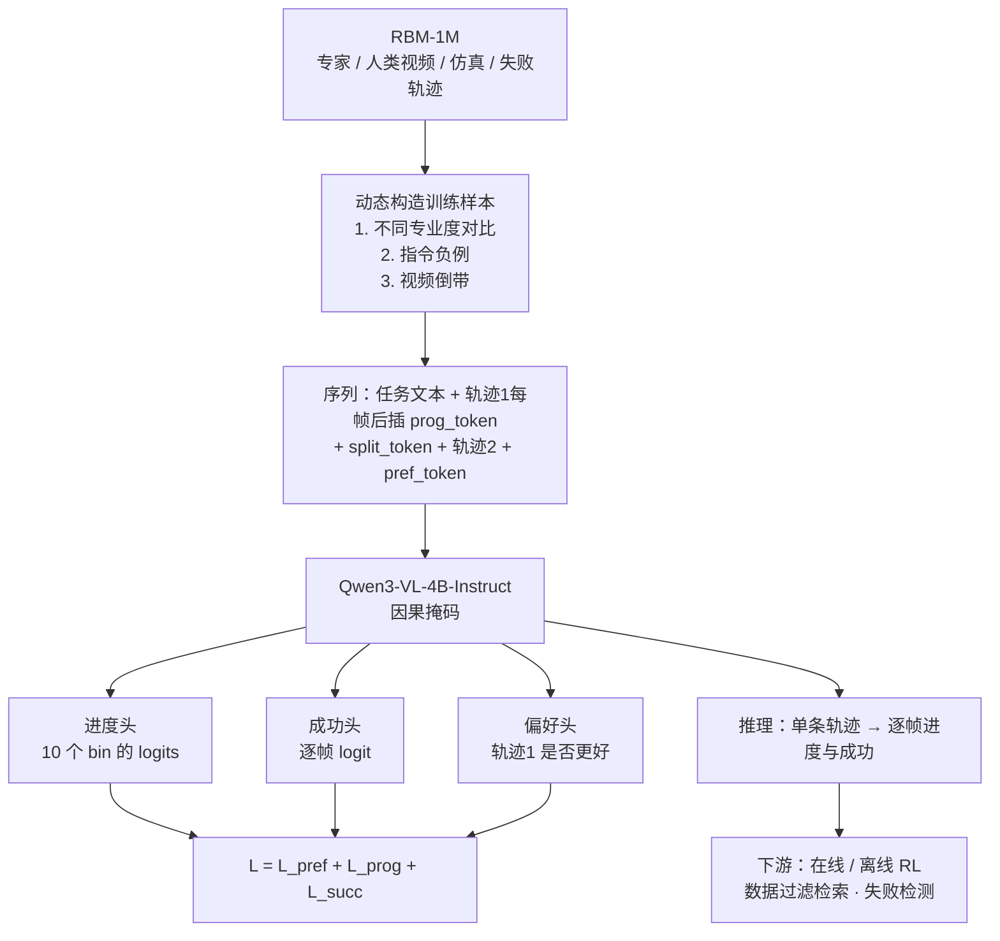
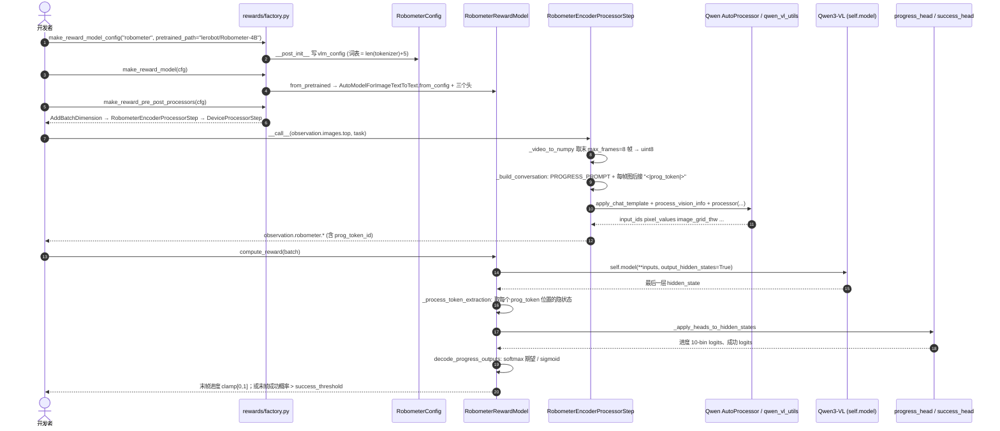
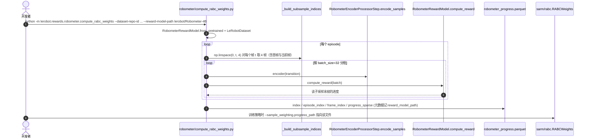
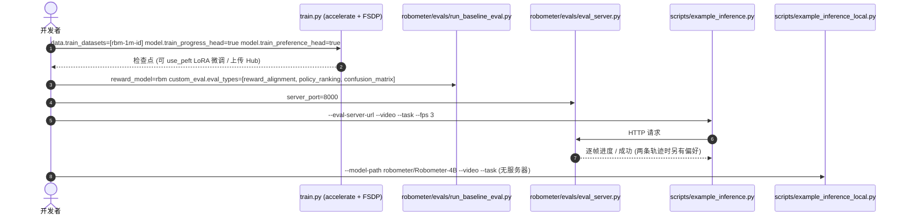

# Robometer：靠轨迹对比较扩展通用机器人奖励模型

**Robometer**（*Robometer: Scaling General-Purpose Robotic Reward Models via Trajectory Comparisons*，[arXiv:2603.02115](https://arxiv.org/abs/2603.02115)，[项目页](https://robometer.github.io/)，[代码](https://github.com/robometer/robometer)）由 Anthony Liang、Yigit Korkmaz 等（USC、UT Dallas、MIT、UW、Ai2、NVIDIA 等，前两位共同一作）提出；LeRobot 文档标注发表于 RSS 2026。本页同时是 LeRobot README 模型清单里「Robometer」的独立详情节点（固定提交 `9e5ee98`，见 [lerobot 仓库归档](../../sources/repos/lerobot.md)）。

> 去重说明：库内此前 `grep -i robometer` 命中的页面（如 [PRM-as-a-Judge](./paper-prm-as-a-judge.md)、[Event2Reward](./paper-event2reward.md)、[HF-WM](./paper-hf-wm-failure-dynamics-world-model.md)）都只把它当基线或打分器引用，各页拼写也不一（RoboMeter / ROBOMETER / Robometer）；全库没有 arXiv:2603.02115 的独立节点，本页是其 canonical 节点。

## 一句话定义

**Robometer 是一个基于 Qwen3-VL-4B 的视频–语言奖励模型：对每一帧输出任务进度和成功概率，训练时额外用「两条轨迹谁更好」的偏好监督，让失败/次优数据也能参与训练。**

## 英文缩写速查

| 缩写 | 英文全称 | 简要说明 |
|------|----------|----------|
| RBM | Robometer（模型）/ Reward-learning dataset 命名里的缩写 | 官方代码与评测里常写 `rbm`；RBM-1M 为训练数据集 |
| RBM-1M | Robometer 训练集（1M 级轨迹） | 论文称覆盖 21 种机器人本体、超过 100 万条轨迹，含失败/次优数据 |
| RBM-EVAL-ID / OOD | 分布内 / 分布外评测集 | OOD 集 976 条轨迹、6 个本体、来自 3 个机构，论文称不在任何基线训练数据中 |
| VOC | Value-Order Correlation | 预测进度与真实时间序的相关系数（论文表 I 用 Pearson r） |
| Kendall τa | Kendall tau-a | 衡量失败/次优/成功轨迹最终奖励排序是否正确 |
| VLM | Vision-Language Model | 骨干：Qwen3-VL-4B-Instruct |
| GVL | Generative Value Learning | 让闭源 VLM 在打乱帧上预测进度的零样本基线 |
| DSRL | Diffusion Steering via RL | 论文用它在 π0 上做在线 RL 的下游实验 |
| IQL | Implicit Q-Learning | 论文用它做混合质量数据的离线 RL |

## 为什么重要

- **失败数据也能训奖励：** 专家示范的逐帧进度容易标，失败轨迹的「绝对进度」含糊；Robometer 只要求「这两条哪条更好」，把无进度标签的失败数据变成可用监督。
- **一模型三输出：** 逐帧进度（密集奖励）、逐帧成功（自动终止/切换阶段）、偏好（数据过滤/检索排序），下游应用从在线 RL 到失败检测都用得上（论文 §IV）。
- **在 LeRobot 内可零样本直接用：** `reward_model.type=robometer` 默认加载 `lerobot/Robometer-4B`，无需训练，可直接给 LeRobot 数据集离线标进度。
- **与 [TOPReward](./paper-topreward.md) 互为基线：** 两篇论文各自都把对方当对照，在自己的基准上各自领先，读结论时要看评测口径（见「与其他工作对比」）。

## 流程总览

图依据：论文 §III-B/C/D、Fig. 2、附录 Fig. 11 的描述。

## 核心方法

### 1. token 设计与架构（论文 §III-B）

- 骨干是因果掩码的 **Qwen3-VL-4B-Instruct**；新增可学习 token，不改 VLM 自带表示。序列形如：任务文本、视频开始符、轨迹 1 的每帧后跟一个 `<|prog_token|>`、`<|split_token|>`、轨迹 2 的帧、末尾一个 `<|pref_token|>`。
- `<|prog_token|>` 因果注意只看当前和之前的轨迹 1 帧，得到逐帧进度；`<|pref_token|>` 同时看两条轨迹，做相对判断。两条轨迹固定长度 T=8，避免模型用「轨迹长度」当优劣代理。
- LeRobot 文档与配置里还有 `<|reward_token|>`、`<|sim_token|>` 两个为检查点兼容保留的 token（五个 token 的加入顺序是数据契约）。

### 2. 训练目标 L = L_pref + L_prog + L_succ（论文 §III-C）

- **偏好：** `<|pref_token|>` 隐状态上的二分类（BCE）。论文附录比较显示，用专用 pref token + BCE 比 Bradley–Terry 形式的奖励对齐从 0.862 升到 0.948、轨迹排序从 0.325 升到 0.655。
- **进度：** 目标 p_t=t/T，线性插值投影到 N=10 个均匀 bin，交叉熵训练；推理取 bin 中心期望。
- **成功：** 末帧为 1，其余为 0，按批平衡的 BCE；为避免示范后段多余帧的影响，论文每个数据源抽样 10 条轨迹判定任务实际结束点。

### 3. 三类训练样本构造（论文 §III-D）

1. **不同专业度的对比：** 专家 vs 未标注失败，或进度不同的两条轨迹；
2. **指令负例：** 换一条别的任务指令，被错配的轨迹进度目标为 0，逼模型对语言敏感；
3. **视频倒带：** 同一条专家轨迹的前进段 vs 倒带段，显式惩罚「撤销进度」。

## 源码运行时序图

### A. LeRobot 推理：`compute_reward`（零样本端口）

固定提交 `9e5ee98`，路径相对 LeRobot 仓库根。

- `forward()` 没有覆盖，`is_trainable=False`；`lerobot-train` 会直接抛错提示「zero-shot 模型不能训练」。偏好头仅为加载官方检查点而保留，LeRobot 推理不使用。
- 标量奖励只取最后一帧：`reward_output="progress"`（默认）或 `"success"`（阈值化为 0/1）。

### B. LeRobot 离线标注：给数据集写 `robometer_progress.parquet`

- 子采样帧数默认 4（脚本注释称与官方 eval server 的 `NUM_SUBSAMPLED_FRAMES` 一致），与 `RobometerConfig.max_frames=8` 的直接推理默认值不同。
- 脚本注释写明 parquet 与 SARM 同表头，`RABCWeights` 读 `progress_sparse` 列即可复用；LeRobot 固定提交里没有找到在线 RL actor/learner 直接调用 `compute_reward` 的代码（`grep compute_reward` 仅命中 `rewards/` 目录自身），所以这里「RL 集成」仅限离线进度标注 + 样本加权，在线 RL 需自行接入。

### C. 官方仓库（README 级入口，未读内部源码）

官方 [robometer/robometer](https://github.com/robometer/robometer)（README 标注 MIT）给出：

以上只来自该仓库 README 的命令与目录说明（2026-11-05 读取）；README 训练示例里写的 `training.max_steps=15000` 与论文附录的 6500 步不一致，未核实原因（可能是示例配置而非论文复现配置，推测）。

## LeRobot 实现要点

| 项 | 内容（固定提交 `9e5ee98`） |
|----|------|
| 入口 | 直接调用 `RobometerRewardModel.compute_reward`；工厂 `make_reward_model_config("robometer")`；离线：`python -m lerobot.rewards.robometer.compute_rabc_weights` |
| 模块 | `rewards/robometer/configuration_robometer.py`、`modeling_robometer.py`（`RobometerRewardModel`、`RobometerPredictionHead`、`convert_bins_to_continuous`、`decode_progress_outputs`）、`processor_robometer.py`（`RobometerEncoderProcessorStep`、`PROGRESS_PROMPT`） |
| 权重 | `lerobot/Robometer-4B`（文档），骨干 `Qwen/Qwen3-VL-4B-Instruct`；词表 151669 + 5 个特殊 token = 151674（文档与配置注释） |
| 依赖 | `pip install -e ".[robometer]"`；强烈建议 GPU |
| 默认配置 | `max_frames=8`、`reward_output="progress"`、`success_threshold=0.5`、`progress_discrete_bins=10`、`use_multi_image=True`、`use_per_frame_progress_token=True`、`torch_dtype="bfloat16"` |
| 输出头 | 三个 `Linear → LayerNorm → GELU → Dropout → Linear` 的小 MLP（进度 10 维 logits，成功与偏好各 1 维） |
| 限制 | 仅推理；不含偏好对训练；不使用特权状态（接触力、物体位姿）；标量奖励只取末帧 |
| 实现差异（相对论文） | 推理单轨迹，不使用 `<|split_token|>`、第二条轨迹与偏好头；论文推理时帧子采样「总包含首帧与当前帧」，LeRobot 的 `compute_reward` 直接取处理器截出的**最后 `max_frames` 帧**，不做该子采样；子采样由离线标注脚本的 `_build_subsample_indices` 完成 |

## 实验与评测

以下数字均读自论文 v2（成功率为论文各实验的试验平均，见各小节口径）：

| 设置 | 结果 |
|------|------|
| RBM-EVAL-OOD 奖励对齐（VOC Pearson r，Table I） | Robometer（RBM-1M）**0.94**；RoboReward-8B 0.88；TOPReward 0.40；GVL 0.21；ReWiND 0.51 |
| RBM-EVAL-ID VOC | Robometer 0.92；RoboReward-8B 0.82；TOPReward 0.42 |
| 轨迹排序 Kendall τa（OOD） | 表中 Robometer 0.64、RoboReward-4B 0.50；**正文写作 0.66，与表不一致**，以表为准待核实 |
| 消融（Table III，LIBERO-90） | 只学进度：Kendall τ 0.63；+偏好：0.74；+失败数据：0.92；换 ReWiND 架构（无预训练 VLM）：−0.14 |
| 在线 RL（DROID，DSRL + π0） | 单阶段 20%→85%（约 10k 步、≤45 分钟）；两阶段 20%→70%；RoboReward 对比分别 55% / 20% |
| 离线 RL（SO-101，IQL，混合质量） | 相对最好基线 2.4× 成功率，γ=0.9 最优（论文口径） |
| 数据检索 + π0.5 微调 | 相对最好基线 4.5× 成功率 |
| 失败检测（DROID，100 条轨迹） | 平均 F1：Robometer 0.81，RoboReward-4B 0.74，GPT-5-mini 0.33，VLAC 0.16，token-uncertainty 0.48 |
| 训练成本（附录） | Qwen3-VL-4B，每卡 batch 16 × 4 张 H200，lr 2e-5，6500 步，约 2 天 |

- **别过度读「LIBERO 消融」：** 那是在 LIBERO 小数据上的受控实验，用来验证趋势，不等于主模型表现。
- **RL 实验口径：** DSRL 在线 RL 与 SO-101 离线 RL 都是论文自己搭的任务与评测（20 次评估试验），与 LeRobot 内如何接入 RL 无直接关系。

## 结论

**Robometer 的核心不是更大的 VLM，而是「进度 + 偏好」双监督加上含失败数据的大规模训练集；LeRobot 里它是开箱即用的零样本进度/成功打分器，不是可训练模块。**

1. **偏好损失 + 失败数据是关键增益** — 论文消融中 Kendall τ 随这两项逐步升高；预训练 VLM 骨干不可省。
2. **用 LeRobot 时认清它只读末帧** — `compute_reward` 返回单标量；要整条曲线请用离线标注脚本（4 帧子采样、含首帧与当前帧）。
3. **进度模式与成功模式分开选** — 要密集奖励用 `progress`；要自动终止/阶段切换用 `success` 并调 `success_threshold`。
4. **评测别只看自家基准** — 与 TOPReward 互相引用时，各自在自己的基准上领先（见下），应在你的任务上复测。
5. **想训练或带偏好对微调** — 需用官方仓库（README 提供 LoRA 微调流程），LeRobot 端口目前做不了。
6. **语言敏感性是设计目标** — 指令负例让错配任务得 0 进度；论文也展示了混淆矩阵对角占优。

## 局限与风险

- 论文自述：对子采样视频逐帧打分，难以记住极长时程里的关键事件；真实失败模式多样，训练数据可能未覆盖；视觉语言模型看不到接触力、抓取稳定性等隐状态；未对安全关键状态预训练。
- LeRobot 端口：仅推理；每次只取末帧标量；4B VLM 推理成本不低，离线标注整套数据集需逐帧前向（脚本注释的做法）。
- 论文表文不一致（Kendall τa 0.64 vs 0.66）；README 示例训练步数与附录不同（见上）。

## 与其他工作对比

| 工作 | 关系 |
|------|------|
| [TOPReward](./paper-topreward.md) | 零训练、读冻结 VLM 的 `True` token 对数似然。Robometer 论文表 I 里 TOPReward（Qwen3-VL-8B）OOD VOC 0.40，远低于 Robometer 0.94；TOPReward 论文（v2）则在 OXE 33 个过滤数据集上报告自己 VOC 0.874 对 Robometer-4B 0.838、ManiRewardBench 上 0.942 对 0.858，并在指令混淆矩阵的对角质量上自己更高（0.420 对 0.149）。**两篇各用自己的基准、评测采样不同，不能直接相减。** |
| [SARM](./paper-sarm.md) | 用子任务标注 + 时间占比给阶段化进度，并可训练、专注长时程 BC 加权；Robometer 无需任务标注、靠预训练 VLM 泛化 |
| [RoboReward](./paper-roboreward.md) | 同样微调 VLM，输出 1–5 的离散进度；Robometer 论文称在相同训练数据下仍更好，并指出 RoboReward 会对无关任务给高分 |
| [Robo-Dopamine](./paper-robo-dopamine-2.md) | 需要目标图与任务特定微调；Robometer 论文以无目标图的零样本设定对比 |
| GVL | 闭源 VLM + 打乱帧提示；Robometer 用训练得到的头，更稳（论文 Table I） |
| ReWiND | 小型 Transformer + 倒带增强；换成大参数量 ReWiND 架构而无预训练 VLM 时奖励质量崩溃（论文 H3） |

## 关联页面

- [过程奖励建模](../concepts/progress-reward-modeling.md) — 接口 × 范式定位
- [Progress Reward Survey](./paper-progress-reward-modeling-survey.md) — 领域地图
- [TOPReward](./paper-topreward.md) — LeRobot 内的零样本 token 似然奖励
- [SARM](./paper-sarm.md) — LeRobot 内可训练的阶段感知奖励模型
- [RoboReward](./paper-roboreward.md) / [Robo-Dopamine](./paper-robo-dopamine-2.md) — 同类 VLM 奖励模型
- [PRM-as-a-Judge](./paper-prm-as-a-judge.md) — 把 Robometer 当序列式 PRM 引用
- [Reinforcement Learning](../methods/reinforcement-learning.md) — 下游在线 / 离线 RL 语境
- [π0](./paper-pi0.md) — 论文在线 RL 实验的基础策略
- [LeRobot](./lerobot.md) — 框架总览

## 参考来源

- [robometer_arxiv_2603_02115.md](../../sources/papers/robometer_arxiv_2603_02115.md)
- [lerobot.md（仓库归档）](../../sources/repos/lerobot.md)
- [arXiv:2603.02115](https://arxiv.org/abs/2603.02115) · [PDF](https://arxiv.org/pdf/2603.02115)：已通读方法（§III）、实验（§IV、Table I–IV）、局限与附录计算资源 / 超参
- [官方 README](https://github.com/robometer/robometer)：仅读 README
- [LeRobot `robometer.mdx`（固定提交）](https://github.com/huggingface/lerobot/blob/9e5ee9859480e425a97a6836bb3fee479539beb5/docs/source/robometer.mdx)
- LeRobot 源码（固定提交）：`src/lerobot/rewards/robometer/`、`src/lerobot/rewards/factory.py`、`src/lerobot/rewards/pretrained.py`
