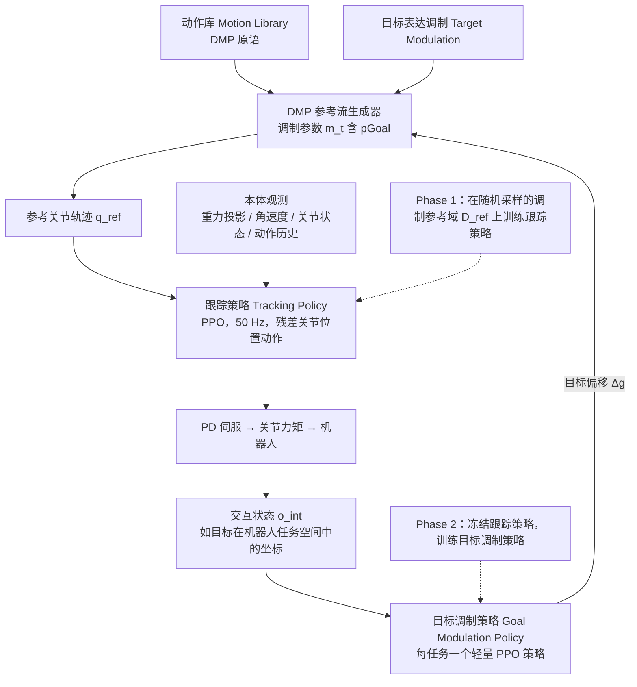

# RoboMMT：调制式表达与交互机器人动作的稳定跟踪学习

**RoboMMT**（*RoboMMT: Learning Stable Tracking of Modulated Expressive and Interactive Robot Motion*，[arXiv:2610.26414](https://arxiv.org/abs/2610.26414)）收录于 senlanke「具身运控lab」10-19–10-23 前沿论文动态（人形/四足）。本页依据**周报条目 + arXiv 摘要页**整理，流程图依据论文方法部分（见参考来源），未逐页核对实验数字；指标与结论以论文为准。

## 一句话定义

**RoboMMT：调制式表达与交互机器人动作的稳定跟踪学习——在完整表达参数域上训练参考条件跟踪策略，再由轻量交互策略修改动作生成器的空间目标；在四足和两种人形平台上统一验证，并完成四足零样本实机迁移。**

## 英文缩写速查

| 缩写 | 英文全称 | 简要说明 |
|------|----------|----------|
| RL | Reinforcement Learning | 强化学习 |
| WBC | Whole-Body Control | 全身控制 |

## 为什么重要

- 周报所述待解决的问题：在线改变表达动作的幅度、方向和节奏时，动态不稳定的腿式平台可能接近平衡极限。

## 流程总览

图依据：论文 §IV–VI / Fig. 1–2。

## 核心机制

| 项 | 内容 |
|----|------|
| **arXiv** | [2610.26414](https://arxiv.org/abs/2610.26414) · [PDF](https://arxiv.org/pdf/2610.26414) |
| **作者（arXiv）** | Till Hielscher, Kai O. Arras |
| **机构（周报所述，未逐条核实）** | 斯图加特大学 |
| **arXiv 评论栏** | （无） |
| **开源** | arXiv 摘要页与评论未见代码或项目页链接（仅核对 arXiv 摘要页，不代表未发布）（2026-10-26） |
| **周报所述创新点** | 在完整表达参数域上训练参考条件跟踪策略，再由轻量交互策略修改动作生成器的空间目标；在四足和两种人形平台上统一验证，并完成四足零样本实机迁移。 |

### arXiv 摘要节选（英文原文）

> Expressive robot motion can improve naturalness, effectiveness, and perceived likability in human-robot interaction. When deployed on dynamically unstable platforms, however, reactive execution of expressive body motion may bring the robot to its stability limits, especially when expressivity is decoupled from physical control.

## 源码运行时序图

**不适用**：arXiv 摘要页与评论未见代码或项目页链接（仅核对 arXiv 摘要页，不代表未发布），无可对齐的官方代码流程。

## 实验与评测

- 周报与摘要给出的数字/场景已写入上表「创新点」与摘要节选；其余实验细节、基线与成功率定义请回到论文正文。
- 读法：先对齐任务设定、传感器与成功定义（仿真/真机），再解读 headline 数字，勿跨论文直接比较。

## 与其他工作对比

| 维度 | 读法 |
|------|------|
| **同周对照** | 见 [人形/四足周报技术地图](../overview/senlanke-weekly-2026-10-19-23-humanoid-quadruped-technology-map.md)，按方向浏览同期论文 |
| **开源状态** | arXiv 摘要页与评论未见代码或项目页链接（仅核对 arXiv 摘要页，不代表未发布） |

## 结论

**RoboMMT：调制式表达与交互机器人动作的稳定跟踪学习。**

1. 本页是入库级摘要，复现前请核对论文正文、附录与代码仓库。
2. 指标须连同实验条件解读。
3. 关注 arXiv 版本更新与代码发布。

## 关联页面

- [senlanke-weekly-2026-10-19-23-humanoid-quadruped-technology-map](../overview/senlanke-weekly-2026-10-19-23-humanoid-quadruped-technology-map.md)
- [locomotion](../tasks/locomotion.md)

## 参考来源

- [robommt-modulated-expressive-motion-tracking_arxiv_2610_26414.md](../../sources/papers/robommt-modulated-expressive-motion-tracking_arxiv_2610_26414.md)
- [wechat_senlanke_weekly_humanoid_quadruped_2026-10-19_23.md](../../sources/blogs/wechat_senlanke_weekly_humanoid_quadruped_2026-10-19_23.md)
- [arXiv:2610.26414](https://arxiv.org/abs/2610.26414)
- [arXiv PDF](https://arxiv.org/pdf/2610.26414)：已通读方法部分（实验与附录以略读为准）：§I–VI（引言、背景、方法概述、跟踪策略、交互目标调制）

## 推荐继续阅读

- [arXiv PDF](https://arxiv.org/pdf/2610.26414)
