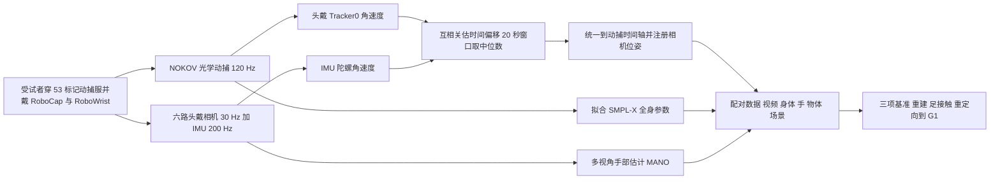

# RoboMoCap（arXiv:2611.10994）

**RoboMoCap**（*RoboMoCap: A Large-Scale Whole-Body Motion Capture Dataset with Egocentric Vision for Robot Learning*，[arXiv:2611.10994](https://arxiv.org/abs/2611.10994)，新加坡国立大学 MAGIC Lab、BitRobot 等）。项目页：<https://bitrobot-foundation.github.io/robomocap/>；数据集（Hugging Face，非代码仓库）：<https://huggingface.co/datasets/BitRobot/robomocap>。论文发布时代码标为 coming soon，故本页不写 `code:`。

## 一句话定义

**一个把头戴/腕戴第一视角传感器与 120 Hz 光学全身动捕在时间和空间上对齐的人体数据集，重点覆盖变速、转向、侧退行走、携物等「走+拿」动作，用来做第一视角全身重建与人到人形的运动重定向。**

## 英文缩写速查

| 缩写 | 英文全称 | 简要说明 |
|------|----------|----------|
| MoCap | Motion Capture | 动作捕捉；此处为反光标记点光学方案（NOKOV） |
| SMPL-X | Skinned Multi-Person Linear model eXpressive | 带手和脸的参数化人体模型，数据集的身体表示 |
| MANO | hand Model with Articulated and Non-rigid defOrmations | 参数化手模型，手部姿态用它表示（视觉估计） |
| IMU | Inertial Measurement Unit | 惯性测量单元（加速度计 + 陀螺） |
| MPJPE | Mean Per-Joint Position Error | 关节位置平均误差；W- 为世界系，WA- 为序列对齐，PA- 为 Procrustes 对齐 |
| F1 | F1 score | 接触检测的精确率与召回率调和平均 |
| GMR / PHC / OmniRetarget | General Motion Retargeting / Perpetual Humanoid Control / OmniRetarget | 论文基准里比较的三种重定向方法 |

## 为什么重要

- 第一视角相机常看不到脚和下肢，只靠视频推全身动作有歧义；光学动捕给出不依赖视觉推断的下肢真值（论文 §1、§4.1）。
- 现有人形用的人体运动数据多缺配对的第一视角画面，第一视角数据多缺高精度全身真值（论文 §2.3、表 1）。
- 论文作者自述这是「最大的以移动为中心的多模态人体运动数据集」（§1 贡献），该「最大」是作者口径，本页未独立核对表 1 之外的数据集。

## 核心原理与流程总览

采集与标注流水线（论文 §3–§4、图 3）：

要点（均为论文内容，章节见括号）：

- **硬件（§3.1）**：6 个头戴全局快门相机（1920×1080、30 Hz）、2 个 IMU、磁力计；双腕 RoboWrist；1 个外部相机；53 个身体标记点；头戴 4 点刚体 Tracker0；物体贴 4 点做 6-DoF 跟踪。
- **采集（§3.2、§4.2）**：7×7 m 动捕棚，布置窄道、障碍、斜面、高度变化；受试者被要求自然行走，不模仿机器人动作；连续多次重复，不是孤立单次。
- **动作库（§4.1、表 2）**：291 个协议、八类；三类核心（移动基元、姿态与动力学、走拿结合）合计 161 小时（约 80.6%，§4.5.1）。
- **同步（§4.3）**：用 IMU 角速度幅值与 Tracker0 角速度做互相关，幅值比较使其无需先做空间标定；漂移超过 3 ms 才用仿射映射；各模态保留原采样率。
- **标注（§4.4）**：SMPL-X 由光学数据拟合；手部是视觉估计，论文明确与光学测量区分；场景用 MapAnything 重建；有任务文本与起止时间戳；各流有逐帧有效性掩码。

### 三项基准（§5）

| 任务 | 设置 | 论文报告的结果 |
|------|------|----------------|
| 第一视角全身重建（§5.1，表 3） | AGRoL、EgoPoser、EgoEgo、EgoAllo 的公开预训练模型，不微调 | EgoAllo 局部 MPJPE 最低 80.8 mm；AGRoL 世界系 W-MPJPE 最低 95.4 mm；论文据此指出局部准与全局准不等价 |
| 足接触与落脚点（§5.2，表 6） | 用同一高度加速度规则从重建足关节推接触，对照脚底标记标签 | EgoAllo 接触 F1 90.5%、落脚点误差 85.1 mm；GT SMPL-X 的 F1 也仅 93.6% |
| 人到人形重定向（§5.3，表 4、5） | 543 个测试 session（约 18 小时），Unitree G1（29 自由度），GMR、PHC、OmniRetarget | OmniRetarget 全局关键体位置误差 34.8 mm，接触 F1 87.7%，片段成功率 53.6%；PHC 成功率 79.6%；GMR 7.4% |

## 工程实践

- **取数**：数据在 Hugging Face，许可 CC BY 4.0，README 标 5TB+（HF README；本页未下载）。各模态保留原采样率和时间戳，使用前需自己按 §4.3 的映射对齐到 120 Hz 动捕时间轴。
- **坐标**：原始动捕为毫米、Y 轴向上，发布已转为米、Z 轴向上右手系；论文特别提醒世界原点不一定等于真实地面，做足接触分析要考虑标记贴附与支撑面几何（§4.3）。
- **手部**：用手部标注时记得它是视觉估计，不是光学真值（§4.4）。
- **重定向**：数据给出 SMPL-X 运动与脚底标记接触标注（§5.3）；基准的身体按身高缩放后对 G1 评测，可参见 [运动重定向流水线](../concepts/motion-retargeting-pipeline.md)。
- **未开放**：论文发表时代码标为 coming soon（HF README、项目页），评测脚本是否释出未核实。

## 与文章说法的核对

文章（公众号《机器人动作块太长，什么时候该重新规划？》2026-11-11 速览，第 19 条）原话要点与核对：

| 文章说法 | 核对结果 |
|----------|----------|
| 同步第一视角视频、腕部视角与光学动作捕捉 | 属实：头戴 6 相机、双腕相机、NOKOV 光学动捕（§3.1、§4.3） |
| 为全身运动重定向和学习提供数据 | 部分属实：论文给出重定向基准（§5.3），但**没有训练任何视觉条件人形策略，也没有机器人上执行**；下游人形执行验证被作者列为未来工作（第 6 节） |
| 采集包含下肢接触细节 | 属实：脚底标记派生接触标签与 foot contact 基准（§5.2、§5.3）；但接触是标记 / 运动学推出的，论文也承认 GT SMPL-X 的接触 F1 仅 93.6% |
| 主体仍是受控实验空间，不能等同于自然环境日常数据 | 与论文自述一致：7×7 m 动捕棚（§3.2），局限节明确「受限于仪器化环境」；这是文章的限定而非论文漏洞 |
| 文章未提及的数字 | 200+ 小时、14 人、291 协议、120 Hz、53 标记，均以论文为准（摘要、表 2、§3.1） |

本页对文章的判断：文章说法与论文没有冲突，且限定语（受控空间）与论文自述吻合；唯一需要补充的是「用于学习」只是**提供数据与评测**，论文没有展示学习结果。

## 局限

- **论文自述（第 6 节）**：仪器化光学动捕环境，场景与地形有限；偶发标记遮挡与身体模型拟合误差；受试者、物体、场景有限；人与人形的形态差异使动作无法直接迁移，仍需重定向与控制适配；下游人形执行未验证。
- **性质**：本文是数据集 / 基准论文，没有提出新方法；三项基准都是用现成方法评测（§5），结论是「现有方法在下肢与全局运动上仍有明显误差」，不是 RoboMoCap 提升了某方法。
- **我看到的未验证之处**：（1）没有在 RoboMoCap 上训练或微调的实验，数据对训练的增益无证据；（2）「最大」为作者自述；（3）手部为视觉估计，精度细节本页未核对到具体数字（§4.4 只提到训练/测试时长）；（4）14 名受试者，泛化到更多体型未知；（5）论文基准的重定向成功率阈值是作者自定（根相对误差、穿地、自碰撞，§5.3）。
- **本页读取范围**：论文 v1 PDF 全文已读；未见附录；图以图注和正文数字为准；未下载数据。

## 关联页面

- [运动重定向流水线](../concepts/motion-retargeting-pipeline.md)
- [SMPL-X](../concepts/smpl-x.md)
- [全身控制](../concepts/whole-body-control.md)
- [全身跟踪流水线](../concepts/whole-body-tracking-pipeline.md)
- [Ego-Exo4D 数据集](../entities/dataset-ego-exo4d.md)
- [PHUMA 数据集](../entities/dataset-bfm-phuma.md)
- [OmniRetarget 数据集](../entities/omniretarget-dataset.md)
- [第一视角视觉资源汇总](../entities/awesome-egocentric-vision.md)
- [模仿学习](../methods/imitation-learning.md)

## 参考来源

- [robomocap_arxiv_2611_10994.md](../../sources/papers/robomocap_arxiv_2611_10994.md)
- [arXiv:2611.10994](https://arxiv.org/abs/2611.10994)
- [项目页](https://bitrobot-foundation.github.io/robomocap/)
- [Hugging Face 数据集](https://huggingface.co/datasets/BitRobot/robomocap)

## 继续阅读

- [arXiv PDF](https://arxiv.org/pdf/2611.10994v1)
- [运动重定向流水线](../concepts/motion-retargeting-pipeline.md)
- [OmniRetarget 数据集](../entities/omniretarget-dataset.md)
