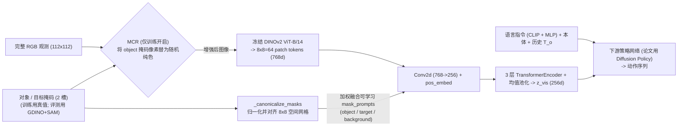
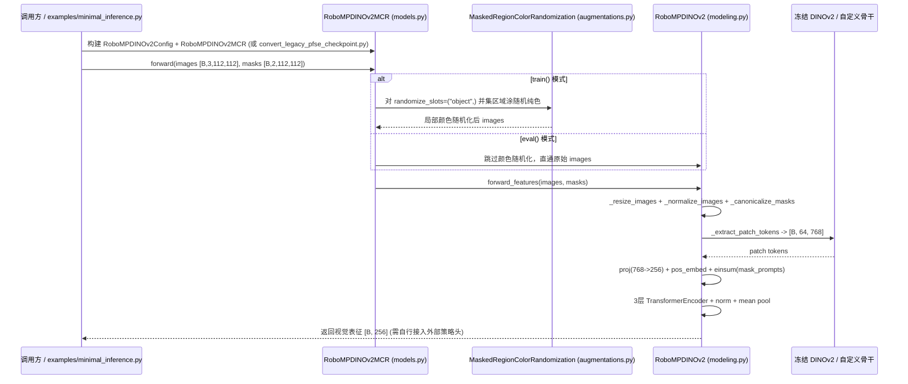

# RoboMP-DINOv2（arXiv:2609.25506）

**RoboMP-DINOv2**（*RoboMP-DINOv2: Prompts, Not Filters for Robust Robot Manipulation*，[arXiv:2609.25506v1](https://arxiv.org/abs/2609.25506)，[代码](https://github.com/han20192019/RoboMP_DINOv2)）由哈佛大学 SEAS 提出，在全场景 DINOv2 表征上以可学习空间提示注入目标掩码信息，代替丢弃背景的硬掩码过滤，并配合局部颜色随机化提升泛化。

## 一句话定义

**在保留完整图像 DINOv2 特征的基础上将操作对象/目标掩码作为空间提示（Prompt）融合进 patch token，而非把掩码当作擦除背景的滤波器（Filter），同时以仅随机化前景掩码物体颜色的 MCR 增强兼顾物体外观泛化与背景环境线索。**

## 英文缩写速查

| 缩写 | 英文全称 | 简要说明 |
|------|----------|----------|
| RoboMP-DINOv2 | Robot Mask-Prompted DINOv2 | 本文方法：将对象/目标掩码作为空间提示融合至冻结 DINOv2 特征 |
| MCR | Masked-Region Color Randomization | 训练期仅对前景掩码区（如 `"object"` 槽）执行均匀随机纯色替换，推理期关闭 |
| DINOv2 | Self-DIstillation with NO labels v2 | 冻结自监督视觉骨干（默认 `dinov2_vitb14`，112×112 → 8×8 patch token） |
| OOD | Out-of-Distribution | 分布外泛化，本文涵盖空间位移、杂乱干扰物与外观变化三类仿真评测 |
| SAM | Segment Anything Model | 测试期与 Grounding DINO 联动生成在线前景掩码提示（不随代码仓内置） |

## 为什么重要

- **修正“硬掩码裁剪丢环境”的盲区：** 现有 2D/3D object-centric 策略用分割掩码把背景清零或裁掉，虽然对无用杂物免疫，却也抹去了避障物体（如障碍罐）和环境颜色信号（如炉灶指示灯红/绿状态）。
- **只随机化物体本身而不毁掉背景语义：** 全图颜色抖动会让模型把任务有关的背景色当噪声丢弃；**MCR** 只随机化 `"object"` 等指定掩码槽像素的均匀颜色，促使策略既忽略目标物体的颜色/纹理变化，又完整记住未受扰动的环境语义线索。
- **工程落地需认清开放边界：** 官方仓 `han20192019/RoboMP_DINOv2` 实为**纯视觉编码器 PyTorch 包**（内部旧命名 `PFSE`），可以即插即用替换观测编码器，但不带下游 Diffusion Policy、Grounding DINO + SAM、仿真任务及训练权重。

## 核心原理

| 组件 | 论文与源码实现（§3 & `src/robomp_dinov2/`） | 关键默认超参 |
|------|----------------------------------------------|--------------|
| **冻结视觉骨干** | `DINOv2` 提取全场景视觉 patch token；`_resize_images` + `_normalize_images` 预处理后经 `Conv2d` 投影至隐空间并加位置编码 `pos_embed` | `dinov2_vitb14`、`image_size=112`、`patch_size=14`（64 token）、`backbone_dim=768→hidden_dim=256` |
| **空间掩码提示（Mask Prompting）** | `_canonicalize_masks` 统一二值/多类别/RGB 掩码输入并下采样到 `8×8`；按每格点各槽位占比通过 `einsum` 把可学习 `mask_prompts` 加权融入 patch token（含额外背景隐式权重） | `num_mask_slots=2`、`slot_names=("object","target")`、`include_background_prompt=True`（共 3 组槽向量） |
| **时序聚合与下游策略** | 3 层 Pre-Norm TransformerEncoder + LayerNorm + token 均值池化得 `[B, 256]` 特征；论文将其与 CLIP 文本、本体感觉、历史视窗 `T_o` 接入 Diffusion Policy | `num_layers=3`、`num_heads=8`、`mlp_ratio=4.0`；仅优化策略损失，无辅助损失 |
| **MCR 数据增强** | `MaskedRegionColorRandomization` 在 `train()` 时把 `randomize_slots`（默认仅 `"object"`）并集区域替换成均匀采样 RGB；`eval()` 自动直通 | 推理零额外耗时，测试需靠外部检测/分割模块提供掩码 |

### 流程总览

## 源码运行时序图

官方仓库 [han20192019/RoboMP_DINOv2](https://github.com/han20192019/RoboMP_DINOv2) **仅提供视觉表征编码器包 `robomp_dinov2` 与示例脚本 `examples/minimal_inference.py`**；下游扩散策略、CLIP、Grounding DINO + SAM、7 个仿真基准以及完整策略 checkpoint 均不在仓内（调用 `hubconf.py` 且 `pretrained=True` 会直接报错提示未捆绑权重）。以下时序图严格对齐仓库现有可执行链路：

## 实验与评测

全篇实验均在 **7 个仿真操作任务**（每任务 100 条示范）上评测，**未做真机实验**；训练期使用仿真真值掩码，评测期由 `Grounding DINO + SAM` 实时生成提示掩码。

### 1. OOD 泛化对比（Tables 1, 3 & 4，7 任务均值 / 高难子集）

| 评测维度 | 2D Object-Centric (DOCIR) | 3D Object-Centric (GROOT) | DP-DINOv2 | RoboGround-DINOv2 | **RoboMP-DINOv2 (+MCR)** | 关键洞察 |
|----------|--------------------------|--------------------------|-----------|-------------------|--------------------------|----------|
| **Clean Spatial OOD**（Table 1） | 8.1% | 28.6% | 50.7% | 55.9% | **60.7%** | 7 项中赢下 6 项；仅 `Place cube` 被 3D GROOT（85% vs 54%）反超 |
| **Clutter OOD**（Table 1） | 6.3% | 16.4% | 41.0% | 36.8% | **59.7%** | 有障碍物放罐 `80.0%`（vs DP 52.0% / 3D 3.0%）；双臂交接 `81.0%`（vs DP 41.0%） |
| **Appearance OOD**（Table 3，均配颜色增强） | 12.0% | 14.2% | 19.1%（full-rand） | 35.1% | **72.5%**（MCR） | 全部 7 个任务均最高 |
| **Appearance + Clutter 组合**（Table 4，3 项） | — | — | 0.00 / 0.02 / 0.00 | — | **0.26 / 0.24 / 0.38** | 对应 `Two arm / Place cube / Pull tool` 三项高难组合场景 |

### 2. 上下文颜色保留、消融与表征稳定性（Table 2, Figs. 2–3）

- **炉灶指示灯背景颜色线索保留（Fig. 3）：** 指示灯为绿/红决定了动作语义，RoboMP-DINOv2-MCR 达到 **88%（绿）/ 71%（红）**，而采用全图颜色随机化的 DP-DINOv2 仅为 **25% / 19%**。
- **同构 Transformer 容量消融（Fig. 2，3 随机种子 × 50 trials）：** 将 3 层 Transformer 编码器保持一致后对比不同输入形式，`RoboMP-DINOv2 > All-one masks > No mask prompting > DINOv2 CLS+mean`，表明收益并非单纯来自网络层数加深。
- **扰动下表征偏移（Table 2）：** 在 5 项杂乱扰动任务中的 4 项与全部 5 项外观变更任务上，RoboMP-DINOv2 特征向量余弦距离及相对 L2 漂移均低于 DP-DINOv2。

## 与其他工作对比

| 路线 | 对待背景像素策略 | 对外观泛化的处理 | 对外部感知依赖 |
|------|------------------|------------------|----------------|
| **DOCIR / GROOT（硬掩码过滤）** | 裁掉或屏蔽背景 RGB/点云 | 只靠局部表面几何或少量前景增强 | 强依赖前景分割准确率；丢失障碍与背景语义 |
| **全图颜色增强 + DP** | 保留背景并一并大幅改色 | 全图像素随机化 | 容易破坏红绿灯、显示器等状态依赖型颜色线索 |
| **RoboMP-DINOv2（本文）** | 全图进 DINOv2，掩码仅作空间提示相加 | **MCR** 仅随机化前景被指代物体像素 | 推理期仍依赖外部提示生成器（论文用 GDINO+SAM） |

## 结论

**用空间掩码提示而非背景擦除来引入目标先验，再配合局部掩码区颜色随机化，是比硬裁剪更适合含障碍与背景状态线索操作任务的视觉编码思路；工程复用需注意官方仓目前仅含编码器而无完整策略栈与权重。**

1. **开源边界核查：** `han20192019/RoboMP_DINOv2` **部分开源** — 仅发布可直接导入的 `robomp_dinov2` 编码器包与 MCR 增强模块；下游 Diffusion Policy、CLIP、Grounding DINO+SAM、仿真环境及检查点未随仓公开。
2. **MCR 适用前提：** 只要任务依赖“目标物体本身的颜色”作为决策条件（而非单纯背景颜色），就不应把该槽位列入 `randomize_slots`。
3. **跨硬件证据尚缺：** 全部定量成绩均来自 7 个仿真操作任务，缺乏真机闭环部署下对延迟、分割漂移及反光/运动模糊的验证。
4. **旧权重迁移入口：** 若从作者早期项目代码读取权重，可通过仓内 `scripts/convert_legacy_pfse_checkpoint.py` 把旧内部前缀 `PFSE` 转成当前参数命名。

## 工程实践

| 工程环节 | 仓库/论文细节 | 落地注意点 |
|----------|---------------|------------|
| 模型构建 | 安装根目录包后直接实例化 `RoboMPDINOv2Config` 与 `RoboMPDINOv2MCR` | 不可调 `pretrained=True` 拉取全模型权重（`hubconf.py` 未托管），须自行从 PyTorch Hub 下载基础 `dinov2_vitb14` 后微调或注入自定义骨干 |
| 掩码槽位对齐 | 支持 `(B, S, H, W)` 二值掩码、`object/target` 单通道编号掩码或红蓝 RGB 掩码（`_canonicalize_masks`） | 槽位顺序（如索引 `0="object"`，`1="target"`）一经训练确定在测试阶段必须保持一致 |
| 分辨率制约 | 默认固定 `image_size=112, patch_size=14` 对应 `8×8` token 网格 | 若任务包含极细小部件，强行用 112×112 会损失几何精度，需同步重设分辨率与位置插值 |
| 外部拼装模块 | 将 `[B, 256]` 输出接入自行搭建的多步动作头（如 Diffusion Policy）与文本条件支路 | 测试时需额外部署 Grounding DINO + SAM 或同类轻量跟踪分割器，并测算其整体端到端时延 |

## 局限与风险

- **无真机实验证据：** 论文的全部主表、消融与指示灯测试均为仿真环境结果，尚未证明在真实相机畸变、物理接触与高频反馈下同样成立。
- **外部掩码失败级联风险：** 测试阶段假设外部 `Grounding DINO + SAM` 能提供准确且跨帧槽位顺序一致的掩码；一旦在密集遮挡或相似物体堆叠中漏检或互换 `object`/`target`，提示向量反而注入错误偏置。
- **112×112 固定低分辨率：** 8×8 的空间网格对大尺度空间布局足够，但对精密插拔等毫米级局部对齐存在明显量化模糊。
- **MCR 槽位强假设：** 如果任务本身要求区分“拿红色杯子还是蓝色杯子”，将 `"object"` 写入 `randomize_slots` 会直接抹掉可区分信号。

## 关联页面

- [Manipulation](../tasks/manipulation.md) — 空间/杂乱/外观泛化场景下的桌面操作主线
- [VLA](../methods/vla.md) — 基础视觉表征与语言动作策略演进
- [Imitation Learning](../methods/imitation-learning.md) — 扩散策略与视觉行为克隆泛化
- [DINOv2](./paper-dinov2.md) — 底层自监督 ViT-B/14 视觉骨干实体
- [具身智能小站 10-18 期 26 篇阅读坐标](../overview/embodied-station-2026-10-18-26-papers-technology-map.md) — 同批次 VLA 评测与部署路线索引

## 参考来源

- [RoboMP-DINOv2 论文归档](../../sources/papers/robomp_dinov2_arxiv_2609_25506.md) — arXiv `2609.25506v1` 全文通读与 Tables 1–4 核对
- [RoboMP-DINOv2 官方仓库归档](../../sources/repos/robomp_dinov2.md) — `han20192019/RoboMP_DINOv2` 全部源码、配置与部分开源边界核查
- [具身智能小站 2026-10-18 盘点](../../sources/blogs/wechat_embodied_station_26_papers_embodiedswe_2026-10-18.md)

## 推荐继续阅读

- [arXiv:2609.25506](https://arxiv.org/abs/2609.25506)
- [han20192019/RoboMP_DINOv2（GitHub）](https://github.com/han20192019/RoboMP_DINOv2)
