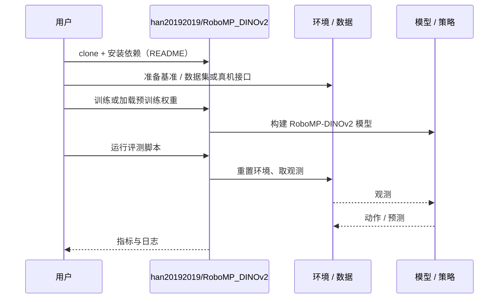

# RoboMP-DINOv2（arXiv:2609.25506）

**RoboMP-DINOv2**（*RoboMP-DINOv2: Prompts, Not Filters for Robust Robot Manipulation*，[arXiv:2609.25506](https://arxiv.org/abs/2609.25506)，[代码](https://github.com/han20192019/RoboMP_DINOv2)）来自 [具身智能小站 2026-10-18 盘点](../../sources/blogs/wechat_embodied_station_26_papers_embodiedswe_2026-10-18.md)，属「VLA 评测与部署」组。

## 一句话定义

**在完整图像特征上加入区域提示，而不是用硬掩码过滤，避免丢掉障碍与背景线索。**

## 英文缩写速查

| 缩写 | 英文全称 | 简要说明 |
|------|----------|----------|
| DINOv2 | Self-DIstillation with NO labels v2 | 自监督视觉特征 |

## 为什么重要

- 硬掩码会丢掉障碍和背景线索；区域提示保留完整场景。
- 开源结论：**已开源**（步骤 2.5，2026-10-18）。仓库可达（git ls-remote）。
- 同期同组工作见 [编程智能体造数据与 VLA 闭环评测：具身智能小站 10-18 期 26 篇阅读坐标](../overview/embodied-station-2026-10-18-26-papers-technology-map.md)。

## 核心机制

| 项 | 内容 |
|----|------|
| **arXiv** | [2609.25506](https://arxiv.org/abs/2609.25506) |
| **开源** | **已开源** |
| **要点** | 完整图像特征 + 区域提示（空间提示），替代硬掩码。 |
| **文内指标** | 公众号称空间、杂乱和颜色迁移实验均在仿真中完成，颜色增强版本应单独看待。 |

## 源码运行时序图

以下为按仓库入口（`han20192019/RoboMP_DINOv2`）推断的通用运行链路；入库日仅核实仓库可达，未逐文件阅读，具体脚本名以 README 为准。

## 实验与评测

- 公众号称空间、杂乱和颜色迁移实验均在仿真中完成，颜色增强版本应单独看待。
- **读法：** 本页为索引级摘要，依据公众号转述的官方摘要与仓库信息整理；逐项数字与 baseline 以原文 PDF 为准。

## 与其他工作对比

- 横向索引见 [编程智能体造数据与 VLA 闭环评测：具身智能小站 10-18 期 26 篇阅读坐标](../overview/embodied-station-2026-10-18-26-papers-technology-map.md)；同 arXiv 不重复造页。

## 结论

**用提示而非过滤注入空间先验，但证据目前全在仿真。**

1. 开源边界：**已开源** — 仓库可达（git ls-remote）。
2. 核心机制：完整图像特征 + 区域提示（空间提示），替代硬掩码。
3. 复现与选型前核对任务协议、硬件与基准口径，勿直接横比公众号摘录数字。

## 关联页面

- [manipulation](../tasks/manipulation.md)
- [vla](../methods/vla.md)
- [paper-dinov2](./paper-dinov2.md)
- [embodied-station-2026-10-18-26-papers-technology-map](../overview/embodied-station-2026-10-18-26-papers-technology-map.md)

## 参考来源

- [robomp_dinov2_arxiv_2609_25506.md](../../sources/papers/robomp_dinov2_arxiv_2609_25506.md)
- [wechat_embodied_station_26_papers_embodiedswe_2026-10-18.md](../../sources/blogs/wechat_embodied_station_26_papers_embodiedswe_2026-10-18.md)
- [arXiv:2609.25506](https://arxiv.org/abs/2609.25506)

## 推荐继续阅读

- [arXiv PDF](https://arxiv.org/pdf/2609.25506)
- [https://github.com/han20192019/RoboMP_DINOv2](https://github.com/han20192019/RoboMP_DINOv2)
