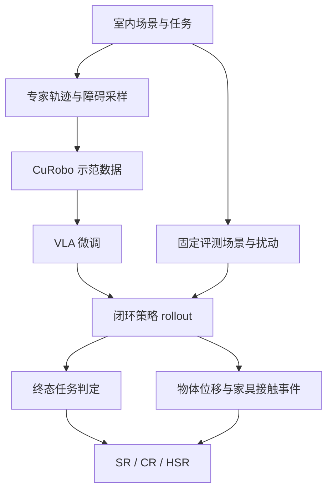
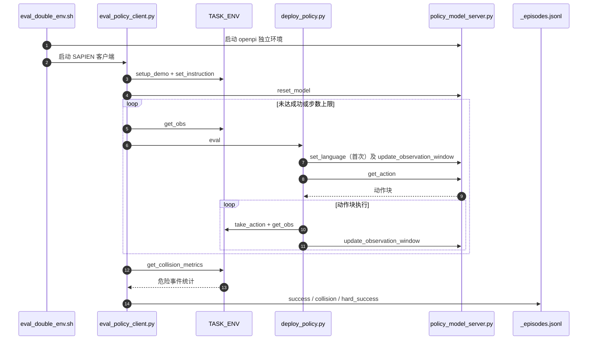

# RoboPRO: A Perturbation-Resilient and Obstacle-Aware Benchmark for Robotic Manipulation｜RoboPRO：抗扰动与障碍感知的机器人操作评测基准

## 一句话定义

RoboPRO 是基于真实感室内仿真场景的双臂操作评测基准，将任务终态成功与执行过程的危险接触分开测量，以暴露仅用成功率无法发现的部署风险。

## 英文缩写速查

| 缩写 | 英文全称 | 简要说明 |
|---|---|---|
| VLA | Vision-Language-Action | 视觉语言动作策略 |
| SR | Success Rate | 任务成功率 |
| CR | Collision Rate | 危险碰撞回合占比 |
| HSR | Hard Success Rate | 完成任务且未触发危险事件的回合占比 |
| OCR | Object Collision Rate | 非目标物体危险位移事件率 |
| FCR | Furniture Collision Rate | 家具危险接触事件率 |
| OOD | Out-of-Distribution | 分布外条件 |

## 为什么重要

机器人把物体送到了正确位置，仍可能撞倒邻近物品或对家具施加过大力。终态成功不代表过程安全；但正常抓取、轻微接触也不应一概判作危险。RoboPRO 将这种差别纳入可复现的仿真评测。

## 核心信息

| 项目 | 内容 |
|---|---|
| 机构 | 华为（Huawei）、多伦多大学（University of Toronto）、滑铁卢大学（University of Waterloo） |
| 论文 | [arXiv:2611.26971v1](https://arxiv.org/abs/2611.26971)，2026-11-20 |
| 仿真 | SAPIEN / RoboTwin 2.0，Aloha-Agilex 双臂 |
| 规模 | 80 任务（60 原子、20 组合）、4 环境、16,000 示范、5,600 语言变体 |
| 开源 | [项目](https://robopro-bench.github.io/RoboPRO/)、[代码](https://github.com/robopro-bench/RoboPRO)、[数据](https://huggingface.co/datasets/RoboPRO/RoboPRO_data) |

## 核心原理

### 场景与扰动

办公室、书房、小厨房、大厨房各 20 个任务，每类含 15 个单技能和 5 个组合任务；组合任务串联 2–4 个技能。对每任务采集 100 个无额外障碍回合和 100 个有障碍回合，障碍密度 6–15 每档 10 条，由 CuRobo 生成示范。障碍在专家轨迹扫掠体积内采样，最小间距 5 cm，迫使策略改变操作路径，而非仅识别视觉背景。

| 扰动维度 | 内容 |
|---|---|
| 视觉 | 光照、逐帧模糊、逐帧像素偏移 |
| 语言 | 无关背景、多物体干扰、常识间接指代、推理链、口语礼貌表达 |
| 物体 | 材质外观、未见障碍、未见目标及组合 |

训练使用每任务 20 条同义变体，评测使用独立的 50 条较复杂变体。语言、视觉和物体扰动可组合；对照实验固定其他因素。

### 危险碰撞判据

令 G 为回合终态是否完成任务，C 为该回合是否发生任一种危险事件：

- OCR 对应非目标物体状态变化：位置超过 1 cm 或姿态超过 0.1 rad。
- FCR 对应固定家具的持续接触力超过 10 N。论文未在正文给出持续时长的具体数值。
- C = E_O OR E_F；两类事件重叠时不重复计数。

$$
SR=\frac{1}{N}\sum_i G_i,\quad CR=\frac{1}{N}\sum_i C_i,\quad HSR=\frac{1}{N}\sum_i G_i(1-C_i).
$$

SR − HSR 是全体回合中成功但危险的比例；CR − (SR − HSR) 是全体回合中失败且危险的比例。HSR 不等于 SR − CR，因为失败回合也可能发生碰撞。

## 流程总览

## 源码运行时序图

以公开 π₀.₅ 双进程入口为例，模型调用经客户端代理传递，三路 RGB 与关节状态由 deploy_policy 编码。详细入口与环境要求见[源码归档](../../sources/repos/robopro-2611-26971.md)；这不是已运行的复现报告。

## 工程实践

- 对同一任务优先使用官方验证的种子或冻结环境；相同种子在 clean 与 clutter 中保持目标初始位姿，避免将场景差异误判为算法变化。
- 评测任务需实现碰撞指标接口；关闭指标或出现 null 时不能算作安全成功。
- 同时保存任务终态、危险事件、障碍密度和失败回放；实际机器人须另设力矩、接触力、速度、安全停机等约束。
- 官方已发布仿真代码、数据与部分模型 checkpoint，具体见[源码](../../sources/repos/robopro-2611-26971.md)。依赖 SAPIEN 版本和资产，不同物理配置可能影响结果。

## 实验与评测

论文 Table II/III，全 80 个任务、每任务每条件 20 个回合、无额外扰动（百分比按原表两位小数换算）：

| 模型 | Clean SR / HSR / CR | Clutter SR / HSR / CR |
|---|---|---|
| X-VLA | 50% / 47% / 9% | 40% / 28% / 39% |
| π₀ | 60% / 56% / 15% | 47% / 33% / 45% |
| π₀.₅ | 70% / 66% / 12% | 61% / 48% / 32% |

π₀.₅ 在 clutter 中 SR 与 HSR 相差约 13 个百分点，新增风险主要来自非目标物体事件（OCR 从 3% 增至 27%，FCR 从 9% 至 8%）。

Table IV（中位难度 12 任务）中，π₀.₅ 的 clean-only、clutter-only、half-split、default 整体 SR 分别为 47.5%、61.1%、64.1%、65.0%；clutter-only 的杂乱 HSR 为 38.3%，高于 default 的 33.7%。Table V 同样基于 12 任务，三模型平均扰动 SR 均下降约 2 个百分点，而语言类下降 6–8 个百分点。图 7 中组合任务的 CR 从原子任务的 19% 升至 32%，新增碰撞集中于失败回合。图 8 显示从 clean 到 6 个障碍时 HSR 明显下降，之后下降趋缓。

## 结论

**评估操作策略的部署价值，必须同时检查能否完成任务与是否以安全的方式完成。**

1. 把 SR、CR、HSR 联合设为评测输出，不用一个指标替代其他指标。
2. 将障碍放入真实动作通路，而不是只在背景中增加物体。
3. 使用 clean 与 clutter 混合数据提升整体能力，另以目标场景 HSR 判断是否需要针对性训练。
4. 对长任务检查失败后是否仍产生危险动作；分别统计成功与失败回合碰撞。
5. 按语言、视觉、物体轴进行控制变量评测，避免仅凭平均分推断鲁棒性。

## 与其他工作对比

- [MOSAIC](./paper-mosaic-clutter-2611-15937.md) 在 RoboPRO 上研究目标、落点、障碍的几何建模；RoboPRO 提供评测环境与事件指标，本身不是新的 VLA 策略。
- [ManiLadder](./paper-maniladder-manipulation-benchmark.md) 侧重任务难度分层；RoboPRO 更强调操作障碍、扰动与危险接触的联合诊断。

## 局限与风险

阈值为论文的仿真实验定义，并非通用安全标准；单一双臂本体、四类室内场景和有限扰动不能覆盖真机工况。碰撞判据不能替代人体安全、峰值冲击、设备耐受性和真实执行器限制的专项验收。部分扰动实验只用 12 任务，不能外推为全量任务保证。

## 关联页面

- [双臂协调操作](../tasks/bimanual-manipulation.md)
- [机器人操作](../tasks/manipulation.md)
- [具身评测基准选型闭环](../overview/hub-embodied-eval-benchmark.md)
- [具身模型测评纵深路线](../../roadmap/depth-embodied-eval.md)

## 参考来源

- [论文原文归档](../../sources/papers/robopro-2611-26971.md)
- [官方项目页归档](../../sources/sites/robopro-2611-26971.md)
- [官方源码归档](../../sources/repos/robopro-2611-26971.md)

## 推荐继续阅读

- [论文 HTML v1](https://arxiv.org/html/2611.26971v1)
- [论文 PDF](https://arxiv.org/pdf/2611.26971)
- [官方评测说明](https://github.com/robopro-bench/RoboPRO/blob/main/eval/README.md)
