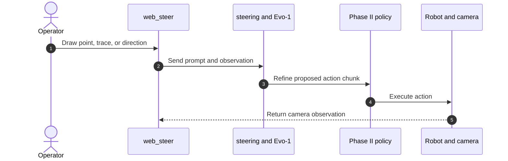

# RoboPrompt: Intuitive Robot Policy Steering with Sparse Human Input

**RoboPrompt**（[arXiv:2610.10534](https://arxiv.org/abs/2610.10534)，上海交通大学、上海创智学院与诺玛矩阵）让用户在相机图像上给出点、手绘轨迹或粗略方向，在线引导已有机器人策略。它把“理解人工意图”和“生成精细动作”解耦：Evo-1 先生成动作草案，基础策略再用扩散或流匹配过程细化动作，不需修改基础策略结构或针对 steering 微调。

## 一句话定义

把低带宽的人类提示变成动作块，再交给预训练策略逐步细化；部署中收集的纠错轨迹还能反过来改进策略。

## 英文缩写速查

| 缩写 | 英文全称 | 简要说明 |
|------|----------|----------|
| VLA | Vision-Language-Action | Evo-1 将图像、任务指令与视觉提示映射为动作草案 |
| PBD | Progressive Biased Denoising | 扩散策略逐步增加对动作草案的去噪细化 |
| TOT | Time-weighted Optimal Transport | 按与专家轨迹的时序相似度筛选 steered rollout |
| DAgger | Dataset Aggregation | 将部署纠错数据回流至策略训练 |

## 为什么重要

- **给端到端策略增加可用的人工纠错接口：** 操作者通过相机视图中的点、轨迹和方向指导机器人，不必使用专用遥操作设备。
- **同一 steering 模块可复用到不同基础策略：** 论文展示 Diffusion Policy、π₀.₅ 和 FastWAM，基础策略无需改架构或为 steerability 微调。
- **把部署纠错接入策略改进：** TOT 过滤 rollout 后再和原始离线演示共同训练，使人工干预数据形成 DAgger 闭环。

## 系统结构与方法

### Phase I：把提示转换为动作草案

项目使用 0.77B Evo-1 模型，输入当前相机图像、单独的提示图像和任务指令；方向提示也可以附加为文本。模型将点、轨迹或方向信息转换为连续的 6D 动作草案及动作块。仓库 README 给出从抓手尖端轨迹生成像素标注的脚本，以及两阶段 Evo-1 训练配置。

### Phase II：由基础策略细化动作

RoboPrompt 把动作草案融入已有生成策略的动作生成过程：

- **Diffusion Policy：** Progressive Biased Denoising（PBD）逐个动作块增加去噪程度，让控制影响逐渐从人工意图转向基础策略先验。
- **Flow-matching policy：** Noise-Augmented Flow Reversal Steering（NA-FRS）在流匹配过程中引入动作草案。二者用于不同生成范式，不能混写成同一算法。

### TOT 筛选与 DAgger 闭环

并非每条成功 rollout 都适合用作训练示范。Time-weighted Optimal Transport（TOT）比较 rollout 和专家示范的策略特征序列，并惩罚过长的犹豫或反复动作；筛选后的 steering rollout 与原始离线数据一起用于后续策略训练。

闭环的数据流是“提示纠错 → 策略执行 → rollout 筛选 → 策略更新”。PBD 与 NA-FRS 分别对应扩散和流匹配策略的动作细化。

## 源码运行时序图

仓库入口与图中模块对应：`web_steer/` 提供浏览器提示界面，`steering/` 组合 Phase I 与 Phase II，`Evo-1/` 生成动作草案，`scripts/realworld/eval/` 启动交互评测与策略服务。仓库还提供标签生成和两阶段训练入口，具体复现依赖 README 所列模型、数据与运行环境。

## 评测与指标

- **提示跟随：** 项目页报告 Diffusion Policy、π₀.₅ 与 FastWAM 的 prompt alignment 至少 95%。
- **π₀.₅ 三任务：** 经过 2–3 轮 DAgger，平均成功率由 80.0% 提升到 95.5%（+15.5 个百分点）；平均人工干预数从 2.86 降到 1.60（减少 44.0%）。
- **Insert Bread 跨策略：** 论文摘要报告三种策略上的成功率平均提升 21.3%，人工干预数由 2.60 降到 0.47（减少 81.9%）。该数值限于单任务的跨策略比较，不与前一行的三任务 π₀.₅ 结果混算。

## 与其他工作对比

| 路线 | 人工输入 | 是否改基础策略 | 与 RoboPrompt 的差异 |
|------|----------|----------------|----------------------|
| **RoboPrompt** | 图像上的点 / 轨迹 / 方向（稀疏） | 否；Phase II 在生成过程中融入草案 | — |
| 全量遥操作纠错 | 专用设备上的逐时刻动作 | 数据回流时才更新 | 带宽最高、设备门槛高；RoboPrompt 用稀疏提示换取低门槛，空间精度依赖 Evo-1 草案质量 |
| 语言指令 steering | 自然语言 | 视实现而定 | 语言难以精确表达空间位置；RoboPrompt 的点和轨迹提供更细的空间约束 |
| [ViTaL](./paper-sa-2606-14981-inference-time-policy-steering-via-vision-and-to.md) | 稠密视触觉引导（非人工） | 否；推理时双层优化 | 引导信号来自传感器而非操作者；RoboPrompt 解决人工意图注入并接 DAgger 闭环 |

## 工程实践与局限

- **开放代码与数据入口：** 官方仓库 README 提供 Evo-1 训练、提示标注、离线交互评测、策略服务和硬件配置；数据集页包含示例数据与检查点下载说明。
- **许可证需核验：** GitHub 仓库元数据未声明许可证。仓库可见并可下载不代表代码可按任意条款复用。
- **部署依赖策略栈：** Phase II 需按所用策略配置运行时；README 的示例涉及 OpenPI、JAX/CUDA、Evo-1 训练依赖及图形界面组件。
- **数据筛选假设：** TOT 以策略特征序列及时长作为轨迹质量信号；论文的收益来自给定任务、机器人与数据设置，不应直接外推为任意策略的通用提升。

## 结论

**RoboPrompt 的关键贡献是把简单的人类提示接到不同生成式策略上，并把部署纠错变成后续训练数据。**

1. 点、轨迹和方向提示提供比语言更细的空间控制，同时比全量遥操作动作更稀疏。
2. Evo-1 负责生成动作草案；基础策略保留对动作的细化能力，两阶段职责应区分。
3. PBD 面向扩散策略，NA-FRS 面向流匹配策略；复现时应根据 Phase II 策略选择实现。
4. TOT 过滤用于降低犹豫、反复等 rollout 对 DAgger 数据的污染；实验收益与任务范围绑定。
5. 公开仓库有训练和评测入口，但许可证元数据缺失，使用前需确认授权条件。

## 关联页面

- [视觉-语言-动作模型（VLA）](../methods/vla.md)
- [模仿学习](../methods/imitation-learning.md)
- [Diffusion Policy](../methods/diffusion-policy.md)
- [动作块（Action Chunking）](../methods/action-chunking.md)
- [机器人操作任务](../tasks/manipulation.md)
- [Inference-time Policy Steering via Vision and Touch（ViTaL）](./paper-sa-2606-14981-inference-time-policy-steering-via-vision-and-to.md) — 稠密视触觉 steering 对照

## 推荐继续阅读

- [RoboPrompt 论文（arXiv:2610.10534）](https://arxiv.org/abs/2610.10534)
- [项目页与演示](https://yanwen-zou.github.io/Roboprompt-Website/)
- [官方代码仓库](https://github.com/yanwen-zou/Roboprompt)
- [数据与示例检查点](https://huggingface.co/datasets/ywzou/Roboprompt_Play_Data)

## 参考来源

- [RoboPrompt 论文来源归档](../../sources/papers/roboprompt_arxiv_2610_10534.md)
- [RoboPrompt 项目页归档](../../sources/sites/roboprompt-project.md)
- [RoboPrompt 官方仓库归档](../../sources/repos/roboprompt.md)
- [arXiv HTML 全文](https://arxiv.org/html/2610.10534)
