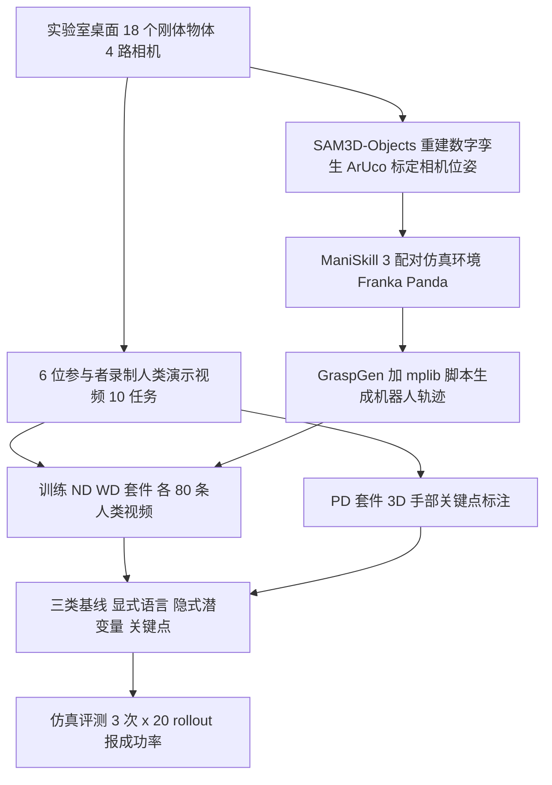

# RoboReel：从人类视频学习技能的统一基准（arXiv:2609.08209）

**RoboReel**（*Monkey See, Can Monkey Do? A Benchmark for Evaluating Robot Skill Learning by Observation*，[arXiv:2609.08209](https://arxiv.org/abs/2609.08209)，Arizona State University 与 NVIDIA，v1 于 2026-09-08）把「真实人类演示视频」与「仿真里的配对评测环境」绑在一起，让不同假设的 Learning from Observation（LfO）方法能在同一设置下对比。

## 一句话定义

**RoboReel 是一个 LfO 基准：10 个桌面操作任务的真实人类演示视频，配 ManiSkill 3 数字孪生环境和脚本生成的机器人轨迹，分 ND / WD / ED / PD 四个套件评测，机器人侧的评测全部在仿真里进行。**

## 英文缩写速查

| 缩写 | 英文全称 | 简要说明 |
|------|----------|----------|
| LfO | Learning from Observation | 从观察（人类视频）学习技能，不要求动作标注 |
| ND | No Distraction suite | 训练与评测都无干扰物（Sec. 3.1） |
| WD | With Distraction suite | 训练与评测都有干扰物 |
| ED | Evaluation Distraction suite | 训练无干扰物，评测时才加入（Sec. 3.1） |
| PD | Pose Defined suite | 用标定相机下的 3D 手部关键点，仅测 PointPolicy |
| VLA | Vision-Language-Action | 视觉语言动作模型，这里指 π0.5 |
| VLM | Vision-Language Model | 视觉语言模型，用于从视频抽语言指令（SeeDo、Qwen3-VL-4B） |
| BPP | Big-Picture Policy | 论文借其思路做关键帧抽取（Sec. 4.1，参考 [59]） |
| SEM | Standard Error of the Mean | 表中 ± 为 3 次评测的均值标准误（附录 D.4） |

## 为什么重要

- 作者指出现有 LfO 方法假设、硬件、环境各不相同，难以横向比较（摘要、Sec. 1）。该基准提供同一份人类视频加同一套评测环境。
- 作者自述这是首个同时提供「真实人类视频训练数据 + 配对评测环境」的统一基准（Sec. 1 贡献 1；Table 1 与 RH20T、MimicDroid、Human2Robot 对比）。「首个」为作者自述，本页未独立核实。
- 它把 LfO 方法按「怎样表示人类视频」分成显式语言、隐式潜变量、关键点三类（Sec. 2、图 3），便于看清各自短板。

## 核心原理与流程总览

要点（均来自论文）：

1. **数据（Sec. 3.3、附录 D.1）：** 4 视角（前、左、右外视角加头盔自我视角），1280×720、30 fps；每任务每条件 100 条人类演示，ND、WD、PD 各 1000 条，合计 3000 条。
2. **仿真配对（Sec. 3.4、附录 D.3）：** 物体用 SAM3D-Objects 重建，抽屉与烤面包机来自 PartNet-Mobility，相机用 ArUco 标定后在仿真中复现；机器人轨迹由 GraspGen 候选抓取加 mplib 规划脚本合成，成功才记录，ND、WD 各 100 条/任务。
3. **三类基线（Sec. 4.1、图 3）：** 显式语言（SeeDo、Qwen3-VL-4B 生成指令后微调 π0.5）；隐式表示（Vid2Robot、UniSkill、作者构造的视频条件 π0.5，均匀抽 32 帧或 BPP 关键帧）；关键点（PointPolicy）。
4. **视频条件 π0.5（附录 B）：** 在公开 pi05 底座前面拼接 512 个示范 token（冻结的 SigLIP 特征加时空位置编码，两层线性投影，约 6.5M 新增参数），语言提示固定为「complete the task」，任务身份只能从示范视频推断。

## 工程实践

- **评测协议（附录 D.4）：** 预录评测库，每格 3 次评测 × 20 rollout = 60 次；评测库只收录 oracle 求解器能完成的初始状态，保证可解；ND/WD/ED 每任务取 80 条人类视频训练、20 条做评测提示。
- **成功判据（附录 D.2、表 7）：** 全是仿真里的几何判据，如 Pick Cube 抬高至少 3 cm、Push Cube 位移至少 5 cm、Press Toaster 下压至少 80% 行程、Close Drawer 推进至少一半行程。
- **训练设置（附录 C）：** 各基线训练 50k 步（语言条件 π0.5 为 30k 步），单卡 H200，种子 42，取最终检查点；每个模型类在每个配置只训练一个检查点，因此 ± 只反映评测随机性，不含训练种子方差（据附录 C 与 D.4 推断，推测）。
- **PointPolicy 是单任务单模型（图 4 图注）**，且不使用人类视频做推理输入（附录 D.4）。
- 数据与代码：论文称在录用后发布（Sec. 1），本页写作时未见具体仓库地址，故 frontmatter 不写 `code:`。

## 与清单说法的核对

清单（Glen Berseth 的 CoRL 2026 阅读清单，条目 052，据作者说明由 LLM 依摘要起草）对该论文的一句话摘要是：「RoboReel: a unified real-world benchmark for policies that learn from human videos.」

- **「real-world」只对一半：** 训练用的人类视频确实是真实拍摄的（Sec. 3.3），但机器人侧的训练轨迹是 ManiSkill 3 仿真中脚本生成（Sec. 3.4），全部评测也在仿真数字孪生里完成（附录 D.4）。论文没有任何真机机器人评测。把它读成「真实机器人上的基准」会读错。（`Prabhath Adireddi` 的贡献说明里提到协助采集真机数据，但正文与附录表格未出现真机结果。）
- **「unified」成立但有限定：** 同一份视频与环境确实覆盖三类方法，但 PointPolicy 单独走 PD 套件，且只测了 5 个任务（图 4），其余扩展任务 0%（附录 A）。
- **「for policies that learn from human videos」成立：** 摘要与 Sec. 1 一致。
- **清单未提到的重点：** 基线整体仍弱，长时程与低容差任务（如 Stack Cups）接近 0（表 2–4）；且数据规模在论文内口径不一（图 1 写 7 小时 / 2,500 episodes，附录写 3000 条 / 约 9 小时）。

另有论文自身的几处不一致，读结论时需留意（详见来源归档）：Q1 称视频条件 π0.5「所有任务、所有套件」最强，但 SeeDo 在 Bowl in Plate 上高于它（表 2：71.3 对 46.7 / 31.7；表 4：66.3 对 25.0 / 31.7）；Q1 称关键帧在 ED 套件「7/10」任务上更好，按表 4 实为 8 项严格更高。

## 局限

论文自己承认（Sec. 5）：只含目标达成型任务，无法测非马尔可夫或动态技能；没有软体物体；没有双臂任务。

我看到的未验证之处（作者自述与判断分开）：

- 机器人训练轨迹是规划器脚本合成，不是人类遥操作，其行为分布与真实机器人数据不同；基准能否反映真机上的 LfO 能力，论文没有验证（判断）。
- 评测全在同一仿真器、同一相机标定下；视觉域差异只通过干扰物体引入，未涉及光照、背景、物体新实例的泛化（判断）。
- 评测提示视频与训练视频来自同一批人类演示（每任务 80 训练、20 评测），且只用前视角一路（附录 B.3）；跨人、跨场景泛化没有测（判断）。
- 每格仅 60 次 rollout 且只有一个训练检查点，部分差异（如 π0.5 两种抽帧的差距）接近误差棒，Q1 关于「关键帧更稳健」的解释是作者的假设，未做消融（判断）。
- 论文自述的归因（预训练带来对应关系、干扰物混淆视觉编码器等）均为作者假设，文中没有对应对照实验。
- PointPolicy 的扩展任务 0% 部分源于仿真与训练关键点漂移（几 mm 到 2 cm）和 2–3 cm 的动作恢复精度下限（附录 A），说明该套件的低分混杂了实现误差，不一定代表关键点范式本身的上限（判断）。
- 数据集和代码尚未发布（Sec. 1），无法复现。

## 关联页面

- [VLA 方法总览](../methods/vla.md)：视频条件 π0.5 属于 VLA 加示范上下文。
- [模仿学习](../methods/imitation-learning.md)：基准内所有基线都以模仿为底。
- [π0 论文页](../entities/paper-pi0.md)：π0.5 的前身，流匹配动作专家。
- [流匹配具身策略](../concepts/flow-matching-embodied-policy.md)：π0.5 的动作生成方式（附录 B.2）。
- [ManiSkill3 论文页](../entities/paper-notebook-maniskill3-gpu-parallelized-robotics-simulation.md)：RoboReel 所用仿真器。
- [HumanNet 人类视频语料对比](../comparisons/humannet-table1-human-video-corpora.md)：人类视频数据集的横向对比。
- [机器人操作数据与基准选型](../comparisons/robot-manipulation-data-benchmark-selection.md)
- [仿真与真实评测差距](../concepts/sim-vs-real-eval-gap.md)：理解本基准纯仿真评测的边界。

## 参考来源

- [来源归档：RoboReel（arXiv:2609.08209）](../../sources/papers/roboreel-lfo-benchmark_arxiv_2609_08209.md)
- 论文 PDF：<https://arxiv.org/pdf/2609.08209v1>
- 项目页：<https://roboreel.github.io>

## 继续阅读

- 论文引用的 LfO 基线原文：Vid2Robot（arXiv:2403.12943）、UniSkill（arXiv:2505.08787）、Point Policy（arXiv:2502.20391）、SeeDo（arXiv:2410.08792）。
- 论文所述最近邻基准：RH20T（arXiv:2307.00595）、Human2Robot（arXiv:2502.16587）、MimicDroid（论文 [26]，无 arXiv 号）。
