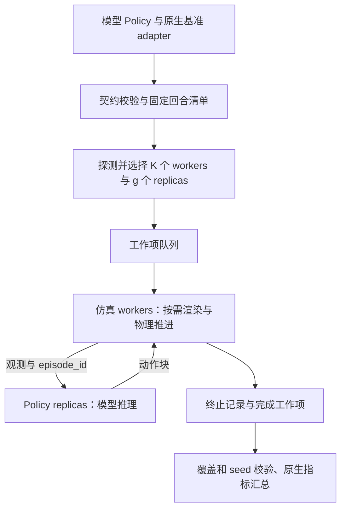
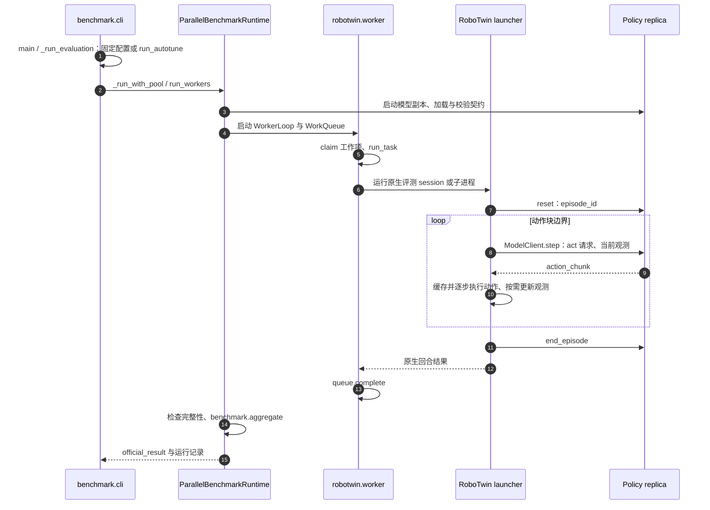

# RoboScope Kit: Unified Interfaces for Fast and Scalable Embodied-AI Evaluation / 快速可扩展具身评测的统一接口

## 一句话定义

RoboScope Kit 在保留原生基准评测协议的前提下，用统一 Policy 接口、独立的仿真与模型进程池以及按需渲染，缩短固定检查点的仿真评测时间。

## 英文缩写速查

| 缩写 | 英文全称 | 简要说明 |
|---|---|---|
| VLA | Vision-Language-Action | 视觉语言动作模型 |
| MPS | Multi-Process Service | NVIDIA CUDA 多进程并发服务 |
| RPC | Remote Procedure Call | 进程之间的观测与动作请求 |
| OOM | Out of Memory | 资源不足导致的内存或显存错误 |

## 核心信息

| 项 | 内容 |
|---|---|
| 主论文 | arXiv:2611.03850v1，2026-11-02；核对正文 1–8 与附录 A–E |
| 机构 | 上海交通大学人工智能学院；作者另有中南大学、同济大学、上海科技大学、中国农业科学院、南京大学联合署名 |
| 官方代码 | MINT-SJTU/RoboScope-Kit，Apache-2.0，已开源 |
| 源码核对版本 | `44fa1adb934456c40df809a7baad27152182488d`；与论文历史实验构建分开记录 |
| 评测模型 | LIBERO：StarVLA/Qwen2.5-VL-OFT-LIBERO-4in1；RoboTwin：StarVLA/Qwen3-VL-OFT-Robotwin2 |

## 为什么重要

同一模型接入多个基准时，重复编写预处理、动作接口与评测循环很容易改变协议。统一模型边界减少接入重复；独立设置仿真进程数 K 和模型副本数 g，可以用多个仿真器填补推理 GPU 的空闲时间，同时避免每个仿真器复制模型。

## 核心机制

- **接口契约**：Policy 保留模型自己的预处理、反归一化及动作语义；声明特征、动作块长度、观测步幅和支持的 suite。运行前检查契约，运行中检查形状、类型。统一命名不意味着所有模型自动适配所有基准。
- **分池调度**：K 个 simulator workers 与 g 个 Policy replicas 在独立环境和进程运行，通过本机 Unix socket 交换观测和动作。状态策略必须用 episode_id 隔离历史。
- **实测并发搜索**：先增 workers，触及吞吐拐点后再加模型副本；短回合测吞吐、CPU、显存及节流，受资源和时间预算约束，失败则保留上一配置。
- **运行时优化**：RoboTwin 重用 SAPIEN Engine/Renderer，移除重复被动力计算；验证过的 seed cache 可跳过专家种子校验。关节位置动作可跳过 cuRobo 初始化；末端动作仍需要规划器。
- **动作块边界观测**：StarVLA RoboTwin 一次输出 16 步动作，仅在需要新观测时渲染；物理推进、执行动作、成功检查仍按原控制频率进行。随机灯光、viewer、视频、点云等会保留逐步观测。
- **结果完整性**：工作项原子领取、完成后幂等发布，汇总前验证 episode keys、seed、覆盖与重复；跨实例采用确定性分片后合并。

## 流程总览

## 源码运行时序图

已核对 `runtime/benchmark/__main__.py`、`cli.py`、`orchestrator.py`、`worker.py`，`runtime/benchmarks/robotwin/worker.py` 以及 `benchmarks/robotwin/roboscope_robotwin_launcher.py`。具体入口、版本链接见[源码归档](../../sources/repos/roboscope-kit.md)。这是源码阅读结果，未在本环境运行 GPU 评测。

## 实验与评测

均为作者报告；不是本次独立复现。所有 GPU 为 **48 GiB RTX 4090**，不可默认套用于普通 24 GB 4090。

| 工作负载与配置 | 正式评测耗时 | 读法 |
|---|---:|---|
| RoboTwin Easy，500 回合，单卡 K1/g1、stride 1 | 21,582 s，359.7 min | 三次运行均值；这是 RoboScope 单 worker 基线，已含部分运行时优化 |
| 同任务，四卡、80 核，K4/g4、stride 1 | 5,934 s，98.9 min | 三次运行；单纯多卡约 3.64 倍 |
| 同硬件，K16/g4、stride 1 | 3,951 s | 一次运行 |
| 同硬件，K16/g4、stride 16、每项 2 回合及 clutter cache | 862 s，约 14.4 min | 一次运行；相对单卡 **25.04 倍**，相对同四卡 K4/g4 **6.88 倍** |
| LIBERO-Long，500 回合，单卡 K12/g3，MPS 关 | 中位数 671 s | 相对官方 StarVLA 4.45 倍、RLinf 2.78 倍、vla-eval 1.52 倍 |
| LIBERO-Long，单卡 K16/g4，MPS 开 | 中位数 485 s | 分别 6.16、3.85、2.10 倍；含搜索端到端约 997 s，对官方约 3.02 倍 |

出处：论文 §5 与表 8–10、16–17。25.04 倍来自未舍入秒数，不能直接用两项已舍入分钟数推导所有有效位。

**一致性边界**：最快 RoboTwin 运行成功 231/500、动作总步数 211,220；与三次单卡基线的所有 500 回合键、成败和终止步一致，OOM/worker failure 为 0/0。不能推广为所有并发配置都完全一致：LIBERO Search 和 Search+MPS 的逐回合成功一致率分别是 97.9% 与 96.5%，作者以 ±2 个百分点的成功率等效区间判定等效。

**计时边界**：正式评测排除初始化、搜索/离线调参与清理；862 s 优化运行端到端 928 s。LIBERO 的约 504–506 s 搜索开销不可遗漏，短任务可能不划算。跨系统对比使用不同主机/同型号 GPU 配置；RLinf 的 LIBERO 路径存在动作采样差异（附录 B.3），不能将其结果解释成严格相同的确定性推理。

## 结论

该项目主要改善评测基础设施的效率；25.04 倍是特定任务、硬件扩容与运行时优化共同产生的结果。

1. 预算有限时先对比同硬件收益，四卡 RoboTwin 的 6.88 倍比标题数字更适合做软件选型依据。
2. 同时报正式评测、搜索与端到端耗时；重复 checkpoint 评测可考虑固定已验证配置。
3. 固定 manifest、seed、检查点及预处理版本，再检查逐回合成败和终止步。
4. 动作块之间少渲染仅适用于策略明确不读取的观测，不能降低物理或成功判定频率。
5. 最快 RoboTwin 配置仅报告一次运行，跨策略、基准、硬件的性能须重新测量。

## 工程实践

官方 quick start：Python ≥3.11，`pip install roboscope-kit`；先用各基准 `build-runtime.sh` 构建固定依赖，再用 `python -m roboscope_kit.runtime.benchmark` 指定 benchmark、suite、checkpoint、manifest、policy config 和输出目录。先 `--quick-test` 验证真实短评测，再选择自动或固定 `--concurrency`、`--replicas`；MPS 另加 `--cuda-mps`。

开源状态已更新为 **代码已开源，Apache-2.0**。PyPI 包不内置全部基准仿真器、数据、检查点与资产，需按上游协议另行获取；本工具没有独立发布新训练数据集。当前源码支持范围已多于论文的六类适配器，版本变化不能混写成论文实验范围。

## 局限与风险

- 性能测量主要集中于 StarVLA 的 LIBERO-Long 和 RoboTwin Easy，跨实例展示是 MetaWorld MT50；不证明其他模型同样加速。
- 48 GiB 显存、CPU 配额、任务划分和模型副本数都会影响可行配置；本机不能直接照抄最优 K/g。
- 论文的故障恢复按工作项重放；论文与当前源码可能有行为差异，实际恢复范围以固定版本实现为准。

## 关联页面

- [仿真评测基础设施](../concepts/simulation-evaluation-infrastructure.md)
- [VLA 方法](../methods/vla.md)
- [具身评测基准选型闭环](../overview/hub-embodied-eval-benchmark.md)

## 参考来源

- [论文全文与核对记录](../../sources/papers/roboscope_kit_arxiv_2611_03850.md)
- [官方项目页核查](../../sources/sites/roboscope-kit.md)
- [官方源码与入口](../../sources/repos/roboscope-kit.md)

## 推荐继续阅读

- [论文 v1 全文](https://arxiv.org/html/2611.03850v1)
- [官方使用指南](https://github.com/MINT-SJTU/RoboScope-Kit/blob/main/packages/roboscope-kit/README.md)
