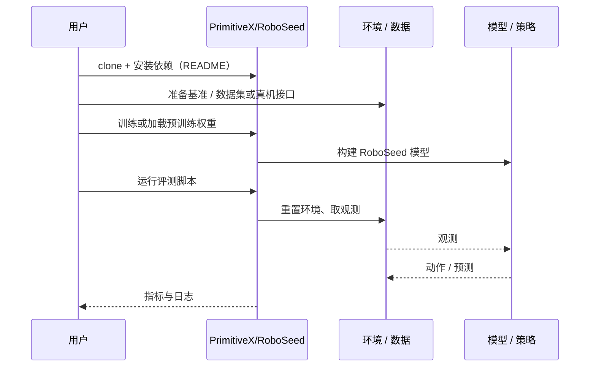

# RoboSeed（arXiv:2610.40026）

**RoboSeed**（*RoboSeed: Multidimensional Evaluation of Vision-Language-Action and World-Action Models: Capability, Resource Affordability, and Research Evidence*，[arXiv:2610.40026](https://arxiv.org/abs/2610.40026)，[代码](https://github.com/PrimitiveX/RoboSeed)）来自 [具身智能小站 2026-10-30 盘点](../../sources/blogs/wechat_embodied_station_28_papers_event2reward_progress_rewards_2026-10-30.md)，属「示范数据与评测」组。

## 一句话定义

**RoboSeed 将能力、训练和部署负担、研究价值及复现证据分维度评估。**

## 英文缩写速查

| 缩写 | 英文全称 | 简要说明 |
|------|----------|----------|
| RoboSeed | RoboSeed: Multidimensional Evaluation of Vision-Language-Action and World-Action Models: Capability, Resource Affordability, and Research Evidence | 本文方法 / 基准的简称 |
| VLA | Vision-Language-Action | 视觉–语言–动作策略 |

## 为什么重要

- 选择动作模型时，把预算和证据一起算。对协议不同或测量缺失的模型保留空缺，不输出缺乏可比性的总排名，适合选型时参考。
- 开源结论：**已开源**（步骤 2.5，2026-10-30）。仓库可达（git ls-remote）。
- 同期同组工作见 [进度奖励、接触监督与规划验证：具身智能小站 10-30 期 28 篇阅读坐标](../overview/embodied-station-2026-10-30-28-papers-technology-map.md)。

## 核心机制

| 项 | 内容 |
|----|------|
| **arXiv** | [2610.40026](https://arxiv.org/abs/2610.40026) |
| **开源** | **已开源** |
| **要点** | RoboSeed 将能力、训练和部署负担、研究价值及复现证据分维度评估。 |
| **文内指标** | 公众号转述：对协议不同或测量缺失的模型保留空缺，不输出缺乏可比性的总排名，适合选型时参考。 |

## 源码运行时序图

以下为按仓库入口（`PrimitiveX/RoboSeed`）推断的通用运行链路；入库日仅核实仓库可达，未逐文件阅读，具体脚本名以 README 为准。

## 实验与评测

- 公众号转述：对协议不同或测量缺失的模型保留空缺，不输出缺乏可比性的总排名，适合选型时参考。
- **读法：** 本页为索引级摘要，依据公众号转述的官方摘要与仓库信息整理；逐项数字与 baseline 以原文 PDF 为准。

## 与其他工作对比

- 横向索引见 [进度奖励、接触监督与规划验证：具身智能小站 10-30 期 28 篇阅读坐标](../overview/embodied-station-2026-10-30-28-papers-technology-map.md)；同 arXiv 不重复造页。

## 结论

**选择动作模型时，把预算和证据一起算：对协议不同或测量缺失的模型保留空缺，不输出缺乏可比性的总排名，适合选型时参考。**

1. 开源边界：**已开源** — 仓库可达（git ls-remote）。
2. 核心机制：RoboSeed 将能力、训练和部署负担、研究价值及复现证据分维度评估。
3. 复现与选型前核对任务协议、硬件与基准口径，勿直接横比公众号摘录数字。

## 关联页面

- [embodied-data-collection-four-layers-taxonomy](../concepts/embodied-data-collection-four-layers-taxonomy.md)
- [imitation-learning](../methods/imitation-learning.md)
- [simulation-evaluation-infrastructure](../concepts/simulation-evaluation-infrastructure.md)
- [embodied-station-2026-10-30-28-papers-technology-map](../overview/embodied-station-2026-10-30-28-papers-technology-map.md)
- [Query：具身大模型评测基准选型](../queries/embodied-eval-benchmark-selection-loop.md)

## 参考来源

- [roboseed_arxiv_2610_40026.md](../../sources/papers/roboseed_arxiv_2610_40026.md)
- [wechat_embodied_station_28_papers_event2reward_progress_rewards_2026-10-30.md](../../sources/blogs/wechat_embodied_station_28_papers_event2reward_progress_rewards_2026-10-30.md)
- [arXiv:2610.40026](https://arxiv.org/abs/2610.40026)

## 推荐继续阅读

- [arXiv PDF](https://arxiv.org/pdf/2610.40026)
- [https://github.com/PrimitiveX/RoboSeed](https://github.com/PrimitiveX/RoboSeed)
